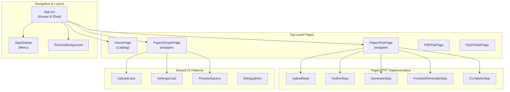
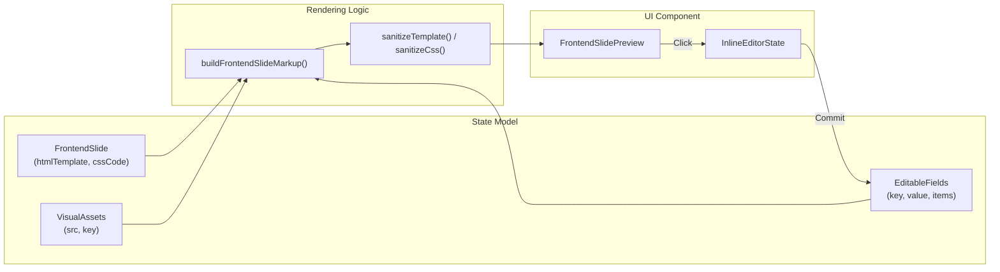
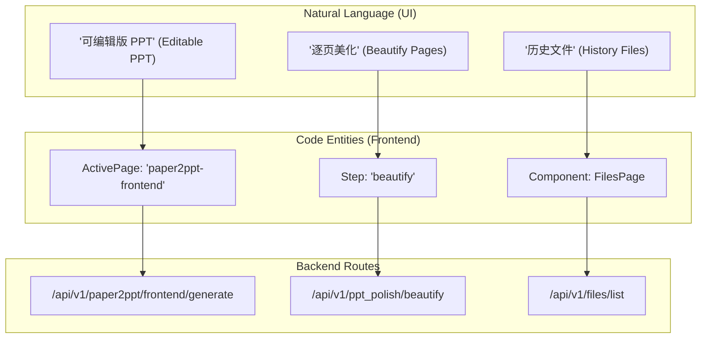

<!-- source: DeepWiki mcp.deepwiki.com · repo OpenDCAI/Paper2Any · page 3.1 User Interface Components · fetched 2026-11-02 -->

# User Interface Components

Relevant source files

The following files were used as context for generating this wiki page:

- [frontend-workflow/src/App.tsx](frontend-workflow/src/App.tsx)
- [frontend-workflow/src/components/AppSidebar.tsx](frontend-workflow/src/components/AppSidebar.tsx)
- [frontend-workflow/src/components/BilingualHint.tsx](frontend-workflow/src/components/BilingualHint.tsx)
- [frontend-workflow/src/components/HomePage.tsx](frontend-workflow/src/components/HomePage.tsx)
- [frontend-workflow/src/components/NavTooltip.tsx](frontend-workflow/src/components/NavTooltip.tsx)
- [frontend-workflow/src/components/Paper2GraphTechExpPage.tsx](frontend-workflow/src/components/Paper2GraphTechExpPage.tsx)
- [frontend-workflow/src/components/paper2graph/ExamplesSection.tsx](frontend-workflow/src/components/paper2graph/ExamplesSection.tsx)
- [frontend-workflow/src/components/paper2graph/Header.tsx](frontend-workflow/src/components/paper2graph/Header.tsx)
- [frontend-workflow/src/components/paper2graph/UploadCard.tsx](frontend-workflow/src/components/paper2graph/UploadCard.tsx)
- [frontend-workflow/src/components/paper2ppt/CompleteStep.tsx](frontend-workflow/src/components/paper2ppt/CompleteStep.tsx)
- [frontend-workflow/src/components/paper2ppt/FrontendGenerateStep.tsx](frontend-workflow/src/components/paper2ppt/FrontendGenerateStep.tsx)
- [frontend-workflow/src/components/paper2ppt/FrontendSlidePreview.tsx](frontend-workflow/src/components/paper2ppt/FrontendSlidePreview.tsx)
- [frontend-workflow/src/components/paper2ppt/UploadStep.tsx](frontend-workflow/src/components/paper2ppt/UploadStep.tsx)
- [frontend-workflow/src/components/paper2ppt/frontendSlideUtils.ts](frontend-workflow/src/components/paper2ppt/frontendSlideUtils.ts)
- [frontend-workflow/src/components/paper2ppt/types.ts](frontend-workflow/src/components/paper2ppt/types.ts)
- [frontend-workflow/src/config/homePageCatalog.ts](frontend-workflow/src/config/homePageCatalog.ts)
- [frontend-workflow/src/locales/en/common.json](frontend-workflow/src/locales/en/common.json)
- [frontend-workflow/src/locales/en/paper2ppt.json](frontend-workflow/src/locales/en/paper2ppt.json)
- [frontend-workflow/src/locales/en/pptPolish.json](frontend-workflow/src/locales/en/pptPolish.json)
- [frontend-workflow/src/locales/zh/common.json](frontend-workflow/src/locales/zh/common.json)
- [frontend-workflow/src/locales/zh/paper2ppt.json](frontend-workflow/src/locales/zh/paper2ppt.json)
- [frontend-workflow/src/locales/zh/pptPolish.json](frontend-workflow/src/locales/zh/pptPolish.json)

This page documents the React-based user interface components that make up the Paper2Any web application. It covers the major page components for each workflow (Paper2PPT, Paper2Figure, PDF2PPT, etc.), shared UI patterns (upload cards, settings panels, preview sections), the HomePage catalog, and the AppSidebar navigation system.

## Component Architecture Overview

The frontend follows a page-based architecture where each major workflow has a dedicated page component. These pages compose smaller, reusable components for common patterns like file uploads, settings panels, and result previews.

Title: Frontend Component Hierarchy

**Sources:** [frontend-workflow/src/App.tsx:1-27](), [frontend-workflow/src/components/AppSidebar.tsx:41-189](), [frontend-workflow/src/components/paper2ppt/UploadStep.tsx:74-112]()

---

## Navigation and Design Language

### Glassmorphism Design
The application utilizes a "glassmorphism" design language, characterized by semi-transparent backgrounds, backdrop blurs, and thin borders.
- **Classes:** `glass`, `glass-dark`, `backdrop-blur-sm`.
- **Background:** A deep dark theme (`bg-[#0a0a1a]`) combined with a `ParticleBackground` component [frontend-workflow/src/App.tsx:177-179]().

### AppSidebar Navigation
The `AppSidebar` manages navigation between the 19+ different workflow pages. It uses a nested menu system for complex categories like `paper2figure` and `paper2ppt` [frontend-workflow/src/components/AppSidebar.tsx:43-47]().

**Navigation Mapping:**
The application uses a manual routing system in `App.tsx` that maps pathnames and legacy hashes to `ActivePage` IDs [frontend-workflow/src/App.tsx:29-75]().

| Page ID | Route Path | Component |
|---------|------------|-----------|
| `home` | `/` | `HomePage` |
| `paper2figure-tech-exp` | `/paper2figure/tech-exp` | `Paper2GraphTechExpPage` |
| `paper2ppt` | `/paper2ppt` | `Paper2PptPage` |
| `paper2ppt-frontend` | `/paper2ppt/frontend` | `Paper2PptPage` (Frontend Mode) |
| `files` | `/files` | `FilesPage` |

**Sources:** [frontend-workflow/src/App.tsx:55-75](), [frontend-workflow/src/components/AppSidebar.tsx:90-189]()

---

## Major Workflow Components

### Paper2PPT Workflow
Paper2PPT supports two generation modes: `image` (visual-heavy) and `frontend` (editable HTML/CSS) [frontend-workflow/src/components/paper2ppt/types.ts:2]().

#### 1. Upload & Configuration (`UploadStep.tsx`)
This component handles the initial input and model configuration.
- **Upload Modes:** File (PDF), Text (Paste), or Topic (Deep Research) [frontend-workflow/src/components/paper2ppt/types.ts:115]().
- **Style Configuration:** Users can select presets (`modern`, `business`, `academic`, `creative`) or upload a reference image [frontend-workflow/src/components/paper2ppt/UploadStep.tsx:28-35]().
- **Model Selection:** Supports selecting both the LLM and the image generation model (e.g., Gemini 3 Pro for Chinese support) [frontend-workflow/src/components/paper2ppt/UploadStep.tsx:60-63]().

#### 2. Editable PPT Generation (`FrontendGenerateStep.tsx`)
A specialized interface for the `frontend` mode that allows real-time preview and editing of slide code.
- **Dual Panel:** Toggle between 'preview' and 'code' modes [frontend-workflow/src/components/paper2ppt/FrontendGenerateStep.tsx:71]().
- **Visual QA:** Includes a `handleReviewSlide` function that triggers an AI visual inspection of the slide [frontend-workflow/src/components/paper2ppt/FrontendGenerateStep.tsx:31]().
- **Self-Healing:** The `handleDebugCodeEdit` function allows the AI to fix code errors based on visual feedback [frontend-workflow/src/components/paper2ppt/FrontendGenerateStep.tsx:33]().

#### 3. Slide Preview & Inline Editing (`FrontendSlidePreview.tsx`)
The core rendering engine for editable slides.
- **Markup Builder:** `buildFrontendSlideMarkup` combines HTML templates, CSS, and `editableFields` into a final render [frontend-workflow/src/components/paper2ppt/frontendSlideUtils.ts:149-174]().
- **Inline Editor:** Clicking text elements opens a floating editor for `text`, `textarea`, or `list` types [frontend-workflow/src/components/paper2ppt/FrontendSlidePreview.tsx:18-28]().
- **Image Replacement:** `openImagePicker` allows users to replace AI-generated or paper-extracted images with local uploads [frontend-workflow/src/components/paper2ppt/FrontendSlidePreview.tsx:116-122]().

Title: Paper2PPT Frontend Data Flow

**Sources:** [frontend-workflow/src/components/paper2ppt/types.ts:68-79](), [frontend-workflow/src/components/paper2ppt/frontendSlideUtils.ts:149-174](), [frontend-workflow/src/components/paper2ppt/FrontendSlidePreview.tsx:135-155]()

---

### PPT Polish Workflow
The `Ppt2PolishPage` (translated as "PPT 润色优化") uses a multi-stage pipeline to beautify existing slides.

**Stages:**
1. **Upload:** Supports PPTX or PDF (16:9) [frontend-workflow/src/locales/zh/pptPolish.json:14-15]().
2. **Beautify:** A side-by-side comparison interface showing "Original PPT" vs "Beautified Result" [frontend-workflow/src/locales/zh/pptPolish.json:93-94]().
3. **Refinement:** Users can enter "Refinement Prompts" to regenerate specific pages [frontend-workflow/src/locales/zh/pptPolish.json:97-98]().

**Sources:** [frontend-workflow/src/locales/zh/pptPolish.json:6-10](), [frontend-workflow/src/locales/en/pptPolish.json:85-102]()

---

## Shared UI Patterns

### HomePage Catalog
The `HomePage` acts as a central hub, organizing workflows into three functional sections defined in `homePageCatalog.ts`.

| Section | Description | Key Workflows |
|---------|-------------|---------------|
| **Creation** | Generate from paper content | Paper2Figure, Paper2PPT, Paper2Video |
| **Conversion** | Refine existing material | PDF2PPT, Image2PPT, PPT Polish |
| **Research** | Tracking and writing | Paper2Citation, Rebuttal, Knowledge Base |

**Sources:** [frontend-workflow/src/locales/zh/common.json:70-82](), [frontend-workflow/src/components/HomePage.tsx:1-27]()

### Upload Cards and Settings
- **UploadCard:** Standardized interface for `paper2figure` workflows, supporting PDF analysis and direct text prompts [frontend-workflow/src/components/paper2graph/UploadCard.tsx:1-20]().
- **SettingsPanel:** Collapsible panels for API Key entry, Model selection, and Style configuration. It uses `localStorage` to persist `apiUrl` and `apiKey` [frontend-workflow/src/components/paper2ppt/UploadStep.tsx:56-59]().

### History and File Management
The `FilesPage` provides a centralized view of all generated assets across all workflows.
- **Data Source:** Fetches from `/api/v1/files/` backend endpoint.
- **Actions:** Download and Delete [frontend-workflow/src/locales/zh/common.json:200-202]().

**Sources:** [frontend-workflow/src/components/FilesPage.tsx:11](), [frontend-workflow/src/locales/en/common.json:186-206]()

---

## Internationalization (i18n)
The UI is fully bilingual (Chinese/English).
- **Namespaces:** `common`, `paper2ppt`, `pptPolish`, `paper2graph`.
- **Implementation:** Uses `useTranslation` hook and JSON locale files [frontend-workflow/src/locales/zh/common.json:1-5]().

Title: Natural Language to Code Entity Mapping

**Sources:** [frontend-workflow/src/App.tsx:63](), [frontend-workflow/src/locales/zh/pptPolish.json:8](), [frontend-workflow/src/locales/en/common.json:25]()

---

