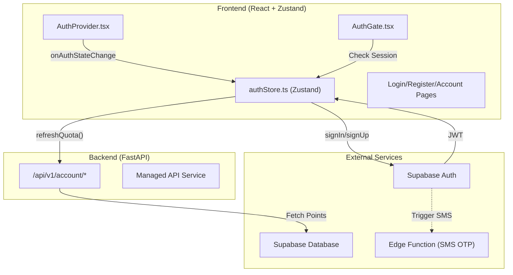
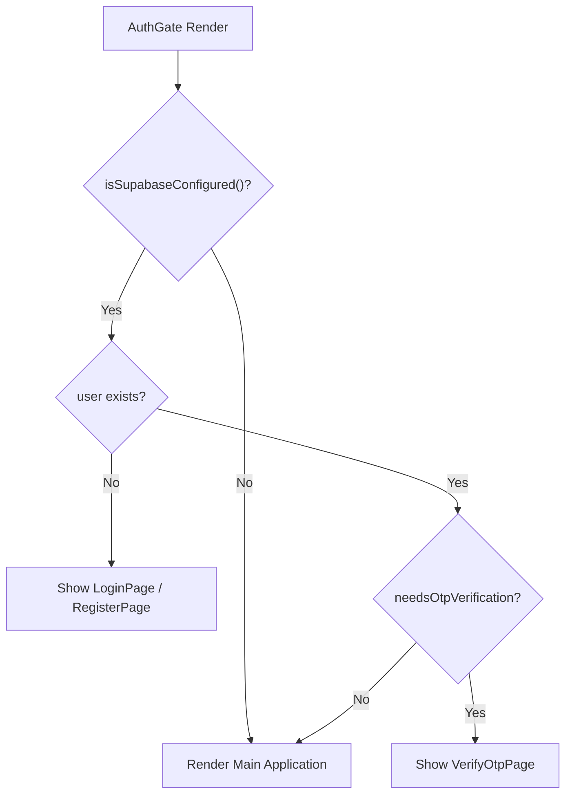

<!-- source: DeepWiki mcp.deepwiki.com · repo OpenDCAI/Paper2Any · page 3.2 Authentication & User Management · fetched 2026-11-02 -->

# Authentication & User Management

Relevant source files

The following files were used as context for generating this wiki page:

- [fastapi_app/config/pricing.py](fastapi_app/config/pricing.py)
- [fastapi_app/config/pricing.yaml](fastapi_app/config/pricing.yaml)
- [fastapi_app/services/managed_api_service.py](fastapi_app/services/managed_api_service.py)
- [frontend-workflow/src/components/AccountPage.tsx](frontend-workflow/src/components/AccountPage.tsx)
- [frontend-workflow/src/components/AuthProvider.tsx](frontend-workflow/src/components/AuthProvider.tsx)
- [frontend-workflow/src/components/PointsDisplay.tsx](frontend-workflow/src/components/PointsDisplay.tsx)
- [frontend-workflow/src/components/UserMenu.tsx](frontend-workflow/src/components/UserMenu.tsx)
- [frontend-workflow/src/components/auth/AuthGate.tsx](frontend-workflow/src/components/auth/AuthGate.tsx)
- [frontend-workflow/src/components/auth/LoginPage.tsx](frontend-workflow/src/components/auth/LoginPage.tsx)
- [frontend-workflow/src/components/auth/RegisterPage.tsx](frontend-workflow/src/components/auth/RegisterPage.tsx)
- [frontend-workflow/src/lib/supabase.ts](frontend-workflow/src/lib/supabase.ts)
- [frontend-workflow/src/stores/authStore.ts](frontend-workflow/src/stores/authStore.ts)

This page documents the authentication and user management system in Paper2Any. The system integrates **Supabase** for identity management, OTP verification, and OAuth, while providing a fallback "No Auth" mode for local or unrestricted deployments.

---

## Overview

Paper2Any implements a multi-layered authentication strategy managed primarily through the frontend `authStore` and protected by an `AuthGate` component.

| Feature | Supabase Mode (Configured) | No-Auth Mode (Default/Local) |
| :--- | :--- | :--- |
| **User Identity** | Email, Phone (OTP), or OAuth | Mock "Anonymous" user |
| **Quota** | Points-based (Database enforced) | Unlimited (∞) |
| **Storage** | Cloud-synced user history | Local browser storage / Session only |
| **Persistence** | Persistent across devices | Local to browser instance |

**Sources**: [frontend-workflow/src/lib/supabase.ts:11-42](), [frontend-workflow/src/components/auth/AuthGate.tsx:32-35]()

---

## System Architecture

### Authentication Data Flow

The system uses a singleton Supabase client and a Zustand-based `authStore` to synchronize session state across the application.

**Sources**: [frontend-workflow/src/components/AuthProvider.tsx:18-53](), [frontend-workflow/src/stores/authStore.ts:74-91](), [fastapi_app/services/managed_api_service.py:124-138]()

---

## Authentication Methods

### 1. Phone OTP (Recommended)
Users can sign in using a mobile phone number. The system normalizes Chinese phone numbers to E.164 format before sending the request to Supabase.
- **Function**: `signInWithPhoneOtp(phone)` [frontend-workflow/src/stores/authStore.ts:232-255]()
- **Normalization**: Prepends `+86` if missing [frontend-workflow/src/stores/authStore.ts:48-53]()

### 2. Email & Password
Standard registration and login flow.
- **Registration**: `signUpWithEmail(email, password)` [frontend-workflow/src/stores/authStore.ts:141-188]()
- **Verification**: Supports mandatory email OTP verification via `VerifyOtpPage` [frontend-workflow/src/components/auth/VerifyOtpPage.tsx]() (referenced).

### 3. OAuth & Anonymous Mode
- **OAuth**: Supports providers like Google/GitHub via `signInWithOAuth` [frontend-workflow/src/stores/authStore.ts:276-286]().
- **Anonymous**: If Supabase is not configured, the system defaults to a state where `quota.remaining` is set to a very high value (effectively infinity) [frontend-workflow/src/components/PointsDisplay.tsx:48-53]().

---

## Quota & Points Management

The system uses a points-based ledger to track usage. Costs for different workflows (e.g., `paper2video` costing 5 points vs `paper2ppt` costing 1 point) are defined in the backend configuration.

### Points Display Logic
The `PointsDisplay` component provides real-time feedback on remaining credits.

| State | Display | Title Hint |
| :--- | :--- | :--- |
| **No Auth** | `∞` | "当前为无限用量" |
| **Paid Mode** | `∞` | "当前为付费模式，平台不扣点" |
| **Standard User** | `{N} 点` | "剩余点数" |

**Sources**: [frontend-workflow/src/components/PointsDisplay.tsx:47-62](), [fastapi_app/config/pricing.py:12-57]()

### Account Profile & Redemption
The `AccountPage` allows users to view their transaction history and redeem points via codes.
- **Redemption Endpoint**: `POST /api/v1/account/points/redeem` [frontend-workflow/src/components/AccountPage.tsx:204-210]()
- **Ledger Reasons**: Includes `signup_bonus`, `daily_grant`, `referral_inviter`, and `workflow_` prefix for usage tracking [frontend-workflow/src/components/AccountPage.tsx:53-74]().

---

## Technical Implementation

### AuthGate: The Security Guard
The `AuthGate` component wraps the main application layout and determines which view to render based on the current session and configuration.

**Sources**: [frontend-workflow/src/components/auth/AuthGate.tsx:22-80]()

### Key Code Entities

| Class/Function | Location | Role |
| :--- | :--- | :--- |
| `useAuthStore` | `authStore.ts` | Central Zustand store managing `user`, `session`, and `quota` state. |
| `AuthProvider` | `AuthProvider.tsx` | Handles session lifecycle (recovery from storage and auto-refresh). |
| `isSupabaseConfigured` | `supabase.ts` | Utility to detect if `VITE_SUPABASE_URL` is present. |
| `get_billing_mode` | `managed_api_service.py` | Backend logic to determine if the system is in `free` or `paid` mode. |

**Sources**: [frontend-workflow/src/stores/authStore.ts:74](), [frontend-workflow/src/components/AuthProvider.tsx:18](), [frontend-workflow/src/lib/supabase.ts:17](), [fastapi_app/services/managed_api_service.py:124]()

---

## User Menu & Profile

The `UserMenu` component provides a dropdown for user actions. It adapts its display based on the user's status:
- **Display Name**: Derived from email prefix or last 4 digits of phone [frontend-workflow/src/components/UserMenu.tsx:42]().
- **Status Badge**: Displays "PRO MEMBER" for authenticated users [frontend-workflow/src/components/UserMenu.tsx:75]().
- **Redemption**: Integrates with the `AccountPage` for point redemption [frontend-workflow/src/components/UserMenu.tsx:138-151]().

---

## Referral & Invite System

Paper2Any includes a referral system to incentivize user growth.
1. **Invite Code Storage**: During registration, an invite code can be saved to `localStorage` [frontend-workflow/src/components/auth/RegisterPage.tsx:80-82]().
2. **Claiming**: Upon successful login or signup, the system attempts to claim the stored code via the backend [frontend-workflow/src/stores/authStore.ts:126-135]().
3. **Rewards**: Points are granted to both inviter and invitee based on `runtimeConfig` settings [frontend-workflow/src/components/AccountPage.tsx:101-106]().

**Sources**: [frontend-workflow/src/stores/authStore.ts:55-69](), [fastapi_app/config/pricing.py:17-18]()

---

