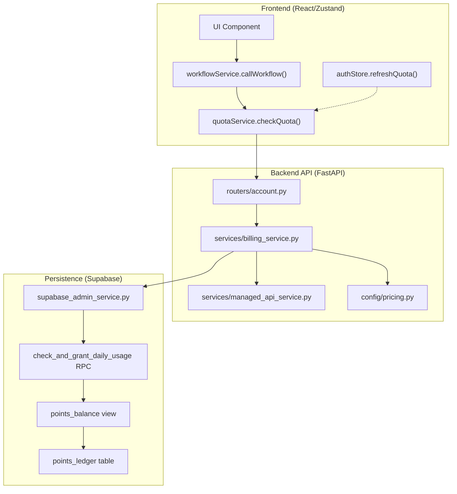
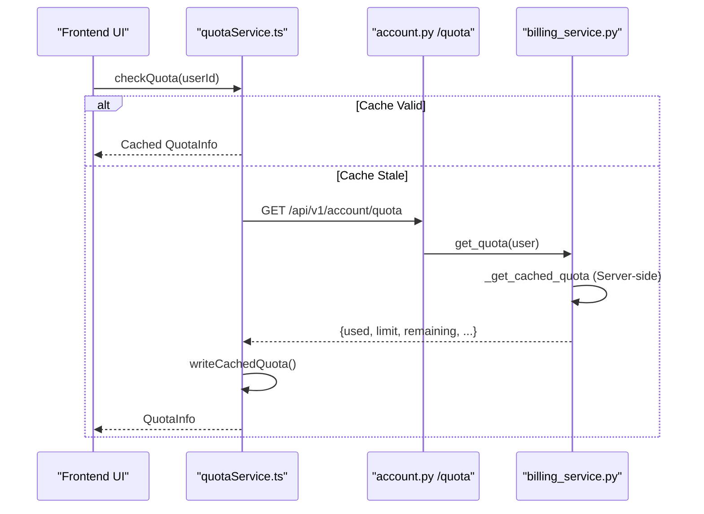

<!-- source: DeepWiki mcp.deepwiki.com · repo OpenDCAI/Paper2Any · page 3.3 Quota & Points System · fetched 2026-11-02 -->

# Quota & Points System

<details>
<summary>Relevant source files</summary>

The following files were used as context for generating this wiki page:

- [fastapi_app/config/pricing.py](fastapi_app/config/pricing.py)
- [fastapi_app/config/pricing.yaml](fastapi_app/config/pricing.yaml)
- [fastapi_app/routers/account.py](fastapi_app/routers/account.py)
- [fastapi_app/services/billing_service.py](fastapi_app/services/billing_service.py)
- [fastapi_app/services/managed_api_service.py](fastapi_app/services/managed_api_service.py)
- [fastapi_app/services/paper2ppt_task_service.py](fastapi_app/services/paper2ppt_task_service.py)
- [frontend-workflow/src/components/AccountPage.tsx](frontend-workflow/src/components/AccountPage.tsx)
- [frontend-workflow/src/components/PointsDisplay.tsx](frontend-workflow/src/components/PointsDisplay.tsx)
- [frontend-workflow/src/services/quotaService.ts](frontend-workflow/src/services/quotaService.ts)
- [frontend-workflow/src/services/runtimeConfigService.ts](frontend-workflow/src/services/runtimeConfigService.ts)
- [frontend-workflow/src/services/workflowService.ts](frontend-workflow/src/services/workflowService.ts)
- [frontend-workflow/src/stores/authStore.ts](frontend-workflow/src/stores/authStore.ts)
- [script/heavy_workflow_worker.py](script/heavy_workflow_worker.py)

</details>


**Purpose**: This document explains the quota management system used to limit and track API usage in Paper2Any. The system implements a flexible points-based architecture that supports multiple billing modes (Free, Paid, Managed), daily grants, referral rewards, and redeemable codes. For authentication mechanisms, see [3.2 Authentication & User Management]().

---

## Overview

The quota system enforces usage limits through a check-before-execute pattern. The implementation spans from frontend service wrappers to backend billing logic and Supabase-backed persistence.

### Architecture & Data Flow



**Sources**: [frontend-workflow/src/services/quotaService.ts:92-127](), [fastapi_app/services/billing_service.py:37-127](), [fastapi_app/routers/account.py:22-30]()

---

## Billing Modes

The system behavior changes significantly based on the `APP_BILLING_MODE` environment variable.

| Mode | Behavior | Enforcement |
| :--- | :--- | :--- |
| **Free** | Unlimited usage for all users. | Backend returns `9,999,999` points. |
| **Paid** | Users consume points from their balance. | `BillingService` checks Supabase ledger. |
| **Managed** | Uses backend-configured API keys for LLM/Image services. | Credentials fetched via `managed_api_service.py`. |

**Sources**: [fastapi_app/services/managed_api_service.py:124-137](), [fastapi_app/services/billing_service.py:110-118]()

---

## Points System & Pricing

### Pricing Configuration
Costs are defined in `fastapi_app/config/pricing.yaml` (and mirrored in `DEFAULT_PRICING` in `pricing.py`). Each workflow type has an associated cost.

| Workflow Type | Default Cost (Points) |
| :--- | :--- |
| `paper2figure` | 1 |
| `paper2ppt` | 1 |
| `paper2video` | 5 |
| `kb_deepresearch` | 2 |
| `kb_mindmap` | 2 (Tiered) |

**Sources**: [fastapi_app/config/pricing.py:12-57](), [fastapi_app/config/pricing.yaml:35-53]()

### Tiered Pricing: Mind Maps
Mind maps use a dynamic pricing model based on the complexity of the generated graph.
- **Node Tiers**: 1-8 nodes (2 pts), 9-16 (3 pts), 17-32 (4 pts), 33-64 (6 pts), 65+ (8 pts).
- **Depth Bonus**: +1 point per level above a threshold of 4, capped at +2 points.

**Sources**: [fastapi_app/config/pricing.py:106-182](), [fastapi_app/config/pricing.yaml:13-33]()

---

## Quota Lifecycle

### 1. Quota Checking
The frontend `quotaService` caches results for 10 seconds (`QUOTA_CACHE_TTL_MS`) to prevent redundant network calls during rapid UI interactions.



**Sources**: [frontend-workflow/src/services/quotaService.ts:24-68](), [fastapi_app/services/billing_service.py:59-84]()

### 2. Daily Grants & Bonuses
The system automatically manages user balances via Supabase logic:
- **Daily Grant**: Users receive 5 points daily, up to a balance cap of 15.
- **Signup Bonus**: New users receive 0 points by default (configurable).
- **Referral Rewards**: Inviter gets 5 points; Invitee gets 0 points by default.

**Sources**: [fastapi_app/config/pricing.py:12-20](), [fastapi_app/config/pricing.yaml:2-7]()

### 3. Consumption
Usage is recorded after a successful workflow execution.

```typescript
// workflowService.ts
export async function callWorkflow(...) {
  const quota = await checkQuota(userId);
  if (quota.remaining <= 0) return { success: false, error: 'Quota Exhausted' };

  const response = await backendFetch(url, ...);
  if (response.ok) {
    await recordUsage(userId, workflowType); // Deducts points
    useAuthStore.getState().refreshQuota();  // Updates UI
  }
}
```

**Sources**: [frontend-workflow/src/services/workflowService.ts:69-124](), [frontend-workflow/src/services/quotaService.ts:136-169]()

---

## Points Redemption System

Users can redeem points using codes stored in flat text files on the server.

### Configuration
The mapping of point values to file paths is defined in `pricing.yaml`:
```yaml
redeem_code_files:
  "10": data/redeem_codes/points_10.txt
  "50": data/redeem_codes/points_50.txt
  "100": data/redeem_codes/points_100.txt
```

### Redemption Flow
1. User submits a code via `AccountPage`.
2. `BillingService.redeem_points_code` checks all configured files.
3. If the code is found, it is added to the `points_ledger` table with a `redeem_code_{points}` reason.
4. The system ensures codes are used once by checking the `event_key` (hash of the code) in the ledger.

**Sources**: [fastapi_app/services/billing_service.py:180-220](), [frontend-workflow/src/components/AccountPage.tsx:193-230](), [fastapi_app/config/pricing.yaml:9-12]()

---

## Implementation Details

### Key Classes & Functions

| Entity | Location | Role |
| :--- | :--- | :--- |
| `BillingService` | `fastapi_app/services/billing_service.py` | Core logic for point deduction, grants, and redemption. |
| `quotaService` | `frontend-workflow/src/services/quotaService.ts` | Frontend client for checking and recording usage with caching. |
| `workflowService` | `frontend-workflow/src/services/workflowService.ts` | Orchestrates quota checks before calling backend workflows. |
| `PointsDisplay` | `frontend-workflow/src/components/PointsDisplay.tsx` | UI component that renders remaining balance or "∞". |
| `Paper2PPTTaskService` | `fastapi_app/services/paper2ppt_task_service.py` | Handles point consumption for long-running async tasks. |

**Sources**: [fastapi_app/services/billing_service.py:37-40](), [frontend-workflow/src/services/quotaService.ts:4-10](), [frontend-workflow/src/components/PointsDisplay.tsx:13-63](), [fastapi_app/services/paper2ppt_task_service.py:82-109]()

### Task-Based Consumption
For long-running tasks like `paper2ppt`, points are consumed at the moment of submission via `_consume_submission_charge` to prevent "free" retries of expensive operations.

**Sources**: [fastapi_app/services/paper2ppt_task_service.py:103-110]()

---

