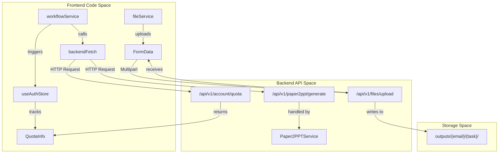
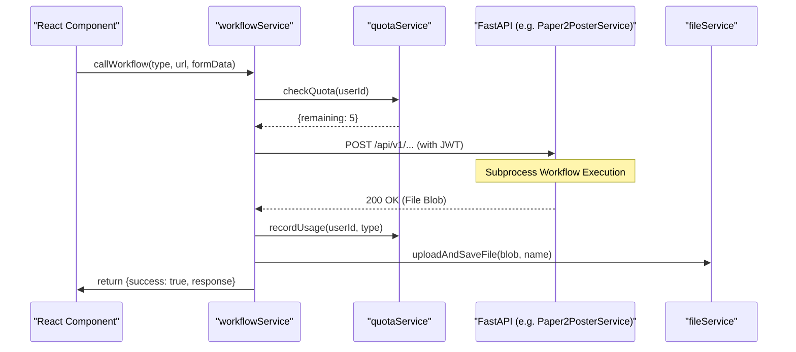

<!-- source: DeepWiki mcp.deepwiki.com · repo OpenDCAI/Paper2Any · page 3.4 State Management · fetched 2026-11-02 -->

# State Management

Relevant source files

The following files were used as context for generating this wiki page:

- [dataflow_agent/toolkits/postertool/src/agents/curator.py](dataflow_agent/toolkits/postertool/src/agents/curator.py)
- [dataflow_agent/toolkits/postertool/src/agents/parser.py](dataflow_agent/toolkits/postertool/src/agents/parser.py)
- [fastapi_app/dependencies/auth.py](fastapi_app/dependencies/auth.py)
- [fastapi_app/routers/files.py](fastapi_app/routers/files.py)
- [fastapi_app/routers/pdf2ppt.py](fastapi_app/routers/pdf2ppt.py)
- [fastapi_app/services/paper2poster_service.py](fastapi_app/services/paper2poster_service.py)
- [frontend-workflow/src/services/fileService.ts](frontend-workflow/src/services/fileService.ts)
- [frontend-workflow/src/services/llmService.ts](frontend-workflow/src/services/llmService.ts)
- [frontend-workflow/src/services/quotaService.ts](frontend-workflow/src/services/quotaService.ts)
- [frontend-workflow/src/services/workflowService.ts](frontend-workflow/src/services/workflowService.ts)
- [tests/test_paper2poster_parser.py](tests/test_paper2poster_parser.py)

This page documents the state management architecture of the Paper2Any frontend application. It details the use of **Zustand** for global stores, the **Service Layer** pattern for encapsulating backend interactions, and the data flow between components and FastAPI endpoints.

## Overview

Paper2Any employs a layered state management approach to separate UI logic from business logic and server communication.

| Layer | Technology | Responsibility |
|:---|:---|:---|
| **Global Store** | Zustand (`authStore`) | Authentication status, user session, and real-time quota tracking. |
| **Service Layer** | TypeScript Modules | Encapsulating API calls, file uploads, and business logic (e.g., `workflowService`, `fileService`). |
| **Local State** | React `useState` / `useReducer` | Component-specific UI states (loading, progress, form inputs). |
| **Persistence** | `localStorage` / Supabase | Storing runtime configurations and user file history. |

### System Data Flow

The following diagram bridges the Natural Language concepts to specific Code Entities.

**Diagram: State and Service Interaction**

**Sources:** [frontend-workflow/src/services/workflowService.ts:13-24](), [frontend-workflow/src/services/quotaService.ts:4-10](), [fastapi_app/routers/files.py:31-33]()

---

## Global State: authStore

The `authStore` is the primary global state container, implemented using **Zustand**. It centralizes authentication and quota management, ensuring that usage limits are enforced across all components.

### Key State and Actions
- `user`: The current authenticated user object.
- `quota`: A `QuotaInfo` object containing `used`, `limit`, and `remaining` points.
- `refreshQuota()`: An action that invokes `quotaService.checkQuota` to sync with the backend.

**Sources:** [frontend-workflow/src/services/workflowService.ts:127-128](), [frontend-workflow/src/services/quotaService.ts:4-10]()

---

## Service Layer Patterns

Paper2Any uses a dedicated service layer to abstract backend complexities. This layer ensures that every workflow request follows a standardized sequence: **Quota Check → API Call → Usage Recording → File Persistence**.

### 1. Workflow Service (`workflowService.ts`)
The `workflowService` acts as a high-level orchestrator for all document conversion tasks.

- **`callWorkflow`**: The core function that wraps `backendFetch`. It performs an upstream quota check before initiating the request and triggers a quota refresh in `authStore` upon completion. [frontend-workflow/src/services/workflowService.ts:58-80]()
- **`callWorkflowBlob`**: Specialization for endpoints returning binary data (e.g., PPTX files), handling `Content-Disposition` headers to extract filenames. [frontend-workflow/src/services/workflowService.ts:181-207]()

### 2. Quota Service (`quotaService.ts`)
Manages the points-based usage system. It includes a caching mechanism to prevent redundant API calls.

- **`checkQuota`**: Fetches the current user's balance from `/api/v1/account/quota`. It supports a "stale-while-revalidate" pattern using `QUOTA_CACHE_TTL_MS`. [frontend-workflow/src/services/quotaService.ts:92-127]()
- **`recordUsage`**: Informs the backend to consume points after a successful workflow execution. [frontend-workflow/src/services/quotaService.ts:136-169]()

### 3. File Service (`fileService.ts`)
Handles the lifecycle of generated assets and user uploads.

- **`uploadAndSaveFile`**: Sanitizes filenames using `sanitizeFileName` to ensure compatibility with storage systems before sending a `POST` request to `/api/v1/files/upload`. [frontend-workflow/src/services/fileService.ts:56-80]()
- **`getFileRecords`**: Retrieves the user's conversion history from `/api/v1/files/history`. [frontend-workflow/src/services/fileService.ts:113-134]()

### 4. Runtime Config Service (`runtimeConfigService.ts`)
Manages application-wide settings fetched from the backend, such as `billing_mode` and whether `server_side_billing_enforced` is active. [frontend-workflow/src/services/quotaService.ts:141-144]()

**Sources:** [frontend-workflow/src/services/workflowService.ts:58-150](), [frontend-workflow/src/services/quotaService.ts:24-27](), [frontend-workflow/src/services/fileService.ts:33-54]()

---

## Data Flow: Component to Backend

The interaction between the React frontend and the FastAPI backend follows a strict request-response lifecycle.

**Diagram: Workflow Execution Data Flow**

**Sources:** [frontend-workflow/src/services/workflowService.ts:58-150](), [fastapi_app/services/paper2poster_service.py:68-82]()

### Implementation Example: PDF to PPT
When a user converts a PDF, the `PDF2PPTService` on the backend handles the file save and workflow trigger, while the frontend `workflowService` manages the state transition.

| Frontend Action | Backend Route | Backend Service |
|:---|:---|:---|
| `callWorkflowBlob` | `/api/v1/pdf2ppt/generate` | `PDF2PPTService.generate_ppt` |
| `uploadAndSaveFile` | `/api/v1/files/upload` | `fastapi_app.routers.files.upload_file` |

**Sources:** [fastapi_app/routers/pdf2ppt.py:20-36](), [fastapi_app/routers/files.py:31-33](), [frontend-workflow/src/services/workflowService.ts:181-186]()

---

## State Management in Complex Workflows

For multi-agent workflows like `paper2poster`, state is managed via a `PosterState` object on the backend, while the frontend tracks progress through status updates.

### Backend State Transitions
The backend `Parser` agent initializes the state by extracting raw text and assets, which are then passed to the `StoryBoardCurator`.

1.  **Parser**: Extracts `raw_text`, `images`, and `tables`. [dataflow_agent/toolkits/postertool/src/agents/parser.py:96-101]()
2.  **Curator**: Generates a `story_board` based on `structured_sections` and `narrative_content`. [dataflow_agent/toolkits/postertool/src/agents/curator.py:59-62]()

### Frontend File Synchronization
The frontend ensures that generated files are visible in the user's history by fetching metadata from the `files` router.

- **Deduplication**: The backend logic in `_resolve_user_dir_candidates` scans multiple possible user identifiers (ID, Email, Phone) to ensure historical files are not lost during state transitions. [fastapi_app/routers/files.py:70-95]()
- **Filtering**: The history view filters out intermediate worker files and `__pycache__` to show only final outputs like `.pptx`, `.mp4`, or `.drawio`. [fastapi_app/routers/files.py:147-152]()

**Sources:** [dataflow_agent/toolkits/postertool/src/agents/parser.py:53-125](), [fastapi_app/routers/files.py:147-194]()

---

