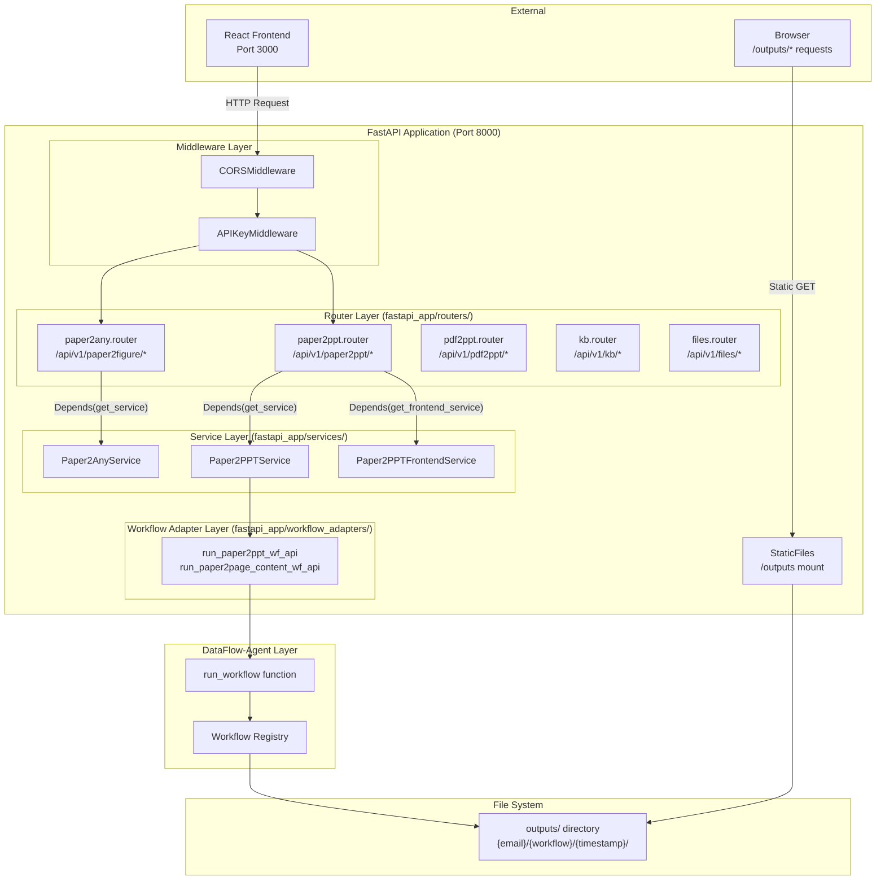
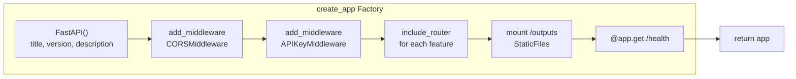
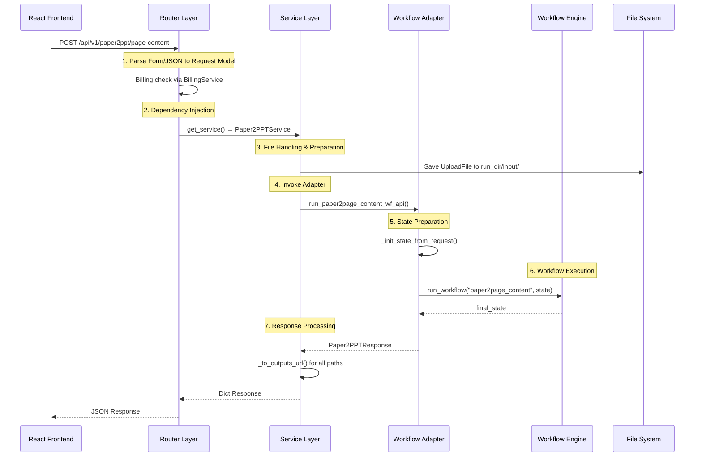

<!-- source: DeepWiki mcp.deepwiki.com · repo OpenDCAI/Paper2Any · page 4 Backend API · fetched 2026-11-02 -->

# Backend API

Relevant source files

The following files were used as context for generating this wiki page:

- [.gitignore](.gitignore)
- [dataflow_agent/workflow/wf_paper2ppt_parallel_consistent_style.py](dataflow_agent/workflow/wf_paper2ppt_parallel_consistent_style.py)
- [fastapi_app/main.py](fastapi_app/main.py)
- [fastapi_app/middleware/api_key.py](fastapi_app/middleware/api_key.py)
- [fastapi_app/routers/__init__.py](fastapi_app/routers/__init__.py)
- [fastapi_app/routers/paper2any.py](fastapi_app/routers/paper2any.py)
- [fastapi_app/routers/paper2ppt.py](fastapi_app/routers/paper2ppt.py)
- [fastapi_app/schemas.py](fastapi_app/schemas.py)
- [fastapi_app/services/paper2ppt_frontend_service.py](fastapi_app/services/paper2ppt_frontend_service.py)
- [fastapi_app/services/paper2ppt_service.py](fastapi_app/services/paper2ppt_service.py)
- [fastapi_app/workflow_adapters/wa_paper2ppt.py](fastapi_app/workflow_adapters/wa_paper2ppt.py)
- [frontend-workflow/src/components/paper2ppt/GenerateStep.tsx](frontend-workflow/src/components/paper2ppt/GenerateStep.tsx)
- [frontend-workflow/src/components/paper2ppt/index.tsx](frontend-workflow/src/components/paper2ppt/index.tsx)
- [frontend-workflow/vite.config.ts](frontend-workflow/vite.config.ts)

## Purpose and Scope

This page documents the FastAPI backend architecture of Paper2Any, covering the HTTP API layer that bridges frontend requests to the DataFlow-Agent workflow engine. The backend implements a clean three-layer architecture (Routers → Services → Workflow Adapters) to separate HTTP concerns, business logic, and workflow orchestration.

**Related pages:**
- For detailed API endpoint specifications, see [API Endpoints](#4.1)
- For Pydantic schema definitions, see [Request & Response Models](#4.2)
- For service layer patterns, see [Service Layer](#4.3)
- For file storage and URL handling, see [File Storage & URLs](#4.4)
- For workflow implementations, see [DataFlow-Agent Framework](#5)

---

## Architecture Overview

The backend follows a strict layered architecture where each layer has a single, well-defined responsibility:

### System Architecture Diagram

**Sources:** [fastapi_app/main.py:87-115](), [fastapi_app/routers/paper2ppt.py:31-46](), [fastapi_app/services/paper2ppt_service.py:143-155](), [fastapi_app/workflow_adapters/wa_paper2ppt.py:4-11]()

---

## Application Initialization

The FastAPI application is created and configured in `fastapi_app/main.py`. It initializes environment variables from `.env` [fastapi_app/main.py:7-14](), configures a runtime temporary directory [fastapi_app/main.py:17-28](), and sets up the core app instance.

### Initialization Flow

**Key configuration:**

| Configuration | Value | Purpose |
|--------------|-------|---------|
| CORS Origins | `settings.CORS_ALLOW_ORIGINS` | Controlled via env vars [fastapi_app/main.py:72-81]() |
| API Key Middleware | `APIKeyMiddleware` | Global request filtering [fastapi_app/main.py:84]() |
| Static Mount | `/outputs` → `{project_root}/outputs` | Serve generated assets [fastapi_app/main.py:125-129]() |

**Sources:** [fastapi_app/main.py:57-135]()

---

## Request Processing Flow

A typical request (e.g., Paper2PPT) flows through the following layers:

**Sources:** [fastapi_app/routers/paper2ppt.py:119-125](), [fastapi_app/services/paper2ppt_service.py:190-213](), [fastapi_app/workflow_adapters/wa_paper2ppt.py:224-250]()

---

## Router Layer

The router layer (`fastapi_app/routers/`) handles HTTP-specific concerns. It performs billing validation before executing long-running tasks [fastapi_app/routers/paper2ppt.py:110-125]().

### Feature Routers

| Module | Tags | Purpose |
|--------|--------|---------|
| `paper2any.py` | `paper2any` | Paper2Figure & System verification [fastapi_app/routers/paper2any.py:88]() |
| `paper2ppt.py` | `paper2ppt` | PPT generation, refinement, and frontend-specific logic [fastapi_app/routers/paper2ppt.py:91]() |
| `pdf2ppt.py` | `pdf2ppt` | Direct PDF to PPT conversion [fastapi_app/main.py:99]() |
| `kb.py` | `Knowledge Base` | RAG and knowledge management [fastapi_app/main.py:107]() |

**Sources:** [fastapi_app/main.py:87-114](), [fastapi_app/routers/paper2ppt.py:27-46]()

---

## Service Layer

The service layer (`fastapi_app/services/`) contains the core business orchestration logic.

### Key Service Components

*   **`Paper2PPTService`**: Manages the lifecycle of PPT generation, including directory creation (`_create_timestamp_run_dir`) [fastapi_app/services/paper2ppt_service.py:203](), reference image saving [fastapi_app/services/paper2ppt_service.py:208](), and result path resolution [fastapi_app/services/paper2ppt_service.py:121]().
*   **`Paper2PPTFrontendService`**: Specialized service for the React-based "Editable PPT" path. It handles theme creation [fastapi_app/services/paper2ppt_frontend_service.py:98](), slide-by-slide generation using semaphores for concurrency control [fastapi_app/services/paper2ppt_frontend_service.py:50-51](), and HTML/CSS sanitization [fastapi_app/services/paper2ppt_frontend_service.py:42-49]().

For details, see [Service Layer](#4.3).

**Sources:** [fastapi_app/services/paper2ppt_service.py:143-155](), [fastapi_app/services/paper2ppt_frontend_service.py:64-106]()

---

## Workflow Adapter Layer

Workflow adapters (`fastapi_app/workflow_adapters/`) bridge the API models to the internal `Paper2FigureState` [dataflow_agent/state.py].

### Adapter Responsibilities
1.  **State Initialization**: Mapping `Paper2PPTRequest` fields to `Paper2FigureState` [fastapi_app/workflow_adapters/wa_paper2ppt.py:72-123]().
2.  **Subprocess Isolation**: Using `run_heavy_workflow_in_subprocess` for resource-intensive tasks to ensure process stability [fastapi_app/workflow_adapters/wa_paper2ppt.py:31-34]().
3.  **Intelligent Routing**: Automatically choosing between standard and long-paper workflows based on token budgets [fastapi_app/workflow_adapters/wa_paper2ppt.py:181-221]().

**Sources:** [fastapi_app/workflow_adapters/wa_paper2ppt.py:1-250]()

---

## Request & Response Models

API contracts are strictly enforced using Pydantic models in `fastapi_app/schemas.py`.

*   **`Paper2FigureRequest`**: Defines inputs for figure generation, supporting `PDF`, `TEXT`, and `FIGURE` input types [fastapi_app/schemas.py:94-190]().
*   **`PageContentRequest`**: Used for the initial extraction of slide outlines from documents [fastapi_app/schemas.py:208-223]().
*   **`GenerateVideoRequest`**: Handles multi-step video generation (scripts to video) [fastapi_app/schemas.py:60-66]().

For details, see [Request & Response Models](#4.2).

**Sources:** [fastapi_app/schemas.py:1-223]()

---

## File Storage & Static Serving

The backend implements a structured output system:
1.  **Storage**: Files are saved under `outputs/{email}/{task}/{run_id}/` [fastapi_app/services/paper2ppt_service.py:135]().
2.  **Serving**: The `outputs` directory is mounted as a static route [fastapi_app/main.py:125-129]().
3.  **Resolution**: Utilities like `_to_outputs_url` [fastapi_app/utils.py] convert local paths to public URLs for the frontend [fastapi_app/services/paper2ppt_service.py:149]().

For details, see [File Storage & URLs](#4.4).

**Sources:** [fastapi_app/main.py:117-129](), [fastapi_app/services/paper2ppt_service.py:118-122]()

---

