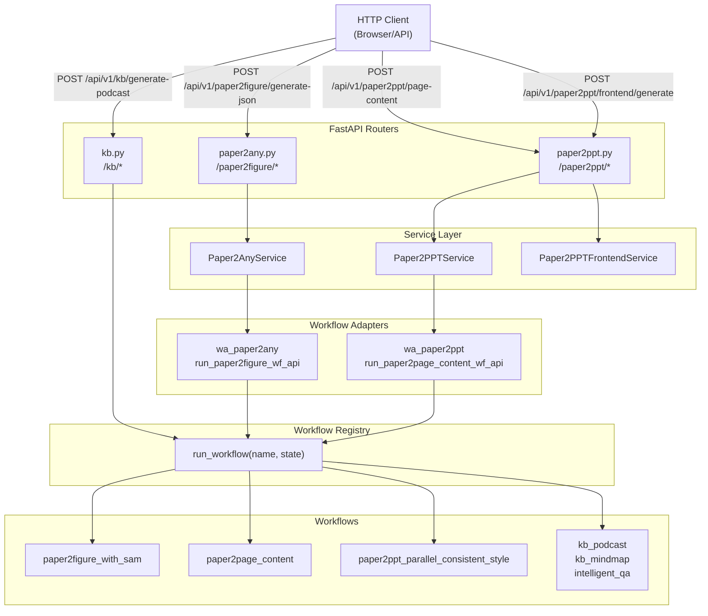

<!-- source: DeepWiki mcp.deepwiki.com · repo OpenDCAI/Paper2Any · page 4.1 API Endpoints · fetched 2026-11-02 -->

# API Endpoints

<details>
<summary>Relevant source files</summary>

The following files were used as context for generating this wiki page:

- [.gitignore](.gitignore)
- [database/01_init_schema.sql](database/01_init_schema.sql)
- [dataflow_agent/toolkits/citationtool/context_locator.py](dataflow_agent/toolkits/citationtool/context_locator.py)
- [dataflow_agent/workflow/wf_kb_podcast.py](dataflow_agent/workflow/wf_kb_podcast.py)
- [dataflow_agent/workflow/wf_paper2citation.py](dataflow_agent/workflow/wf_paper2citation.py)
- [dataflow_agent/workflow/wf_paper2ppt_parallel_consistent_style.py](dataflow_agent/workflow/wf_paper2ppt_parallel_consistent_style.py)
- [fastapi_app/main.py](fastapi_app/main.py)
- [fastapi_app/middleware/api_key.py](fastapi_app/middleware/api_key.py)
- [fastapi_app/routers/__init__.py](fastapi_app/routers/__init__.py)
- [fastapi_app/routers/kb.py](fastapi_app/routers/kb.py)
- [fastapi_app/routers/paper2any.py](fastapi_app/routers/paper2any.py)
- [fastapi_app/routers/paper2citation.py](fastapi_app/routers/paper2citation.py)
- [fastapi_app/routers/paper2ppt.py](fastapi_app/routers/paper2ppt.py)
- [fastapi_app/routers/paper2rebuttal.py](fastapi_app/routers/paper2rebuttal.py)
- [fastapi_app/schemas.py](fastapi_app/schemas.py)
- [fastapi_app/services/paper2citation_service.py](fastapi_app/services/paper2citation_service.py)
- [fastapi_app/services/paper2ppt_frontend_service.py](fastapi_app/services/paper2ppt_frontend_service.py)
- [fastapi_app/services/paper2ppt_service.py](fastapi_app/services/paper2ppt_service.py)
- [fastapi_app/services/rebuttal_service.py](fastapi_app/services/rebuttal_service.py)
- [fastapi_app/workflow_adapters/wa_paper2citation.py](fastapi_app/workflow_adapters/wa_paper2citation.py)
- [fastapi_app/workflow_adapters/wa_paper2ppt.py](fastapi_app/workflow_adapters/wa_paper2ppt.py)
- [frontend-workflow/src/components/knowledge-base/LibraryView.tsx](frontend-workflow/src/components/knowledge-base/LibraryView.tsx)
- [frontend-workflow/src/components/knowledge-base/OutputView.tsx](frontend-workflow/src/components/knowledge-base/OutputView.tsx)
- [frontend-workflow/src/components/knowledge-base/UploadView.tsx](frontend-workflow/src/components/knowledge-base/UploadView.tsx)
- [frontend-workflow/src/components/knowledge-base/index.tsx](frontend-workflow/src/components/knowledge-base/index.tsx)
- [frontend-workflow/src/components/knowledge-base/tools/MindMapTool.tsx](frontend-workflow/src/components/knowledge-base/tools/MindMapTool.tsx)
- [frontend-workflow/src/components/knowledge-base/tools/PodcastTool.tsx](frontend-workflow/src/components/knowledge-base/tools/PodcastTool.tsx)
- [frontend-workflow/src/components/knowledge-base/tools/PptTool.tsx](frontend-workflow/src/components/knowledge-base/tools/PptTool.tsx)
- [frontend-workflow/src/components/paper2citation/index.tsx](frontend-workflow/src/components/paper2citation/index.tsx)
- [frontend-workflow/src/components/paper2citation/types.ts](frontend-workflow/src/components/paper2citation/types.ts)
- [frontend-workflow/src/components/paper2ppt/GenerateStep.tsx](frontend-workflow/src/components/paper2ppt/GenerateStep.tsx)
- [frontend-workflow/src/components/paper2ppt/index.tsx](frontend-workflow/src/components/paper2ppt/index.tsx)
- [frontend-workflow/vite.config.ts](frontend-workflow/vite.config.ts)

</details>


This page documents all REST API endpoints exposed by the FastAPI backend server. The API provides access to document conversion workflows (Paper2Figure, Paper2PPT, PDF2PPT), knowledge base management, and academic research tools (Paper2Citation, Paper2Rebuttal).

For information about the request/response schemas used by these endpoints, see [Request & Response Models](#4.2). For details on how services orchestrate workflows, see [Service Layer](#4.3).

---

## Endpoint Organization

The API is organized into feature-based routers mounted under `/api/v1/` in `fastapi_app/main.py` [fastapi_app/main.py:88-114]():

| Router Prefix | Purpose | Router File |
|--------------|---------|-------------|
| `/paper2figure/` | Scientific figure generation from papers | [fastapi_app/routers/paper2any.py:1-134]() |
| `/paper2ppt/` | Presentation generation and outline management | [fastapi_app/routers/paper2ppt.py:1-274]() |
| `/pdf2ppt/` | PDF-to-PPT conversion with layout preservation | [fastapi_app/routers/pdf2ppt.py:1-50]() |
| `/kb/` | Knowledge base file management and AI tools | [fastapi_app/routers/kb.py:1-800]() |
| `/paper2citation/`| Academic citation network exploration | [fastapi_app/routers/paper2citation.py:1-100]() |
| `/paper2video/` | Video generation from paper scripts | [fastapi_app/routers/paper2video.py:1-150]() |
| `/paper2rebuttal/`| Paper review rebuttal generation | [fastapi_app/routers/paper2rebuttal.py:1-100]() |
| `/system/` | System utilities (LLM verification, health checks) | [fastapi_app/routers/paper2any.py:20-29]() |

Sources: [fastapi_app/main.py:88-114](), [fastapi_app/routers/paper2any.py:11-135](), [fastapi_app/routers/paper2ppt.py:27-210](), [fastapi_app/routers/kb.py:30-100]()

---

## Request Flow Architecture



**Request Flow Pattern**: Client sends HTTP request → Router validates input → Service layer handles business logic (e.g., `Paper2PPTService` [fastapi_app/services/paper2ppt_service.py:143-155]()) → Workflow adapter prepares state → `run_workflow()` executes LangGraph-based workflow → Response transformed to URLs via `_to_outputs_url()` [fastapi_app/utils.py:118-122]() and returned.

Sources: [fastapi_app/routers/paper2any.py:43-134](), [fastapi_app/routers/paper2ppt.py:31-46](), [fastapi_app/services/paper2ppt_service.py:1-155](), [fastapi_app/workflow_adapters/wa_paper2ppt.py:1-128]()

---

## Paper2Figure Endpoints

### POST `/api/v1/paper2figure/generate-json`

Generates scientific figures (model architecture diagrams, technical route SVGs, or experimental charts) from paper PDFs or text descriptions. Returns JSON response with output file URLs.

**Request Parameters** (multipart/form-data):

| Parameter | Type | Required | Description |
|-----------|------|----------|-------------|
| `img_gen_model_name` | string | Yes | Image generation model (e.g., `dall-e-3`) |
| `chat_api_url` | string | No | LLM API base URL |
| `api_key` | string | No | API authentication key |
| `input_type` | string | Yes | `"file"`, `"text"`, or `"image"` |
| `file` | file | Conditional | PDF/image file (required if `input_type="file"`) |
| `file_kind` | string | Conditional | `"pdf"` or `"image"` (required with file) |
| `text` | string | Conditional | Text description (required if `input_type="text"`) |
| `graph_type` | string | No | `"model_arch"` (default), `"tech_route"`, or `"exp_data"` |
| `language` | string | No | Output language: `"zh"` (default) or `"en"` |
| `style` | string | No | Visual style: `"cartoon"` (default), `"realistic"`, etc. |
| `figure_complex` | string | No | Complexity: `"easy"` (default), `"mid"`, `"hard"` |
| `resolution` | string | No | `"2K"` (default) or `"4K"` |
| `tech_route_palette` | string | No | Color palette identifier (e.g., `"academic_blue"`) |

**Response Schema**: `Paper2FigureResponse` [fastapi_app/schemas.py:192-204]()

**Workflow Triggered**: 
- `"model_arch"` → `paper2figure_with_sam`
- `"tech_route"` → `paper2technical` [fastapi_app/routers/paper2any.py:95-102]()

Sources: [fastapi_app/routers/paper2any.py:84-134](), [fastapi_app/schemas.py:94-204]()

---

## Paper2PPT Endpoints

### POST `/api/v1/paper2ppt/page-content`

Generates structured outline (`pagecontent`) from input documents. This stage produces a JSON array describing each slide's content.

**Request Parameters** (multipart/form-data):

| Parameter | Type | Required | Description |
|-----------|------|----------|-------------|
| `input_type` | string | Yes | `"text"`, `"pdf"`, `"pptx"`, or `"topic"` |
| `file` | file | Conditional | PDF/PPTX file |
| `page_count` | int | Yes | Target number of slides |
| `use_long_paper` | string | No | `"true"` for long documents requiring chunking |
| `pdf_as_slides` | string | No | `"true"` to treat PDF pages as slide images |

**Workflow Triggered**: 
- `paper2page_content` or `paper2page_content_for_long_paper` [fastapi_app/workflow_adapters/wa_paper2ppt.py:181-222]()

Sources: [fastapi_app/routers/paper2ppt.py:210-250](), [fastapi_app/services/paper2ppt_service.py:190-238]()

---

### POST `/api/v1/paper2ppt/frontend/generate`

A specialized endpoint for the React-based "Frontend PPT" mode. It generates React/Tailwind-compatible slide specs instead of flat images.

**Request Body** (JSON - `FrontendPPTGenerationRequest` [fastapi_app/schemas.py:284-301]()):
- `pagecontent`: JSON string of slide contents.
- `include_images`: Boolean to trigger parallel image generation for slides.
- `page_id`: Optional index to regenerate a single slide.

**Implementation**: Orchestrated by `Paper2PPTFrontendService.generate_slides` [fastapi_app/services/paper2ppt_frontend_service.py:70-140](). Uses `_SLIDE_GEN_SEMAPHORE` (limit 4) [fastapi_app/services/paper2ppt_frontend_service.py:50]() for concurrent generation.

Sources: [fastapi_app/routers/paper2ppt.py:314-340](), [fastapi_app/services/paper2ppt_frontend_service.py:70-140]()

---

## Knowledge Base Endpoints

### POST `/api/v1/kb/generate-podcast`

Generates an audio podcast from knowledge base files.

**Request Body** (JSON):
- `file_paths`: List of KB file paths.
- `podcast_mode`: `"monologue"` or `"dialog"`.
- `tts_model`: Model for speech synthesis (e.g., `cosyvoice`).

**Workflow Triggered**: `wf_kb_podcast` [dataflow_agent/workflow/wf_kb_podcast.py:1-20]().

Sources: [fastapi_app/routers/kb.py:552-673](), [dataflow_agent/workflow/wf_kb_podcast.py:1-20]()

---

### POST `/api/v1/kb/chat`

RAG-based chat interface for knowledge base interaction.

**Request Body** (JSON):
- `files`: List of files to use as context.
- `query`: User question.

**Workflow Triggered**: `wf_intelligent_qa` via `run_workflow` [fastapi_app/routers/kb.py:355-364]().

Sources: [fastapi_app/routers/kb.py:291-364]()

---

## Paper2Video Endpoints

### POST `/api/v1/paper2video/generate-subtitle`

First step of video generation: parses PDF and generates speech scripts for each page.

**Response**: `GenerateSubtitleResponse` [fastapi_app/schemas.py:50-58]() containing `script_pages` and a `state_snapshot` for the next step.

### POST `/api/v1/paper2video/generate-video`

Second step: takes edited scripts and generates the final video file.

**Request**: `GenerateVideoRequest` [fastapi_app/schemas.py:60-66]() including `result_path` and `script_pages`.

Sources: [fastapi_app/routers/paper2video.py:1-150](), [fastapi_app/schemas.py:43-75]()

---

## File & History Endpoints

### GET `/api/v1/files/history`

Lists historical tasks and output files for a specific user.

**Query Parameters**:
- `email`: User email.
- `workflow_type`: Filter by `paper2ppt`, `paper2figure`, etc.

Sources: [fastapi_app/routers/files.py:1-50]()

---

## API-to-Service Mapping

The following diagram shows how REST endpoints map to internal service classes and their primary orchestration methods.

```mermaid
classDiagram
    class Paper2AnyRouter {
        +POST /paper2figure/generate-json
        +POST /system/verify-llm
    }
    class Paper2PPTRouter {
        +POST /paper2ppt/page-content
        +POST /paper2ppt/generate
        +POST /paper2ppt/frontend/generate
    }
    class KBRouter {
        +POST /kb/chat
        +POST /kb/generate-podcast
    }

    class Paper2AnyService {
        +generate_paper2figure_json()
        +verify_llm_connection()
    }
    class Paper2PPTService {
        +get_page_content()
        +generate_ppt()
    }
    class Paper2PPTFrontendService {
        +generate_slides()
        +export_to_pptx()
    }

    Paper2AnyRouter --> Paper2AnyService : Depends
    Paper2PPTRouter --> Paper2PPTService : Depends
    Paper2PPTRouter --> Paper2PPTFrontendService : Depends
    KBRouter --> "run_workflow()" : Call Directly
```

Sources: [fastapi_app/routers/paper2any.py:14-17](), [fastapi_app/routers/paper2ppt.py:31-46](), [fastapi_app/services/paper2ppt_service.py:143-155](), [fastapi_app/services/paper2ppt_frontend_service.py:64-69]()

---

## Common Response Patterns

### Success Response
Most generation endpoints return a JSON object with `success: true` and a list of output URLs.
```json
{
  "success": true,
  "result_path": "/outputs/user@example.com/paper2ppt/1739856000",
  "all_output_files": [
    "http://localhost:8000/outputs/user@example.com/paper2ppt/1739856000/result.pptx"
  ]
}
```

### Error Response
Errors are returned with a `4xx` or `5xx` status code and a standard `ErrorResponse` [fastapi_app/schemas.py:16-21]().
```json
{
  "error": "Failed to parse PDF",
  "code": "WORKFLOW_ERROR",
  "details": { "node": "mineru_parser", "exception": "..." }
}
```

Sources: [fastapi_app/schemas.py:11-21](), [fastapi_app/utils.py:118-122]()

---

