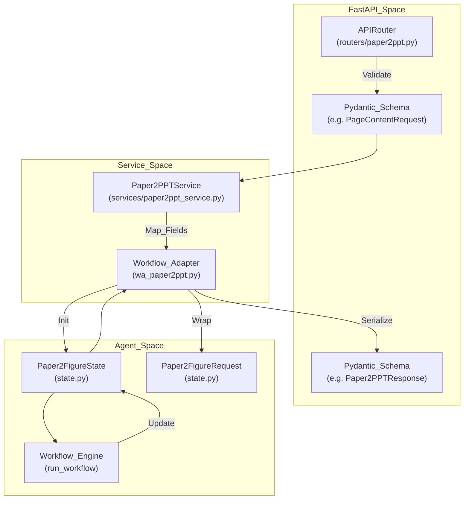
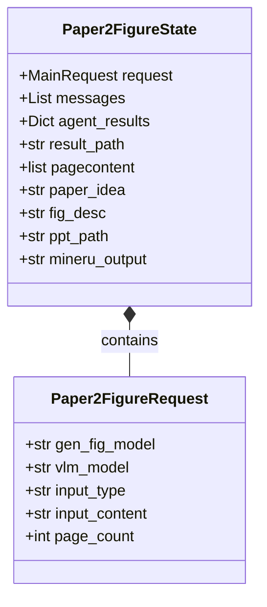

<!-- source: DeepWiki mcp.deepwiki.com · repo OpenDCAI/Paper2Any · page 4.2 Request & Response Models · fetched 2026-11-02 -->

# Request & Response Models

Relevant source files

The following files were used as context for generating this wiki page:

- [dataflow_agent/workflow/wf_paper2figure_image_only.py](dataflow_agent/workflow/wf_paper2figure_image_only.py)
- [dataflow_agent/workflow/wf_paper2ppt_parallel_consistent_style.py](dataflow_agent/workflow/wf_paper2ppt_parallel_consistent_style.py)
- [fastapi_app/.env.example](fastapi_app/.env.example)
- [fastapi_app/config/settings.py](fastapi_app/config/settings.py)
- [fastapi_app/middleware/api_key.py](fastapi_app/middleware/api_key.py)
- [fastapi_app/routers/paper2ppt.py](fastapi_app/routers/paper2ppt.py)
- [fastapi_app/schemas.py](fastapi_app/schemas.py)
- [fastapi_app/services/image2ppt_service.py](fastapi_app/services/image2ppt_service.py)
- [fastapi_app/services/paper2any_service.py](fastapi_app/services/paper2any_service.py)
- [fastapi_app/services/paper2ppt_frontend_service.py](fastapi_app/services/paper2ppt_frontend_service.py)
- [fastapi_app/services/paper2ppt_service.py](fastapi_app/services/paper2ppt_service.py)
- [fastapi_app/workflow_adapters/wa_paper2figure.py](fastapi_app/workflow_adapters/wa_paper2figure.py)
- [fastapi_app/workflow_adapters/wa_paper2ppt.py](fastapi_app/workflow_adapters/wa_paper2ppt.py)
- [fastapi_app/workflow_adapters/wa_pdf2ppt.py](fastapi_app/workflow_adapters/wa_pdf2ppt.py)
- [frontend-workflow/src/components/paper2ppt/GenerateStep.tsx](frontend-workflow/src/components/paper2ppt/GenerateStep.tsx)
- [frontend-workflow/src/components/paper2ppt/index.tsx](frontend-workflow/src/components/paper2ppt/index.tsx)

This page documents the request and response models used throughout the Paper2Any system. These models define the data structures for API communication and internal workflow state management.

**Scope**: This page covers Pydantic schemas used in FastAPI routes ([fastapi_app/schemas.py]()), dataclass-based request and state models used by the workflow engine ([dataflow_agent/state.py]()), and their relationships.

---

## Architecture Overview

Paper2Any uses a **two-layer model architecture**:

1. **API Layer (FastAPI)**: Pydantic-based schemas that validate HTTP requests/responses and enforce type safety at the network boundary.
2. **Workflow Layer (DataFlow-Agent)**: Dataclass-based `Request` and `State` models that flow through workflow nodes and maintain execution context.

**Natural Language Space to Code Entity Space Mapping**

Title: Model Interaction Flow

**Sources**: [fastapi_app/schemas.py:1-312](), [fastapi_app/services/paper2ppt_service.py:143-155](), [fastapi_app/workflow_adapters/wa_paper2ppt.py:72-123]()

---

## Core API Schemas

Defined in `fastapi_app/schemas.py`, these models use Pydantic `BaseModel` to handle incoming JSON and Form data.

### Paper2FigureRequest
This is the primary model for the "Paper2Graph" feature, supporting multiple input types and complexity levels.

| Field | Type | Default | Description |
| :--- | :--- | :--- | :--- |
| `input_type` | `Literal["PDF", "TEXT", "FIGURE"]` | `"PDF"` | Specifies if input is a file path or raw text [fastapi_app/schemas.py:145-149]() |
| `graph_type` | `Literal["model_arch", "tech_route", "exp_data"]` | `"model_arch"` | The target diagram type [fastapi_app/schemas.py:161]() |
| `figure_complex` | `str` | `"easy"` | Complexity (easy/mid/hard) for model architecture [fastapi_app/schemas.py:112-113]() |
| `style` | `str` | `"cartoon"` | Visual style (cartoon/realistic) [fastapi_app/schemas.py:163]() |
| `aspect_ratio` | `Literal["1:1", "16:9", ...]` | `"16:9"` | Output image dimensions [fastapi_app/schemas.py:159]() |

**Sources**: [fastapi_app/schemas.py:94-190]()

### Paper2PPT Request Suite
The Paper2PPT workflow is split into specialized request models for different stages of the pipeline.

1.  **PageContentRequest**: Used for initial parsing and outline generation. Includes fields like `use_long_paper` and `pdf_as_slides` [fastapi_app/schemas.py:208-220]().
2.  **PPTGenerationRequest**: Used for batch slide generation or single-page editing. Key fields include `page_id`, `edit_prompt`, and `get_down` (boolean flag for edit mode) [fastapi_app/schemas.py:201-220]().
3.  **FrontendPPTGenerationRequest**: Specialized for the React-based "Frontend" generation mode where the browser renders components to images [fastapi_app/schemas.py:255-274]().

**Sources**: [fastapi_app/schemas.py:201-274](), [fastapi_app/routers/paper2ppt.py:128-169]()

---

## Internal State & Request Models

The `dataflow_agent/state.py` file defines the dataclasses that live inside the workflow engine.

### Paper2FigureState
This state object is the "God Object" for document conversion workflows. It accumulates data as it passes through various agents.

Title: Paper2FigureState Internal Structure

**Sources**: [dataflow_agent/state.py:286-392](), [dataflow_agent/state.py:247-284]()

---

## Data Flow & Conversion

### API to Workflow Mapping
When a request hits an endpoint (e.g., `/paper2ppt/page-content`), the system performs the following conversion:

1.  **Router**: Receives `PageContentRequest` [fastapi_app/routers/paper2ppt.py:211]().
2.  **Service**: `Paper2PPTService` validates credentials and saves uploaded files [fastapi_app/services/paper2ppt_service.py:190-210]().
3.  **Adapter**: `wa_paper2ppt.py` initializes a `Paper2FigureState` and attaches a `Paper2PPTRequest` (internal dataclass) to it [fastapi_app/workflow_adapters/wa_paper2ppt.py:72-123]().

### URL and Path Management
The models frequently store file paths. The system distinguishes between:
*   **Local Paths**: Absolute paths on the server (e.g., `/app/outputs/...`).
*   **Static URLs**: Browser-accessible links (e.g., `http://domain.com/outputs/...`).

The `Paper2PPTService` and `Paper2PPTFrontendService` use `_to_outputs_url` to convert internal paths to public URLs before returning the response to the frontend [fastapi_app/services/paper2ppt_service.py:149](), [fastapi_app/services/paper2ppt_frontend_service.py:34]().

**Sources**: [fastapi_app/services/paper2ppt_service.py:143-155](), [fastapi_app/workflow_adapters/wa_paper2ppt.py:31-34]()

---

## Summary of Key Models

| Feature | API Request Model | Internal State Model | Purpose |
| :--- | :--- | :--- | :--- |
| **Paper2Figure** | `Paper2FigureRequest` | `Paper2FigureState` | PDF to Model/Tech diagrams [fastapi_app/schemas.py:94]() |
| **Paper2PPT** | `PPTGenerationRequest` | `Paper2FigureState` | Paper to full presentation [fastapi_app/schemas.py:201]() |
| **Paper2Video** | `GenerateVideoRequest` | `Paper2VideoState` | Script to MP4 generation [fastapi_app/schemas.py:60]() |
| **Verification** | `VerifyLlmRequest` | N/A | Testing LLM API connectivity [fastapi_app/schemas.py:80]() |

**Sources**: [fastapi_app/schemas.py:1-312](), [dataflow_agent/state.py:1-534]()

---

