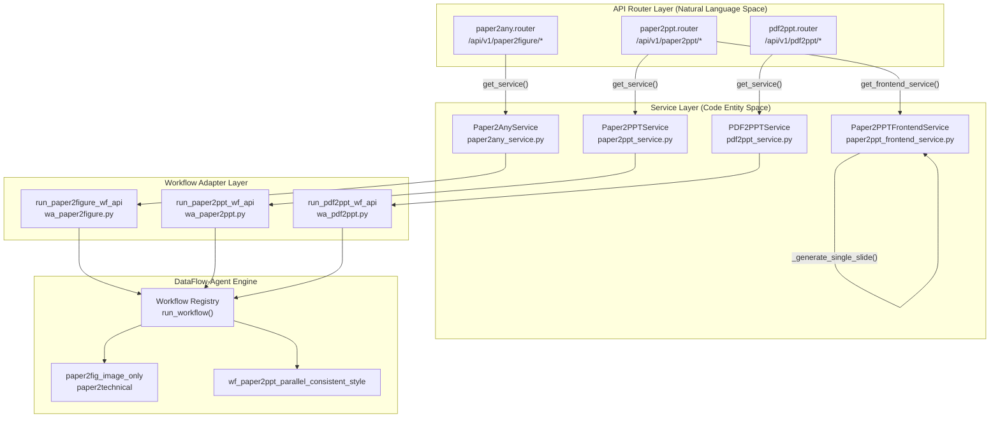
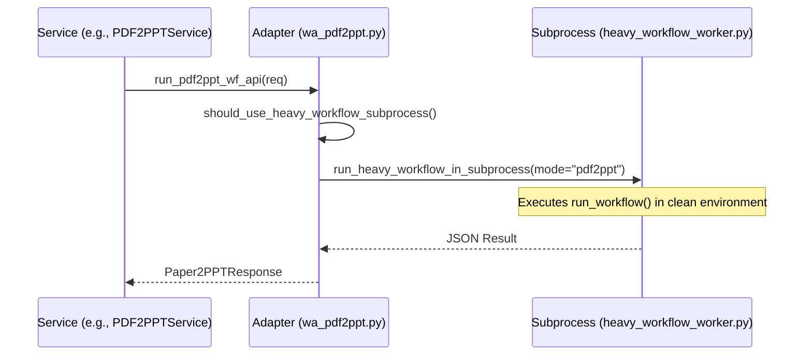

<!-- source: DeepWiki mcp.deepwiki.com · repo OpenDCAI/Paper2Any · page 4.3 Service Layer · fetched 2026-11-02 -->

# Service Layer

Relevant source files

The following files were used as context for generating this wiki page:

- [dataflow_agent/toolkits/postertool/src/agents/curator.py](dataflow_agent/toolkits/postertool/src/agents/curator.py)
- [dataflow_agent/toolkits/postertool/src/agents/parser.py](dataflow_agent/toolkits/postertool/src/agents/parser.py)
- [dataflow_agent/workflow/wf_paper2figure_image_only.py](dataflow_agent/workflow/wf_paper2figure_image_only.py)
- [dataflow_agent/workflow/wf_paper2ppt_parallel_consistent_style.py](dataflow_agent/workflow/wf_paper2ppt_parallel_consistent_style.py)
- [fastapi_app/.env.example](fastapi_app/.env.example)
- [fastapi_app/config/settings.py](fastapi_app/config/settings.py)
- [fastapi_app/dependencies/auth.py](fastapi_app/dependencies/auth.py)
- [fastapi_app/middleware/api_key.py](fastapi_app/middleware/api_key.py)
- [fastapi_app/routers/account.py](fastapi_app/routers/account.py)
- [fastapi_app/routers/files.py](fastapi_app/routers/files.py)
- [fastapi_app/routers/paper2ppt.py](fastapi_app/routers/paper2ppt.py)
- [fastapi_app/routers/pdf2ppt.py](fastapi_app/routers/pdf2ppt.py)
- [fastapi_app/schemas.py](fastapi_app/schemas.py)
- [fastapi_app/services/billing_service.py](fastapi_app/services/billing_service.py)
- [fastapi_app/services/image2ppt_service.py](fastapi_app/services/image2ppt_service.py)
- [fastapi_app/services/paper2any_service.py](fastapi_app/services/paper2any_service.py)
- [fastapi_app/services/paper2poster_service.py](fastapi_app/services/paper2poster_service.py)
- [fastapi_app/services/paper2ppt_frontend_service.py](fastapi_app/services/paper2ppt_frontend_service.py)
- [fastapi_app/services/paper2ppt_service.py](fastapi_app/services/paper2ppt_service.py)
- [fastapi_app/services/paper2ppt_task_service.py](fastapi_app/services/paper2ppt_task_service.py)
- [fastapi_app/workflow_adapters/wa_paper2figure.py](fastapi_app/workflow_adapters/wa_paper2figure.py)
- [fastapi_app/workflow_adapters/wa_paper2ppt.py](fastapi_app/workflow_adapters/wa_paper2ppt.py)
- [fastapi_app/workflow_adapters/wa_pdf2ppt.py](fastapi_app/workflow_adapters/wa_pdf2ppt.py)
- [frontend-workflow/src/components/paper2ppt/GenerateStep.tsx](frontend-workflow/src/components/paper2ppt/GenerateStep.tsx)
- [frontend-workflow/src/components/paper2ppt/index.tsx](frontend-workflow/src/components/paper2ppt/index.tsx)
- [frontend-workflow/src/services/fileService.ts](frontend-workflow/src/services/fileService.ts)
- [frontend-workflow/src/services/runtimeConfigService.ts](frontend-workflow/src/services/runtimeConfigService.ts)
- [script/heavy_workflow_worker.py](script/heavy_workflow_worker.py)
- [tests/test_paper2poster_parser.py](tests/test_paper2poster_parser.py)

The Service Layer provides business logic orchestration between the FastAPI routers and the underlying workflow engine. Services handle request validation, file management, directory creation, concurrency control, and workflow execution coordination. This layer abstracts the complexity of workflow invocation and provides a clean interface for HTTP endpoints.

---

## Architecture Overview

The Service Layer sits between HTTP routers and workflow adapters, providing a structured approach to business logic. It bridges the gap between the "Natural Language Space" (user intents) and the "Code Entity Space" (specific workflow implementations).

### Service Layer Orchestration

**Sources:** [fastapi_app/routers/paper2ppt.py:31-46](), [fastapi_app/services/paper2any_service.py:57-66](), [fastapi_app/services/paper2ppt_service.py:143-155](), [fastapi_app/services/paper2ppt_frontend_service.py:64-69]()

---

## Core Service Classes

### Paper2PPTService
The primary service for the standard Paper2PPT workflow. It handles the transition from paper parsing (page content) to final PPT generation.

| Method | Purpose | Workflow Adapter |
| :--- | :--- | :--- |
| `get_page_content` | Parses PDF/Text into structured slide outlines | `run_paper2page_content_wf_api` |
| `generate_ppt` | Generates PPT slides based on a JSON outline | `run_paper2ppt_wf_api` |
| `run_full_pipeline` | One-click conversion from PDF to final PPT | `run_paper2ppt_full_pipeline` |

**Sources:** [fastapi_app/services/paper2ppt_service.py:190-202](), [fastapi_app/services/paper2ppt_service.py:337-342](), [fastapi_app/services/paper2ppt_service.py:446-451]()

### Paper2PPTFrontendService
A specialized service designed for the "Interactive" frontend-heavy PPT workflow. It allows for slide-by-slide generation, real-time editing, and visual theme management.

*   **Concurrency Control:** Uses `_SLIDE_GEN_SEMAPHORE` (limit 4) and `_IMAGE_GEN_SEMAPHORE` (limit 2) to manage parallel generation of slide components [fastapi_app/services/paper2ppt_frontend_service.py:50-51]().
*   **Theme Management:** `_load_or_create_deck_theme` ensures visual consistency across all slides in a presentation [fastapi_app/services/paper2ppt_frontend_service.py:98-106]().
*   **Incremental Generation:** Supports `skip_slides` to avoid regenerating slides that are already completed [fastapi_app/services/paper2ppt_frontend_service.py:142-154]().

**Sources:** [fastapi_app/services/paper2ppt_frontend_service.py:70-140](), [fastapi_app/services/paper2ppt_frontend_service.py:228-235]()

---

## Process Isolation and Locking

To ensure system stability and prevent resource exhaustion (especially GPU memory), the Service Layer employs two primary mechanisms: Subprocess Isolation and Inter-process Locking.

### Subprocess Isolation (Heavy Workflows)
Heavy workflows like `pdf2ppt_qwenvl` (VLM-based) or `paper2fig_image_only` (Stable Diffusion) are executed in isolated subprocesses. This prevents memory leaks in the main FastAPI process and allows for strict timeout management.

**Sources:** [fastapi_app/workflow_adapters/wa_pdf2ppt.py:60-64](), [fastapi_app/workflow_adapters/wa_paper2figure.py:188-194](), [fastapi_app/workflow_adapters/heavy_workflow_subprocess.py:30-34]()

### Inter-process Locking
For operations that cannot run concurrently (e.g., specific GPU tasks or SAM segmentation), the system uses `AsyncInterProcessSemaphore`.

*   **`sam3_visual_workflows`**: Limits SAM3-based segmentation tasks to 1 at a time system-wide [fastapi_app/services/paper2any_service.py:30]().
*   **`paper2any_service_tasks`**: General throttle for Paper2Any service requests [fastapi_app/services/paper2any_service.py:29]().

**Sources:** [fastapi_app/services/paper2any_service.py:29-30](), [fastapi_app/interprocess_lock.py:16]()

---

## Data Flow: From Request to Result

The following diagram associates code entities with the data flow of a Paper2PPT request.

**Key Code Entities:**
*   **`Paper2FigureState`**: The primary state object passed between workflow nodes [dataflow_agent/state.py]().
*   **`_to_outputs_url`**: Utility to convert local filesystem paths to accessible static URLs [fastapi_app/utils.py:14]().
*   **`resolve_llm_credentials`**: Handles API key resolution based on billing mode (free/paid) [fastapi_app/services/managed_api_service.py:114-117]().

**Sources:** [fastapi_app/services/paper2ppt_service.py:212-220](), [fastapi_app/workflow_adapters/wa_paper2ppt.py:72-87](), [fastapi_app/services/paper2any_service.py:14](), [fastapi_app/services/paper2ppt_service.py:114-117]()

---

## Directory and File Management

Services are responsible for organizing the `outputs/` directory structure.

1.  **Run Directory:** Created using `_create_timestamp_run_dir` [fastapi_app/services/paper2ppt_service.py:203]().
    *   Path: `outputs/{email}/{task}/{timestamp}/`
2.  **Input Storage:** Original files are saved in the `input/` subdirectory [fastapi_app/services/paper2ppt_service.py:204]().
3.  **Asset Resolution:** `_resolve_asset_path` in workflows ensures that relative asset references (like images in a slide outline) are correctly mapped to absolute local paths during generation [dataflow_agent/workflow/wf_paper2ppt_parallel_consistent_style.py:176-199]().

**Sources:** [fastapi_app/services/paper2ppt_service.py:203-206](), [dataflow_agent/workflow/wf_paper2ppt_parallel_consistent_style.py:176-199]()

---

