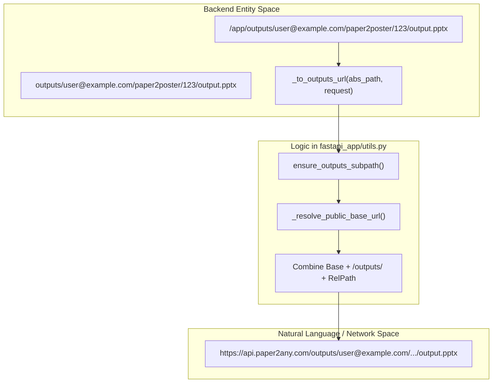
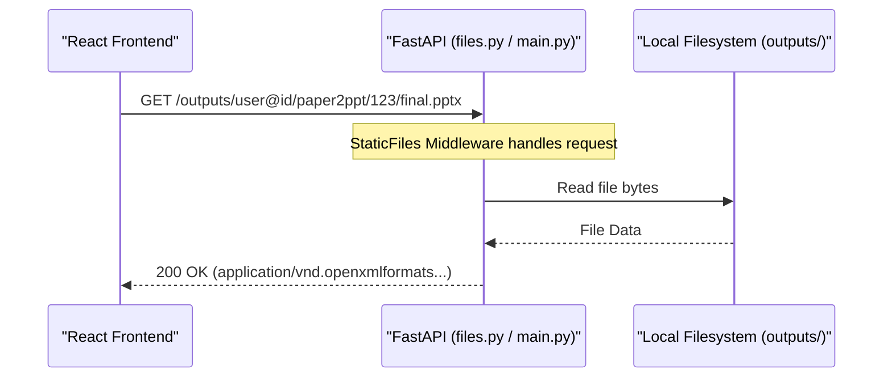

<!-- source: DeepWiki mcp.deepwiki.com · repo OpenDCAI/Paper2Any · page 4.4 File Storage & URLs · fetched 2026-11-02 -->

# File Storage & URLs

<details>
<summary>Relevant source files</summary>

The following files were used as context for generating this wiki page:

- [dataflow_agent/toolkits/postertool/src/agents/curator.py](dataflow_agent/toolkits/postertool/src/agents/curator.py)
- [dataflow_agent/toolkits/postertool/src/agents/parser.py](dataflow_agent/toolkits/postertool/src/agents/parser.py)
- [fastapi_app/dependencies/__init__.py](fastapi_app/dependencies/__init__.py)
- [fastapi_app/dependencies/auth.py](fastapi_app/dependencies/auth.py)
- [fastapi_app/routers/files.py](fastapi_app/routers/files.py)
- [fastapi_app/routers/pdf2ppt.py](fastapi_app/routers/pdf2ppt.py)
- [fastapi_app/services/paper2poster_service.py](fastapi_app/services/paper2poster_service.py)
- [fastapi_app/utils.py](fastapi_app/utils.py)
- [frontend-workflow/src/services/fileService.ts](frontend-workflow/src/services/fileService.ts)
- [tests/test_paper2poster_parser.py](tests/test_paper2poster_parser.py)

</details>


This page documents how Paper2Any organizes generated files on disk, constructs file paths, and exposes them via HTTP URLs for frontend access. The system uses a hierarchical directory structure under a single `outputs/` root, with each workflow run receiving its own isolated subdirectory. All generated files are served as static assets through FastAPI's static file mounting mechanism, with an additional `files` router providing history retrieval and authenticated access control.

---

## Directory Structure & Isolation

Each workflow execution creates an isolated directory under the `outputs/` root to prevent file conflicts. The system supports both authenticated users (organized by email or user ID) and anonymous users.

### Run Directory Creation

Multiple service modules implement directory creation with consistent logic. For authenticated users, directories are primarily organized by the user's identifier (email or Supabase ID).

```
outputs/
├── user@example.com/             # Authenticated User (Primary Identifier)
│   ├── paper2ppt/
│   │   └── 1738000000-a1b2c3d4/  # {timestamp}-{short_uuid}
│   │       ├── input/            # Uploaded source files
│   │       └── output/           # Generated artifacts
│   └── paper2poster/
│       └── 1738001000-e5f6g7h8/
│           ├── input/
│           └── assets/           # Extracted images/tables
└── default/                      # Anonymous or Fallback
    └── paper2poster/
        └── 1738002000-i9j0k1l2/
```

**Directory Naming Convention:**

| User Type | Format |
|-----------|--------|
| **Authenticated** | `outputs/{identifier}/{workflow_type}/{timestamp}-{uuid_hex}/` |
| **Anonymous** | `outputs/default/{workflow_type}/{timestamp}-{uuid_hex}/` |

- `identifier`: Resolved via `_resolve_primary_user_dir`, prioritizing `user.id` then `user.email` [fastapi_app/routers/files.py:98-100]().
- `workflow_type`: Workflow identifier (`paper2ppt`, `paper2poster`, `paper2video`, etc.) [fastapi_app/services/paper2poster_service.py:61-66]().
- `timestamp`: Unix epoch seconds.
- `uuid_hex`: First 8 characters of a UUID v4 for collision avoidance [fastapi_app/services/paper2poster_service.py:62-62]().

**Common Subdirectories:**
- `input/`: Stores uploaded files (PDFs, logos) [fastapi_app/services/paper2poster_service.py:91-92]().
- `content/`: Extracted text and JSON metadata (used in poster/video workflows) [dataflow_agent/toolkits/postertool/src/agents/parser.py:58-60]().
- `assets/`: Extracted figures and tables from PDFs [dataflow_agent/toolkits/postertool/src/agents/parser.py:59-61]().

Sources: [fastapi_app/routers/files.py:70-100](), [fastapi_app/services/paper2poster_service.py:61-66](), [dataflow_agent/toolkits/postertool/src/agents/parser.py:57-62]()

---

## URL Generation & Path Management

The system converts internal filesystem paths to frontend-accessible URLs through the `_to_outputs_url()` helper function.

### Path-to-URL Transformation

**URL Generation Flow:**


**Key Utilities in `fastapi_app/utils.py`:**
- `get_outputs_root()`: Returns the absolute path to the `outputs/` directory [fastapi_app/utils.py:16-17]().
- `ensure_outputs_subpath()`: Validates that a path is safely contained within the `outputs/` directory to prevent path traversal [fastapi_app/utils.py:27-56]().
- `_to_outputs_url()`: Converts an absolute path to a URL string. It uses `_resolve_public_base_url()` to handle proxies and `X-Forwarded-Host` headers [fastapi_app/utils.py:106-149]().
- `_from_outputs_url()`: The inverse function, converting a URL back to a local filesystem path [fastapi_app/utils.py:151-193]().

Sources: [fastapi_app/utils.py:16-17](), [fastapi_app/utils.py:27-56](), [fastapi_app/utils.py:106-149](), [fastapi_app/utils.py:151-193]()

---

## The Files Router & History

The `fastapi_app/routers/files.py` module manages file history and secure access.

### History Retrieval Logic

The history endpoint `GET /api/v1/files/history` scans the user's directories to reconstruct a list of generated files.

**History Filtering Rules:**
The system applies specific filters in `_should_include_history_file()` to hide intermediate artifacts [fastapi_app/routers/files.py:147-194]():
- **Include**: `.pptx` files, final `video.mp4` for videos, `.drawio` files, and specific figure prefixes (`fig_`, `technical_route`).
- **Exclude**: Anything in `input/` folders, `__pycache__`, or `.worker` directories.

### File Access Tokens

For enhanced security, the system can generate short-lived access tokens for files.
- `_build_file_access_token()`: Creates a HMAC-signed token containing the file path and expiration [fastapi_app/routers/files.py:213-228]().
- `verify_file_access_token()`: Validates the signature before allowing access to sensitive files [fastapi_app/routers/files.py:230-249]().

Sources: [fastapi_app/routers/files.py:147-194](), [fastapi_app/routers/files.py:213-249](), [fastapi_app/routers/files.py:31-31]()

---

## Frontend Integration

The React frontend interacts with file storage through the `fileService.ts`.

### File Upload & Sanitization

When the frontend uploads a file (e.g., via `uploadAndSaveFile`), it performs sanitization to ensure compatibility with backend filesystems.

**Sanitization Process:**
The `sanitizeFileName` function [frontend-workflow/src/services/fileService.ts:33-54]():
1. Replaces spaces with underscores.
2. Removes non-alphanumeric characters (except `-`, `_`, `.`).
3. Limits length to 100 characters.
4. Falls back to `{workflowType}_{timestamp}` if the result is empty (e.g., all-Chinese filenames).

### History Consumption

The frontend calls `getFileRecords()` which fetches data from the `/api/v1/files/history` endpoint [frontend-workflow/src/services/fileService.ts:113-140]().

**Frontend File Record Structure:**
```typescript
export interface FileRecord {
  id?: string;
  file_name: string;
  file_size?: number;
  workflow_type: string;
  created_at?: string;
  download_url?: string; // This is the /outputs/... URL
}
```

Sources: [frontend-workflow/src/services/fileService.ts:33-54](), [frontend-workflow/src/services/fileService.ts:113-140](), [frontend-workflow/src/services/fileService.ts:10-17]()

---

## Static File Serving Implementation

FastAPI is configured to serve the `outputs/` directory as static content. This is typically set up in the main application entry point using `StaticFiles`.

**Static Request Lifecycle:**


**Direct File Responses:**
Some endpoints, like `/pdf2ppt/generate`, return a `FileResponse` directly instead of a URL, allowing immediate download after processing [fastapi_app/routers/pdf2ppt.py:69-77]().

Sources: [fastapi_app/routers/pdf2ppt.py:69-77](), [fastapi_app/utils.py:106-139]()

---

