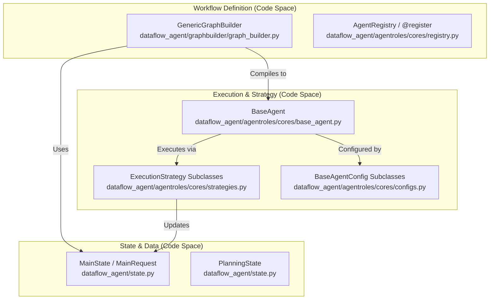
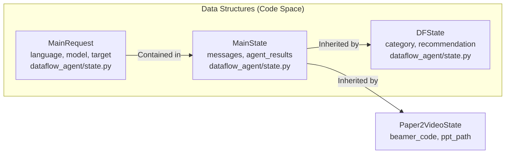

<!-- source: DeepWiki mcp.deepwiki.com · repo OpenDCAI/Paper2Any · page 5 DataFlow-Agent Framework · fetched 2026-11-02 -->

# DataFlow-Agent Framework

Relevant source files

The following files were used as context for generating this wiki page:

- [dataflow_agent/agentroles/__init__.py](dataflow_agent/agentroles/__init__.py)
- [dataflow_agent/agentroles/cores/__init__.py](dataflow_agent/agentroles/cores/__init__.py)
- [dataflow_agent/agentroles/cores/base_agent.py](dataflow_agent/agentroles/cores/base_agent.py)
- [dataflow_agent/agentroles/cores/configs.py](dataflow_agent/agentroles/cores/configs.py)
- [dataflow_agent/agentroles/cores/strategies.py](dataflow_agent/agentroles/cores/strategies.py)
- [dataflow_agent/graphbuilder/graph_builder.py](dataflow_agent/graphbuilder/graph_builder.py)
- [dataflow_agent/promptstemplates/prompts_repo.py](dataflow_agent/promptstemplates/prompts_repo.py)
- [dataflow_agent/resources/faiss_cache/all_ops.index.meta](dataflow_agent/resources/faiss_cache/all_ops.index.meta)
- [dataflow_agent/state.py](dataflow_agent/state.py)
- [dataflow_agent/templates/agent_as_tool_name.py.jinja](dataflow_agent/templates/agent_as_tool_name.py.jinja)
- [dataflow_agent/templates/state_name.py.jinja](dataflow_agent/templates/state_name.py.jinja)
- [dataflow_agent/toolkits/optool/op_tools.py](dataflow_agent/toolkits/optool/op_tools.py)
- [dataflow_agent/toolkits/pipetool/pipe_tools.py](dataflow_agent/toolkits/pipetool/pipe_tools.py)
- [dataflow_agent/toolkits/resources/ops.json](dataflow_agent/toolkits/resources/ops.json)

The DataFlow-Agent Framework is the core orchestration engine that powers all document processing workflows in Paper2Any. It provides a declarative system for defining multi-agent workflows as directed graphs, where nodes represent agent executions and edges define control flow. The framework abstracts LLM interactions, tool management, state propagation, and execution strategies into reusable components.

**Scope**: This page covers the architecture and core components of the framework. For detailed information on specific aspects:
- Workflow definition and registration: see [Workflows](#5.1)
- Agent implementation and configuration: see [Agents](#5.2)
- State objects and data models: see [State & Request Models](#5.3)
- Pre-tools and post-tools: see [Tool System](#5.4)
- Execution modes: see [Execution Strategies](#5.5)
- Prompt management: see [Prompt Templates](#5.6)
- Execution tracing: see [Trajectory & Execution Tracing](#5.7)

---

## Architecture Overview

The framework implements a layered architecture with clear separation of concerns, bridging high-level natural language intent to specific code entities.

### System to Code Entity Mapping
This diagram associates logical system components with their corresponding Python classes and files.

**Sources**: [dataflow_agent/graphbuilder/graph_builder.py:10-18](), [dataflow_agent/agentroles/cores/base_agent.py:95-144](), [dataflow_agent/state.py:40-55](), [dataflow_agent/agentroles/cores/configs.py:18-44]()

---

## Core Components

### Workflow Registry and Graph Builder

Workflows are registered using the `@register` decorator and defined using `GenericGraphBuilder`. The builder supports a declarative style for adding nodes, edges, and tools.

[dataflow_agent/graphbuilder/graph_builder.py:10-149]() defines the `GenericGraphBuilder` which utilizes `langgraph.graph.StateGraph` [dataflow_agent/graphbuilder/graph_builder.py:7]() to compile the execution logic.

**Key Methods**:
- `add_node(name, func, role)`: Adds an execution step [dataflow_agent/graphbuilder/graph_builder.py:57-60]().
- `pre_tool(name, role)`: Decorator for context injection before a node runs [dataflow_agent/graphbuilder/graph_builder.py:39-46]().
- `post_tool(role)`: Decorator for LLM function calling capabilities [dataflow_agent/graphbuilder/graph_builder.py:48-55]().
- `build()`: Compiles the nodes and edges into a runnable graph [dataflow_agent/graphbuilder/graph_builder.py:131-149]().

**Sources**: [dataflow_agent/graphbuilder/graph_builder.py:1-149](), [dataflow_agent/agentroles/cores/registry.py:1-12]()

---

### Agent Creation and Configuration

The framework provides a unified agent creation interface. Agents are instantiated via `create_agent` [dataflow_agent/agentroles/__init__.py:59-133]() which looks up the class in the `AgentRegistry` [dataflow_agent/agentroles/cores/registry.py:11]().

| Function | Config Type | Use Case |
|----------|-------------|----------|
| `create_simple_agent()` | `SimpleConfig` | Single LLM call [dataflow_agent/agentroles/__init__.py:174-208]() |
| `create_react_agent()` | `ReactConfig` | Reason-Act loop with validation [dataflow_agent/agentroles/__init__.py:211-250]() |
| `create_vlm_agent()` | `VLMConfig` | Vision/Image processing [dataflow_agent/agentroles/__init__.py:287-332]() |
| `create_parallel_agent()` | `ParallelConfig` | Concurrent batch processing [dataflow_agent/agentroles/__init__.py:335-370]() |

**Sources**: [dataflow_agent/agentroles/__init__.py:59-370](), [dataflow_agent/agentroles/cores/configs.py:6-16]()

---

### Execution Strategies

The framework uses a Strategy Pattern to handle different execution behaviors. Each `BaseAgent` is assigned an `ExecutionStrategy` [dataflow_agent/agentroles/cores/strategies.py:13-23]() based on its `ExecutionMode` [dataflow_agent/agentroles/cores/configs.py:6-15]().

**Strategy Implementation Details**:
- **SimpleStrategy**: Executes pre-tools then a single LLM call [dataflow_agent/agentroles/cores/strategies.py:26-34]().
- **ReactStrategy**: Implements a loop that retries based on `ValidatorFunc` results [dataflow_agent/agentroles/cores/strategies.py:36-59]().
- **ParallelStrategy**: Uses `asyncio.Semaphore` to manage concurrency limits [dataflow_agent/agentroles/cores/strategies.py:107-122]().
- **PlanSolveStrategy**: Generates a full plan via a "Planner" and executes it sequentially [dataflow_agent/agentroles/cores/strategies.py:126-210]().

**Sources**: [dataflow_agent/agentroles/cores/strategies.py:1-210](), [dataflow_agent/agentroles/cores/configs.py:46-195]()

---

### State and Request Models

Data flows through the system via `dataclass` objects. Every workflow starts with a `MainRequest` and maintains a `MainState`.

**Key Fields**:
- `agent_results`: A dictionary storing the output of every node, keyed by the agent's role [dataflow_agent/state.py:46]().
- `messages`: An `Annotated` list of `BaseMessage` objects compatible with LangGraph's `add_messages` [dataflow_agent/state.py:44]().

**Sources**: [dataflow_agent/state.py:12-210]()

---

### Tool System Architecture

The framework distinguishes between context-providing tools and action-performing tools.

- **Pre-tools**: Functions that run before an agent to prepare input data (e.g., `local_tool_for_get_purpose`) [dataflow_agent/toolkits/optool/op_tools.py:38-39]().
- **Post-tools**: LangChain-compatible `@tool` functions that the LLM can call during execution [dataflow_agent/toolkits/optool/op_tools.py:31]().
- **ToolManager**: Orchestrates the registration and role-based filtering of these tools [dataflow_agent/agentroles/cores/base_agent.py:116]().

**Sources**: [dataflow_agent/toolkits/optool/op_tools.py:1-230](), [dataflow_agent/agentroles/cores/base_agent.py:181-220]()

---

### Prompt Template System

Prompts are managed centrally in `prompts_repo.py`. The `PromptsTemplateGenerator` [dataflow_agent/agentroles/cores/base_agent.py:59]() loads these templates based on the agent's `role_name`.

**Example Prompt Categories**:
- **TargetParsing**: Decomposes user requirements into operator descriptions [dataflow_agent/promptstemplates/prompts_repo.py:76-113]().
- **RecommendationInference**: Assembles data processing pipelines [dataflow_agent/promptstemplates/prompts_repo.py:118-165]().

**Sources**: [dataflow_agent/promptstemplates/prompts_repo.py:1-165](), [dataflow_agent/agentroles/cores/base_agent.py:22-27]()

---

## Summary

The DataFlow-Agent Framework provides:
1. **Declarative Workflow Construction**: Using `GenericGraphBuilder` [dataflow_agent/graphbuilder/graph_builder.py:10]().
2. **Flexible Execution**: Through `ExecutionStrategy` patterns [dataflow_agent/agentroles/cores/strategies.py:13]().
3. **Robust State Management**: Centered around `MainState` [dataflow_agent/state.py:41]().
4. **Dynamic Agent Discovery**: Via the `AgentRegistry` [dataflow_agent/agentroles/cores/registry.py:11]().
5. **Intelligent Pipeline Assembly**: Leveraging `pipeline_assembler` tools [dataflow_agent/toolkits/pipetool/pipe_tools.py:148]().

---

