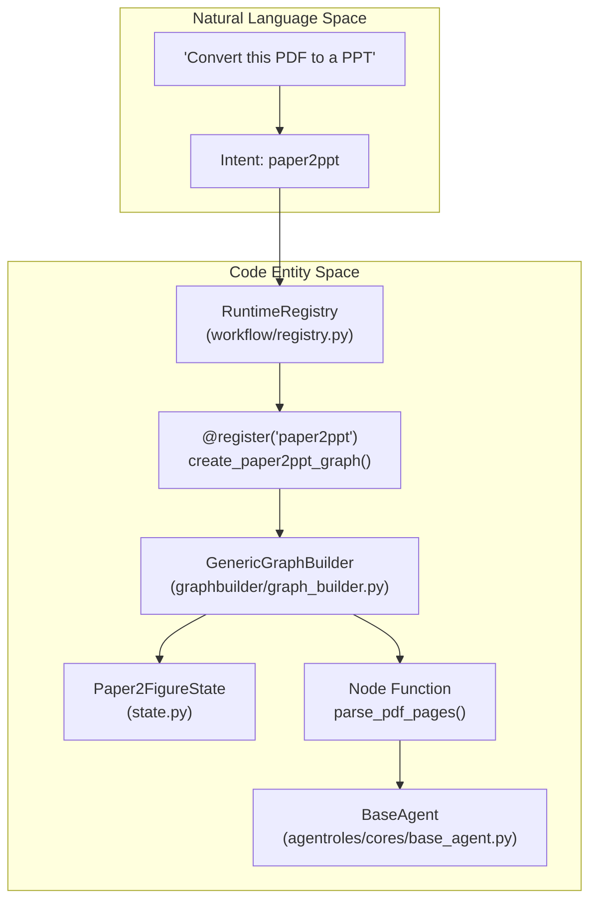
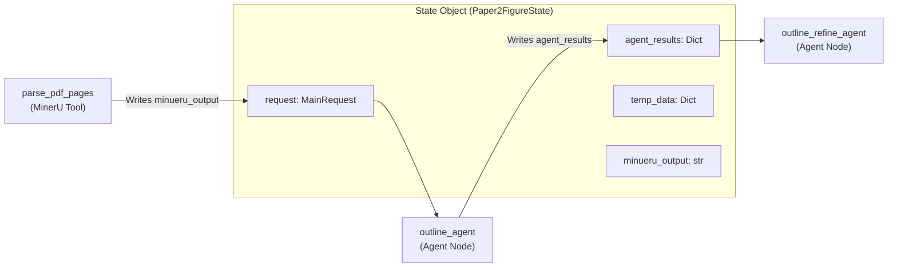

<!-- source: DeepWiki mcp.deepwiki.com · repo OpenDCAI/Paper2Any · page 5.1 Workflows · fetched 2026-11-02 -->

# Workflows

<details>
<summary>Relevant source files</summary>

The following files were used as context for generating this wiki page:

- [dataflow_agent/agentroles/cores/base_agent.py](dataflow_agent/agentroles/cores/base_agent.py)
- [dataflow_agent/graphbuilder/graph_builder.py](dataflow_agent/graphbuilder/graph_builder.py)
- [dataflow_agent/promptstemplates/prompts_repo.py](dataflow_agent/promptstemplates/prompts_repo.py)
- [dataflow_agent/resources/faiss_cache/all_ops.index.meta](dataflow_agent/resources/faiss_cache/all_ops.index.meta)
- [dataflow_agent/state.py](dataflow_agent/state.py)
- [dataflow_agent/toolkits/multimodaltool/bg_tool.py](dataflow_agent/toolkits/multimodaltool/bg_tool.py)
- [dataflow_agent/toolkits/optool/op_tools.py](dataflow_agent/toolkits/optool/op_tools.py)
- [dataflow_agent/toolkits/pipetool/pipe_tools.py](dataflow_agent/toolkits/pipetool/pipe_tools.py)
- [dataflow_agent/toolkits/resources/ops.json](dataflow_agent/toolkits/resources/ops.json)
- [dataflow_agent/workflow/__init__.py](dataflow_agent/workflow/__init__.py)
- [dataflow_agent/workflow/wf_paper2page_content.py](dataflow_agent/workflow/wf_paper2page_content.py)
- [dataflow_agent/workflow/wf_paper2page_content_for_long_paper.py](dataflow_agent/workflow/wf_paper2page_content_for_long_paper.py)
- [docker-compose.yml](docker-compose.yml)
- [frontend-workflow/Dockerfile](frontend-workflow/Dockerfile)
- [frontend-workflow/src/components/ParticleBackground.tsx](frontend-workflow/src/components/ParticleBackground.tsx)
- [frontend-workflow/src/components/knowledge-base/tools/MermaidPreview.tsx](frontend-workflow/src/components/knowledge-base/tools/MermaidPreview.tsx)
- [frontend-workflow/src/types/index.ts](frontend-workflow/src/types/index.ts)

</details>


This document covers the workflow system in the Paper2Any codebase, specifically the `dataflow_agent` framework. It explains workflow definition using `GenericGraphBuilder`, registration with the `@register` decorator, and the execution mechanics involving nodes, edges, and conditional routing.

---

## Purpose and Scope

Workflows in Paper2Any are directed graphs that orchestrate complex multi-step document processing tasks (e.g., converting a paper to a figure or video). Each workflow is defined as a `StateGraph` (via LangGraph) using the `GenericGraphBuilder` utility [dataflow_agent/graphbuilder/graph_builder.py:10-16](). Workflows operate on a shared state object that flows through nodes, accumulating results from agents and tools [dataflow_agent/state.py:39-55]().

---

## Workflow Architecture

The architecture bridges high-level workflow definitions with the underlying execution engine.

### Natural Language to Code Entity Space



**Sources:** [dataflow_agent/workflow/registry.py:1-20](), [dataflow_agent/graphbuilder/graph_builder.py:10-30](), [dataflow_agent/workflow/wf_paper2page_content.py:52-58]()

---

## Workflow Registration

Workflows are registered using a decorator pattern. This allows the system to lazily load and discover workflows by name [dataflow_agent/workflow/__init__.py:20-40]().

### The @register Decorator
The `@register` decorator maps a unique string identifier to a factory function that constructs the workflow graph [dataflow_agent/workflow/registry.py:10-15]().

```python
@register("paper2page_content")
def create_paper2page_content_graph() -> GenericGraphBuilder:
    # Function body constructs the builder
    builder = GenericGraphBuilder(state_model=Paper2FigureState, entry_point="_start_")
    ...
    return builder
```

| Component | Functionality |
|-----------|---------------|
| `RuntimeRegistry` | Stores the mapping of names to factory functions [dataflow_agent/workflow/registry.py:1-9](). |
| `get_workflow(name)` | Retrieves the factory and handles lazy-loading of modules [dataflow_agent/workflow/__init__.py:42-54](). |
| `run_workflow(name, state)` | The primary entry point for execution [dataflow_agent/workflow/__init__.py:56-64](). |

**Sources:** [dataflow_agent/workflow/registry.py:1-20](), [dataflow_agent/workflow/__init__.py:1-71]()

---

## GenericGraphBuilder

The `GenericGraphBuilder` is a wrapper around LangGraph's `StateGraph` that simplifies node/edge management and tool binding [dataflow_agent/graphbuilder/graph_builder.py:10-16]().

### Key Methods

*   **`add_node(name, func, role)`**: Adds a node to the graph. If a `role` is provided, it automatically wraps the node to register pre/post tools associated with that role before execution [dataflow_agent/graphbuilder/graph_builder.py:57-60]().
*   **`add_edge(src, dst)`**: Creates a directed transition between nodes [dataflow_agent/graphbuilder/graph_builder.py:70-73]().
*   **`add_conditional_edge(src, condition_func)`**: Routes the flow based on the logic in `condition_func` [dataflow_agent/graphbuilder/graph_builder.py:80-83]().
*   **`build()`**: Compiles the graph into an executable `CompiledGraph` [dataflow_agent/graphbuilder/graph_builder.py:131-150]().

### Tool Binding Decorators
The builder provides decorators to bind data-fetching logic (`pre_tool`) or LLM-callable functions (`post_tool`) to specific roles [dataflow_agent/graphbuilder/graph_builder.py:39-55]().

```python
@builder.pre_tool("minueru_output", "outline_agent")
def _get_mineru_markdown(state: Paper2FigureState):
    return state.minueru_output or ""
```

**Sources:** [dataflow_agent/graphbuilder/graph_builder.py:10-150](), [dataflow_agent/workflow/wf_paper2page_content.py:62-64]()

---

## Nodes and State Flow

Nodes are the functional units of a workflow. In Paper2Any, nodes typically perform PDF parsing, text expansion, or agent invocation.

### Data Flow Space Diagram



### Node Implementation Examples
Nodes are generally `async` functions that take a `State` and return an updated `State` [dataflow_agent/workflow/wf_paper2page_content.py:102-162]().

1.  **Tool Nodes**: Execute external processes like `run_mineru_pdf_extract_http` [dataflow_agent/workflow/wf_paper2page_content.py:133-137]().
2.  **Agent Nodes**: Use `create_react_agent` or `create_simple_agent` to invoke LLMs with specific roles [dataflow_agent/workflow/wf_paper2page_content.py:13-14]().

**Sources:** [dataflow_agent/workflow/wf_paper2page_content.py:93-200](), [dataflow_agent/state.py:134-169]()

---

## Execution Logic: run_workflow

The `run_workflow` function is the unified interface for starting a pipeline.

1.  **Workflow Retrieval**: It calls `get_workflow(name)` to find the factory [dataflow_agent/workflow/__init__.py:60]().
2.  **Graph Construction**: It executes the factory to get a `GenericGraphBuilder` and then calls `.build()` [dataflow_agent/workflow/__init__.py:61-62]().
3.  **Invocation**: It calls `.ainvoke(state)` on the compiled graph to begin execution [dataflow_agent/workflow/__init__.py:63]().

### Subprocess Isolation
Certain workflows, like `paper2video`, are executed via `run_paper2video_via_subprocess` to ensure resource isolation and handle complex ffmpeg/TTS dependencies [dataflow_agent/workflow/__init__.py:57-58]().

**Sources:** [dataflow_agent/workflow/__init__.py:42-63](), [dataflow_agent/graphbuilder/graph_builder.py:131-150]()

---

## Long Paper Handling

The system includes specialized workflows like `paper2page_content_for_long_paper` for handling documents exceeding 50 pages [dataflow_agent/workflow/wf_paper2page_content_for_long_paper.py:100-105]().

### Strategic Differences
*   **Content Expansion**: Uses `expand_text_iteratively` if the input is too short for the target page count [dataflow_agent/workflow/wf_paper2page_content_for_long_paper.py:38-42]().
*   **Batching**: Uses `build_section_batches` to split long markdown into manageable chunks for the LLM [dataflow_agent/workflow/wf_paper2page_content_for_long_paper.py:17-22]().
*   **Dynamic Budgeting**: Calculates `max_batch_tokens` based on the model's context window [dataflow_agent/workflow/wf_paper2page_content_for_long_paper.py:173-174]().

**Sources:** [dataflow_agent/workflow/wf_paper2page_content_for_long_paper.py:1-52](), [dataflow_agent/utils_markdown_sections.py:17-22]()

---

