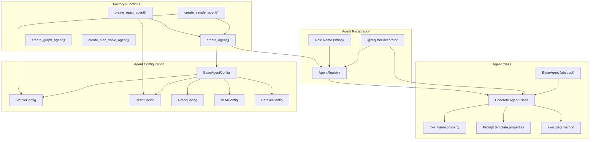
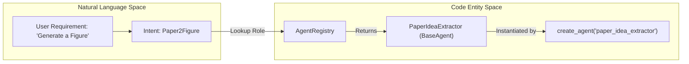
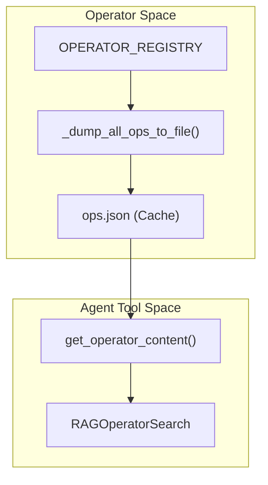

<!-- source: DeepWiki mcp.deepwiki.com · repo OpenDCAI/Paper2Any · page 5.2 Agents · fetched 2026-11-02 -->

# Agents

<details>
<summary>Relevant source files</summary>

The following files were used as context for generating this wiki page:

- [dataflow_agent/agentroles/__init__.py](dataflow_agent/agentroles/__init__.py)
- [dataflow_agent/agentroles/cores/__init__.py](dataflow_agent/agentroles/cores/__init__.py)
- [dataflow_agent/agentroles/cores/base_agent.py](dataflow_agent/agentroles/cores/base_agent.py)
- [dataflow_agent/agentroles/cores/configs.py](dataflow_agent/agentroles/cores/configs.py)
- [dataflow_agent/agentroles/cores/strategies.py](dataflow_agent/agentroles/cores/strategies.py)
- [dataflow_agent/agentroles/paper2any_agents/__init__.py](dataflow_agent/agentroles/paper2any_agents/__init__.py)
- [dataflow_agent/agentroles/paper2any_agents/deep_research_agent.py](dataflow_agent/agentroles/paper2any_agents/deep_research_agent.py)
- [dataflow_agent/agentroles/paper2any_agents/icon_editor.py](dataflow_agent/agentroles/paper2any_agents/icon_editor.py)
- [dataflow_agent/agentroles/paper2any_agents/icon_generator.py](dataflow_agent/agentroles/paper2any_agents/icon_generator.py)
- [dataflow_agent/agentroles/paper2any_agents/icon_prompt_generator.py](dataflow_agent/agentroles/paper2any_agents/icon_prompt_generator.py)
- [dataflow_agent/graphbuilder/graph_builder.py](dataflow_agent/graphbuilder/graph_builder.py)
- [dataflow_agent/promptstemplates/prompts_repo.py](dataflow_agent/promptstemplates/prompts_repo.py)
- [dataflow_agent/resources/faiss_cache/all_ops.index.meta](dataflow_agent/resources/faiss_cache/all_ops.index.meta)
- [dataflow_agent/state.py](dataflow_agent/state.py)
- [dataflow_agent/templates/agent_as_tool_name.py.jinja](dataflow_agent/templates/agent_as_tool_name.py.jinja)
- [dataflow_agent/templates/state_name.py.jinja](dataflow_agent/templates/state_name.py.jinja)
- [dataflow_agent/toolkits/optool/op_tools.py](dataflow_agent/toolkits/optool/op_tools.py)
- [dataflow_agent/toolkits/pipetool/pipe_tools.py](dataflow_agent/toolkits/pipetool/pipe_tools.py)
- [dataflow_agent/toolkits/resources/ops.json](dataflow_agent/toolkits/resources/ops.json)

</details>


## Purpose and Scope

Agents are the fundamental execution units in the DataFlow-Agent framework. Each agent represents a specialized role responsible for a specific task within a workflow, such as extracting paper ideas, generating figure descriptions, or creating presentation slides. This document covers:

- The `BaseAgent` class and agent architecture [[dataflow_agent/agentroles/cores/base_agent.py:95-144]]()
- Agent configuration using config objects (`SimpleConfig`, `ReactConfig`, etc.) [[dataflow_agent/agentroles/cores/configs.py:18-195]]()
- Agent creation patterns and factory functions [[dataflow_agent/agentroles/__init__.py:59-133]]()
- The agent registry system and role-based design [[dataflow_agent/agentroles/cores/registry.py:1-40]]()
- The relationship between Agents and the Operator system [[dataflow_agent/toolkits/optool/op_tools.py:125-160]]()

---

## Agent Architecture

### Core Components

Agents in Paper2Any follow a role-based architecture where each agent class inherits from `BaseAgent` and registers itself with a unique role name. The agent system consists of three key components:



**Diagram: Agent System Architecture**

Sources: [dataflow_agent/agentroles/cores/base_agent.py:95-144](), [dataflow_agent/agentroles/cores/configs.py:18-44](), [dataflow_agent/agentroles/__init__.py:59-133]()

### BaseAgent Class

The `BaseAgent` class is an abstract base class that defines the interface all agents must implement. It provides the `__init_subclass__` hook to automatically register any child class into the `AgentRegistry` [[dataflow_agent/agentroles/cores/base_agent.py:150-179]]().

| Property/Method | Purpose | Implementation Detail |
|----------------|---------|---------|
| `role_name` | Unique identifier for the agent | Abstract property [[dataflow_agent/agentroles/cores/base_agent.py:270-274]]() |
| `system_prompt_template_name` | Template ID for system prompt | Abstract property [[dataflow_agent/agentroles/cores/base_agent.py:276-280]]() |
| `task_prompt_template_name` | Template ID for task prompt | Abstract property [[dataflow_agent/agentroles/cores/base_agent.py:282-286]]() |
| `execute()` | Main entry point | Delegates to an `ExecutionStrategy` [[dataflow_agent/agentroles/cores/base_agent.py:343-380]]() |
| `create()` | Factory method | Instantiates agent with specific config [[dataflow_agent/agentroles/cores/base_agent.py:216-263]]() |

Sources: [dataflow_agent/agentroles/cores/base_agent.py:95-286]()

### Agent Registry System

The agent registry provides a centralized mechanism for discovering and instantiating agents by role name. It is implemented as a singleton `AgentRegistry` class [[dataflow_agent/agentroles/cores/registry.py:5-40]]().



**Diagram: Bridge - Intent to Agent Registry**

The `@register` decorator is a convenience wrapper around `AgentRegistry.register()` [[dataflow_agent/agentroles/cores/registry.py:43-52]]().

Sources: [dataflow_agent/agentroles/cores/registry.py:1-52](), [dataflow_agent/agentroles/__init__.py:54-57]()

---

## Agent Configuration

### Configuration Objects

The framework uses a dataclass-based configuration system defined in `dataflow_agent/agentroles/cores/configs.py`. Every agent creation requires a configuration object that determines its `ExecutionMode` [[dataflow_agent/agentroles/cores/configs.py:6-15]]().

| Config Class | Execution Mode | Key Parameters |
|-------------|----------------|----------------|
| `SimpleConfig` | `SIMPLE` | `model_name`, `temperature` [[dataflow_agent/agentroles/cores/configs.py:47-50]]() |
| `ReactConfig` | `REACT` | `max_retries`, `validators` [[dataflow_agent/agentroles/cores/configs.py:53-57]]() |
| `GraphConfig` | `GRAPH` | `enable_react_validation` [[dataflow_agent/agentroles/cores/configs.py:61-65]]() |
| `VLMConfig` | `VLM` | `vlm_mode`, `image_detail` [[dataflow_agent/agentroles/cores/configs.py:69-77]]() |
| `ParallelConfig` | `PARALLEL` | `concurrency_limit` [[dataflow_agent/agentroles/cores/configs.py:80-83]]() |
| `PlanSolveConfig`| `PLAN_SOLVE` | `planner_model`, `max_plan_steps` [[dataflow_agent/agentroles/cores/configs.py:89-133]]() |

Sources: [dataflow_agent/agentroles/cores/configs.py:1-195]()

---

## Creating Agents

### Factory Functions

The primary way to instantiate agents is through the `create_agent` function in `dataflow_agent/agentroles/__init__.py`. This function handles both the new configuration-based API and legacy keyword arguments [[dataflow_agent/agentroles/__init__.py:59-133]]().

```python
# Modern usage with ReactConfig
agent = create_agent(
    "writer",
    config=ReactConfig(max_retries=5, temperature=0.7)
)
```

Convenience functions are provided for specific modes:
- `create_simple_agent`: Wraps `SimpleConfig` [[dataflow_agent/agentroles/__init__.py:174-208]]().
- `create_react_agent`: Wraps `ReactConfig` with retry logic [[dataflow_agent/agentroles/__init__.py:211-250]]().
- `create_graph_agent`: Wraps `GraphConfig` [[dataflow_agent/agentroles/__init__.py:253-284]]().

Sources: [dataflow_agent/agentroles/__init__.py:59-284]()

---

## Advanced Agent Patterns

### Agent-as-Tool

The `BaseAgent` class includes logic to wrap an agent instance as a LangChain-compatible `Tool` [[dataflow_agent/agentroles/cores/base_agent.py:526-556]](). This allows complex agents (like a `PaperIdeaExtractor`) to be called by other agents (like a `PlannerAgent`).

### Planning Agents

Paper2Any introduces specialized planning agents that use `PlanningState` and `PlanningRequest` [[dataflow_agent/state.py:171-230]](). These agents support two sophisticated execution strategies:
1. **Plan-and-Solve**: Generates a complete plan once and executes sequentially [[dataflow_agent/agentroles/cores/strategies.py:126-137]]().
2. **Plan-and-Execute**: Dynamically adjusts the plan after each step based on results [[dataflow_agent/agentroles/cores/strategies.py:220-230]]().

Sources: [dataflow_agent/agentroles/cores/strategies.py:126-230](), [dataflow_agent/state.py:171-230]()

### Operator Discovery

Agents can interact with the Operator system through tools. The `get_operator_content` function retrieves metadata from `ops.json` [[dataflow_agent/toolkits/optool/op_tools.py:212-230]](), which is generated by scanning the `OPERATOR_REGISTRY` [[dataflow_agent/toolkits/optool/op_tools.py:161-193]]().



**Diagram: Bridge - Code Operators to Agent Tools**

Sources: [dataflow_agent/toolkits/optool/op_tools.py:161-230](), [dataflow_agent/toolkits/pipetool/pipe_tools.py:148-164]()

---

## Built-in Agents

The system comes with a variety of pre-registered agents organized by domain:

- **Paper2Any Agents**: `PaperIdeaExtractor`, `ChartTypeRecommender`, `ChartCodeGenerator`, `FigureDescGenerator`, `DeepResearchAgent` [[dataflow_agent/agentroles/paper2any_agents/__init__.py:1-20]]().
- **Icon Agents**: `IconGenerator`, `IconEditor`, `IconPromptGenerator`.
- **Infrastructure Agents**: `ChatIntent`, `Planer`, `DebugPipeline`, `WriteOperator`.

Sources: [dataflow_agent/agentroles/paper2any_agents/__init__.py:1-20](), [dataflow_agent/agentroles/__init__.py:50]()

---

