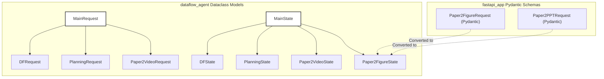
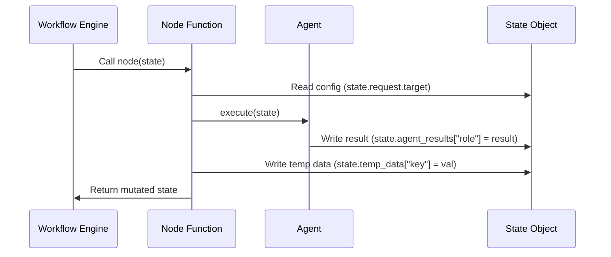

<!-- source: DeepWiki mcp.deepwiki.com · repo OpenDCAI/Paper2Any · page 5.3 State & Request Models · fetched 2026-11-02 -->

# State & Request Models

<details>
<summary>Relevant source files</summary>

The following files were used as context for generating this wiki page:

- [dataflow_agent/agentroles/cores/base_agent.py](dataflow_agent/agentroles/cores/base_agent.py)
- [dataflow_agent/graphbuilder/graph_builder.py](dataflow_agent/graphbuilder/graph_builder.py)
- [dataflow_agent/promptstemplates/prompts_repo.py](dataflow_agent/promptstemplates/prompts_repo.py)
- [dataflow_agent/resources/faiss_cache/all_ops.index.meta](dataflow_agent/resources/faiss_cache/all_ops.index.meta)
- [dataflow_agent/state.py](dataflow_agent/state.py)
- [dataflow_agent/toolkits/multimodaltool/bg_tool.py](dataflow_agent/toolkits/multimodaltool/bg_tool.py)
- [dataflow_agent/toolkits/optool/op_tools.py](dataflow_agent/toolkits/optool/op_tools.py)
- [dataflow_agent/toolkits/pipetool/pipe_tools.py](dataflow_agent/toolkits/pipetool/pipe_tools.py)
- [dataflow_agent/toolkits/resources/ops.json](dataflow_agent/toolkits/resources/ops.json)
- [dataflow_agent/workflow/wf_paper2page_content.py](dataflow_agent/workflow/wf_paper2page_content.py)
- [dataflow_agent/workflow/wf_paper2page_content_for_long_paper.py](dataflow_agent/workflow/wf_paper2page_content_for_long_paper.py)
- [docker-compose.yml](docker-compose.yml)
- [frontend-workflow/Dockerfile](frontend-workflow/Dockerfile)
- [frontend-workflow/src/components/ParticleBackground.tsx](frontend-workflow/src/components/ParticleBackground.tsx)
- [frontend-workflow/src/components/knowledge-base/tools/MermaidPreview.tsx](frontend-workflow/src/components/knowledge-base/tools/MermaidPreview.tsx)
- [frontend-workflow/src/types/index.ts](frontend-workflow/src/types/index.ts)

</details>


## Purpose and Scope

This document describes the state and request model system in the DataFlow-Agent framework, which provides a standardized way to pass data and configuration through multi-agent workflows. The state models define the mutable data structures that flow through workflow nodes, while request models encapsulate immutable user inputs and configuration parameters.

**Sources:** [dataflow_agent/state.py:1-42]()

---

## Architecture Overview

The state management system follows a two-tier hierarchy: **Request objects** contain configuration and inputs, while **State objects** contain both the request and mutable execution results.

### Two-Layer Request Architecture

Paper2Any uses two distinct layers for request handling:

1.  **FastAPI Layer (Pydantic)**: Pydantic models (e.g., `Paper2FigureRequest`, `Paper2PPTRequest`) handle HTTP request validation, serialization, and API documentation.
2.  **Workflow Layer (Dataclass)**: Python `dataclass` models in `dataflow_agent/state.py` provide the request/state objects used within workflow execution.

The service layer (e.g., `Paper2PPTService`) converts between these two representations before triggering a workflow.

### Class Hierarchy



**Sources:** [dataflow_agent/state.py:13-210](), [dataflow_agent/workflow/wf_paper2page_content.py:10-12]()

---

## Core Base Classes

### MainRequest

`MainRequest` is the base class for all request objects, containing core configuration fields that every workflow needs.

| Field | Type | Default | Description |
| :--- | :--- | :--- | :--- |
| `language` | `str` | `"en"` | User's preferred language (`"en"`, `"zh"`, etc.) |
| `chat_api_url` | `str` | `os.getenv("DF_API_URL")` | LLM API endpoint URL |
| `api_key` | `str` | `os.getenv("DF_API_KEY")` | API authentication key |
| `model` | `str` | `"gpt-4o"` | LLM model name |
| `target` | `str` | `""` | User's task description or requirement |

**Sources:** [dataflow_agent/state.py:13-37]()

### MainState

`MainState` is the base class for all state objects, containing the request object and execution-related fields. It integrates with LangGraph for message history management.

| Field | Type | Default | Description |
| :--- | :--- | :--- | :--- |
| `request` | `MainRequest` | `MainRequest()` | Request configuration object |
| `messages` | `Annotated[list[BaseMessage], add_messages]` | `[]` | LangChain message history with automatic merging |
| `agent_results` | `Dict[str, Any]` | `{}` | Results from each agent execution, keyed by agent role |
| `temp_data` | `Dict[str, Any]` | `{}` | Temporary data storage for inter-node communication |

**Sources:** [dataflow_agent/state.py:40-54]()

---

## Specialized State Models

### Pipeline Recommendation (DFState)

Used for the main pipeline discovery and assembly workflow. It tracks matched operators and generated code.

| Field | Type | Description |
| :--- | :--- | :--- |
| `category` | `Dict[str, Any]` | Classification results of the user intent |
| `matched_ops` | `list[str]` | List of operator names found via RAG discovery |
| `pipeline_structure_code` | `Dict[str, Any]` | Generated Python code for the pipeline |
| `execution_result` | `Dict[str, Any]` | Result of running the assembled pipeline |
| `opname_and_params` | `List[Dict]` | Configuration for each operator in the pipeline |

**Sources:** [dataflow_agent/state.py:84-101]()

### Paper2Video State

Used for the paper-to-video pipeline, tracking Beamer code, audio paths, and video segments.

| Field | Type | Description |
| :--- | :--- | :--- |
| `beamer_code_path` | `str` | Path to the generated LaTeX Beamer code |
| `ppt_path` | `str` | Path to the generated PPT/PDF file |
| `speech_save_dir` | `str` | Directory containing generated TTS audio files |
| `talking_video_save_dir`| `str` | Directory containing talking-head video segments |
| `video_path` | `str` | Final composited video path |

**Sources:** [dataflow_agent/state.py:133-168]()

### Planning State

Used for `plan-and-execute` workflows where a high-level agent decomposes a task into steps.

| Field | Type | Description |
| :--- | :--- | :--- |
| `plan` | `List[str]` | List of planned steps as strings |
| `plan_steps` | `List[Dict]` | Detailed steps with status (`pending`, `running`, `completed`) |
| `current_step_index` | `int` | Index of the step currently being executed |
| `past_steps` | `List[tuple]` | History of `(step_description, result)` |
| `plan_approved` | `bool` | Human-in-the-loop approval flag |

**Sources:** [dataflow_agent/state.py:210-234]()

---

## Data Flow in Workflows

Workflows are built using `GenericGraphBuilder`. Data flows through the graph by mutating the state object in each node.

### State Mutation Pattern



**Sources:** [dataflow_agent/graphbuilder/graph_builder.py:117-130](), [dataflow_agent/agentroles/cores/base_agent.py:142-144]()

### Example: Paper2PageContent Workflow
In the `paper2page_content` workflow, the state transitions from raw PDF path to parsed Markdown, and finally to a list of slide contents.

1.  **`_start_`**: Initializes `result_path` and clears dirty fields [dataflow_agent/workflow/wf_paper2page_content.py:93-100]().
2.  **`parse_pdf_pages`**: Calls MinerU, reads the Markdown file, and updates `state.minueru_output` [dataflow_agent/workflow/wf_paper2page_content.py:102-162]().
3.  **`outline_agent`**: Uses `state.minueru_output` to generate slide structures, updating `state.pagecontent` [dataflow_agent/workflow/wf_paper2page_content.py:189-200]().

**Sources:** [dataflow_agent/workflow/wf_paper2page_content.py:53-162]()

---

## Tool-State Interaction

The framework uses `@pre_tool` and `@post_tool` decorators to inject data from the state into agent prompts or process agent outputs back into the state.

| Tool Type | Function | Registration |
| :--- | :--- | :--- |
| **Pre-Tool** | Extracts a specific field from `State` to provide as context for an `Agent` | `builder.pre_tool(tool_name, agent_role)` |
| **Post-Tool**| Processes `Agent` output and updates `State` fields | `builder.post_tool(agent_role)` |

Example of a pre-tool providing Markdown content to the `outline_agent`:
```python
@builder.pre_tool("minueru_output", "outline_agent")
def _get_mineru_markdown(state: Paper2FigureState):
    return state.minueru_output or ""
```

**Sources:** [dataflow_agent/graphbuilder/graph_builder.py:39-55](), [dataflow_agent/workflow/wf_paper2page_content.py:62-64]()

---

## Metadata and Discovery

State models are also used during **Pipeline Assembly**. The `OPERATOR_REGISTRY` and `ops.json` cache metadata about operator parameters, which allows the `PlanningAgent` to correctly wire inputs and outputs between nodes.

| Entity | Role |
| :--- | :--- |
| `OPERATOR_REGISTRY` | Stores all available operators and their classes [dataflow_agent/toolkits/optool/op_tools.py:30]() |
| `_dump_all_ops_to_file` | Inspects operator `__init__` and `run` methods to extract parameter schemas [dataflow_agent/toolkits/optool/op_tools.py:161-193]() |
| `ops.json` | A cached JSON file containing all operator metadata used for RAG-based discovery [dataflow_agent/toolkits/optool/op_tools.py:36]() |

**Sources:** [dataflow_agent/toolkits/optool/op_tools.py:107-193]()

---

