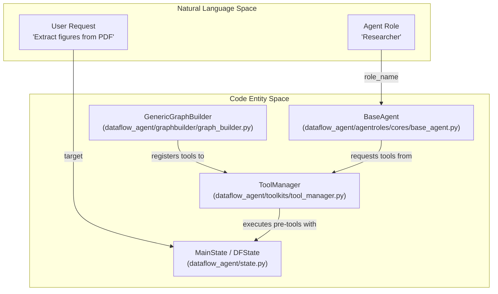
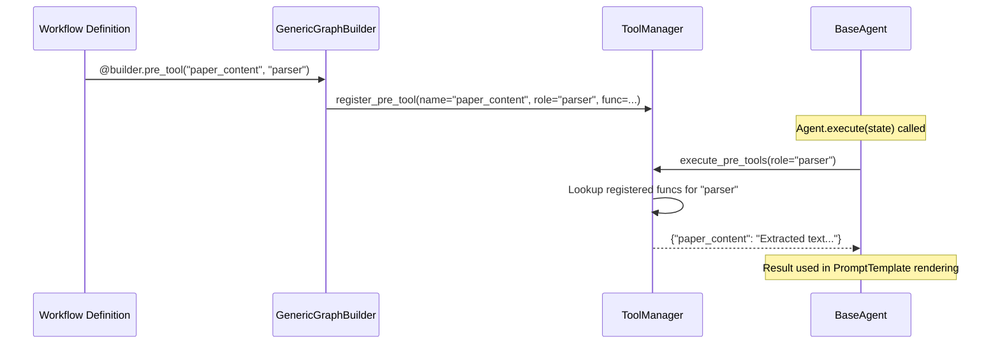

<!-- source: DeepWiki mcp.deepwiki.com · repo OpenDCAI/Paper2Any · page 5.4 Tool System · fetched 2026-11-02 -->

# Tool System

<details>
<summary>Relevant source files</summary>

The following files were used as context for generating this wiki page:

- [dataflow_agent/agentroles/cores/base_agent.py](dataflow_agent/agentroles/cores/base_agent.py)
- [dataflow_agent/graphbuilder/graph_builder.py](dataflow_agent/graphbuilder/graph_builder.py)
- [dataflow_agent/logger.py](dataflow_agent/logger.py)
- [dataflow_agent/promptstemplates/prompts_repo.py](dataflow_agent/promptstemplates/prompts_repo.py)
- [dataflow_agent/resources/faiss_cache/all_ops.index.meta](dataflow_agent/resources/faiss_cache/all_ops.index.meta)
- [dataflow_agent/state.py](dataflow_agent/state.py)
- [dataflow_agent/toolkits/basetool/file_tools.py](dataflow_agent/toolkits/basetool/file_tools.py)
- [dataflow_agent/toolkits/optool/op_tools.py](dataflow_agent/toolkits/optool/op_tools.py)
- [dataflow_agent/toolkits/pipetool/pipe_tools.py](dataflow_agent/toolkits/pipetool/pipe_tools.py)
- [dataflow_agent/toolkits/resources/ops.json](dataflow_agent/toolkits/resources/ops.json)
- [dataflow_agent/toolkits/tool_manager.py](dataflow_agent/toolkits/tool_manager.py)
- [tests/cat_icon.png](tests/cat_icon.png)

</details>


The Tool System in Paper2Any provides a mechanism for injecting contextual data into agent prompts (pre-tools) and exposing callable functions to agents during execution (post-tools). Tools are managed centrally through the `ToolManager` and are bound to agents by their `role_name`.

**Scope**: This page covers tool registration, role-based filtering, the `ToolManager` implementation, and the distinction between pre-tools and post-tools.

---

## Tool System Architecture

The tool system bridges the gap between the static workflow definition and the dynamic execution of agents. It allows developers to define logic that either prepares data for an LLM (Pre-Tools) or allows the LLM to interact back with the system (Post-Tools).

### Logic Flow and Code Entities



**Sources**: [dataflow_agent/toolkits/tool_manager.py:13-20](), [dataflow_agent/graphbuilder/graph_builder.py:10-30](), [dataflow_agent/agentroles/cores/base_agent.py:95-144](), [dataflow_agent/state.py:40-54]()

---

## Pre-Tools: Context Injection

Pre-tools are functions executed *before* an agent's LLM call. Their results are injected as variables into the agent's prompt template. This is the primary way to pass data from the `MainState` or `DFState` into the LLM's context.

### Pre-Tool Registration Flow

Pre-tools are registered using the `@builder.pre_tool(placeholder_name, role_name)` decorator provided by `GenericGraphBuilder`.



**Sources**: [dataflow_agent/graphbuilder/graph_builder.py:39-46](), [dataflow_agent/toolkits/tool_manager.py:22-31](), [dataflow_agent/toolkits/tool_manager.py:58-74]()

### Implementation Detail: Tool Binding
When a node is added to the graph via `GenericGraphBuilder.add_node`, the builder wraps the node function with `_wrap_node_with_tools`. This ensures that every time a node runs, the specific tools for that node's role are dynamically bound to the `ToolManager`.

**Sources**: [dataflow_agent/graphbuilder/graph_builder.py:117-130](), [dataflow_agent/graphbuilder/graph_builder.py:90-115]()

---

## Post-Tools: Agent-Callable Functions

Post-tools are LangChain-compatible `@tool` functions that agents can invoke during execution (primarily in `ReAct` or `Graph` execution strategies).

### LangChain Integration
Post-tools must be decorated with both the workflow builder's `@builder.post_tool(role_name)` and the standard `@tool` decorator.

```python
from langchain_core.tools import tool

@builder.post_tool("researcher")
@tool
def search_papers(query: str):
    """Search for academic papers based on a query string."""
    # Implementation logic
    return "Search results..."
```

### Execution Logic
1. **Registration**: `GenericGraphBuilder` stores the tool in `ToolManager.role_post_tools` under the specified role [dataflow_agent/toolkits/tool_manager.py:33-42]().
2. **Retrieval**: When `BaseAgent` initializes its execution strategy, it calls `ToolManager.get_post_tools(role_name)` [dataflow_agent/toolkits/tool_manager.py:51-56]().
3. **Binding**: The agent binds these tools to the LLM (e.g., using `llm.bind_tools(tools)` in LangChain) [dataflow_agent/agentroles/cores/base_agent.py:181-220]().

---

## ToolManager: Central Registry

The `ToolManager` class is the central authority for tool lifecycle management. It maintains separate registries for global tools and role-specific tools.

### Key Methods and Data Structures

| Method | Description |
| :--- | :--- |
| `register_pre_tool` | Adds a function to `role_pre_tools` or `global_pre_tools`. |
| `register_post_tool` | Adds a `Tool` object to `role_post_tools` or `global_post_tools`. |
| `execute_pre_tools` | An `async` method that runs all pre-tools for a role and returns a dictionary of results. |
| `get_post_tools` | Returns a combined list of global and role-specific post-tools. |
| `register_agent_as_tool` | Wraps a `BaseAgent` instance as a `Tool` and registers it as a post-tool. |

**Sources**: [dataflow_agent/toolkits/tool_manager.py:13-111]()

### Agent-as-Tool Pattern
A powerful feature of the system is the ability to treat an entire Agent as a tool for another Agent. This is handled by `register_agent_as_tool`, which converts an agent's `execute` logic into a callable tool interface.

**Sources**: [dataflow_agent/toolkits/tool_manager.py:83-95](), [dataflow_agent/agentroles/cores/base_agent.py:108-113]()

---

## Built-in Toolkits

The system includes several pre-defined toolkits used across various workflows:

### 1. Operator Discovery (op_tools.py)
Used by the Pipeline Recommendation system to find and describe available data processing operators.
- `_dump_all_ops_to_file()`: Scans the `OPERATOR_REGISTRY` and generates a `ops.json` metadata file [dataflow_agent/toolkits/optool/op_tools.py:161-193]().
- `get_operator_content(data_type)`: Retrieves JSON descriptions of operators for a specific category [dataflow_agent/toolkits/optool/op_tools.py:212-231]().

### 2. Pipeline Assembly (pipe_tools.py)
Tools for generating executable Python code from a high-level pipeline plan.
- `choose_prompt_template_by_llm`: Uses an LLM to select the best `prompt_template` from an operator's `ALLOWED_PROMPTS` list [dataflow_agent/toolkits/pipetool/pipe_tools.py:148-180]().

### 3. File Operations (file_tools.py)
Provides utilities for sampling and inspecting data files.
- `local_tool_for_sample`: Samples and classifies data from storage (e.g., `SampleFileStorage`) [dataflow_agent/toolkits/basetool/file_tools.py:30-155]().
- `change_pycode_lines`: Utility to programmatically modify lines in a Python file, often used by the Debugger Agent [dataflow_agent/toolkits/basetool/file_tools.py:182-220]().

---

## Best Practices for Tool Definition

1. **Role Naming**: Ensure the `role` parameter in `@builder.pre_tool` or `@builder.post_tool` matches the `role_name` property of the agent exactly [dataflow_agent/graphbuilder/graph_builder.py:57-60]().
2. **Type Hints**: Use `DFState` or specific state subclasses in pre-tool arguments to enable IDE autocompletion [dataflow_agent/state.py:84-101]().
3. **Tool Docstrings**: For post-tools, write clear, descriptive docstrings. The LLM uses these to determine when and how to call the tool [dataflow_agent/toolkits/optool/op_tools.py:138-139]().
4. **Error Handling**: `ToolManager.execute_pre_tools` catches exceptions and logs errors to prevent a single tool failure from crashing the entire workflow [dataflow_agent/toolkits/tool_manager.py:70-72]().

**Sources**: [dataflow_agent/logger.py:73-81](), [dataflow_agent/toolkits/tool_manager.py:58-74]()

---

