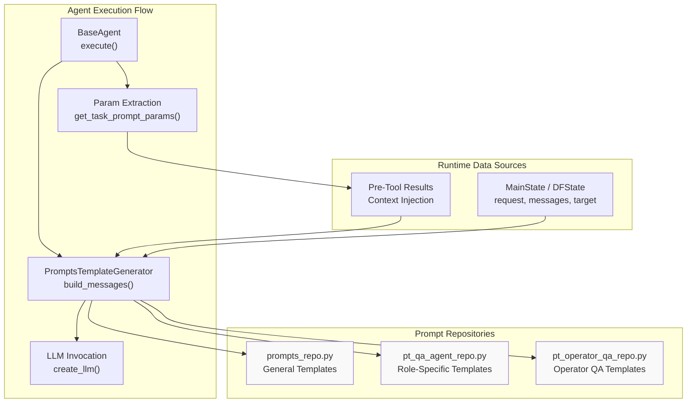
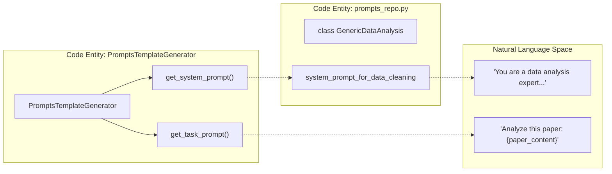
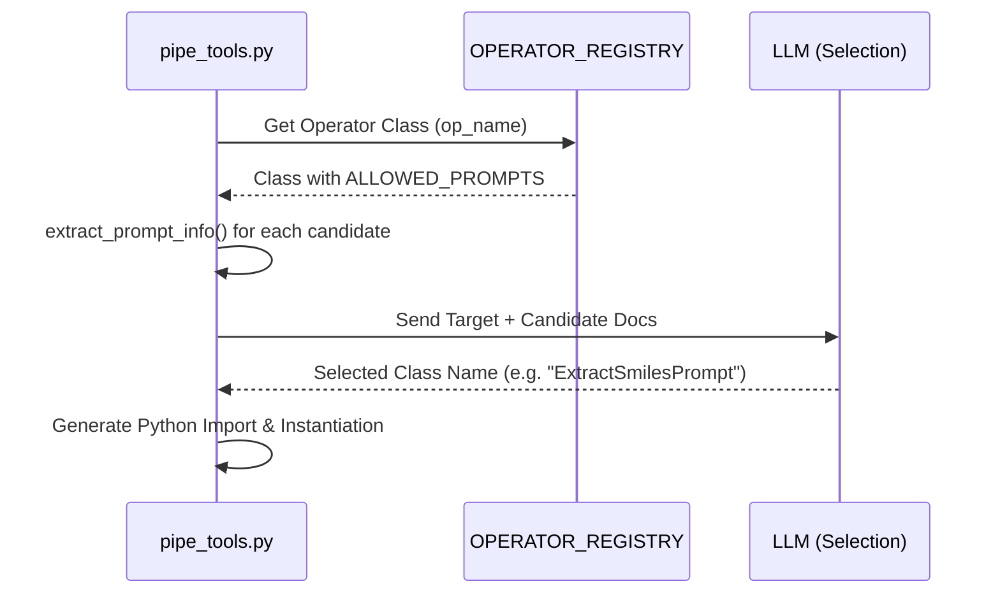

<!-- source: DeepWiki mcp.deepwiki.com · repo OpenDCAI/Paper2Any · page 5.6 Prompt Templates · fetched 2026-11-02 -->

# Prompt Templates

<details>
<summary>Relevant source files</summary>

The following files were used as context for generating this wiki page:

- [dataflow_agent/agentroles/cores/base_agent.py](dataflow_agent/agentroles/cores/base_agent.py)
- [dataflow_agent/agentroles/paper2any_agents/outline_refine_agent.py](dataflow_agent/agentroles/paper2any_agents/outline_refine_agent.py)
- [dataflow_agent/agentroles/paper2any_agents/qa_agent.py](dataflow_agent/agentroles/paper2any_agents/qa_agent.py)
- [dataflow_agent/agentroles/paper2any_agents/table_extractor_agent.py](dataflow_agent/agentroles/paper2any_agents/table_extractor_agent.py)
- [dataflow_agent/graphbuilder/graph_builder.py](dataflow_agent/graphbuilder/graph_builder.py)
- [dataflow_agent/promptstemplates/prompts_repo.py](dataflow_agent/promptstemplates/prompts_repo.py)
- [dataflow_agent/promptstemplates/resources/pt_operator_qa_repo.py](dataflow_agent/promptstemplates/resources/pt_operator_qa_repo.py)
- [dataflow_agent/promptstemplates/resources/pt_qa_agent_repo.py](dataflow_agent/promptstemplates/resources/pt_qa_agent_repo.py)
- [dataflow_agent/resources/faiss_cache/all_ops.index.meta](dataflow_agent/resources/faiss_cache/all_ops.index.meta)
- [dataflow_agent/state.py](dataflow_agent/state.py)
- [dataflow_agent/toolkits/optool/op_tools.py](dataflow_agent/toolkits/optool/op_tools.py)
- [dataflow_agent/toolkits/pipetool/pipe_tools.py](dataflow_agent/toolkits/pipetool/pipe_tools.py)
- [dataflow_agent/toolkits/resources/ops.json](dataflow_agent/toolkits/resources/ops.json)

</details>


This document describes the prompt template system in Paper2Any (DataFlow-Agent), which provides a centralized, reusable mechanism for constructing LLM prompts. Prompt templates use dynamic string formatting and Jinja2-style syntax to combine static instructions with runtime data injected by agents and pre-tools.

**Scope**: This page covers the structure, organization, and usage of prompt templates. For information about how agents execute with these prompts, see [Agents](5.2). For information about how pre-tools inject data into templates, see [Tool System](5.4).

---

## Prompt Template Architecture

Prompt templates are organized as Python classes containing string-based templates. These templates are rendered at runtime using data from the `MainState` or pre-tool results to construct complete LLM messages.

### System Overview



**Sources**: [dataflow_agent/agentroles/cores/base_agent.py:59-65](), [dataflow_agent/promptstemplates/prompts_repo.py:1-50](), [dataflow_agent/agentroles/paper2any_agents/table_extractor_agent.py:56-69]()

---

## Template Structure

Each prompt template class contains two primary types of prompts that form the context for the LLM:

### 1. System Prompt
Defines the agent's identity (`[ROLE]`), core capabilities, and strict behavioral constraints (e.g., "Return ONLY JSON"). It sets the persona for the entire conversation.

### 2. Task Prompt
Defines the specific action to be performed. It includes placeholders (e.g., `{target}`, `{minueru_output}`) that are populated at runtime with data from the current workflow state.



**Sources**: [dataflow_agent/promptstemplates/prompts_repo.py:4-37](), [dataflow_agent/agentroles/cores/base_agent.py:110-115]()

---

## Prompt Repository Organization

Templates are distributed across several files to maintain modularity based on the workflow or agent role:

| File Path | Primary Purpose | Key Classes |
|-----------|-----------------|-------------|
| `prompts_repo.py` | Core pipeline and data processing prompts | `TargetParsing`, `RecommendationInferencePipeline`, `Executioner` |
| `pt_operator_qa_repo.py` | Support for operator discovery and documentation | `OperatorQAPrompts` |
| `pt_qa_agent_repo.py` | General Q&A and paper analysis support | `QaAgentPrompts` |

### Key Template Classes in `prompts_repo.py`

| Class Name | Purpose | Key Prompts |
|-----------|---------|-------------|
| `TargetParsing` | Decomposes user intent into operator descriptions | `system_prompt_for_target_parsing` |
| `RecommendationInferencePipeline` | Assembles a data processing pipeline from available operators | `task_prompt_for_recommendation_inference_pipeline` |
| `GenericDataAnalysis` | General data cleaning and structuring | `system_prompt_for_data_cleaning_and_analysis` |
| `KnowledgeBaseSummary` | Summarizing large sets of knowledge base documents | `system_prompt_for_KBSummary` |

**Sources**: [dataflow_agent/promptstemplates/prompts_repo.py:4-123](), [dataflow_agent/promptstemplates/resources/pt_operator_qa_repo.py:11-21]()

---

## Agent-Template Binding

Agents declare their associated templates via property overrides. The `BaseAgent` uses these names to look up the actual strings in the repository.

### Implementation Pattern
Concrete agents like `TableExtractor` or `OutlineRefineAgent` implement the following properties:

```python
@register("table_extractor")
class TableExtractor(BaseAgent):
    @property
    def system_prompt_template_name(self) -> str:
        return "system_prompt_for_table_extractor"

    @property
    def task_prompt_template_name(self) -> str:
        return "task_prompt_for_table_extractor"

    def get_task_prompt_params(self, pre_tool_results: Dict[str, Any]) -> Dict[str, Any]:
        # Maps state data to template placeholders
        return {
            'minueru_output': self.state.minueru_output,
            'table_num': self.state.asset_ref,
        }
```

**Sources**: [dataflow_agent/agentroles/paper2any_agents/table_extractor_agent.py:41-69](), [dataflow_agent/agentroles/paper2any_agents/outline_refine_agent.py:33-48]()

---

## Dynamic Prompt Generation & Pipeline Assembly

The system includes advanced logic for selecting prompts dynamically, particularly during the automated pipeline generation phase.

### LLM-Based Template Selection
The `choose_prompt_template_by_llm` function allows the system to pick the best prompt template from a list of candidates (`ALLOWED_PROMPTS`) defined on an operator.

1.  **Extract Info**: It calls `extract_prompt_info` to get docstrings and examples for all candidate templates [dataflow_agent/toolkits/pipetool/pipe_tools.py:93-145]().
2.  **LLM Decision**: It sends the user's `target` and the candidate descriptions to an LLM to decide which template fits best [dataflow_agent/toolkits/pipetool/pipe_tools.py:188-200]().
3.  **Result**: Returns the class name of the chosen template to be instantiated in the generated Python code [dataflow_agent/toolkits/pipetool/pipe_tools.py:175-180]().



**Sources**: [dataflow_agent/toolkits/pipetool/pipe_tools.py:148-200](), [dataflow_agent/toolkits/pipetool/pipe_tools.py:1-25]()

---

## Common Prompt Patterns

### 1. JSON Enforcement
Templates strictly enforce JSON output to ensure the `BaseParser` can convert LLM strings back into Python dictionaries for state updates.

```python
# From GenericDataAnalysis
system_prompt_for_data_cleaning_and_analysis = """
[ROLE] 数据清洗与分析专家
职责：
1. 严格遵循JSON格式规范
2. 保持历史数据结构一致性
3. 禁止任何形式的注释或解释性文字
"""
```
**Sources**: [dataflow_agent/promptstemplates/prompts_repo.py:4-18]()

### 2. Operator Discovery (RAG)
The `OperatorQAPrompts` are designed to work with tools like `search_operators` to help users find capabilities within the `OPERATOR_REGISTRY`.

```python
# From OperatorQAPrompts
system_prompt_for_operator_qa = """
[能力]
1. 根据用户描述的需求，推荐合适的算子
2. 解释算子的功能、用途和使用场景
...
[可用工具]
1. search_operators(query, top_k)
2. get_operator_info(operator_name)
"""
```
**Sources**: [dataflow_agent/promptstemplates/resources/pt_operator_qa_repo.py:23-50]()

---

## Summary of Data Flow

1.  **Workflow Start**: A user request arrives in `MainRequest` [dataflow_agent/state.py:13-31]().
2.  **Agent Selection**: The workflow identifies an agent (e.g., `TargetParsing`).
3.  **Param Gathering**: `get_task_prompt_params` collects data from `state` and `pre_tools` [dataflow_agent/agentroles/paper2any_agents/table_extractor_agent.py:56-69]().
4.  **Formatting**: The `PromptsTemplateGenerator` retrieves strings from `prompts_repo.py` and uses `.format(**params)` to inject data [dataflow_agent/agentroles/cores/base_agent.py:59-65]().
5.  **Execution**: The final `SystemMessage` and `HumanMessage` are sent to the LLM [dataflow_agent/agentroles/cores/base_agent.py:48-50]().

**Sources**: [dataflow_agent/state.py:13-31](), [dataflow_agent/agentroles/cores/base_agent.py:59-65](), [dataflow_agent/promptstemplates/prompts_repo.py:1-100]()

---

