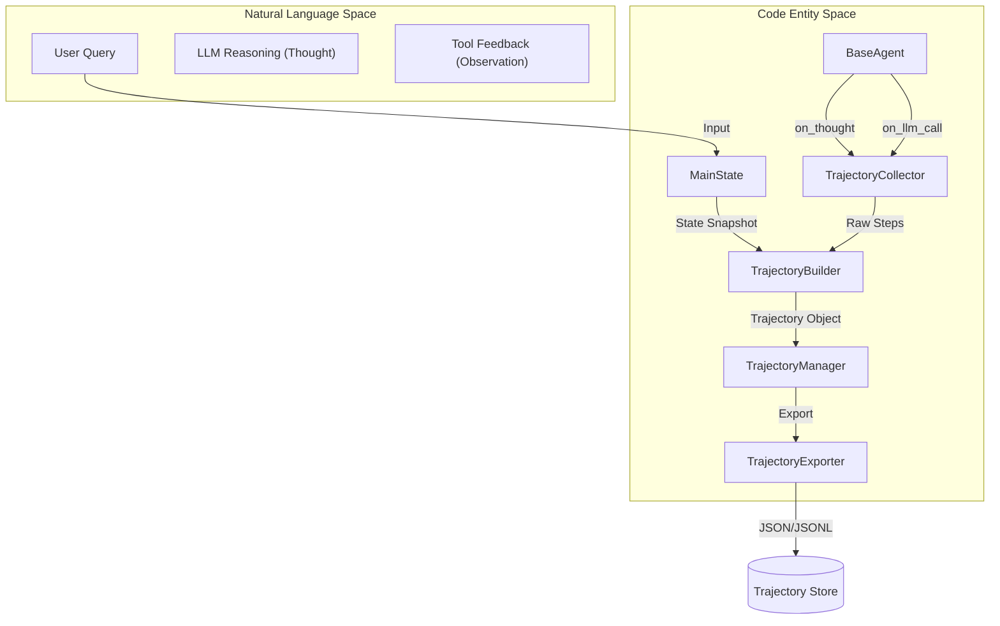
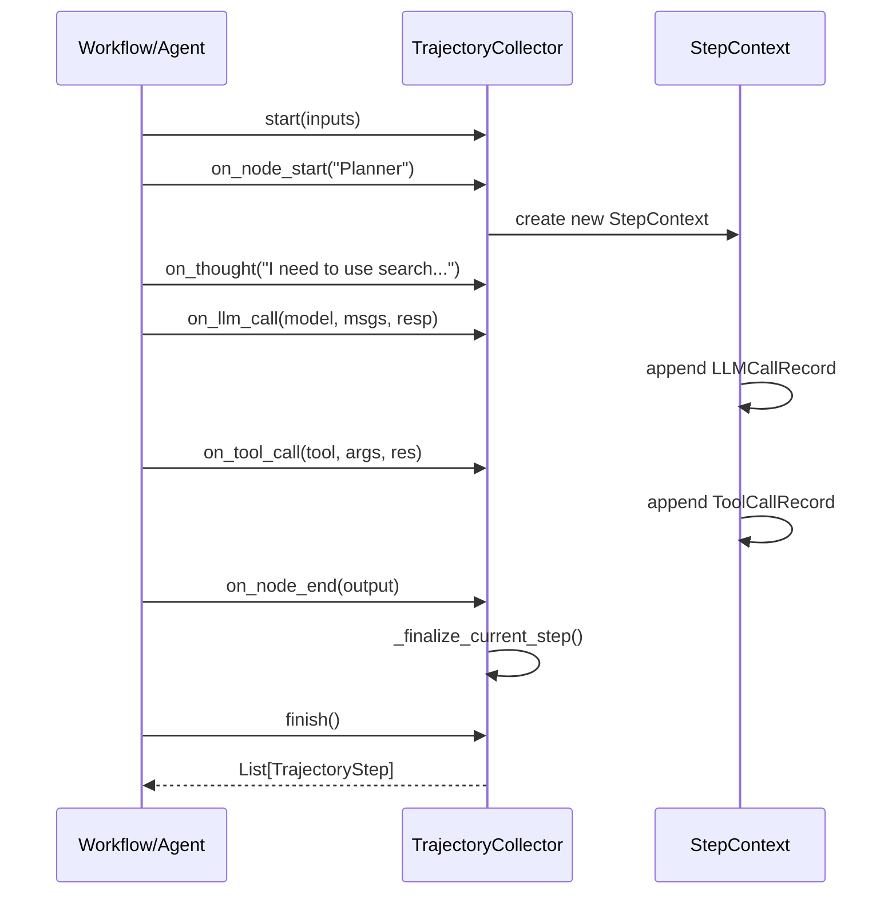

<!-- source: DeepWiki mcp.deepwiki.com · repo OpenDCAI/Paper2Any · page 5.7 Trajectory & Execution Tracing · fetched 2026-11-02 -->

# Trajectory & Execution Tracing

<details>
<summary>Relevant source files</summary>

The following files were used as context for generating this wiki page:

- [dataflow_agent/logger.py](dataflow_agent/logger.py)
- [dataflow_agent/toolkits/basetool/file_tools.py](dataflow_agent/toolkits/basetool/file_tools.py)
- [dataflow_agent/toolkits/tool_manager.py](dataflow_agent/toolkits/tool_manager.py)
- [dataflow_agent/trajectory/__init__.py](dataflow_agent/trajectory/__init__.py)
- [dataflow_agent/trajectory/builder.py](dataflow_agent/trajectory/builder.py)
- [dataflow_agent/trajectory/collector.py](dataflow_agent/trajectory/collector.py)
- [dataflow_agent/trajectory/exporter.py](dataflow_agent/trajectory/exporter.py)
- [dataflow_agent/trajectory/manager.py](dataflow_agent/trajectory/manager.py)
- [dataflow_agent/trajectory/models.py](dataflow_agent/trajectory/models.py)
- [frontend-workflow/README.md](frontend-workflow/README.md)
- [tests/cat_icon.png](tests/cat_icon.png)

</details>


The Trajectory subsystem in Paper2Any provides a comprehensive framework for capturing, structuring, and exporting the execution history of agents and workflows. It enables deep observability into the decision-making process of LLMs, tool interactions, and state transitions, facilitating debugging, performance analysis, and the generation of datasets for Supervised Fine-Tuning (SFT) or Direct Preference Optimization (DPO).

## 1. Overview and Architecture

The trajectory system is designed to handle different execution paradigms, primarily the **ReAct** (Reasoning and Acting) loop used by agents and the **Workflow** (Graph-based) execution used by the overall system orchestration.

### Execution Tracing Data Flow
The following diagram illustrates how execution data flows from active components into the trajectory storage.

**Diagram: Execution Data Flow**

Sources: [dataflow_agent/trajectory/manager.py:23-47](), [dataflow_agent/trajectory/collector.py:49-59](), [dataflow_agent/trajectory/builder.py:26-32]()

## 2. Core Data Models

The system defines a standardized hierarchy of data classes to represent the execution trace.

### TrajectoryStep
The `TrajectoryStep` is the fundamental unit of a trace, representing a single node execution or a single turn in an agent loop [dataflow_agent/trajectory/models.py:75-89]().

| Field | Type | Description |
| :--- | :--- | :--- |
| `step_index` | `int` | Sequential index of the step [dataflow_agent/trajectory/models.py:90]() |
| `node_name` | `str` | Name of the workflow node or agent role [dataflow_agent/trajectory/models.py:91]() |
| `role` | `StepRole` | Type of entity: `agent`, `tool`, `system_node`, etc. [dataflow_agent/trajectory/models.py:92]() |
| `thought` | `Optional[str]` | LLM's internal reasoning (ReAct mode) [dataflow_agent/trajectory/models.py:99]() |
| `llm_calls` | `List[LLMCallRecord]` | Detailed logs of LLM interactions within this step [dataflow_agent/trajectory/models.py:108]() |
| `tool_calls` | `List[ToolCallRecord]` | Detailed logs of tool executions within this step [dataflow_agent/trajectory/models.py:109]() |

### TrajectoryMode
The system automatically detects or assigns a mode to the trajectory [dataflow_agent/trajectory/models.py:16-20]():
*   **REACT**: Focuses on the Thought -> Action -> Observation loop.
*   **WORKFLOW**: Focuses on State_In -> Processing -> State_Update transitions.
*   **HYBRID**: Combines both for complex multi-agent graphs.

### Call Records
*   **LLMCallRecord**: Captures the model name, input messages, output response, duration, and token usage [dataflow_agent/trajectory/models.py:53-62]().
*   **ToolCallRecord**: Captures the tool name, arguments passed, the returned result, and any error messages [dataflow_agent/trajectory/models.py:42-50]().

Sources: [dataflow_agent/trajectory/models.py:9-122]()

## 3. The Collection Mechanism

Execution tracing is performed by the `TrajectoryCollector`, which uses a hook-based mechanism to record events in real-time.

### Collector Lifecycle
1.  **Start**: `collector.start(inputs)` initializes the sequence [dataflow_agent/trajectory/collector.py:74-90]().
2.  **Node Entry**: `on_node_start()` is called when a workflow node or agent begins execution [dataflow_agent/trajectory/collector.py:111-139]().
3.  **Events**: During execution, `on_llm_call()`, `on_tool_call()`, and `on_thought()` are invoked to populate the current step [dataflow_agent/trajectory/collector.py:163-241]().
4.  **Node Exit**: `on_node_end()` finalizes the current step data [dataflow_agent/trajectory/collector.py:141-161]().
5.  **Finish**: `collector.finish()` returns the list of all captured `TrajectoryStep` objects [dataflow_agent/trajectory/collector.py:92-109]().

**Diagram: Trajectory Capture Sequence**

Sources: [dataflow_agent/trajectory/collector.py:29-241]()

## 4. Trajectory Management & Export

The `TrajectoryManager` acts as the high-level API for the entire subsystem, coordinating the collector, builder, and exporter [dataflow_agent/trajectory/manager.py:23-47]().

### TrajectoryBuilder
The `TrajectoryBuilder` transforms raw collected steps and the final `MainState` into a structured `Trajectory` object [dataflow_agent/trajectory/builder.py:37-55](). It performs:
*   **Mode Detection**: Analyzes steps for `thought` or `observation` fields to distinguish between ReAct and Workflow modes [dataflow_agent/trajectory/builder.py:149-174]().
*   **Input Extraction**: Pulls query data from `state.request` [dataflow_agent/trajectory/builder.py:185-222]().
*   **Statistics Calculation**: Sums durations and token counts across all steps [dataflow_agent/trajectory/builder.py:76-79]().

### TrajectoryExporter
The `TrajectoryExporter` persists the data to disk [dataflow_agent/trajectory/exporter.py:27-32]().
*   **JSON**: Full trace export for debugging [dataflow_agent/trajectory/exporter.py:43-78]().
*   **JSONL**: Batch export for large-scale analysis [dataflow_agent/trajectory/exporter.py:80-129]().
*   **SFT/DPO Formats**: Converts trajectories into instruction-tuning formats (e.g., ShareGPT or pair-wise comparisons) for model training [dataflow_agent/trajectory/exporter.py:131-211]().

### Usage Example
```python
trj_manager = get_trajectory_manager()
trj_manager.start_recording(inputs={"query": user_query})

# ... Workflow Execution ...

trajectory = trj_manager.stop_recording(
    state=final_state, 
    workflow_name="paper2figure"
)
trj_manager.export(trajectory, format="json")
```
Sources: [dataflow_agent/trajectory/manager.py:63-146](), [dataflow_agent/trajectory/builder.py:37-104]()

## 5. Debugging and Observability

The system integrates with the global logger defined in `dataflow_agent/logger.py` to provide real-time feedback during collection. The `TrajectoryCollector` logs node transitions at the `DEBUG` level and completion at the `INFO` level [dataflow_agent/trajectory/collector.py:139, 161, 106]().

Traces are stored by default in the `outputs/trajectories/` directory relative to the project root [dataflow_agent/trajectory/exporter.py:23-25](). Each trace is assigned a unique `trace_id` using a UUID-based generator [dataflow_agent/trajectory/models.py:255-259]().

Sources: [dataflow_agent/logger.py:73-81](), [dataflow_agent/trajectory/exporter.py:34-41]()

---

