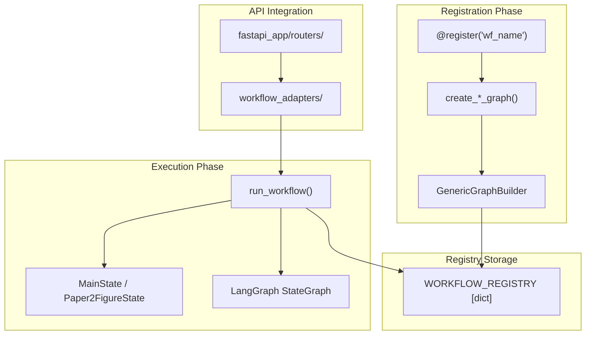
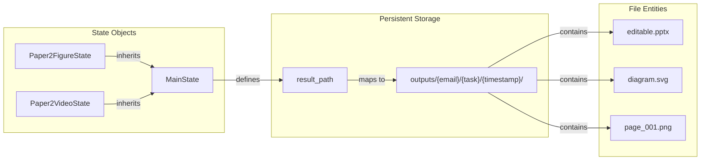

<!-- source: DeepWiki mcp.deepwiki.com · repo OpenDCAI/Paper2Any · page 6 Paper2Any Workflows · fetched 2026-11-02 -->

# Paper2Any Workflows

Relevant source files

The following files were used as context for generating this wiki page:

- [README.md](README.md)
- [README_CN.md](README_CN.md)
- [frontend-workflow/src/App.tsx](frontend-workflow/src/App.tsx)
- [frontend-workflow/src/components/AppSidebar.tsx](frontend-workflow/src/components/AppSidebar.tsx)
- [frontend-workflow/src/components/HomePage.tsx](frontend-workflow/src/components/HomePage.tsx)
- [frontend-workflow/src/config/homePageCatalog.ts](frontend-workflow/src/config/homePageCatalog.ts)
- [frontend-workflow/src/locales/en/common.json](frontend-workflow/src/locales/en/common.json)
- [frontend-workflow/src/locales/zh/common.json](frontend-workflow/src/locales/zh/common.json)
- [static/new_readme/paper2citation/citation-explorer.png](static/new_readme/paper2citation/citation-explorer.png)
- [static/new_readme/paper2video/demo.gif](static/new_readme/paper2video/demo.gif)

## Overview

Paper2Any workflows are specialized document transformation pipelines built on the **DataFlow-Agent** framework. They convert academic papers, PDFs, and images into multimodal formats including editable presentations, scientific figures, videos, and posters through multi-agent orchestration, computer vision models, and LLM-powered content generation.

Each workflow is registered via the `@register` decorator and executes as a state machine with conditional routing. This page provides a high-level overview of the major conversion paths and links to detailed child pages for each.

---

## Workflow Registration and Execution

All Paper2Any workflows follow a common registration pattern using the `@register` decorator from `dataflow_agent.workflow.registry`. This enables dynamic workflow discovery and execution through the `run_workflow` function.

### Code Entity Space: Registration Flow
The following diagram bridges the natural language "Workflow Execution" to the specific code entities involved in the process.

**Sources:** [dataflow_agent/workflow/registry.py:1-50](), [dataflow_agent/workflow/wf_paper2figure_with_sam.py:94-100]()

---

## Core Document Conversion Workflows

### 📊 Paper2Figure Workflow
The Paper2Figure workflow generates scientific diagrams (model architectures, technical routes, and experimental plots) using a **Generate-Deconstruct-Reconstruct** pattern. It uses SAM (Segment Anything Model) for layout extraction and MinerU for content parsing to produce editable PPTX files.
*   **Key Stages:** Idea Extraction → Figure Description → Dual-Image Generation → SAM Segmentation → PPT Assembly.
*   **For details, see [Paper2Figure Workflow](#6.1).**

### 🎬 Paper2PPT Workflow
This workflow converts papers, raw text, or topics into full presentation decks. It features a unique **frontend self-healing loop** where users can edit outlines and refine individual slides before final compilation.
*   **Key Stages:** PDF Parsing (MinerU) → Outline Generation → Parallel Slide Generation → Style Anchoring → Final PPTX.
*   **For details, see [Paper2PPT Workflow](#6.2).**

### 🖼️ PDF2PPT Workflow
Unlike the generative Paper2PPT, this workflow focuses on **layout-preserving conversion**. It uses VLM recognition (QwenVL) and intelligent cutouts to transform static PDFs back into editable PPTX slides while maintaining the original design.
*   **For details, see [PDF2PPT Workflow](#6.3).**

### 🎨 PPT Polish Workflow
The beautification pipeline allows users to upload existing decks and apply styles (Modern, Business, Academic, Creative). It uses reference images for style transfer and supports slide-by-slide editing.
*   **For details, see [PPT Polish Workflow](#6.4).**

---

## Specialized Output Workflows

### 🗺️ Technical Route & Roadmap
Generates structured SVG technical roadmaps. It handles CJK font injection for Chinese character support and provides multiple color palettes (e.g., `academic_blue`).
*   **For details, see [Technical Route Diagrams](#6.5).**

### 🎥 Paper2Video Workflow
An end-to-end pipeline that turns papers into narrated videos. It generates Beamer LaTeX slides, synthesizes speech via TTS (CosyVoice/OpenAI), and can integrate talking-head avatars (LivePortrait).
*   **For details, see [Paper2Video Workflow](#6.6).**

### 🧩 Paper2Drawio & Image2Drawio
Converts paper content or screenshots into editable **Draw.io XML**. It utilizes SAM3-based segmentation to extract diagram components and integrates an inline iframe editor.
*   **For details, see [Paper2Drawio & Image2Drawio Workflows](#6.7).**

### 🖼️ Paper2Poster Workflow
A multi-agent pipeline (Parser → Curator → Layout Optimizer) that transforms paper PDFs into academic posters with configurable sections and branding.
*   **For details, see [Paper2Poster Workflow](#6.8).**

### 📝 Paper2Rebuttal & Paper2Citation
Specialized academic utility workflows for drafting structured peer-review rebuttals and exploring citation networks via DOI or author search.
*   **For details, see [Paper2Rebuttal & Paper2Citation Workflows](#6.9).**

---

## State and Result Management

All workflows share a common state management pattern using a `result_path` to persist outputs across API calls.

### Code Entity Space: State Management
This diagram shows how data flows through the system's state objects and directory structure.

**Sources:** [dataflow_agent/workflow/wf_paper2figure_with_sam.py:72-88](), [fastapi_app/routers/paper2ppt.py:26-34]()

---

## Sources
- [README.md:102-120]() (Feature list)
- [frontend-workflow/src/App.tsx:29-49]() (Page IDs and routes)
- [frontend-workflow/src/locales/en/common.json:11-58]() (Workflow descriptions)
- [frontend-workflow/src/config/homePageCatalog.ts:60-110]() (Featured workflow metadata)
- [dataflow_agent/workflow/registry.py]() (Workflow registration logic)

---

