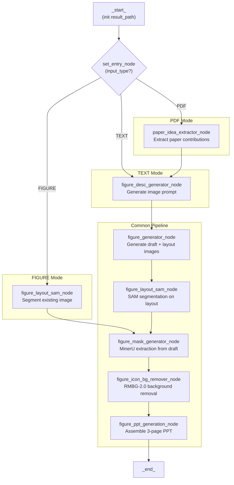
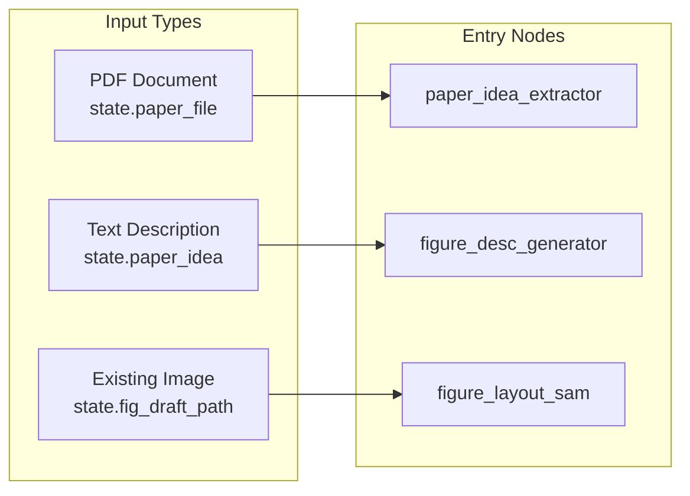

<!-- source: DeepWiki mcp.deepwiki.com · repo OpenDCAI/Paper2Any · page 6.1 Paper2Figure Workflow · fetched 2026-11-02 -->

# Paper2Figure Workflow

<details>
<summary>Relevant source files</summary>

The following files were used as context for generating this wiki page:

- [dataflow_agent/agentroles/paper2any_agents/chart_code_generator.py](dataflow_agent/agentroles/paper2any_agents/chart_code_generator.py)
- [dataflow_agent/agentroles/paper2any_agents/chart_type_recommender.py](dataflow_agent/agentroles/paper2any_agents/chart_type_recommender.py)
- [dataflow_agent/agentroles/paper2any_agents/fig_desc_generator.py](dataflow_agent/agentroles/paper2any_agents/fig_desc_generator.py)
- [dataflow_agent/agentroles/paper2any_agents/paper_idea_extractor.py](dataflow_agent/agentroles/paper2any_agents/paper_idea_extractor.py)
- [dataflow_agent/agentroles/paper2any_agents/technical_route_desc_generator_agent.py](dataflow_agent/agentroles/paper2any_agents/technical_route_desc_generator_agent.py)
- [dataflow_agent/llm_callers/image.py](dataflow_agent/llm_callers/image.py)
- [dataflow_agent/promptstemplates/resources/pt_technical_route_desc_generator_repo.py](dataflow_agent/promptstemplates/resources/pt_technical_route_desc_generator_repo.py)
- [dataflow_agent/workflow/wf_paper2expfigure.py](dataflow_agent/workflow/wf_paper2expfigure.py)
- [dataflow_agent/workflow/wf_paper2figure_image_only.py](dataflow_agent/workflow/wf_paper2figure_image_only.py)
- [dataflow_agent/workflow/wf_paper2figure_with_sam.py](dataflow_agent/workflow/wf_paper2figure_with_sam.py)
- [dataflow_agent/workflow/wf_paper2technical.py](dataflow_agent/workflow/wf_paper2technical.py)
- [fastapi_app/.env.example](fastapi_app/.env.example)
- [fastapi_app/config/settings.py](fastapi_app/config/settings.py)
- [fastapi_app/services/image2ppt_service.py](fastapi_app/services/image2ppt_service.py)
- [fastapi_app/services/paper2any_service.py](fastapi_app/services/paper2any_service.py)
- [fastapi_app/workflow_adapters/wa_paper2figure.py](fastapi_app/workflow_adapters/wa_paper2figure.py)
- [fastapi_app/workflow_adapters/wa_pdf2ppt.py](fastapi_app/workflow_adapters/wa_pdf2ppt.py)
- [frontend-workflow/src/components/Image2DrawioPage.tsx](frontend-workflow/src/components/Image2DrawioPage.tsx)
- [frontend-workflow/src/components/Image2PptPage.tsx](frontend-workflow/src/components/Image2PptPage.tsx)
- [frontend-workflow/src/components/paper2graph/index.tsx](frontend-workflow/src/components/paper2graph/index.tsx)
- [frontend-workflow/src/components/paper2rebuttal/index.tsx](frontend-workflow/src/components/paper2rebuttal/index.tsx)

</details>


## Purpose and Scope

The Paper2Figure workflow transforms research papers or text descriptions into professional scientific diagrams, packaged as editable PowerPoint presentations. This document covers the complete pipeline from input processing through dual-image generation, layout segmentation, element extraction, and final PPT assembly.

For technical route diagram generation (SVG-based workflow graphs), see [Technical Route Diagrams](6.5). For general Paper2PPT presentation generation, see [Paper2PPT Workflow](6.2).

**Sources:** [dataflow_agent/workflow/wf_paper2figure_with_sam.py:1-92]()

---

## Overview

The Paper2Figure workflow implements a multi-stage pipeline that separates structural layout from content elements using a dual-image strategy:

| Stage | Purpose | Key Technologies |
|-------|---------|------------------|
| **Idea Extraction** | Extract core contributions from PDF papers | MinerU PDF parsing, LLM analysis |
| **Description Generation** | Generate image prompts from research concepts | LLM with graph-specific prompts |
| **Dual-Image Generation** | Create draft image (with content) and layout template (empty boxes) | Text-to-image API with edit capability |
| **Layout Segmentation** | Segment layout template into structural boxes | SAM (Segment Anything Model) |
| **Content Extraction** | Extract text and icons from draft image | MinerU recursive layout analysis |
| **Background Removal** | Remove backgrounds from icon images | RMBG-2.0 model |
| **PPT Assembly** | Combine layout boxes and content into editable PPT | `python-pptx` with EMF vector support |

**Sources:** [dataflow_agent/workflow/wf_paper2figure_with_sam.py:105-866]()

---

## Workflow Architecture



**Workflow Registration:**
- Factory function: `create_p2fig_graph()` decorated with `@register("paper2fig_with_sam")` [dataflow_agent/workflow/wf_paper2figure_with_sam.py:98-103]()
- Entry point: `_start_` node executes `_init_result_path()` to ensure consistent output directory [dataflow_agent/workflow/wf_paper2figure_with_sam.py:885-892]()
- Conditional routing: `set_entry_node()` function inspects `state.request.input_type` [dataflow_agent/workflow/wf_paper2figure_with_sam.py:871-883]()

**Sources:** [dataflow_agent/workflow/wf_paper2figure_with_sam.py:98-920]()

---

## Input Types and Entry Points

The workflow supports three input modes, each entering the pipeline at a different stage:



### Routing Logic

The `set_entry_node()` function determines the starting node based on `state.request.input_type`:

```python
def set_entry_node(state: Paper2FigureState) -> str:
    if state.request.input_type == "PDF":
        return "paper_idea_extractor"
    elif state.request.input_type == "TEXT":
        return "figure_desc_generator"
    elif state.request.input_type == "FIGURE":
        return "figure_layout_sam"
    else:
        log.error(f"Invalid input type: {state.request.input_type}")
        return "_end_"
```

**State Fields:**
- `state.request.input_type`: `Literal["PDF", "TEXT", "FIGURE"]` [frontend-workflow/src/components/paper2graph/types.ts:21-27]()
- `state.request.input_content`: Path (for PDF/FIGURE) or text content (for TEXT) [fastapi_app/schemas.py:118-119]()
- `state.result_path`: Unified output directory, initialized in `_ensure_result_path()` [dataflow_agent/workflow/wf_paper2figure_with_sam.py:76-92]()

**Sources:** [dataflow_agent/workflow/wf_paper2figure_with_sam.py:871-883](), [fastapi_app/schemas.py:102-113]()

---

## Stage 1: Idea Extraction (PDF Mode)

### paper_idea_extractor_node

Extracts core contributions and key concepts from the first 10 pages of a research paper using a combination of PDF parsing and LLM analysis.

**Pre-Tool: `paper_content`**

The workflow defines a pre-tool that provides paper context to the agent:

```python
@builder.pre_tool("paper_content", "paper_idea_extractor")
def _get_abstract_intro(state: Paper2FigureState):
    # 1. Extract title from PDF metadata
    with open(state.paper_file, 'rb') as f:
        reader = PyPDF2.PdfReader(f)
        paper_title = reader.metadata.get('/Title', 'Unknown Title')
    
    # 2. Extract text from first 10 pages
    pdf_document = fitz.open(state.paper_file)
    text = ""
    for page_num in range(min(10, len(pdf_document))):
        page = pdf_document.load_page(page_num)
        text += page.get_text("text")
    
    return f"The title of the paper is {paper_title}\n\nHere's first ten page content: {content}"
```

**Agent Execution:**

```python
async def paper_idea_extractor_node(state: Paper2FigureState) -> Paper2FigureState:
    paper_idea_extractor = create_graph_agent("paper_idea_extractor")
    state = await paper_idea_extractor.execute(state, use_agent=True)
    return state
```

**Output:**
- `state.paper_idea`: Concise summary of paper's core contributions
- `state.agent_results["paper_idea_extractor"]`: Full agent response

**Sources:** [dataflow_agent/workflow/wf_paper2figure_with_sam.py:105-159]()

---

## Stage 2: Description Generation

### figure_desc_generator_node

Converts abstract research concepts into concrete visual descriptions suitable for text-to-image models.

**Pre-Tool: `paper_idea`**

```python
@builder.pre_tool("paper_idea", "figure_desc_generator")
def _get_paper_idea(state: Paper2FigureState):
    return state.paper_idea
```

**Agent Configuration:**

The agent uses ReAct mode with retry logic and supports different complexity levels based on `state.request.figure_complex`:

```python
async def figure_desc_generator_node(state: Paper2FigureState) -> Paper2FigureState:
    figure_desc_generator = create_react_agent(
        "figure_desc_generator",
        max_retries=5,
        model_name="gpt-5.1"
    )
    state = await figure_desc_generator.execute(state, use_agent=True)
    return state
```

**Prompt Strategy:**

The agent receives different system prompts based on `state.request.graph_type` and `state.request.style`. For example, `FIGURE_STYLE_CONFIGS` provides detailed stylistic parameters like `color_palette` and `rendering` for styles like `cartoon`, `realistic`, and `3d` [dataflow_agent/promptstemplates/resources/pt_technical_route_desc_generator_repo.py:9-73]().

| Parameter | Values | Effect |
|-----------|--------|--------|
| `graph_type` | `"model_arch"`, `"tech_route"`, `"exp_data"` | Determines visual structure |
| `style` | `"cartoon"`, `"realistic"`, etc. | Controls artistic style |
| `figure_complex` | `"easy"`, `"mid"`, `"hard"` | Affects detail level |

**Sources:** [dataflow_agent/workflow/wf_paper2figure_with_sam.py:143-169](), [dataflow_agent/promptstemplates/resources/pt_technical_route_desc_generator_repo.py:10-128]()

---

## Stage 3: Dual-Image Generation Strategy

### figure_generator_node

This node implements the workflow's key innovation: generating two complementary images from a single prompt.

#### Image 1: Draft (Content-Rich)

The first image contains all visual elements—text, icons, diagrams, and annotations [dataflow_agent/workflow/wf_paper2figure_with_sam.py:192-205]().

#### Image 2: Layout Template (Empty Boxes)

The second image is generated by editing the draft with a fixed `TEMPLATE_EDIT_PROMPT` that removes all content but preserves structure [dataflow_agent/workflow/wf_paper2figure_with_sam.py:66-74]().

```python
# 2) Based on the content image, perform a second edit to generate an empty layout
layout_name = f"layout_{int(time.time())}.png"
layout_save_path = str(result_root / layout_name)

await generate_or_edit_and_save_image_async(
    prompt=TEMPLATE_EDIT_PROMPT,
    save_path=layout_save_path,
    image_path=save_path, # Edit the draft image
    use_edit=True,
    # ... credentials and settings
)
state.fig_layout_path = layout_save_path
```

**Dual-Image Strategy Rationale:**

| Image | Purpose | Used By |
|-------|---------|---------|
| Draft (`fig_draft_path`) | Content extraction | MinerU → text/icon elements |
| Layout (`fig_layout_path`) | Structure segmentation | SAM → bounding boxes for layout |

**Sources:** [dataflow_agent/workflow/wf_paper2figure_with_sam.py:66-74](), [dataflow_agent/workflow/wf_paper2figure_with_sam.py:171-228]()

---

## Stage 4: Layout Segmentation (SAM)

### figure_layout_sam_node

Applies the Segment Anything Model (SAM) to the layout template image, generating bounding boxes for structural elements.

### SAM Execution

The node prioritizes remote SAM service with local fallback using `segment_layout_boxes_server` and `segment_layout_boxes` [dataflow_agent/workflow/wf_paper2figure_with_sam.py:272-303]().

### Coordinate System Conversion

SAM returns normalized bounding boxes. The node converts these to pixel coordinates based on the layout image dimensions [dataflow_agent/workflow/wf_paper2figure_with_sam.py:307-321]().

### Vector Conversion Pipeline

Each segmented box undergoes PNG → SVG → EMF conversion for PPT insertion using `local_tool_for_raster_to_svg` and `svg_to_emf` [dataflow_agent/workflow/wf_paper2figure_with_sam.py:341-352]().

**Sources:** [dataflow_agent/workflow/wf_paper2figure_with_sam.py:230-357](), [dataflow_agent/toolkits/multimodaltool/sam_tool.py:37](), [dataflow_agent/toolkits/multimodaltool/bg_tool.py:36]()

---

## Stage 5: Content Element Extraction (MinerU)

### figure_mask_generator_node

Extracts text and graphical elements from the draft image using MinerU's API with recursive layout analysis [dataflow_agent/workflow/wf_paper2figure_with_sam.py:359-636]().

### Element Classification

MinerU returns blocks which are classified into:
- **Text Elements:** Stored with pixel bounding boxes and content [dataflow_agent/workflow/wf_paper2figure_with_sam.py:417-425]().
- **Image Elements:** Cropped from the draft image and saved as individual icons [dataflow_agent/workflow/wf_paper2figure_with_sam.py:432-441]().

### Fallback: SAM-Guided Sub-Image Extraction

When MinerU returns fewer elements than expected, the node uses SAM layout boxes to guide extraction by cropping sub-images and running MinerU again [dataflow_agent/workflow/wf_paper2figure_with_sam.py:465-515]().

**Sources:** [dataflow_agent/workflow/wf_paper2figure_with_sam.py:359-636](), [dataflow_agent/toolkits/multimodaltool/mineru_tool.py:38-41]()

---

## Stage 6: Background Removal

### figure_icon_bg_remover_node

Removes backgrounds from extracted icon images using the `local_tool_for_bg_remove` tool (RMBG-2.0 model), producing PNG files with transparent alpha channels [dataflow_agent/workflow/wf_paper2figure_with_sam.py:638-669]().

### Memory Management

After processing all images, the node explicitly frees GPU memory using `free_bg_rm_model` [dataflow_agent/workflow/wf_paper2figure_with_sam.py:667]().

**Sources:** [dataflow_agent/workflow/wf_paper2figure_with_sam.py:638-669](), [dataflow_agent/toolkits/multimodaltool/bg_tool.py:36]()

---

## Stage 7: PPT Assembly

### figure_ppt_generation_node

Assembles the final PowerPoint presentation with three pages: reconstructed layout, layout-only debug view, and full draft image [dataflow_agent/workflow/wf_paper2figure_with_sam.py:671-866]().

### Reconstructed Layout Assembly

1.  **EMF Boxes:** Background structural layer added using `add_picture` with EMF files [dataflow_agent/workflow/wf_paper2figure_with_sam.py:734-754]().
2.  **Text Elements:** Overlaid using `add_text_element` [dataflow_agent/workflow/wf_paper2figure_with_sam.py:768-771]().
3.  **Icon Elements:** Overlaid using `add_image_element` [dataflow_agent/workflow/wf_paper2figure_with_sam.py:773-774]().

**Sources:** [dataflow_agent/workflow/wf_paper2figure_with_sam.py:671-866](), [dataflow_agent/utils/__init__.py]()

---

## State Management

### Paper2FigureState

The workflow uses `Paper2FigureState` to track image paths, layout items, and extracted masks [dataflow_agent/state.py:16]().

### Result Path Initialization

The `_ensure_result_path` function ensures a consistent output directory across all nodes by checking `state.result_path` and creating a timestamped directory if missing [dataflow_agent/workflow/wf_paper2figure_with_sam.py:76-92]().

**Sources:** [dataflow_agent/workflow/wf_paper2figure_with_sam.py:76-92](), [dataflow_agent/state.py:16]()

---

## Configuration and Parameters

### Workflow Adapters

The `wa_paper2figure.py` adapter routes incoming `Paper2FigureRequest` objects to specific workflows based on `graph_type` and `input_type` [fastapi_app/workflow_adapters/wa_paper2figure.py:93-116]().

| Graph Type | Input Type | Workflow |
|------------|------------|----------|
| `model_arch` | `FIGURE` (no prompt) | `pdf2ppt_qwenvl` |
| `model_arch` | Other | `paper2fig_image_only` |
| `tech_route` | Any | `paper2technical` |
| `exp_data` | Any | `paper2expfigure` |
| Other | Any | `paper2fig_with_sam` |

**Sources:** [fastapi_app/workflow_adapters/wa_paper2figure.py:93-116](), [fastapi_app/schemas.py:102-113]()

---

