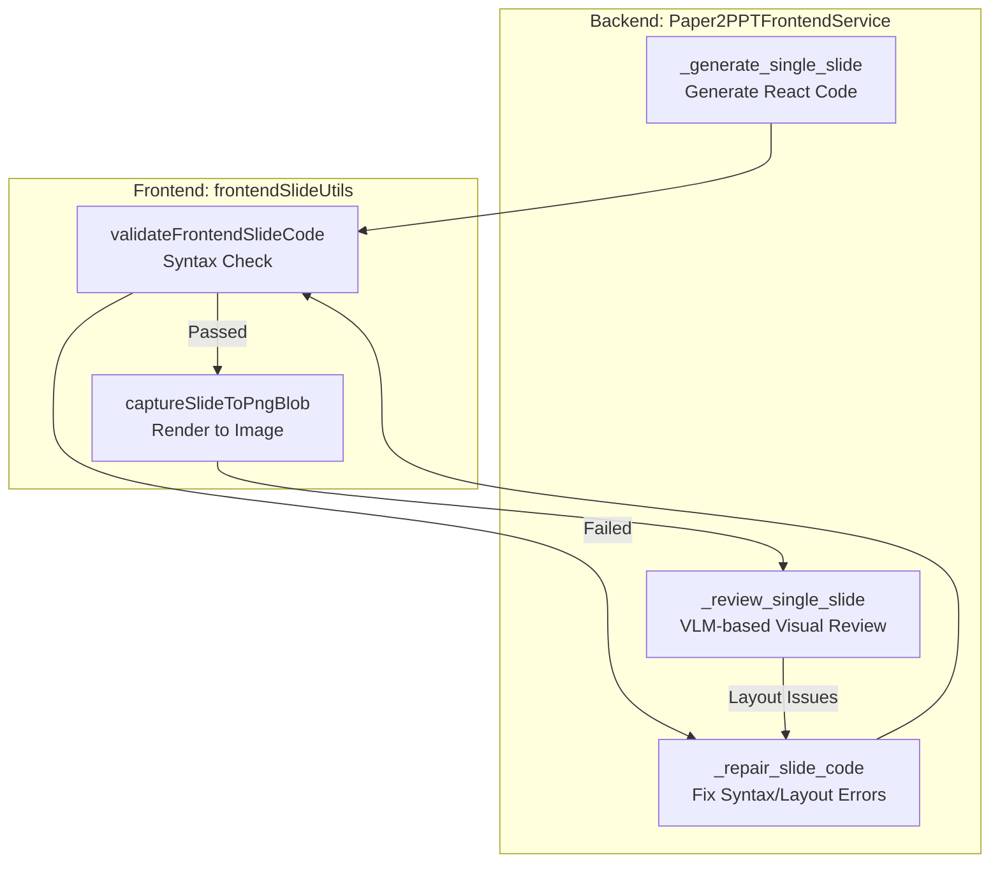

<!-- source: DeepWiki mcp.deepwiki.com · repo OpenDCAI/Paper2Any · page 6.2 Paper2PPT Workflow · fetched 2026-11-02 -->

# Paper2PPT Workflow

<details>
<summary>Relevant source files</summary>

The following files were used as context for generating this wiki page:

- [dataflow_agent/agentroles/paper2any_agents/content_expander_agent.py](dataflow_agent/agentroles/paper2any_agents/content_expander_agent.py)
- [dataflow_agent/agentroles/paper2any_agents/long_paper_outline_agent.py](dataflow_agent/agentroles/paper2any_agents/long_paper_outline_agent.py)
- [dataflow_agent/agentroles/paper2any_agents/outline_agent.py](dataflow_agent/agentroles/paper2any_agents/outline_agent.py)
- [dataflow_agent/agentroles/paper2any_agents/topic_writer_agent.py](dataflow_agent/agentroles/paper2any_agents/topic_writer_agent.py)
- [dataflow_agent/promptstemplates/resources/pt_long_paper_repo.py](dataflow_agent/promptstemplates/resources/pt_long_paper_repo.py)
- [dataflow_agent/workflow/wf_paper2ppt_parallel_consistent_style.py](dataflow_agent/workflow/wf_paper2ppt_parallel_consistent_style.py)
- [fastapi_app/middleware/api_key.py](fastapi_app/middleware/api_key.py)
- [fastapi_app/routers/paper2ppt.py](fastapi_app/routers/paper2ppt.py)
- [fastapi_app/schemas.py](fastapi_app/schemas.py)
- [fastapi_app/services/paper2ppt_frontend_service.py](fastapi_app/services/paper2ppt_frontend_service.py)
- [fastapi_app/services/paper2ppt_service.py](fastapi_app/services/paper2ppt_service.py)
- [fastapi_app/workflow_adapters/wa_paper2ppt.py](fastapi_app/workflow_adapters/wa_paper2ppt.py)
- [frontend-workflow/src/components/Paper2GraphPage.tsx](frontend-workflow/src/components/Paper2GraphPage.tsx)
- [frontend-workflow/src/components/Paper2PptPage.tsx](frontend-workflow/src/components/Paper2PptPage.tsx)
- [frontend-workflow/src/components/Pdf2PptPage.tsx](frontend-workflow/src/components/Pdf2PptPage.tsx)
- [frontend-workflow/src/components/Ppt2PolishPage.tsx](frontend-workflow/src/components/Ppt2PolishPage.tsx)
- [frontend-workflow/src/components/paper2ppt/FrontendGenerateStep.tsx](frontend-workflow/src/components/paper2ppt/FrontendGenerateStep.tsx)
- [frontend-workflow/src/components/paper2ppt/FrontendSlidePreview.tsx](frontend-workflow/src/components/paper2ppt/FrontendSlidePreview.tsx)
- [frontend-workflow/src/components/paper2ppt/GenerateStep.tsx](frontend-workflow/src/components/paper2ppt/GenerateStep.tsx)
- [frontend-workflow/src/components/paper2ppt/UploadStep.tsx](frontend-workflow/src/components/paper2ppt/UploadStep.tsx)
- [frontend-workflow/src/components/paper2ppt/frontendSlideUtils.ts](frontend-workflow/src/components/paper2ppt/frontendSlideUtils.ts)
- [frontend-workflow/src/components/paper2ppt/index.tsx](frontend-workflow/src/components/paper2ppt/index.tsx)
- [frontend-workflow/src/components/paper2ppt/types.ts](frontend-workflow/src/components/paper2ppt/types.ts)

</details>


## Purpose and Scope

The Paper2PPT workflow transforms academic papers, documents, and text content into structured PowerPoint presentations. This document covers the end-to-end pipeline from input parsing to final PPTX/PDF generation, including outline extraction, user editing capabilities, parallel slide generation with style anchoring, version management, and the specialized frontend self-healing loop.

For information about PPT beautification of existing presentations, see [PPT Polish Workflow](#6.4). For converting PDF documents while preserving layouts via VLM, see [PDF2PPT Workflow](#6.3).

## Overview

The Paper2PPT workflow operates in distinct stages, each implemented as a separate workflow or API endpoint. The system supports multiple input types (PDF, PPTX, TEXT, TOPIC) and provides interactive outline editing before final generation. It features two distinct generation paths: an **Image-based path** (rendering slides as high-quality images) and a **Frontend-based path** (generating editable React-based slides).

### High-Level Architecture

```mermaid
graph TB
    subgraph "Frontend Layer"
        PaperPPTPage["Paper2PptPage Component"]
        UploadStep["UploadStep Component"]
        OutlineStep["OutlineStep Component"]
        GenerateStep["GenerateStep (Image Path)"]
        FrontendGen["FrontendGenerateStep (Editable Path)"]
    end
    
    subgraph "API Layer"
        Router["paper2ppt.py Router"]
        PageContentEndpoint["/paper2ppt/page-content"]
        GenerateEndpoint["/paper2ppt/generate"]
        FrontendGenEndpoint["/paper2ppt/frontend/generate"]
    }
    
    subgraph "Service Layer"
        Paper2PPTService["Paper2PPTService"]
        FrontendService["Paper2PPTFrontendService"]
    end
    
    subgraph "Workflow Layer"
        WF_PageContent["paper2page_content Workflow"]
        WF_PPT_Parallel["wf_paper2ppt_parallel_consistent_style"]
        LongPaperWF["paper2page_content_for_long_paper"]
    end
    
    PaperPPTPage --> UploadStep
    UploadStep --> PageContentEndpoint
    PageContentEndpoint --> Paper2PPTService
    Paper2PPTService --> WF_PageContent
    
    OutlineStep --> GenerateEndpoint
    GenerateEndpoint --> Paper2PPTService
    Paper2PPTService --> WF_PPT_Parallel
    
    OutlineStep --> FrontendGenEndpoint
    FrontendGenEndpoint --> FrontendService
```

**Sources:**
- [frontend-workflow/src/components/paper2ppt/index.tsx:63-112]()
- [fastapi_app/routers/paper2ppt.py:210-274]()
- [fastapi_app/services/paper2ppt_service.py:143-155]()
- [fastapi_app/services/paper2ppt_frontend_service.py:64-68]()

## Stage 1: Input Processing & Outline Generation

The system first extracts a structured outline (`pagecontent`) from the source document.

### Input Routing & Long Paper Handling
The system automatically selects between a standard single-pass workflow and a specialized long-paper workflow based on token budget and page count.

**Logic:** [fastapi_app/workflow_adapters/wa_paper2ppt.py:181-221]()
- **Standard:** `paper2page_content` for documents within the LLM's context window.
- **Long Paper:** `paper2page_content_for_long_paper` uses a sliding window or hierarchical approach for massive PDFs.

### Input Type Handling
- **PDF:** Uses MinerU for markdown extraction [fastapi_app/workflow_adapters/wa_paper2ppt.py:151-179]().
- **PPTX:** Converts slides to images via `soffice` [dataflow_agent/workflow/wf_paper2page_content.py:165-231]().
- **Topic:** Uses `TopicWriterAgent` to generate content from a short prompt.

**Sources:**
- [fastapi_app/workflow_adapters/wa_paper2ppt.py:181-221]()
- [dataflow_agent/workflow/wf_paper2page_content.py:50-273]()

## Stage 2: Parallel Slide Generation (Image Path)

This path generates high-fidelity slide images using a "Style Anchoring" strategy to ensure visual consistency.

### Style Anchoring Strategy
To prevent visual drift across slides, the workflow uses a two-phase parallel approach:
1.  **Anchor Generation:** Generates the first slide (Page 0) as a style reference [dataflow_agent/workflow/wf_paper2ppt_parallel_consistent_style.py:282-358]().
2.  **Parallel Follow-up:** Generates all subsequent slides in parallel, passing the Page 0 image as a `prev_image` or visual hint to the image model [dataflow_agent/workflow/wf_paper2ppt_parallel_consistent_style.py:360-482]().

### Implementation Details
- **Concurrency:** Uses `asyncio.Semaphore(3)` to limit simultaneous API calls [dataflow_agent/workflow/wf_paper2ppt_parallel_consistent_style.py:455-460]().
- **Asset Integration:** If a slide references a paper figure (`asset_ref`), it uses `gemini_multi_image_edit_async` to blend the figure with the generated slide background [dataflow_agent/workflow/wf_paper2ppt_parallel_consistent_style.py:112-173]().

**Sources:**
- [dataflow_agent/workflow/wf_paper2ppt_parallel_consistent_style.py:282-482]()
- [dataflow_agent/workflow/wf_paper2ppt_parallel_consistent_style.py:112-173]()

## Stage 3: Editable Deck Generation (Frontend Path)

The Frontend Path generates React-based slides that can be edited directly in the browser.

### The Self-Healing Loop (Frontend Review)
The `Paper2PPTFrontendService` implements a "Review-Repair" loop to ensure generated React code is valid and follows the requested style.



1.  **Generation:** LLM generates a JSON object containing React code and metadata [fastapi_app/services/paper2ppt_frontend_service.py:112-130]().
2.  **Validation:** Frontend checks for basic syntax and forbidden tags (e.g., `<script>`) [frontend-workflow/src/components/paper2ppt/frontendSlideUtils.ts:45-50]().
3.  **Visual Review:** If `frontendAutoReviewEnabled` is true, the system renders the slide to a PNG, sends it to a VLM, and asks if the layout matches the description [fastapi_app/services/paper2ppt_frontend_service.py:28-29]().

**Sources:**
- [fastapi_app/services/paper2ppt_frontend_service.py:70-140]()
- [frontend-workflow/src/components/paper2ppt/frontendSlideUtils.ts:41-46]()

## Version Management & Persistence

The system maintains a full history of slide iterations to allow non-destructive editing.

### ImageVersionManager
The `ImageVersionManager` handles the file-system mapping of versions:
- **Path:** `outputs/{email}/{task_id}/ppt_pages/`
- **Naming:** `page_001.png` (Current), `page_001_v001.png` (History) [dataflow_agent/utils/version_manager.py]().

### Version Reversion
The `/revert-version` endpoint allows users to swap the current slide image with a previous version from the history [fastapi_app/routers/paper2ppt.py:224-273]().

**Sources:**
- [fastapi_app/routers/paper2ppt.py:181-273]()
- [dataflow_agent/utils/version_manager.py]()

## Key Classes and Data Structures

### PageContent Item Schema
Each slide in the `pagecontent` list follows this structure:

| Field | Description |
| :--- | :--- |
| `title` | The slide heading. |
| `layout_description` | Natural language instructions for the layout/visuals. |
| `key_points` | Array of bullet points to display. |
| `asset_ref` | Reference to an extracted image or table from the paper. |

### Paper2FigureState (PPT Extension)
The state object carries PPT-specific context:
- `generated_pages`: List of paths to generated slide images [dataflow_agent/state.py:313]().
- `ppt_pptx_path`: Final path to the generated PowerPoint file [dataflow_agent/state.py:321]().
- `mineru_root`: Directory containing extracted paper assets [dataflow_agent/state.py:317]().

**Sources:**
- [dataflow_agent/state.py:286-325]()
- [fastapi_app/schemas.py:208-220]()

## Summary of Data Flow

1.  **Upload:** User provides a PDF/Text and selects a style (Preset or Reference Image) [frontend-workflow/src/components/paper2ppt/UploadStep.tsx:74-112]().
2.  **Parse:** Backend runs `paper2page_content` to create a `SlideOutline[]` [fastapi_app/services/paper2ppt_service.py:190-230]().
3.  **Edit:** User modifies titles or points in the `OutlineStep` [frontend-workflow/src/components/paper2ppt/OutlineStep.tsx:1-50]().
4.  **Generate:** 
    - **Image Path:** `wf_paper2ppt_parallel_consistent_style` generates images and merges them into a PPTX using `convert_images_dir_to_pdf_and_full_slide_ppt` [dataflow_agent/workflow/wf_paper2ppt_parallel_consistent_style.py:604-651]().
    - **Frontend Path:** `Paper2PPTFrontendService` generates React components [fastapi_app/services/paper2ppt_frontend_service.py:70-106]().
5.  **Refine:** User can select a single slide and provide an `edit_prompt` to regenerate just that page [fastapi_app/routers/paper2ppt.py:128-170]().

**Sources:**
- [frontend-workflow/src/components/paper2ppt/index.tsx:63-132]()
- [fastapi_app/services/paper2ppt_service.py:190-230]()
- [dataflow_agent/workflow/wf_paper2ppt_parallel_consistent_style.py:604-651]()

---

