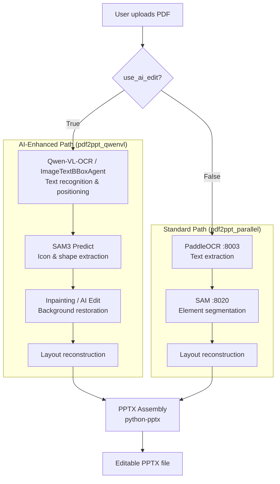
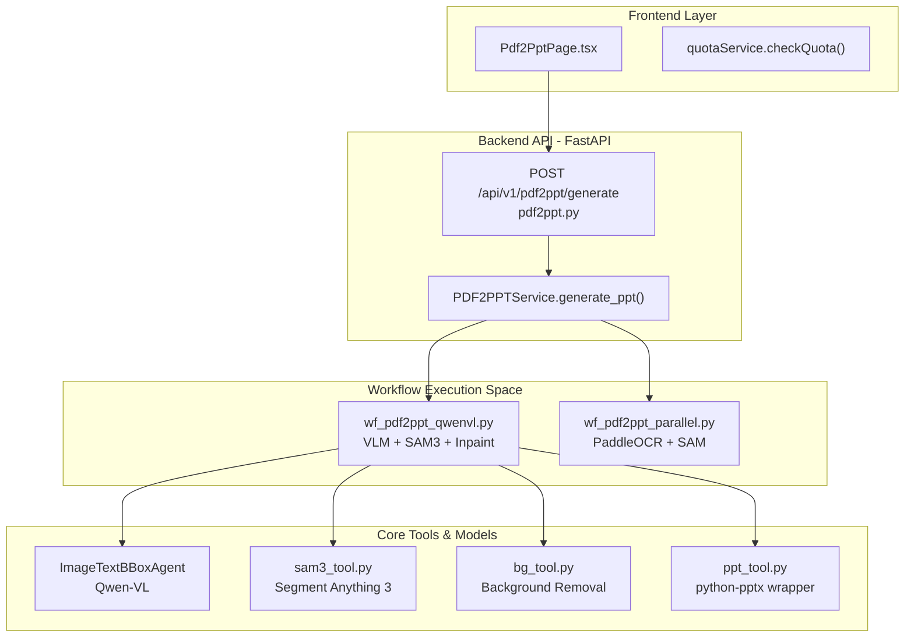

<!-- source: DeepWiki mcp.deepwiki.com · repo OpenDCAI/Paper2Any · page 6.3 PDF2PPT Workflow · fetched 2026-11-02 -->

# PDF2PPT Workflow

Relevant source files

The following files were used as context for generating this wiki page:

- [dataflow_agent/toolkits/multimodaltool/req_img.py](dataflow_agent/toolkits/multimodaltool/req_img.py)
- [dataflow_agent/toolkits/multimodaltool/utils.py](dataflow_agent/toolkits/multimodaltool/utils.py)
- [dataflow_agent/toolkits/postertool/src/agents/curator.py](dataflow_agent/toolkits/postertool/src/agents/curator.py)
- [dataflow_agent/toolkits/postertool/src/agents/parser.py](dataflow_agent/toolkits/postertool/src/agents/parser.py)
- [dataflow_agent/workflow/wf_pdf2ppt_qwenvl.py](dataflow_agent/workflow/wf_pdf2ppt_qwenvl.py)
- [fastapi_app/dependencies/auth.py](fastapi_app/dependencies/auth.py)
- [fastapi_app/routers/files.py](fastapi_app/routers/files.py)
- [fastapi_app/routers/pdf2ppt.py](fastapi_app/routers/pdf2ppt.py)
- [fastapi_app/services/paper2poster_service.py](fastapi_app/services/paper2poster_service.py)
- [frontend-workflow/.env.example](frontend-workflow/.env.example)
- [frontend-workflow/src/components/Paper2GraphPage.tsx](frontend-workflow/src/components/Paper2GraphPage.tsx)
- [frontend-workflow/src/components/Paper2PptPage.tsx](frontend-workflow/src/components/Paper2PptPage.tsx)
- [frontend-workflow/src/components/Pdf2PptPage.tsx](frontend-workflow/src/components/Pdf2PptPage.tsx)
- [frontend-workflow/src/components/Ppt2PolishPage.tsx](frontend-workflow/src/components/Ppt2PolishPage.tsx)
- [frontend-workflow/src/services/fileService.ts](frontend-workflow/src/services/fileService.ts)
- [tests/test_paper2poster_parser.py](tests/test_paper2poster_parser.py)

## Purpose and Scope

The PDF2PPT workflow converts PDF presentations into editable PPTX files while preserving the original layout, text, and visual elements. Unlike Paper2PPT ([6.2]()) which generates new presentations from paper content, PDF2PPT focuses on faithfully reconstructing existing PDF slides as editable PowerPoint documents.

This workflow extracts text via VLM or OCR, segments visual elements using SAM, reconstructs the layout, and optionally applies AI-powered background enhancement (inpainting). The result is an editable PPTX that maintains the visual fidelity of the original PDF.

**Sources:** [frontend-workflow/src/components/Pdf2PptPage.tsx:23-37](), [dataflow_agent/workflow/wf_pdf2ppt_qwenvl.py:1-13]()

---

## Overview

PDF2PPT converts PDF presentations into editable PPTX files through two distinct workflow paths:

**Key characteristics:**
- **VLM Recognition**: Uses Qwen-VL-OCR (via `ImageTextBBoxAgent`) for high-accuracy text and bounding box detection [dataflow_agent/workflow/wf_pdf2ppt_qwenvl.py:4-12]().
- **Intelligent Cutout**: Employs SAM3 for grouping and segmenting icons, arrows, and shapes [dataflow_agent/workflow/wf_pdf2ppt_qwenvl.py:199-215]().
- **Adaptive Background Fill**: Implements a hybrid approach using OpenCV `inpaint` and mean color filling to clean backgrounds after text extraction [dataflow_agent/workflow/wf_pdf2ppt_qwenvl.py:106-197]().
- **Layout preservation**: Maintains exact positioning of text boxes and images.

**Sources:** [dataflow_agent/workflow/wf_pdf2ppt_qwenvl.py:1-60](), [frontend-workflow/src/components/Pdf2PptPage.tsx:110-114]()

---

## Architecture

### System Diagram

**Sources:** [fastapi_app/routers/pdf2ppt.py:20-36](), [dataflow_agent/workflow/wf_pdf2ppt_qwenvl.py:27-60]()

---

## Processing Stages (AI-Enhanced Path)

### Stage 1: VLM Text & BBox Extraction
Instead of traditional OCR, the `pdf2ppt_qwenvl` workflow uses a Visual Language Model (VLM).
- **Function**: `create_vlm_agent` [dataflow_agent/workflow/wf_pdf2ppt_qwenvl.py:33]().
- **Logic**: Renders PDF pages to PNG and identifies text content along with normalized bounding boxes.
- **Adaptive Fill**: Once text is identified, the system uses `_adaptive_fill_text_regions` to remove text from the background image, calculating local variance (standard deviation) to decide between mean color filling or `cv2.INPAINT_TELEA` [dataflow_agent/workflow/wf_pdf2ppt_qwenvl.py:106-194]().

### Stage 2: SAM3 Element Segmentation
Visual elements like icons and diagrams are segmented using SAM3.
- **Prompts**: The workflow uses specific prompt lists for shapes (`rectangle`, `diamond`, `ellipse`) and arrows (`arrow`, `connector`) [dataflow_agent/workflow/wf_pdf2ppt_qwenvl.py:199-210]().
- **Tools**: Calls `run_sam3_predict_runs` and `dedup_sam3_results_across_groups` to isolate graphical assets [dataflow_agent/workflow/wf_pdf2ppt_qwenvl.py:36-43]().

### Stage 3: Background Inpainting
If `use_ai_edit` is enabled, the system calls an external Inpainting API to fill the "holes" left by extracted text and icons.
- **API Call**: `generate_or_edit_and_save_image_async` [dataflow_agent/workflow/wf_pdf2ppt_qwenvl.py:45]().
- **Fallback**: If the AI edit fails, it uses the results from the `_adaptive_fill_text_regions` local processing.

### Stage 4: PPTX Assembly
The final slide is constructed by layering:
1. The cleaned/inpainted background image.
2. SAM3-segmented icons as individual image shapes.
3. VLM-extracted text as editable text boxes at specific coordinates.

**Sources:** [dataflow_agent/workflow/wf_pdf2ppt_qwenvl.py:4-13](), [dataflow_agent/workflow/wf_pdf2ppt_qwenvl.py:106-215]()

---

## API Reference

### POST /api/v1/pdf2ppt/generate

The primary endpoint for initiating the conversion.

| Parameter | Type | Required | Description |
|-----------|------|----------|-------------|
| `pdf_file` | File | Yes | The PDF file to be converted. |
| `use_ai_edit` | Boolean | No | Whether to use VLM and AI inpainting (Default: `false`). |
| `chat_api_url`| String | No* | LLM API URL (Required if `use_ai_edit` is true). |
| `api_key` | String | No* | LLM API Key (Required if `use_ai_edit` is true). |
| `model` | String | No | Model name for VLM recognition. |
| `gen_fig_model`| String | No | Model name for AI inpainting/editing. |

**Sources:** [fastapi_app/routers/pdf2ppt.py:20-52]()

---

## Data Flow & Persistence

1.  **Frontend Upload**: User selects a file in `Pdf2PptPage.tsx`, which is sent via `multipart/form-data` [frontend-workflow/src/components/Pdf2PptPage.tsx:170-181]().
2.  **Backend Processing**: The `PDF2PPTService` handles the file saving and workflow invocation [fastapi_app/routers/pdf2ppt.py:56-67]().
3.  **Storage**: After generation, the file is saved to the local `outputs` directory. If the user is authenticated, the frontend triggers `uploadAndSaveFile` to persist the result in the user's history [frontend-workflow/src/services/fileService.ts:56-106]().
4.  **History Retrieval**: Users can view past conversions via the `/api/v1/files/history` endpoint, which filters for `pdf2ppt` workflow types [fastapi_app/routers/files.py:186-188]().

**Sources:** [fastapi_app/routers/files.py:35](), [frontend-workflow/src/services/fileService.ts:56-106](), [fastapi_app/routers/pdf2ppt.py:69-77]()

---

