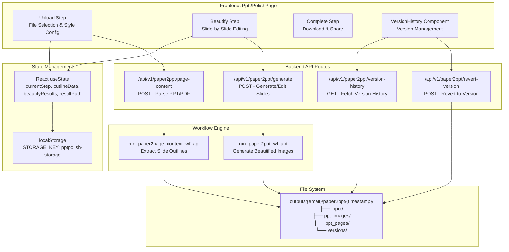
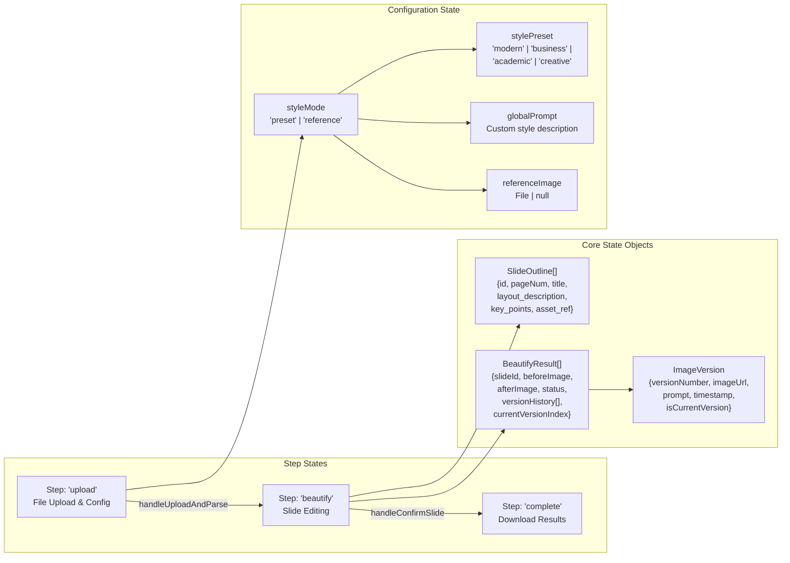
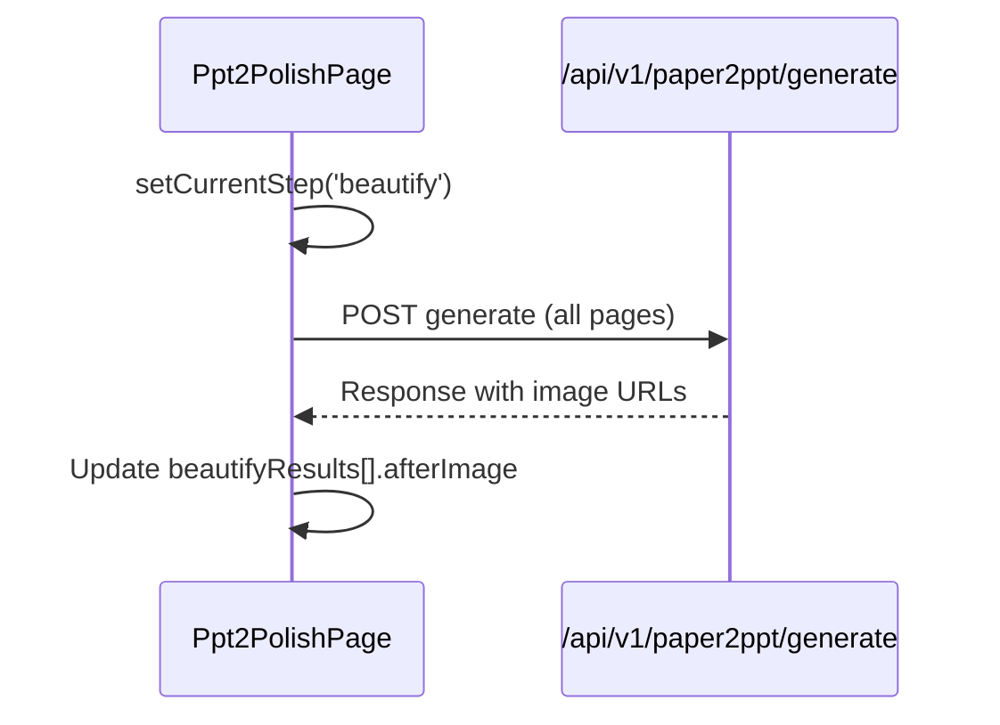
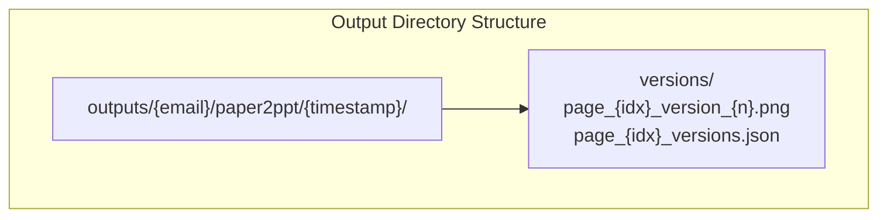

<!-- source: DeepWiki mcp.deepwiki.com · repo OpenDCAI/Paper2Any · page 6.4 PPT Polish Workflow · fetched 2026-11-02 -->

# PPT Polish Workflow

Relevant source files

The following files were used as context for generating this wiki page:

- [frontend-workflow/src/components/Paper2GraphPage.tsx](frontend-workflow/src/components/Paper2GraphPage.tsx)
- [frontend-workflow/src/components/Paper2PptPage.tsx](frontend-workflow/src/components/Paper2PptPage.tsx)
- [frontend-workflow/src/components/Pdf2PptPage.tsx](frontend-workflow/src/components/Pdf2PptPage.tsx)
- [frontend-workflow/src/components/Ppt2PolishPage.tsx](frontend-workflow/src/components/Ppt2PolishPage.tsx)
- [frontend-workflow/src/components/paper2ppt/CompleteStep.tsx](frontend-workflow/src/components/paper2ppt/CompleteStep.tsx)
- [frontend-workflow/src/locales/en/paper2ppt.json](frontend-workflow/src/locales/en/paper2ppt.json)
- [frontend-workflow/src/locales/en/pptPolish.json](frontend-workflow/src/locales/en/pptPolish.json)
- [frontend-workflow/src/locales/zh/paper2ppt.json](frontend-workflow/src/locales/zh/paper2ppt.json)
- [frontend-workflow/src/locales/zh/pptPolish.json](frontend-workflow/src/locales/zh/pptPolish.json)

## Purpose and Scope

The PPT Polish Workflow enables users to upload existing PowerPoint presentations (PPTX) or PDF documents and enhance them with AI-generated visual improvements. Unlike Paper2PPT (see [Paper2PPT Workflow](6.2)) which generates presentations from scratch, PPT Polish focuses on beautifying and refining existing slides while preserving their content structure.

This document covers:
- Frontend interface for file upload, style configuration, and slide-by-slide editing.
- Backend API endpoints for parsing, generation, and version management.
- Integration with the Paper2PPT workflow engine for image generation.
- Version history tracking and reversion capabilities.

For creating presentations from academic papers or text, see [Paper2PPT Workflow](6.2). For PDF-to-PPT conversion with layout preservation, see [PDF2PPT Workflow](6.3).

---

## High-Level Architecture

### Component Overview Diagram

**Sources:** [frontend-workflow/src/components/Ppt2PolishPage.tsx:1-212](), [frontend-workflow/src/components/paper2ppt/VersionHistory.tsx:1-100]()

---

## Frontend Implementation

### Component Structure and State Flow

The `Ppt2PolishPage` component implements a three-step wizard interface with comprehensive state management for configuration, outline editing, and beautification tracking.

**Sources:** [frontend-workflow/src/components/Ppt2PolishPage.tsx:38-212]()

### Key Data Structures

The workflow uses primary TypeScript interfaces to manage slide data and versioning:

| Interface | Properties | Purpose |
|-----------|-----------|---------|
| `SlideOutline` | `id`, `pageNum`, `title`, `layout_description`, `key_points[]`, `asset_ref` | Represents parsed slide content and metadata [frontend-workflow/src/components/Ppt2PolishPage.tsx:51-59]() |
| `BeautifyResult` | `slideId`, `beforeImage`, `afterImage`, `status`, `userPrompt`, `versionHistory[]`, `currentVersionIndex` | Tracks beautification state per slide [frontend-workflow/src/components/Ppt2PolishPage.tsx:70-81]() |
| `ImageVersion` | `versionNumber`, `imageUrl`, `prompt`, `timestamp`, `isCurrentVersion` | Stores historical versions for rollback [frontend-workflow/src/components/Ppt2PolishPage.tsx:62-68]() |

---

## Workflow Step-by-Step

### Step 1: Upload and Configuration

The upload step collects the input file and style configuration. Users can choose between **Preset Mode** (modern, business, academic, creative) or **Reference Mode** (uploading a style guide image).

**Key Functions:**
- `handleFileChange()` / `handleDrop()`: Validates file type (PPT/PPTX/PDF) and size (<50MB) [frontend-workflow/src/components/Ppt2PolishPage.tsx:419-450]().
- `handleReferenceImageChange()`: Validates reference image format (JPG/PNG/WEBP/GIF) [frontend-workflow/src/components/Ppt2PolishPage.tsx:452-474]().
- `handleUploadAndParse()`: Main handler that checks quota, verifies LLM connection via `verifyLlmConnection()`, and calls the backend `/page-content` API [frontend-workflow/src/components/Ppt2PolishPage.tsx:546-651]().

**Sources:** [frontend-workflow/src/components/Ppt2PolishPage.tsx:419-719]()

### Step 2: Batch Beautification

After parsing, the workflow automatically initiates batch beautification for all slides. The `generateInitialPPT()` function constructs a request for all pages and calls the generation API.

**Sources:** [frontend-workflow/src/components/Ppt2PolishPage.tsx:818-930]()

### Step 3: Slide-by-Slide Editing

Users navigate through slides and refine individual pages with custom prompts.

**Key Functions:**
- `startBeautifyCurrentSlide()`: Regenerates the current slide using a specific `page_id` and `edit_prompt` [frontend-workflow/src/components/Ppt2PolishPage.tsx:932-1015]().
- `fetchVersionHistory()`: Loads version metadata from the backend [frontend-workflow/src/components/Ppt2PolishPage.tsx:709-763]().
- `handleRevertToVersion()`: Restores a previous version via the `/revert-version` endpoint [frontend-workflow/src/components/Ppt2PolishPage.tsx:1223-1268]().

**Sources:** [frontend-workflow/src/components/Ppt2PolishPage.tsx:932-1268]()

### Step 4: Final Export

The `handleGenerateFinal()` function triggers the backend to compile the final PPTX file and PDF preview.

**Sources:** [frontend-workflow/src/components/Ppt2PolishPage.tsx:1117-1200]()

---

## Style Configuration System

### Style Modes

PPT Polish supports two distinct style configuration approaches:

1.  **Preset Mode** (`styleMode='preset'`): Users select from predefined templates (modern, business, academic, creative) [frontend-workflow/src/components/Ppt2PolishPage.tsx:238-290]().
2.  **Reference Mode** (`styleMode='reference'`): Users upload a reference image to guide the visual style [frontend-workflow/src/components/Ppt2PolishPage.tsx:204]().

### Style Preset Descriptions

| Preset | Description (Key Traits) |
|--------|----------------------|
| modern | Minimal business style, spacious layout, 2–3 color palette [frontend-workflow/src/locales/en/pptPolish.json:44](). |
| business | Professional, structured, standard business colors [frontend-workflow/src/locales/en/pptPolish.json:45](). |
| academic | White background, rigorous layout, blue/gray/black tones [frontend-workflow/src/locales/en/pptPolish.json:46](). |
| creative | High design, unique visual elements, artistic flair [frontend-workflow/src/locales/en/pptPolish.json:47](). |

---

## Version History and Rollback

Each slide maintains a separate version history. The `VersionHistory` component interacts with the backend to list and revert versions.

**Sources:** [frontend-workflow/src/components/paper2ppt/VersionHistory.tsx:1-200](), [frontend-workflow/src/components/Ppt2PolishPage.tsx:709-763]()

---

## Configuration Persistence

The component persists user configuration across sessions using `localStorage` under the key `pptpolish-storage` [frontend-workflow/src/components/Ppt2PolishPage.tsx:188]().

**Saved State Includes:**
- `styleMode`, `stylePreset`, `globalPrompt` [frontend-workflow/src/components/Ppt2PolishPage.tsx:145-159]().
- `llmApiUrl`, `apiKey`, `model`, `genFigModel` [frontend-workflow/src/components/Ppt2PolishPage.tsx:111-114]().

**Sources:** [frontend-workflow/src/components/Ppt2PolishPage.tsx:346-403]()

---

## Quota and Authentication Integration

The workflow integrates with the `quotaService` and `authStore` to manage usage:
- `checkQuota()` is called before starting the parsing process [frontend-workflow/src/components/Ppt2PolishPage.tsx:501]().
- `recordUsage()` is called after successful generation [frontend-workflow/src/components/Ppt2PolishPage.tsx:1169]().
- Authentication state determines if managed API settings or local settings are used [frontend-workflow/src/components/Ppt2PolishPage.tsx:355-365]().

**Sources:** [frontend-workflow/src/components/Ppt2PolishPage.tsx:18-25](), [frontend-workflow/src/services/quotaService.ts:1-150]()

---

