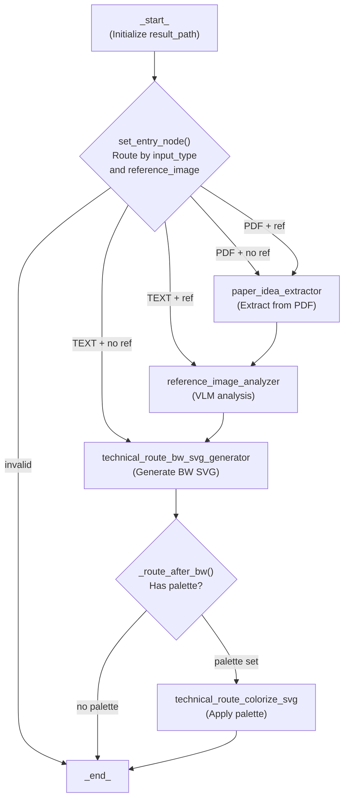
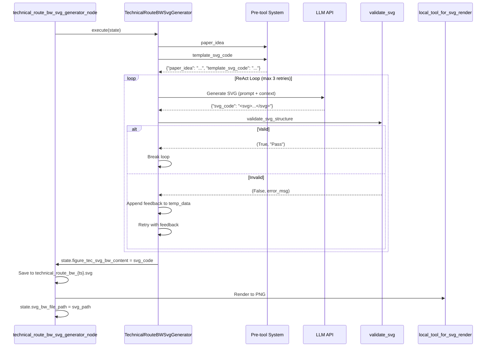
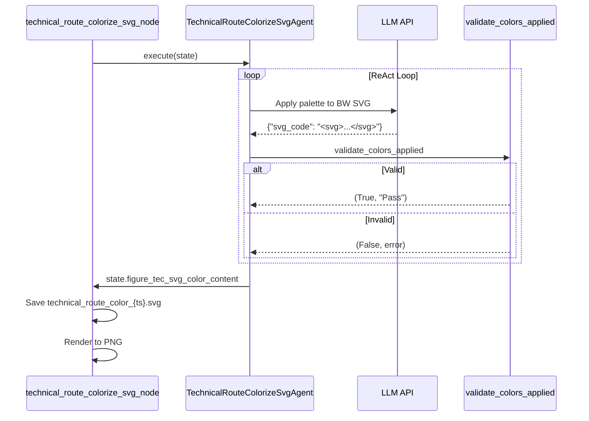

<!-- source: DeepWiki mcp.deepwiki.com · repo OpenDCAI/Paper2Any · page 6.5 Technical Route Diagrams · fetched 2026-11-02 -->

# Technical Route Diagrams

<details>
<summary>Relevant source files</summary>

The following files were used as context for generating this wiki page:

- [dataflow_agent/agentroles/paper2any_agents/fig_desc_generator.py](dataflow_agent/agentroles/paper2any_agents/fig_desc_generator.py)
- [dataflow_agent/agentroles/paper2any_agents/paper_idea_extractor.py](dataflow_agent/agentroles/paper2any_agents/paper_idea_extractor.py)
- [dataflow_agent/agentroles/paper2any_agents/technical_route_bw_svg_generator.py](dataflow_agent/agentroles/paper2any_agents/technical_route_bw_svg_generator.py)
- [dataflow_agent/agentroles/paper2any_agents/technical_route_colorize_svg_agent.py](dataflow_agent/agentroles/paper2any_agents/technical_route_colorize_svg_agent.py)
- [dataflow_agent/agentroles/paper2any_agents/technical_route_desc_generator_agent.py](dataflow_agent/agentroles/paper2any_agents/technical_route_desc_generator_agent.py)
- [dataflow_agent/promptstemplates/resources/pt_technical_route_desc_generator_repo.py](dataflow_agent/promptstemplates/resources/pt_technical_route_desc_generator_repo.py)
- [dataflow_agent/workflow/resources/tech-roadmap-template/figure/temp1.png](dataflow_agent/workflow/resources/tech-roadmap-template/figure/temp1.png)
- [dataflow_agent/workflow/resources/tech-roadmap-template/figure/temp2.png](dataflow_agent/workflow/resources/tech-roadmap-template/figure/temp2.png)
- [dataflow_agent/workflow/resources/tech-roadmap-template/figure/temp3.jpg](dataflow_agent/workflow/resources/tech-roadmap-template/figure/temp3.jpg)
- [dataflow_agent/workflow/resources/tech-roadmap-template/figure/temp4.jpg](dataflow_agent/workflow/resources/tech-roadmap-template/figure/temp4.jpg)
- [dataflow_agent/workflow/resources/tech-roadmap-template/figure/temp5.jpg](dataflow_agent/workflow/resources/tech-roadmap-template/figure/temp5.jpg)
- [dataflow_agent/workflow/resources/tech-roadmap-template/svg/temp1.svg](dataflow_agent/workflow/resources/tech-roadmap-template/svg/temp1.svg)
- [dataflow_agent/workflow/resources/tech-roadmap-template/svg/temp2.svg](dataflow_agent/workflow/resources/tech-roadmap-template/svg/temp2.svg)
- [dataflow_agent/workflow/resources/tech-roadmap-template/svg/temp3.svg](dataflow_agent/workflow/resources/tech-roadmap-template/svg/temp3.svg)
- [dataflow_agent/workflow/resources/tech-roadmap-template/svg/temp4.svg](dataflow_agent/workflow/resources/tech-roadmap-template/svg/temp4.svg)
- [dataflow_agent/workflow/resources/tech-roadmap-template/svg/temp5.svg](dataflow_agent/workflow/resources/tech-roadmap-template/svg/temp5.svg)
- [dataflow_agent/workflow/wf_paper2figure_with_sam.py](dataflow_agent/workflow/wf_paper2figure_with_sam.py)
- [dataflow_agent/workflow/wf_paper2technical.py](dataflow_agent/workflow/wf_paper2technical.py)
- [frontend-workflow/public/tech-roadmap-templates/temp1.png](frontend-workflow/public/tech-roadmap-templates/temp1.png)

</details>


## Purpose and Scope

This page documents the **Technical Route Diagram** generation workflow, which converts academic papers or text descriptions into visual technical route diagrams suitable for presentation. The workflow generates SVG-based diagrams representing research pipelines, experimental workflows, or system architectures, then assembles them into PowerPoint presentations with proper vector graphics support.

For general Paper2Any workflow concepts, see [Paper2Any Workflows](). For other diagram generation features like Paper2Figure, see [Paper2Figure Workflow]().

---

## Workflow Architecture

The `paper2technical` workflow is implemented in [dataflow_agent/workflow/wf_paper2technical.py]() and registered with the workflow system. It generates SVG-based technical route diagrams in two stages: **black-and-white generation** followed by optional **colorization** with user-selected palettes.

### High-Level Workflow Graph



**Input Modes:**
- **PDF mode**: Extracts technical route from academic paper PDF [dataflow_agent/workflow/wf_paper2technical.py:596]()
- **TEXT mode**: Uses direct text description from `state.paper_idea` [dataflow_agent/workflow/wf_paper2technical.py:598-603]()
- **Reference image**: Optional reference diagram for style/layout guidance [dataflow_agent/workflow/wf_paper2technical.py:376-405]()

**Sources:** [dataflow_agent/workflow/wf_paper2technical.py:240-662](), [dataflow_agent/workflow/wf_paper2technical.py:581-661]()

---

## Template System

The workflow supports **5 pre-designed templates** plus an auto-select mode. Templates provide SVG layout references for the BW generator.

### Template Selection

**Backend Resolution:** [dataflow_agent/workflow/wf_paper2technical.py:162-205]()

```python
def _get_template_svg_code(state: Paper2FigureState, use_color: bool = False) -> str:
    template_name = getattr(state.request, "tech_route_template", "") or ""
    
    if template_name:
        # Priority 1: Custom template SVG
        template_svg = root / "dataflow_agent" / "workflow" / "resources" / \
                       "tech-roadmap-template" / "svg" / f"{template_stem}.svg"
        if template_svg.exists():
            return _read_svg_file(template_svg)
    
    # Priority 2: Default template (by language + color)
    lang_prefix = "ZN" if lang in ["ZH", "CN", "CHINESE"] else "EN"
    color_suffix = "color" if use_color else "gray"
    template_file = f"SVG_template_{lang_prefix}_{color_suffix}.md"
    return _extract_svg_from_react_md(template_file)
```

**Template Directory Structure:**
```
dataflow_agent/workflow/resources/
├── tech-roadmap-template/
│   └── svg/
│       ├── temp1.svg
│       ├── temp2.svg
│       ├── temp3.svg
│       ├── temp4.svg
│       └── temp5.svg
├── SVG_template_ZN_gray.md       # Chinese BW template
├── SVG_template_ZN_color.md      # Chinese color template
├── SVG_template_EN_gray.md       # English BW template
└── SVG_template_EN_color.md      # English color template
```

**Sources:** [dataflow_agent/workflow/wf_paper2technical.py:162-205](), [dataflow_agent/workflow/resources/tech-roadmap-template/svg/temp1.svg:1-15]()

---

## Color Palette System

The workflow supports predefined palettes (e.g., `academic_blue`) to ensure professional visual output.

### Palette Mapping

**Backend Mapping:** [dataflow_agent/workflow/wf_paper2technical.py:208-247]()
```python
def _get_palette_config(state: Paper2FigureState) -> dict | None:
    palette_name = getattr(state.request, "tech_route_palette", "") or ""
    if not palette_name:
        return None
    
    palettes = {
        "academic_blue": {
            "name": "academic_blue",
            "colors": ["#1F6FEB", "#60A5FA", "#A7C7FF", "#0B3D91"],
            "level_colors": ["#A7C7FF", "#60A5FA", "#1F6FEB", "#0B3D91"],
            "arrow_color": "#0B3D91",
            "text_color": "#0B3D91",
        },
        # ... other palettes (teal_orange, slate_rose, indigo_amber)
    }
    return palettes.get(palette_name)
```

**Sources:** [dataflow_agent/workflow/wf_paper2technical.py:208-247](), [dataflow_agent/promptstemplates/resources/pt_technical_route_desc_generator_repo.py:9-73]()

---

## Black-and-White SVG Generation

### Node: `technical_route_bw_svg_generator_node`

The first generation stage produces a grayscale SVG using **ReAct mode** with retry validation.

**Workflow Diagram:**


**Agent Definition:** [dataflow_agent/agentroles/paper2any_agents/technical_route_bw_svg_generator.py:20-50]()

**Validation Logic:** [dataflow_agent/agentroles/paper2any_agents/technical_route_bw_svg_generator.py:51-180]()
The ReAct validator checks for:
1. **SVG Structure**: Presence of `<svg>` root and `viewBox` attribute.
2. **CJK Fonts**: Ensures Chinese text uses compatible fonts (Noto Sans CJK SC, etc.).
3. **Language**: Validates that text matches the requested language (EN/ZH).

**Sources:** [dataflow_agent/workflow/wf_paper2technical.py:458-513](), [dataflow_agent/agentroles/paper2any_agents/technical_route_bw_svg_generator.py:20-180]()

---

## SVG Colorization Process

### Node: `technical_route_colorize_svg_node`

If a palette is selected, the workflow colorizes the BW SVG while preserving layout and structure.

**Colorization Workflow:**


**Agent Definition:** [dataflow_agent/agentroles/paper2any_agents/technical_route_colorize_svg_agent.py:20-50]()

**Validation Logic:** [dataflow_agent/agentroles/paper2any_agents/technical_route_colorize_svg_agent.py:155-165]()
The color validator specifically checks that all `black` or `#000000` fills have been replaced with colors from the provided palette.

**Sources:** [dataflow_agent/workflow/wf_paper2technical.py:515-575](), [dataflow_agent/agentroles/paper2any_agents/technical_route_colorize_svg_agent.py:20-165]()

---

## SVG Post-Processing and Font Injection

After generation, the workflow applies critical transformations to ensure rendering quality across platforms [dataflow_agent/workflow/wf_paper2technical.py:412-456]().

### CJK Font Injection
The `_post_process_svg` function detects Chinese characters and injects a global style block to ensure proper rendering in environments without default CJK fonts.

```python
def _post_process_svg(svg_code: str) -> str:
    # Detect CJK characters using \u4e00-\u9fff
    if _svg_has_cjk(svg_code):
        chinese_fonts = 'Noto Sans CJK SC, Microsoft YaHei, SimHei, SimSun, WenQuanYi Zen Hei, sans-serif'
        
        # Replace font-family attributes and inject <style>
        svg_code = re.sub(r'font-family="[^"]*"', f'font-family="{chinese_fonts}"', svg_code)
        style_block = f"""
  <style type="text/css">
    text, tspan {{ font-family: {chinese_fonts} !important; }}
  </style>
"""
        # ... insertion logic ...
    return svg_code
```

**Sources:** [dataflow_agent/workflow/wf_paper2technical.py:412-456](), [dataflow_agent/agentroles/paper2any_agents/technical_route_bw_svg_generator.py:75-106]()

---

## State Model and Data Flow

### State Fields

The workflow uses `Paper2FigureState` [dataflow_agent/state.py:377-467]() to track generated assets.

| Field | Type | Purpose | Set By |
|-------|------|---------|--------|
| `paper_idea` | `str` | Research summary context | `paper_idea_extractor` |
| `figure_tec_svg_bw_content` | `str` | Raw BW SVG code | `TechnicalRouteBWSvgGenerator` |
| `figure_tec_svg_color_content` | `str` | Raw color SVG code | `TechnicalRouteColorizeSvgAgent` |
| `svg_bw_file_path` | `str` | Path to .svg file | `technical_route_bw_svg_generator_node` |
| `svg_color_file_path` | `str` | Path to color .svg | `technical_route_colorize_svg_node` |
| `result_path` | `str` | Output root directory | `_ensure_result_path()` |

**Sources:** [dataflow_agent/state.py:377-467](), [dataflow_agent/workflow/wf_paper2technical.py:32-59]()

---

## Usage Examples

### Python API Call

**PDF to Colorized Technical Route:**
```python
from dataflow_agent.state import Paper2FigureState, Paper2FigureRequest
from dataflow_agent.workflow import run_workflow

req = Paper2FigureRequest(
    input_type="PDF",
    language="zh",
    tech_route_palette="academic_blue",
    tech_route_template="temp1"
)

state = Paper2FigureState(
    request=req,
    paper_file="/path/to/paper.pdf"
)

final_state = await run_workflow("paper2technical", state)
print(f"Final SVG: {final_state.svg_color_file_path}")
```

**Sources:** [dataflow_agent/workflow/wf_paper2technical.py:581-606](), [dataflow_agent/agentroles/paper2any_agents/paper_idea_extractor.py:44-59]()

---

