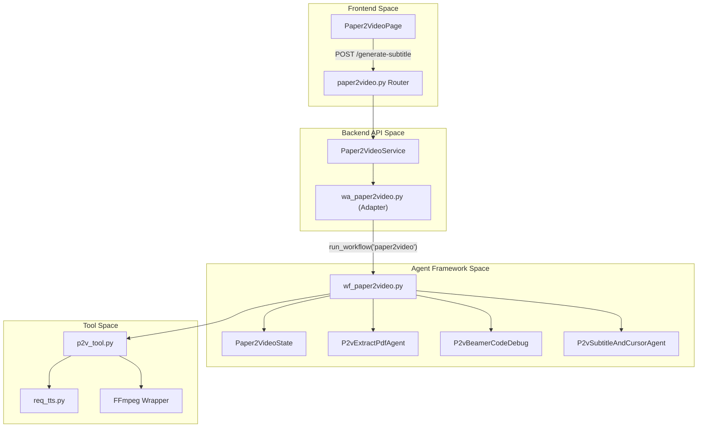
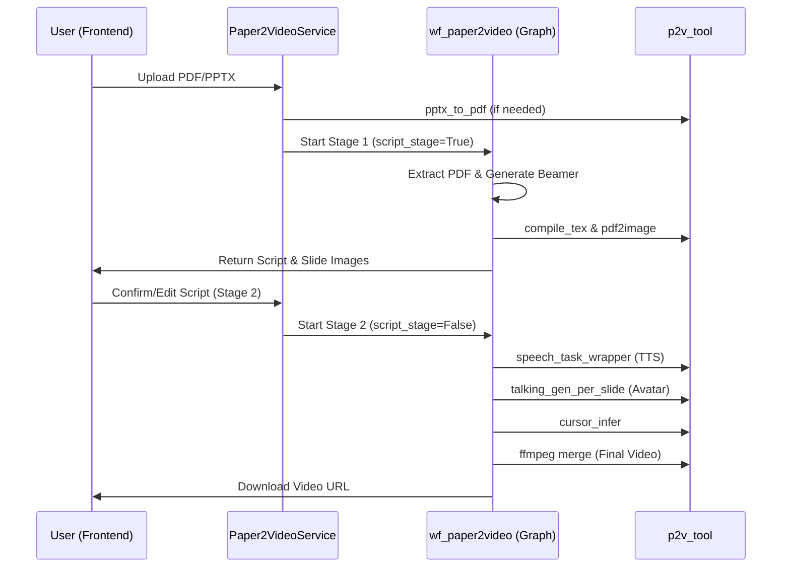

<!-- source: DeepWiki mcp.deepwiki.com · repo OpenDCAI/Paper2Any · page 6.6 Paper2Video Workflow · fetched 2026-11-02 -->

# Paper2Video Workflow

Relevant source files

The following files were used as context for generating this wiki page:

- [DEPLOY.md](DEPLOY.md)
- [dataflow_agent/agentroles/paper2any_agents/diagram_segment_hint_agent.py](dataflow_agent/agentroles/paper2any_agents/diagram_segment_hint_agent.py)
- [dataflow_agent/agentroles/paper2any_agents/p2v_beamer_code_debug_agent.py](dataflow_agent/agentroles/paper2any_agents/p2v_beamer_code_debug_agent.py)
- [dataflow_agent/agentroles/paper2any_agents/p2v_extract_pdf_agent.py](dataflow_agent/agentroles/paper2any_agents/p2v_extract_pdf_agent.py)
- [dataflow_agent/agentroles/paper2any_agents/p2v_pdf2ppt_agent.py](dataflow_agent/agentroles/paper2any_agents/p2v_pdf2ppt_agent.py)
- [dataflow_agent/agentroles/paper2any_agents/p2v_refine_subtitle_and_cursor_agent.py](dataflow_agent/agentroles/paper2any_agents/p2v_refine_subtitle_and_cursor_agent.py)
- [dataflow_agent/agentroles/paper2any_agents/p2v_subtitle_and_cursor_agent.py](dataflow_agent/agentroles/paper2any_agents/p2v_subtitle_and_cursor_agent.py)
- [dataflow_agent/promptstemplates/resources/pt_diagram_segment_hint_agent_repo.py](dataflow_agent/promptstemplates/resources/pt_diagram_segment_hint_agent_repo.py)
- [dataflow_agent/toolkits/multimodaltool/providers.py](dataflow_agent/toolkits/multimodaltool/providers.py)
- [dataflow_agent/toolkits/multimodaltool/req_tts.py](dataflow_agent/toolkits/multimodaltool/req_tts.py)
- [dataflow_agent/toolkits/p2vtool/__init__.py](dataflow_agent/toolkits/p2vtool/__init__.py)
- [dataflow_agent/toolkits/p2vtool/p2v_tool.py](dataflow_agent/toolkits/p2vtool/p2v_tool.py)
- [dataflow_agent/workflow/paper2video_subprocess.py](dataflow_agent/workflow/paper2video_subprocess.py)
- [dataflow_agent/workflow/wf_paper2video.py](dataflow_agent/workflow/wf_paper2video.py)
- [fastapi_app/routers/paper2video.py](fastapi_app/routers/paper2video.py)
- [fastapi_app/services/paper2video_service.py](fastapi_app/services/paper2video_service.py)
- [fastapi_app/workflow_adapters/wa_paper2video.py](fastapi_app/workflow_adapters/wa_paper2video.py)
- [frontend-workflow/src/components/paper2video/UploadStep.tsx](frontend-workflow/src/components/paper2video/UploadStep.tsx)
- [frontend-workflow/src/components/paper2video/index.tsx](frontend-workflow/src/components/paper2video/index.tsx)
- [frontend-workflow/src/locales/en/paper2video.json](frontend-workflow/src/locales/en/paper2video.json)
- [frontend-workflow/src/locales/zh/paper2video.json](frontend-workflow/src/locales/zh/paper2video.json)
- [script/echomimic_api.py](script/echomimic_api.py)

The **Paper2Video** workflow is a multimodal pipeline designed to convert academic papers (PDF/PPTX) into high-quality presentation videos. This system orchestrates complex tasks including LaTeX Beamer generation, text-to-speech (TTS) synthesis, talking-head video generation, and cursor movement inference to simulate a professional academic presentation.

## Workflow Overview

The workflow is implemented as a two-stage process to allow user intervention and script editing before the resource-intensive video rendering phase.

1.  **Stage 1: Script & Asset Generation**: Extracts content from the paper, generates LaTeX Beamer slides, compiles them into images, and produces an initial voiceover script [fastapi_app/routers/paper2video.py:40-46]().
2.  **Stage 2: Video Synthesis**: Takes the confirmed/edited script and performs TTS synthesis, generates talking-head videos (optional), infers cursor movements, and composites the final video using FFmpeg [fastapi_app/routers/paper2video.py:102-108]().

### Data Flow Architecture

The following diagram illustrates the transition from high-level user intent to the code entities that execute the Paper2Video workflow.

**System to Code Entity Mapping**

Sources: [fastapi_app/routers/paper2video.py:27-135](), [fastapi_app/services/paper2video_service.py:42-130](), [dataflow_agent/workflow/wf_paper2video.py:163-181](), [frontend-workflow/src/components/paper2video/index.tsx:38-63]()

## Technical Implementation Details

### 1. Document Extraction and Beamer Generation
The workflow begins by processing the input file. If the input is a `.pptx`, it is converted to PDF using LibreOffice [dataflow_agent/toolkits/p2vtool/p2v_tool.py:62-106](). The `P2vExtractPdfAgent` then parses the document to generate LaTeX Beamer code.

To ensure visual quality, the system employs a self-healing loop:
*   **Compilation**: `compile_tex` attempts to build the PDF from LaTeX [dataflow_agent/toolkits/p2vtool/p2v_tool.py:200-250]().
*   **Debugging**: If compilation fails, the `P2vBeamerCodeDebug` agent analyzes the logs and fixes the LaTeX source [dataflow_agent/agentroles/paper2any_agents/p2v_beamer_code_debug_agent.py:27-84]().

### 2. Audio Synthesis (TTS)
The system supports multiple TTS backends, primarily favoring cloud-based solutions for quality:
*   **CosyVoice**: Integrated via the DashScope SDK for high-fidelity Chinese and English speech [dataflow_agent/toolkits/multimodaltool/req_tts.py:174-188]().
*   **F5-TTS**: Used as a local fallback if cloud services are unavailable [dataflow_agent/toolkits/multimodaltool/req_tts.py:207-212]().
*   **Sentence Splitting**: Long scripts are intelligently split into chunks based on byte limits or punctuation to prevent API timeouts [dataflow_agent/toolkits/multimodaltool/req_tts.py:42-110]().

### 3. Talking-Head Generation
If a digital human is requested, the system uses **LivePortrait** to animate a static avatar image using the synthesized audio as a driving signal [fastapi_app/services/paper2video_service.py:182-195]().
*   **Face Detection**: `liveportrait_face_detect` ensures the avatar image is suitable for animation [dataflow_agent/toolkits/p2vtool/p2v_tool.py:34-35]().
*   **Synthesis**: `talking_gen_per_slide` generates individual video segments for each slide [dataflow_agent/workflow/wf_paper2video.py:27-31]().

### 4. Cursor Inference and Video Compositing
To simulate a real presentation, the system infers where a "laser pointer" should move based on the script text and slide content.
*   **Cursor Inference**: The `cursor_infer` function uses VLM (Vision-Language Models) to map script segments to (x, y) coordinates on the slide image [dataflow_agent/workflow/wf_paper2video.py:28-31]().
*   **Compositing**: `render_video_with_cursor_from_json` uses FFmpeg to overlay the cursor, subtitles, and talking-head video onto the slide images [dataflow_agent/toolkits/p2vtool/p2v_tool.py:31-32]().

## Workflow State and Pipeline

The workflow execution is managed by `Paper2VideoState`, which tracks file paths, generated scripts, and processing progress.

**Paper2Video Execution Pipeline**

Sources: [dataflow_agent/workflow/wf_paper2video.py:163-210](), [fastapi_app/services/paper2video_service.py:113-200](), [dataflow_agent/toolkits/p2vtool/p2v_tool.py:62-106]()

## Key Functions and Classes

| Entity | Location | Description |
| :--- | :--- | :--- |
| `Paper2VideoState` | [dataflow_agent/state.py]() | Dataclass storing workflow variables like `ppt_path`, `script_pages`, and `result_path`. |
| `wf_paper2video` | [dataflow_agent/workflow/wf_paper2video.py:163]() | The main LangGraph workflow definition. |
| `pptx_to_pdf` | [dataflow_agent/toolkits/p2vtool/p2v_tool.py:62]() | Headless LibreOffice wrapper for format conversion. |
| `compile_tex` | [dataflow_agent/toolkits/p2vtool/p2v_tool.py:200]() | Compiles Beamer LaTeX and returns error logs for debugging. |
| `generate_speech_bytes_async` | [dataflow_agent/toolkits/multimodaltool/req_tts.py:154]() | Orchestrates multi-provider TTS synthesis with retry logic. |
| `run_paper2video_generate_video_wf_api` | [fastapi_app/workflow_adapters/wa_paper2video.py:207]() | Adapter function that triggers the video rendering stage. |

## Configuration
The workflow relies on several environment variables and settings:
*   **SOFFICE_BIN**: Path to the LibreOffice executable [dataflow_agent/toolkits/p2vtool/p2v_tool.py:82]().
*   **PAPER2VIDEO_SUBTITLE_FONT_PATH**: Path to CJK-compatible fonts for subtitle rendering [dataflow_agent/toolkits/p2vtool/p2v_tool.py:138]().
*   **TTS Models**: Configurable via `tts_model` (e.g., `cosyvoice-v3-flash`) [fastapi_app/routers/paper2video.py:53]().

Sources: [dataflow_agent/toolkits/p2vtool/p2v_tool.py:25-52](), [fastapi_app/config/settings.py]() (implied), [dataflow_agent/toolkits/multimodaltool/req_tts.py:1-11]()

---

