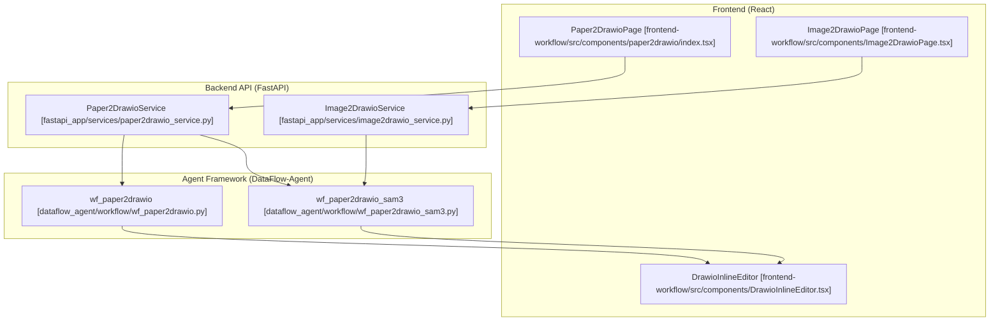
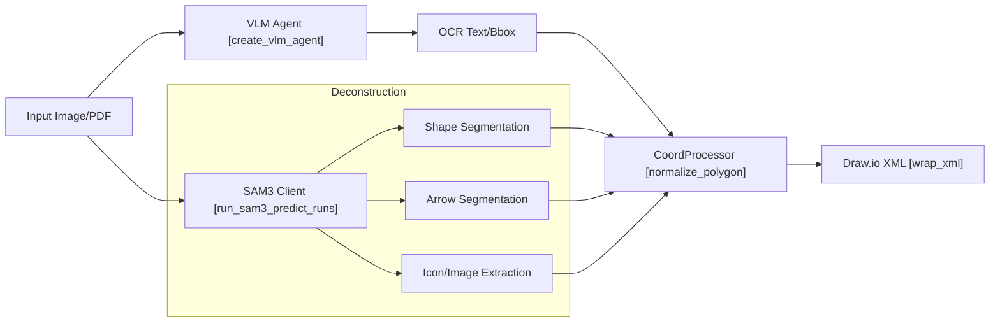

<!-- source: DeepWiki mcp.deepwiki.com · repo OpenDCAI/Paper2Any · page 6.7 Paper2Drawio & Image2Drawio Workflows · fetched 2026-11-02 -->

# Paper2Drawio & Image2Drawio Workflows

Relevant source files

The following files were used as context for generating this wiki page:

- [dataflow_agent/toolkits/multimodaltool/mineru_tool.py](dataflow_agent/toolkits/multimodaltool/mineru_tool.py)
- [dataflow_agent/workflow/wf_paper2drawio.py](dataflow_agent/workflow/wf_paper2drawio.py)
- [dataflow_agent/workflow/wf_paper2drawio_sam3.py](dataflow_agent/workflow/wf_paper2drawio_sam3.py)
- [fastapi_app/services/image2drawio_service.py](fastapi_app/services/image2drawio_service.py)
- [fastapi_app/services/paper2drawio_service.py](fastapi_app/services/paper2drawio_service.py)
- [fastapi_app/services/pdf2ppt_service.py](fastapi_app/services/pdf2ppt_service.py)
- [frontend-workflow/src/components/Image2DrawioPage.tsx](frontend-workflow/src/components/Image2DrawioPage.tsx)
- [frontend-workflow/src/components/Image2PptPage.tsx](frontend-workflow/src/components/Image2PptPage.tsx)
- [frontend-workflow/src/components/paper2drawio/index.tsx](frontend-workflow/src/components/paper2drawio/index.tsx)
- [frontend-workflow/src/components/paper2graph/index.tsx](frontend-workflow/src/components/paper2graph/index.tsx)
- [frontend-workflow/src/components/paper2poster/index.tsx](frontend-workflow/src/components/paper2poster/index.tsx)
- [frontend-workflow/src/components/paper2rebuttal/index.tsx](frontend-workflow/src/components/paper2rebuttal/index.tsx)
- [frontend-workflow/src/components/paper2video/ScriptStep.tsx](frontend-workflow/src/components/paper2video/ScriptStep.tsx)
- [frontend-workflow/src/components/paper2video/constants.ts](frontend-workflow/src/components/paper2video/constants.ts)
- [tests/manual/README.md](tests/manual/README.md)
- [tests/manual/sam3/test_paper2drawio_sam3_back.py](tests/manual/sam3/test_paper2drawio_sam3_back.py)

This section documents the technical implementation of the Paper2Drawio and Image2Drawio workflows. These systems enable the conversion of academic papers (PDFs), text descriptions, and static diagram images into editable, multi-layered Draw.io XML format.

## 1. Overview and System Integration

The system provides two primary routes for diagram generation: a **Semantic Route** (LLM-driven XML generation from text/PDF) and a **Visual Route** (Computer Vision-driven extraction from images). Both routes integrate with a specialized Draw.io inline editor in the frontend.

### Workflow Architecture
The following diagram illustrates the relationship between frontend components, backend services, and the specialized SAM3-based visual workflow.

**Diagram: Diagram Generation Service Map**

Sources: [frontend-workflow/src/components/paper2drawio/index.tsx:41-49](), [fastapi_app/services/paper2drawio_service.py:31-32](), [dataflow_agent/workflow/wf_paper2drawio_sam3.py:1-13]()

---

## 2. Paper2Drawio Workflow (Semantic Route)

The `paper2drawio_semantic` workflow focuses on generating diagrams from textual descriptions or extracted paper content. It uses LLMs to reason about structure and output XML directly.

### Key Implementation Details
- **Service Orchestration**: The `Paper2DrawioService` manages model candidates and directory structures [fastapi_app/services/paper2drawio_service.py:31-68]().
- **Concurrency Control**: Semantic workflows are limited to 2 concurrent processes using `SEMANTIC_WORKFLOW_LIMITER` (AsyncInterProcessSemaphore) [fastapi_app/services/paper2drawio_service.py:28-110]().
- **PDF Extraction**: If the input is a PDF, the service uses `run_mineru_pdf_extract_http` to convert the document to Markdown before processing [fastapi_app/services/paper2drawio_service.py:17-190]().

---

## 3. Image2Drawio & SAM3 Workflow (Visual Route)

The `paper2drawio_sam3` workflow is a sophisticated computer vision pipeline that deconstructs a static image into editable Draw.io components.

### Technical Pipeline
1.  **VLM OCR**: Uses models like `qwen-vl-ocr-latest` to extract text and bounding boxes [dataflow_agent/workflow/wf_paper2drawio_sam3.py:9-37]().
2.  **SAM3 Segmentation**: Calls the SAM3 (Segment Anything Model 3) HTTP service to segment shapes, arrows, and icons [dataflow_agent/workflow/wf_paper2drawio_sam3.py:39-46]().
3.  **Classification**: Segments are grouped into `shape`, `arrow`, `image`, and `background` with specific score thresholds [dataflow_agent/workflow/wf_paper2drawio_sam3.py:133-146]().
4.  **Vectorization**: The `CoordProcessor` class normalizes coordinates from the source image to the Draw.io canvas, calculating rotation and baseline offsets [dataflow_agent/workflow/wf_paper2drawio_sam3.py:186-221]().

**Diagram: SAM3 Visual Extraction Data Flow**

Sources: [dataflow_agent/workflow/wf_paper2drawio_sam3.py:35-50](), [dataflow_agent/workflow/wf_paper2drawio_sam3.py:186-210](), [dataflow_agent/workflow/wf_paper2drawio_sam3.py:141-146]()

---

## 4. Draw.io Inline Editor Integration

The frontend integrates the Draw.io editor using an `<iframe>` and a postMessage-based communication protocol.

### Integration Features
- **Origin Security**: Communication is restricted to `https://embed.diagrams.net` and `https://app.diagrams.net` [frontend-workflow/src/components/paper2drawio/index.tsx:22]().
- **Animated Loading**: To improve user experience, diagrams are loaded "cell-by-cell" using a batching animation logic to simulate real-time drawing [frontend-workflow/src/components/paper2drawio/index.tsx:25-27]().
- **State Sync**: The `lastLoadedXmlRef` and `isAnimatingRef` ensure the editor stays in sync with backend generation results without redundant reloads [frontend-workflow/src/components/paper2drawio/index.tsx:119-120]().

### Animation Constants
| Constant | Value | Description |
| :--- | :--- | :--- |
| `DRAWIO_ANIMATE_STEP_MS` | 60ms | Delay between animation frames |
| `DRAWIO_ANIMATE_MAX_CELLS` | 240 | Maximum elements to animate before instant load |
| `DRAWIO_ANIMATE_LARGE_BATCH`| 5 | Number of cells added per frame in large diagrams |

Sources: [frontend-workflow/src/components/paper2drawio/index.tsx:25-27](), [frontend-workflow/src/components/Image2DrawioPage.tsx:36-38]()

---

## 5. Implementation Summary

### Backend Services
- **`Paper2DrawioService`**: Orchestrates the high-level generation request, handles file persistence in `outputs/{email}/paper2drawio/{ts}/`, and implements model racing/retry logic [fastapi_app/services/paper2drawio_service.py:58-143]().
- **`AsyncInterProcessSemaphore`**: Used to protect GPU-intensive SAM3 tasks. `VISUAL_WORKFLOW_LIMITER` restricts SAM3 tasks to 1 concurrent execution system-wide [fastapi_app/services/paper2drawio_service.py:27-110]().

### Workflow Logic
- **`wf_paper2drawio_sam3.py`**: Contains the logic for "Image Recall." If the first pass misses small icons, a second pass with a lower threshold (`SAM3_IMAGE_RECALL_SCORE_THRESHOLD = 0.38`) is triggered [dataflow_agent/workflow/wf_paper2drawio_sam3.py:148-152]().
- **XML Wrapping**: The `wrap_xml` utility ensures that raw cell definitions are correctly nested within the `<mxfile><diagram><mxGraphModel><root>` hierarchy required by Draw.io [dataflow_agent/workflow/wf_paper2drawio_sam3.py:49-121]().

Sources: [fastapi_app/services/paper2drawio_service.py:27-110](), [dataflow_agent/workflow/wf_paper2drawio_sam3.py:148-152](), [dataflow_agent/toolkits/drawio_tools.py:16-17]()

---

