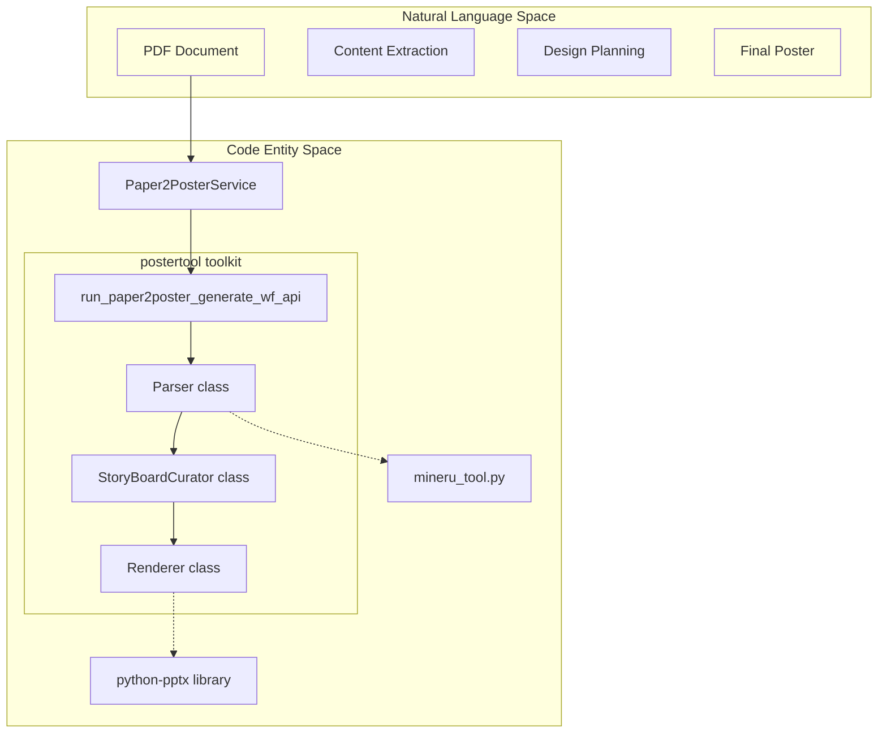
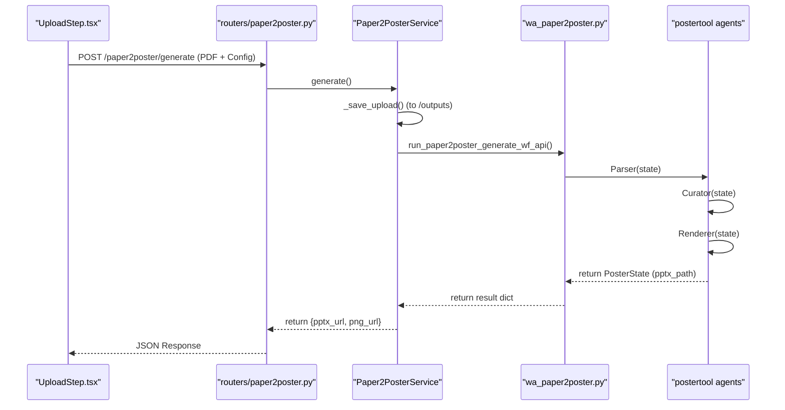

<!-- source: DeepWiki mcp.deepwiki.com · repo OpenDCAI/Paper2Any · page 6.8 Paper2Poster Workflow · fetched 2026-11-02 -->

# Paper2Poster Workflow

Relevant source files

The following files were used as context for generating this wiki page:

- [dataflow_agent/toolkits/postertool/src/agents/curator.py](dataflow_agent/toolkits/postertool/src/agents/curator.py)
- [dataflow_agent/toolkits/postertool/src/agents/parser.py](dataflow_agent/toolkits/postertool/src/agents/parser.py)
- [dataflow_agent/toolkits/postertool/src/agents/renderer.py](dataflow_agent/toolkits/postertool/src/agents/renderer.py)
- [dataflow_agent/toolkits/postertool/src/layout/text_height_measurement.py](dataflow_agent/toolkits/postertool/src/layout/text_height_measurement.py)
- [dataflow_agent/toolkits/postertool/src/workflow/pipeline.py](dataflow_agent/toolkits/postertool/src/workflow/pipeline.py)
- [dataflow_agent/toolkits/postertool/utils/langgraph_utils.py](dataflow_agent/toolkits/postertool/utils/langgraph_utils.py)
- [dataflow_agent/workflow/wf_paper2poster.py](dataflow_agent/workflow/wf_paper2poster.py)
- [fastapi_app/dependencies/auth.py](fastapi_app/dependencies/auth.py)
- [fastapi_app/routers/files.py](fastapi_app/routers/files.py)
- [fastapi_app/routers/paper2poster.py](fastapi_app/routers/paper2poster.py)
- [fastapi_app/routers/pdf2ppt.py](fastapi_app/routers/pdf2ppt.py)
- [fastapi_app/services/paper2poster_service.py](fastapi_app/services/paper2poster_service.py)
- [frontend-workflow/src/components/paper2poster/UploadStep.tsx](frontend-workflow/src/components/paper2poster/UploadStep.tsx)
- [frontend-workflow/src/services/fileService.ts](frontend-workflow/src/services/fileService.ts)
- [tests/test_paper2poster_parser.py](tests/test_paper2poster_parser.py)

The **Paper2Poster** workflow is a specialized multimodal pipeline designed to transform academic PDF papers into professional conference posters. It utilizes a multi-agent orchestration framework to handle document parsing, content curation, aesthetic design, and final rendering into editable PowerPoint (`.pptx`) and image (`.png`) formats.

## Pipeline Architecture

The workflow follows a sequential multi-agent design where each agent specializes in a specific domain of poster creation, from structural analysis to spatial optimization.

### Multi-Agent Sequence
1.  **Parser**: Extracts raw text, figures, and tables from the PDF using MinerU or PyMuPDF fallbacks [dataflow_agent/toolkits/postertool/src/agents/parser.py:39-53]().
2.  **Curator**: Performs spatial content planning and creates a "storyboard" that maps paper sections to poster columns [dataflow_agent/toolkits/postertool/src/agents/curator.py:15-24]().
3.  **Color Agent**: Determines the visual theme based on institution logos or academic standards.
4.  **Section Title Designer**: Generates stylized headers for different poster modules.
5.  **Layout Optimizer**: Calculates precise coordinates (x, y, width, height) for every element to ensure no overlaps and optimal whitespace.
6.  **Font Agent**: Selects typography scales (Title, Authors, Body) that maintain readability at large print scales.
7.  **Renderer**: Uses `python-pptx` to assemble the final document [dataflow_agent/toolkits/postertool/src/agents/renderer.py:22-34]().

### Technical Entity Map (Natural Language to Code)

The following diagram maps the conceptual workflow stages to the specific classes and files implementing them.

"Poster Generation System Map"

Sources: [fastapi_app/services/paper2poster_service.py:22-135](), [dataflow_agent/toolkits/postertool/src/agents/parser.py:39-125](), [dataflow_agent/toolkits/postertool/src/agents/renderer.py:22-55]()

## Implementation Details

### PosterState
The `PosterState` object acts as the shared memory for the pipeline. It tracks extraction results, generated content, and coordinate data as it moves through the agents.

| Key | Type | Description |
|:---|:---|:---|
| `pdf_path` | `str` | Path to the source PDF file. |
| `raw_text` | `str` | Full text extracted from the paper [dataflow_agent/toolkits/postertool/src/agents/parser.py:96](). |
| `story_board` | `Dict` | Mapping of content to spatial columns [dataflow_agent/toolkits/postertool/src/agents/curator.py:59](). |
| `images` / `tables` | `Dict` | Metadata and paths for extracted visual assets [dataflow_agent/toolkits/postertool/src/agents/parser.py:100-101](). |
| `output_dir` | `Path` | Directory for intermediate assets and final results. |

Sources: [dataflow_agent/toolkits/postertool/src/agents/parser.py:53-125](), [dataflow_agent/toolkits/postertool/src/agents/curator.py:25-75]()

### The Parser Agent
The `Parser` is responsible for "Foundation Building". It primarily uses the **MinerU** service via HTTP (port 8010) to perform layout-aware text extraction [dataflow_agent/toolkits/postertool/src/agents/parser.py:45-136]().

*   **Asset Extraction**: It identifies figures and tables, cropping them from the PDF pages [dataflow_agent/toolkits/postertool/src/agents/parser.py:63-64]().
*   **Fallback**: If MinerU is unavailable, it falls back to `PyMuPDF` for basic text and image extraction [dataflow_agent/toolkits/postertool/src/agents/parser.py:138-142]().
*   **Narrative Generation**: It uses an LLM to generate an "ABT" (And, But, Therefore) narrative of the paper to ensure the poster tells a cohesive story [dataflow_agent/toolkits/postertool/src/agents/parser.py:70-73]().

Sources: [dataflow_agent/toolkits/postertool/src/agents/parser.py:39-142](), [tests/test_paper2poster_parser.py:80-142]()

### The Renderer Agent
The `Renderer` converts the optimized layout coordinates into a physical PowerPoint file.

*   **Styling**: It loads `styling_interfaces.json` to apply consistent bullet points, bolding, and spacing [dataflow_agent/toolkits/postertool/src/agents/renderer.py:57-78]().
*   **Element Rendering**: It iterates through `styled_layout` elements, calling specific methods for `_render_title`, `_render_section_title`, and `_render_visual` [dataflow_agent/toolkits/postertool/src/agents/renderer.py:114-132]().
*   **Dimension Control**: It explicitly sets `prs.slide_width` and `prs.slide_height` based on the user's requested poster dimensions (e.g., 54x36 inches) [dataflow_agent/toolkits/postertool/src/agents/renderer.py:81-84]().

Sources: [dataflow_agent/toolkits/postertool/src/agents/renderer.py:22-102](), [fastapi_app/services/paper2poster_service.py:26-34]()

## Data Flow Diagram

"Paper2Poster Internal Data Flow"

Sources: [frontend-workflow/src/components/paper2poster/UploadStep.tsx:37-56](), [fastapi_app/routers/paper2poster.py:16-44](), [fastapi_app/services/paper2poster_service.py:68-150](), [dataflow_agent/toolkits/postertool/src/agents/renderer.py:36-55]()

## File Management & Security

Poster generation involves significant file I/O. The system ensures user isolation and path safety:

1.  **User Isolation**: Files are stored in `outputs/{email}/paper2poster/{run_id}/` [fastapi_app/services/paper2poster_service.py:61-66]().
2.  **Path Sanitization**: Filenames are sanitized to prevent directory traversal using `_safe_filename` [fastapi_app/services/paper2poster_service.py:37-42]().
3.  **Authentication**: Endpoints use `get_current_user` to ensure only authorized users can trigger generation and access history [fastapi_app/routers/files.py:122-135]().
4.  **URL Mapping**: Internal filesystem paths are converted to browser-accessible URLs via `_to_outputs_url` [fastapi_app/services/paper2poster_service.py:147-148]().

Sources: [fastapi_app/services/paper2poster_service.py:37-66](), [fastapi_app/routers/files.py:122-135](), [frontend-workflow/src/services/fileService.ts:33-54]()

---

