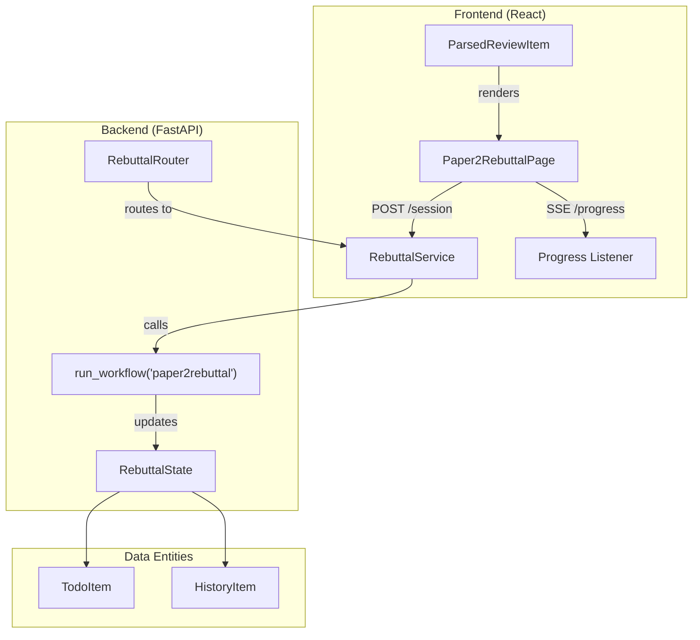
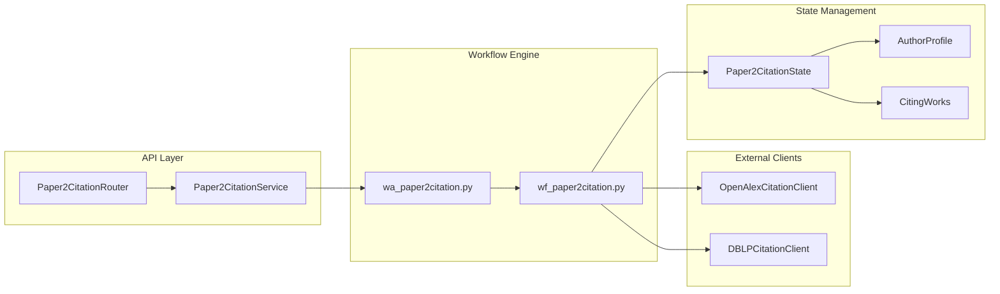

<!-- source: DeepWiki mcp.deepwiki.com · repo OpenDCAI/Paper2Any · page 6.9 Paper2Rebuttal & Paper2Citation Workflows · fetched 2026-11-02 -->

# Paper2Rebuttal & Paper2Citation Workflows

Relevant source files

The following files were used as context for generating this wiki page:

- [dataflow_agent/toolkits/citationtool/context_locator.py](dataflow_agent/toolkits/citationtool/context_locator.py)
- [dataflow_agent/workflow/wf_paper2citation.py](dataflow_agent/workflow/wf_paper2citation.py)
- [fastapi_app/routers/paper2citation.py](fastapi_app/routers/paper2citation.py)
- [fastapi_app/routers/paper2rebuttal.py](fastapi_app/routers/paper2rebuttal.py)
- [fastapi_app/services/paper2citation_service.py](fastapi_app/services/paper2citation_service.py)
- [fastapi_app/services/rebuttal_service.py](fastapi_app/services/rebuttal_service.py)
- [fastapi_app/workflow_adapters/wa_paper2citation.py](fastapi_app/workflow_adapters/wa_paper2citation.py)
- [frontend-workflow/src/components/Image2DrawioPage.tsx](frontend-workflow/src/components/Image2DrawioPage.tsx)
- [frontend-workflow/src/components/Image2PptPage.tsx](frontend-workflow/src/components/Image2PptPage.tsx)
- [frontend-workflow/src/components/paper2citation/index.tsx](frontend-workflow/src/components/paper2citation/index.tsx)
- [frontend-workflow/src/components/paper2citation/types.ts](frontend-workflow/src/components/paper2citation/types.ts)
- [frontend-workflow/src/components/paper2graph/index.tsx](frontend-workflow/src/components/paper2graph/index.tsx)
- [frontend-workflow/src/components/paper2rebuttal/index.tsx](frontend-workflow/src/components/paper2rebuttal/index.tsx)
- [frontend-workflow/src/locales/en/paper2citation.json](frontend-workflow/src/locales/en/paper2citation.json)
- [frontend-workflow/src/locales/zh/paper2citation.json](frontend-workflow/src/locales/zh/paper2citation.json)

This page documents two specialized academic workflows within Paper2Any: **Paper2Rebuttal**, which assists researchers in generating responses to peer reviews, and **Paper2Citation**, which explores academic influence through citation network analysis.

## 1. Paper2Rebuttal Workflow

The Paper2Rebuttal workflow is designed to streamline the academic rebuttal process by parsing reviewer comments, suggesting response strategies, and drafting rebuttal text. It utilizes a stateful session-based approach with Server-Sent Events (SSE) for real-time progress updates.

### 1.1 Implementation & Data Flow
The workflow operates through a multi-step process:
1.  **Input Parsing**: Accepts PDF papers and review text (either as a file or direct input) [frontend-workflow/src/components/paper2rebuttal/index.tsx:108-111]().
2.  **Review Itemization**: The system parses the raw review text into discrete `ParsedReviewItem` objects [frontend-workflow/src/components/paper2rebuttal/index.tsx:57-60]().
3.  **Strategy Generation**: For each identified question or critique, the agent generates a response strategy and a list of "To-Do" items (e.g., "perform ablation study") [frontend-workflow/src/components/paper2rebuttal/index.tsx:17-24]().
4.  **Drafting**: Based on the strategy and paper content, it generates a draft response for the researcher to review.

### 1.2 Key Components
*   **Session Management**: Tracks the state of a rebuttal across multiple questions and revisions [frontend-workflow/src/components/paper2rebuttal/index.tsx:51-55]().
*   **Progress Tracking**: Uses a `Timeline` component to show the current stage (upload -> processing -> review -> result) [frontend-workflow/src/components/paper2rebuttal/index.tsx:10-10]().
*   **Interactive Editing**: Users can provide feedback on specific draft responses, triggering a revision loop [frontend-workflow/src/components/paper2rebuttal/index.tsx:44-44]().

### 1.3 Rebuttal System Architecture
This diagram bridges the frontend UI components with the backend service logic.

"Paper2Rebuttal System Bridge"

Sources: `frontend-workflow/src/components/paper2rebuttal/index.tsx`, `fastapi_app/services/rebuttal_service.py`

---

## 2. Paper2Citation Workflow

The Paper2Citation workflow provides a deep-dive into the citation network of an author or a specific paper. It aggregates data from OpenAlex and DBLP to visualize academic impact.

### 2.1 Search Modes
The workflow supports two primary entry points [frontend-workflow/src/components/paper2citation/types.ts:1-1]():
1.  **Author Mode**: Searches for author candidates by name. Once a candidate is selected, it loads their publication history and citation network [dataflow_agent/workflow/wf_paper2citation.py:25-35]().
2.  **Paper Mode**: Resolves a DOI or URL to fetch specific paper details and the works that cite it [dataflow_agent/workflow/wf_paper2citation.py:108-118]().

### 2.2 Citation Context Locator
A unique feature of this workflow is the `context_locator`, which attempts to find the exact sentence and paragraph where a paper is cited within the full text of a citing work [dataflow_agent/workflow/wf_paper2citation.py:9-11]().

*   **Function**: `extract_citation_context_for_work`
*   **Data Model**: `CitationContextItem` stores the section name, the specific sentence, and the surrounding paragraph [frontend-workflow/src/components/paper2citation/types.ts:110-116]().

### 2.3 Implementation Details
The backend logic is encapsulated in `wf_paper2citation.py`, which utilizes a `GenericGraphBuilder` to manage the complex data retrieval tasks [dataflow_agent/workflow/wf_paper2citation.py:6-8]().

| Function | Responsibility |
| :--- | :--- |
| `_fetch_openalex_seed_works` | Retrieves top-cited papers for an author to serve as "seeds" for the citation crawl [dataflow_agent/workflow/wf_paper2citation.py:189-201](). |
| `aggregate_citation_network` | Combines data from multiple sources to build the citing authors and institutions list [dataflow_agent/workflow/wf_paper2citation.py:22-22](). |
| `enrich_honors_with_websearch` | Adds academic prestige labels (Fellows, Awards) to author profiles [dataflow_agent/workflow/wf_paper2citation.py:29-29](). |

### 2.4 Citation Data Flow
This diagram illustrates how the `Paper2CitationService` orchestrates data from external clients into the `Paper2CitationState`.

"Paper2Citation Data Flow"

Sources: `fastapi_app/routers/paper2citation.py`, `fastapi_app/services/paper2citation_service.py`, `dataflow_agent/workflow/wf_paper2citation.py`

### 2.5 Key Data Structures
*   **`CitationAuthorCandidate`**: Represents a potential match during author search [frontend-workflow/src/components/paper2citation/types.ts:3-13]().
*   **`CitationWorkItem`**: A standardized representation of a paper across different sources [frontend-workflow/src/components/paper2citation/types.ts:43-53]().
*   **`CitationStatItem`**: Used for rendering bar charts and statistics (e.g., h-index, total citations) [frontend-workflow/src/components/paper2citation/types.ts:15-18]().

Sources:
*   `frontend-workflow/src/components/paper2rebuttal/index.tsx` [1-204]()
*   `dataflow_agent/workflow/wf_paper2citation.py` [1-216]()
*   `fastapi_app/routers/paper2citation.py` [1-65]()
*   `fastapi_app/services/paper2citation_service.py` [1-96]()
*   `fastapi_app/workflow_adapters/wa_paper2citation.py` [1-159]()
*   `frontend-workflow/src/components/paper2citation/types.ts` [1-139]()

---

