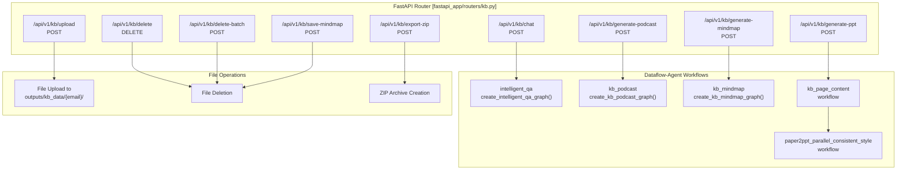
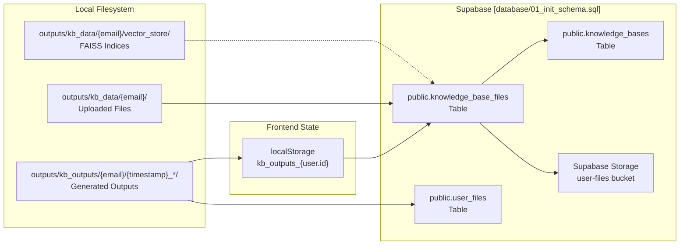
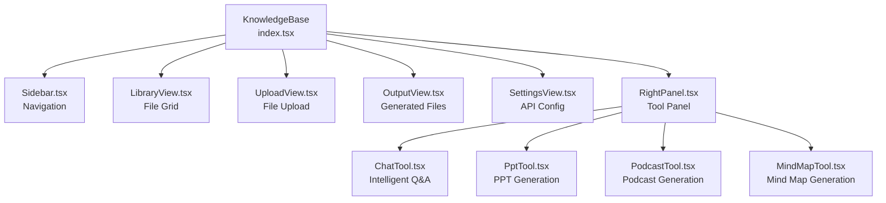
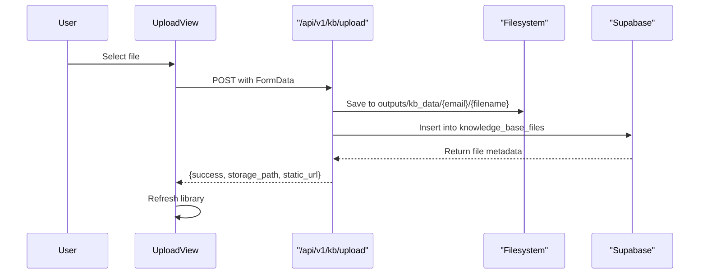
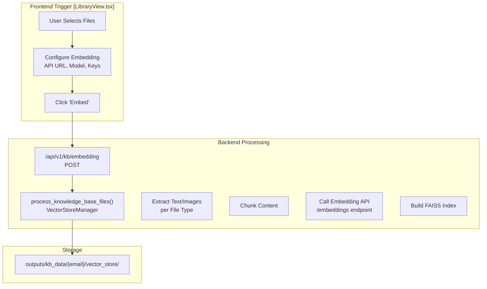
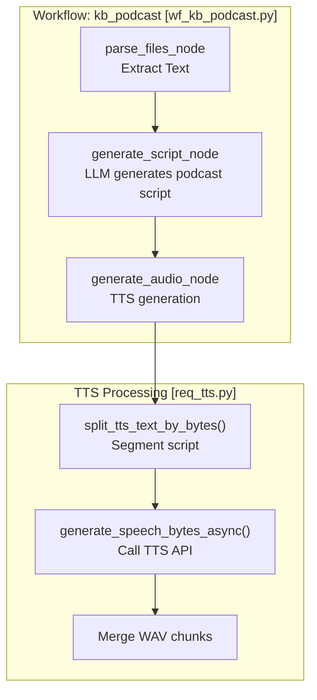

<!-- source: DeepWiki mcp.deepwiki.com · repo OpenDCAI/Paper2Any · page 7 Knowledge Base System · fetched 2026-11-02 -->

# Knowledge Base System

Relevant source files

The following files were used as context for generating this wiki page:

- [database/01_init_schema.sql](database/01_init_schema.sql)
- [dataflow_agent/workflow/wf_intelligent_qa.py](dataflow_agent/workflow/wf_intelligent_qa.py)
- [dataflow_agent/workflow/wf_kb_podcast.py](dataflow_agent/workflow/wf_kb_podcast.py)
- [fastapi_app/routers/kb.py](fastapi_app/routers/kb.py)
- [frontend-workflow/src/components/knowledge-base/LibraryView.tsx](frontend-workflow/src/components/knowledge-base/LibraryView.tsx)
- [frontend-workflow/src/components/knowledge-base/OutputView.tsx](frontend-workflow/src/components/knowledge-base/OutputView.tsx)
- [frontend-workflow/src/components/knowledge-base/RightPanel.tsx](frontend-workflow/src/components/knowledge-base/RightPanel.tsx)
- [frontend-workflow/src/components/knowledge-base/Sidebar.tsx](frontend-workflow/src/components/knowledge-base/Sidebar.tsx)
- [frontend-workflow/src/components/knowledge-base/ToolSelector.tsx](frontend-workflow/src/components/knowledge-base/ToolSelector.tsx)
- [frontend-workflow/src/components/knowledge-base/UploadView.tsx](frontend-workflow/src/components/knowledge-base/UploadView.tsx)
- [frontend-workflow/src/components/knowledge-base/index.tsx](frontend-workflow/src/components/knowledge-base/index.tsx)
- [frontend-workflow/src/components/knowledge-base/tools/ChatTool.tsx](frontend-workflow/src/components/knowledge-base/tools/ChatTool.tsx)
- [frontend-workflow/src/components/knowledge-base/tools/MindMapTool.tsx](frontend-workflow/src/components/knowledge-base/tools/MindMapTool.tsx)
- [frontend-workflow/src/components/knowledge-base/tools/PodcastTool.tsx](frontend-workflow/src/components/knowledge-base/tools/PodcastTool.tsx)
- [frontend-workflow/src/components/knowledge-base/tools/PptTool.tsx](frontend-workflow/src/components/knowledge-base/tools/PptTool.tsx)
- [frontend-workflow/src/components/knowledge-base/types.ts](frontend-workflow/src/components/knowledge-base/types.ts)

The Knowledge Base System is a comprehensive multi-file management and AI-powered content generation platform. It enables users to upload documents (PDF, DOCX, PPTX), images, and videos; organize them into categorized knowledge bases; perform semantic search via vector embeddings; and generate derivative outputs including intelligent Q&A responses, audio podcasts, mind maps, and presentations.

For information about individual document conversion workflows (Paper2Figure, Paper2PPT, PDF2PPT), see sections [Paper2Figure Workflow](#6.1), [Paper2PPT Workflow](#6.2), and [PDF2PPT Workflow](#6.3). The Knowledge Base system differs in that it operates on **multiple files simultaneously** and supports **persistent storage** with metadata tracking.

---

## System Architecture Overview

The Knowledge Base system implements a three-tier architecture: frontend React components, FastAPI backend routers, and dataflow-agent workflows.

**Backend API Routes → Workflow Mapping**

**Sources:** [fastapi_app/routers/kb.py:30-799]()

---

## Data Storage Architecture

The system uses a hybrid storage model: file binaries on the local filesystem, metadata in Supabase PostgreSQL, and optional vector embeddings for semantic search.

**Storage Layer Diagram**

**File Path Structure:**
- **Uploaded Files:** `outputs/kb_data/{email}/{filename}` [fastapi_app/routers/kb.py:36]()
- **Generated Outputs:** `outputs/kb_outputs/{email}/{timestamp}_{workflow_type}/` [dataflow_agent/workflow/wf_kb_podcast.py:69]()
- **Vector Store:** `outputs/kb_data/{email}/vector_store/`
- **Exports:** `outputs/kb_exports/{email}/{kb_name}_{timestamp}.zip` [fastapi_app/routers/kb.py:97]()

**Supabase Tables Schema:**

| Table | Key Columns | Purpose |
|-------|-------------|---------|
| `knowledge_base_files` | `id`, `user_id`, `file_name`, `storage_path`, `kb_id`, `is_embedded` | Metadata for uploaded files [database/01_init_schema.sql:155-168]() |
| `knowledge_bases` | `id`, `user_id`, `name`, `description` | Knowledge base categories [database/01_init_schema.sql:112-119]() |
| `user_files` | `id`, `user_id`, `file_path`, `file_type` | Generated output metadata [database/01_init_schema.sql:68-76]() |

**Sources:** [fastapi_app/routers/kb.py:30-36](), [frontend-workflow/src/components/knowledge-base/index.tsx:68-91](), [database/01_init_schema.sql:103-168]()

---

## Frontend Component Architecture

The Knowledge Base UI is implemented as a React application with multiple specialized views and tools.

**Component Hierarchy**

**State Management:**

The main component maintains the following state objects [frontend-workflow/src/components/knowledge-base/index.tsx:21-56]():
- `files: KnowledgeFile[]` - Library files fetched from Supabase.
- `outputFiles: KnowledgeFile[]` - Generated outputs from localStorage.
- `knowledgeBases: KnowledgeBaseEntry[]` - KB categories.
- `selectedIds: Set<string>` - Currently selected file IDs.
- `activeTool: ToolType` - Active tool in RightPanel ('chat' | 'ppt' | 'podcast' | 'mindmap' | 'search' | 'video').
- `activeSection: SectionType` - Active view ('library' | 'upload' | 'output' | 'settings').

**Sources:** [frontend-workflow/src/components/knowledge-base/index.tsx:1-141](), [frontend-workflow/src/components/knowledge-base/RightPanel.tsx:28-117]()

---

## File Management

File management operations include upload, deletion, categorization into knowledge bases, and export to ZIP archives. For details, see [File Management](#7.1).

**Upload Flow**

**Endpoint: `/api/v1/kb/upload`** [fastapi_app/routers/kb.py:115]()

- **Method:** POST
- **Allowed Extensions:** `.pdf`, `.docx`, `.pptx`, `.png`, `.jpg`, `.jpeg`, `.mp4` [fastapi_app/routers/kb.py:38]()
- **Storage Path:** `outputs/kb_data/{email}/{filename}`
- **Response:** Includes `filename`, `file_size`, and `static_url` [fastapi_app/routers/kb.py:164-171]().

**Sources:** [fastapi_app/routers/kb.py:115-171](), [frontend-workflow/src/components/knowledge-base/UploadView.tsx:83-156]()

---

## Vector Embedding & Search

The Knowledge Base system supports semantic search via vector embeddings stored in FAISS indices. For details, see [Vector Embedding & Search](#7.5).

**Embedding Architecture**

**Sources:** [frontend-workflow/src/components/knowledge-base/LibraryView.tsx:113-135](), [fastapi_app/routers/kb.py:461-500]()

---

## Intelligent Q&A

The Intelligent Q&A tool implements a RAG (Retrieval-Augmented Generation) system for answering questions about uploaded knowledge base files. For details, see [Intelligent Q&A](#7.2).

**Workflow Implementation: `wf_intelligent_qa`**

The workflow is defined in `dataflow_agent/workflow/wf_intelligent_qa.py` [dataflow_agent/workflow/wf_intelligent_qa.py:30-31](). It uses `parallel_parse_node` to extract content from PDFs, Word, and PPT files concurrently [dataflow_agent/workflow/wf_intelligent_qa.py:62-166]().

**Sources:** [dataflow_agent/workflow/wf_intelligent_qa.py:30-185](), [frontend-workflow/src/components/knowledge-base/tools/ChatTool.tsx]()

---

## Podcast Generation

The Podcast Generation tool converts knowledge base documents into audio podcasts with AI-generated scripts and TTS narration. For details, see [Podcast Generation](#7.3).

**Podcast Pipeline Architecture**

**Sources:** [dataflow_agent/workflow/wf_kb_podcast.py:36-451](), [frontend-workflow/src/components/knowledge-base/tools/PodcastTool.tsx:118-193]()

---

## Mind Map Generation

The Mind Map tool analyzes knowledge base files and generates Mermaid-format mind maps for visualization. For details, see [Mind Map Generation](#7.4).

**Frontend Display:** The `MindMapTool` uses `MermaidPreview` to render the generated code [frontend-workflow/src/components/knowledge-base/tools/MindMapTool.tsx:5-20](). Users can edit the Mermaid code directly and save modifications via `/api/v1/kb/save-mindmap` [fastapi_app/routers/kb.py:761-798]().

**Sources:** [fastapi_app/routers/kb.py:674-798](), [frontend-workflow/src/components/knowledge-base/tools/MindMapTool.tsx:41-118]()

---

## Summary

The Knowledge Base System provides a comprehensive platform for managing multi-file knowledge repositories and generating diverse AI-powered outputs. Key capabilities include:

- **File Management:** Upload, organize, delete, and export files with Supabase metadata tracking.
- **Vector Search:** Optional FAISS-based semantic search via embedding APIs.
- **Intelligent Q&A:** RAG-based question answering with conversation history.
- **Podcast Generation:** AI script generation + multi-voice TTS narration (monologue/dialog modes).
- **Mind Map Generation:** Mermaid diagram creation with in-browser editing.
- **PPT Generation:** Multi-file PPT creation with retrieval-based content selection.

**Sources:** [fastapi_app/routers/kb.py:1-799](), [frontend-workflow/src/components/knowledge-base/index.tsx:1-141]()

---

