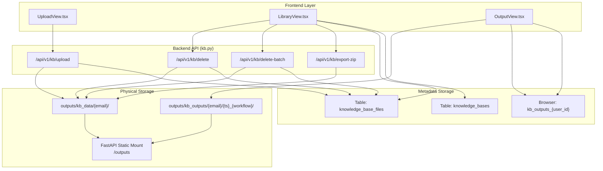
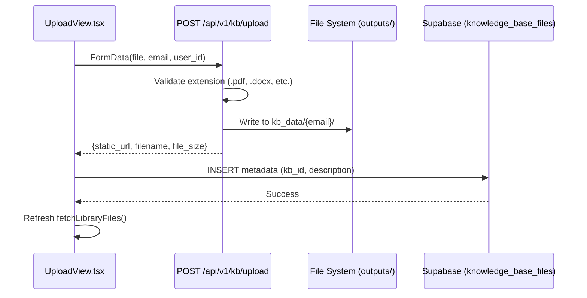

<!-- source: DeepWiki mcp.deepwiki.com · repo OpenDCAI/Paper2Any · page 7.1 File Management · fetched 2026-11-02 -->

# File Management

<details>
<summary>Relevant source files</summary>

The following files were used as context for generating this wiki page:

- [database/01_init_schema.sql](database/01_init_schema.sql)
- [dataflow_agent/workflow/wf_kb_podcast.py](dataflow_agent/workflow/wf_kb_podcast.py)
- [fastapi_app/routers/kb.py](fastapi_app/routers/kb.py)
- [fastapi_app/routers/kb_embedding.py](fastapi_app/routers/kb_embedding.py)
- [fastapi_app/workflow_adapters/wa_kb_deepresearch.py](fastapi_app/workflow_adapters/wa_kb_deepresearch.py)
- [fastapi_app/workflow_adapters/wa_kb_report.py](fastapi_app/workflow_adapters/wa_kb_report.py)
- [frontend-workflow/src/components/knowledge-base/LibraryView.tsx](frontend-workflow/src/components/knowledge-base/LibraryView.tsx)
- [frontend-workflow/src/components/knowledge-base/OutputView.tsx](frontend-workflow/src/components/knowledge-base/OutputView.tsx)
- [frontend-workflow/src/components/knowledge-base/UploadView.tsx](frontend-workflow/src/components/knowledge-base/UploadView.tsx)
- [frontend-workflow/src/components/knowledge-base/index.tsx](frontend-workflow/src/components/knowledge-base/index.tsx)
- [frontend-workflow/src/components/knowledge-base/tools/MindMapTool.tsx](frontend-workflow/src/components/knowledge-base/tools/MindMapTool.tsx)
- [frontend-workflow/src/components/knowledge-base/tools/PodcastTool.tsx](frontend-workflow/src/components/knowledge-base/tools/PodcastTool.tsx)
- [frontend-workflow/src/components/knowledge-base/tools/PptTool.tsx](frontend-workflow/src/components/knowledge-base/tools/PptTool.tsx)

</details>


## Purpose and Scope

This document describes the file management system within the Knowledge Base feature, covering file upload, storage, organization, metadata tracking, and access patterns. For information about how files are processed by knowledge base workflows (intelligent QA, podcast generation, etc.), see [Knowledge Base System](#7). For general output file management across all workflows, see [File Storage & URLs](#4.4).

The file management system handles two distinct categories:
- **Library files**: User-uploaded source materials (PDFs, documents, images, videos).
- **Output files**: AI-generated artifacts (presentations, podcasts, mindmaps).

Both categories use hierarchical directory structures under `outputs/` but differ in persistence strategies and metadata storage.

---

## Storage Architecture

The system implements a dual-storage architecture separating physical files from metadata:

**Storage Logic Diagram**

**Sources**: [fastapi_app/routers/kb.py:30-36](), [frontend-workflow/src/components/knowledge-base/index.tsx:21-33](), [database/01_init_schema.sql:103-168]()

### Directory Structure

- **Library Files**: `outputs/kb_data/{email}/{filename}`. User-uploaded files are isolated by email to prevent cross-user access [fastapi_app/routers/kb.py:91-98]().
- **Output Files**: `outputs/kb_outputs/{email}/{timestamp}_{workflow}/`. Generated artifacts are stored in timestamped subdirectories for isolation [dataflow_agent/workflow/wf_kb_podcast.py:64-71]().
- **Notebooks Metadata**: `outputs/kb_data/_notebooks/{user_id}.json`. Local JSON files store notebook configurations and directory mappings [fastapi_app/routers/kb.py:117-121]().

**Sources**: [fastapi_app/routers/kb.py:43-43](), [fastapi_app/routers/kb.py:182-195](), [dataflow_agent/workflow/wf_kb_podcast.py:69-71]()

---

## File Upload System

### Upload Endpoint

The `/api/v1/kb/upload` endpoint handles multipart form uploads and metadata persistence.

**Upload Flow**

**Sources**: [fastapi_app/routers/kb.py:38-41](), [frontend-workflow/src/components/knowledge-base/UploadView.tsx:95-132]()

### Validation and Security

- **Extension Whitelist**: Supported types include `.pdf`, `.docx`, `.pptx`, `.png`, `.jpg`, `.jpeg`, `.mp4` [fastapi_app/routers/kb.py:38-41]().
- **Path Isolation**: The backend uses `_ensure_path_within_roots` to verify that any requested file operation stays within the user's allowed directories (`kb_data`, `kb_outputs`, `kb_exports`) [fastapi_app/routers/kb.py:101-109]().
- **Safe Filenames**: The `_safe_dirname` helper sanitizes names by removing dangerous characters and collapsing whitespace [fastapi_app/routers/kb.py:60-70]().

**Sources**: [fastapi_app/routers/kb.py:91-98](), [fastapi_app/routers/kb.py:112-114]()

---

## File Organization

### Knowledge Base Categories

Files are organized into `knowledge_bases` (categories) managed in Supabase.

| Feature | Code Entity | Description |
| :--- | :--- | :--- |
| **Table** | `public.knowledge_bases` | Stores KB names and descriptions per user [database/01_init_schema.sql:112-119](). |
| **Relation** | `kb_id` | Foreign key in `knowledge_base_files` linking a file to a KB [database/01_init_schema.sql:165-165](). |
| **UI Selector** | `selectedKbId` | React state in `UploadView` for assigning files to a KB during upload [frontend-workflow/src/components/knowledge-base/UploadView.tsx:30-30](). |

**Sources**: [database/01_init_schema.sql:122-122](), [frontend-workflow/src/components/knowledge-base/LibraryView.tsx:142-153]()

### Batch Operations

- **Bulk Delete**: `LibraryView.tsx` uses `supabase.from('knowledge_base_files').delete().in('id', ...)` to remove multiple metadata records [frontend-workflow/src/components/knowledge-base/LibraryView.tsx:178-187]().
- **Bulk Export**: The backend generates ZIP archives of selected files for download, ensuring filenames do not collide within the archive [fastapi_app/routers/kb.py:234-289]().

---

## Metadata and State Management

### Supabase Integration

The `knowledge_base_files` table tracks the state of library files, including whether they have been processed for RAG (Retrieval-Augmented Generation).

- **`is_embedded`**: Boolean flag indicating if the file's vector embeddings are generated [database/01_init_schema.sql:163-163]().
- **`kb_file_id`**: Stores the unique identifier from the vector database (e.g., FAISS) for retrieval [fastapi_app/routers/kb_embedding.py:68-77]().

**Sources**: [database/01_init_schema.sql:155-168](), [fastapi_app/routers/kb_embedding.py:61-89]()

### Output Tracking (LocalStorage)

Unlike library files, generated outputs are tracked in the browser's `localStorage` to allow for quick access without frequent database queries.

```typescript
// frontend-workflow/src/components/knowledge-base/index.tsx
useEffect(() => {
  const key = getOutputStorageKey(); // "kb_outputs_{user_id}"
  const raw = localStorage.getItem(key);
  if (raw) setOutputFiles(JSON.parse(raw));
}, [user?.id]);
```
**Sources**: [frontend-workflow/src/components/knowledge-base/index.tsx:68-91](), [frontend-workflow/src/components/knowledge-base/index.tsx:93-97]()

---

## UI Components

### LibraryView
The main interface for managing uploaded materials. It supports:
- **Filtering**: By file type or embedding status [frontend-workflow/src/components/knowledge-base/LibraryView.tsx:68-68]().
- **Tool Compatibility**: Highlighting which files are supported by the currently active tool (e.g., PodcastTool only supports documents) [frontend-workflow/src/components/knowledge-base/LibraryView.tsx:26-35]().

### UploadView
Handles the drag-and-drop upload process. It requires a `selectedKbId` before allowing uploads to ensure all files are categorized [frontend-workflow/src/components/knowledge-base/UploadView.tsx:85-88]().

### OutputView
Displays generated artifacts. It resolves secure asset URLs for generated files to enable previewing and downloading [frontend-workflow/src/components/knowledge-base/OutputView.tsx:19-43]().

**Sources**: [frontend-workflow/src/components/knowledge-base/LibraryView.tsx:91-102](), [frontend-workflow/src/components/knowledge-base/OutputView.tsx:102-114]()

---

## Processing Workflows

Workflows often require file parsing and merging before AI generation.

- **`parse_files_node`**: Extracts text from `.pdf`, `.docx`, and `.pptx` using `fitz`, `python-docx`, and `python-pptx` [dataflow_agent/workflow/wf_kb_podcast.py:80-141]().
- **PDF Merging**: Multiple selected documents are merged into a single PDF using `fitz.open()` and `insert_pdf()` for context processing [dataflow_agent/workflow/wf_kb_podcast.py:586-603]().
- **Output URL Resolution**: The `_to_outputs_url` utility converts local paths into static URLs served by the FastAPI backend [fastapi_app/workflow_adapters/wa_kb_report.py:10-11](), [fastapi_app/workflow_adapters/wa_kb_report.py:62-62]().

**Sources**: [dataflow_agent/workflow/wf_kb_podcast.py:153-158](), [fastapi_app/workflow_adapters/wa_kb_report.py:14-20]()

---

