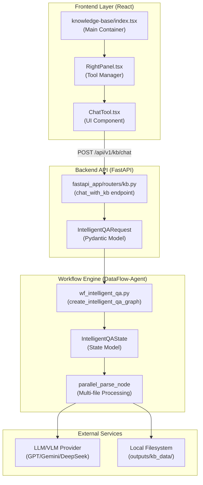
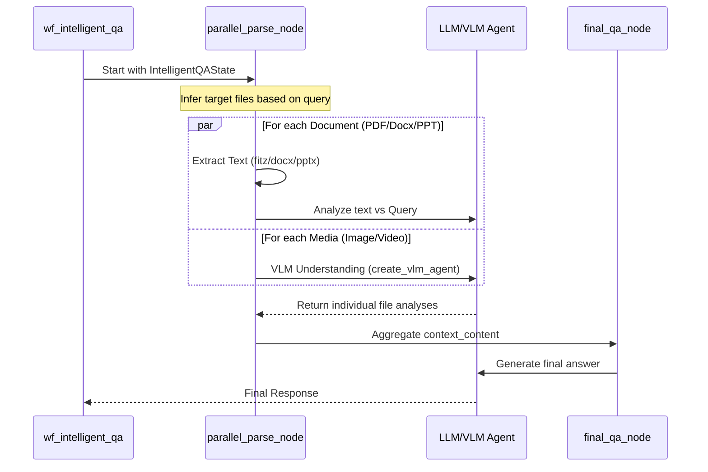

<!-- source: DeepWiki mcp.deepwiki.com · repo OpenDCAI/Paper2Any · page 7.2 Intelligent Q&A · fetched 2026-11-02 -->

# Intelligent Q&A

<details>
<summary>Relevant source files</summary>

The following files were used as context for generating this wiki page:

- [database/01_init_schema.sql](database/01_init_schema.sql)
- [dataflow_agent/workflow/wf_intelligent_qa.py](dataflow_agent/workflow/wf_intelligent_qa.py)
- [dataflow_agent/workflow/wf_kb_podcast.py](dataflow_agent/workflow/wf_kb_podcast.py)
- [fastapi_app/routers/kb.py](fastapi_app/routers/kb.py)
- [frontend-workflow/src/components/knowledge-base/LibraryView.tsx](frontend-workflow/src/components/knowledge-base/LibraryView.tsx)
- [frontend-workflow/src/components/knowledge-base/OutputView.tsx](frontend-workflow/src/components/knowledge-base/OutputView.tsx)
- [frontend-workflow/src/components/knowledge-base/RightPanel.tsx](frontend-workflow/src/components/knowledge-base/RightPanel.tsx)
- [frontend-workflow/src/components/knowledge-base/Sidebar.tsx](frontend-workflow/src/components/knowledge-base/Sidebar.tsx)
- [frontend-workflow/src/components/knowledge-base/ToolSelector.tsx](frontend-workflow/src/components/knowledge-base/ToolSelector.tsx)
- [frontend-workflow/src/components/knowledge-base/UploadView.tsx](frontend-workflow/src/components/knowledge-base/UploadView.tsx)
- [frontend-workflow/src/components/knowledge-base/index.tsx](frontend-workflow/src/components/knowledge-base/index.tsx)
- [frontend-workflow/src/components/knowledge-base/tools/ChatTool.tsx](frontend-workflow/src/components/knowledge-base/tools/ChatTool.tsx)
- [frontend-workflow/src/components/knowledge-base/tools/MindMapTool.tsx](frontend-workflow/src/components/knowledge-base/tools/MindMapTool.tsx)
- [frontend-workflow/src/components/knowledge-base/tools/PodcastTool.tsx](frontend-workflow/src/components/knowledge-base/tools/PodcastTool.tsx)
- [frontend-workflow/src/components/knowledge-base/tools/PptTool.tsx](frontend-workflow/src/components/knowledge-base/tools/PptTool.tsx)
- [frontend-workflow/src/components/knowledge-base/types.ts](frontend-workflow/src/components/knowledge-base/types.ts)

</details>


## Purpose and Scope

The Intelligent Q&A system is a RAG (Retrieval-Augmented Generation) based chat interface that answers questions about uploaded knowledge base files. It combines multi-format content extraction with LLM/VLM reasoning to provide contextually relevant answers from document collections. The system uniquely supports parallel analysis of multiple file types, including PDFs, Word documents, PowerPoint presentations, images, and videos. [dataflow_agent/workflow/wf_intelligent_qa.py:31-38]()

For information about uploading and managing knowledge base files, see [File Management](#7.1). For other knowledge base workflows, see [Podcast Generation](#7.3) and [Mind Map Generation](#7.4).

---

## Architecture Overview

The Intelligent Q&A system follows a three-tier architecture with a React-based frontend, FastAPI backend, and a specialized `intelligent_qa` workflow graph.

### System Components and Code Entities



**Sources:** [frontend-workflow/src/components/knowledge-base/index.tsx:18-22](), [frontend-workflow/src/components/knowledge-base/RightPanel.tsx:92-94](), [fastapi_app/routers/kb.py:291-363](), [dataflow_agent/workflow/wf_intelligent_qa.py:31-40]()

---

## Workflow Execution Logic

The `intelligent_qa` workflow is designed for high-concurrency and multimodal support. Unlike standard RAG systems that only handle text, this workflow uses VLMs (Vision-Language Models) to "understand" images and videos in the same context as text documents. [dataflow_agent/workflow/wf_intelligent_qa.py:31-38]()

### Parallel Processing Sequence



**Sources:** [dataflow_agent/workflow/wf_intelligent_qa.py:62-230]()

### Key Functions and Nodes

- **`_infer_target_files`**: Filters the provided file list to prioritize files whose names or stems match keywords in the user query. [dataflow_agent/workflow/wf_intelligent_qa.py:71-84]()
- **`parallel_parse_node`**: An `async` node that uses `asyncio.gather` to process all selected files concurrently. It handles format-specific extraction:
    - **PDF**: Uses `fitz` (PyMuPDF). [dataflow_agent/workflow/wf_intelligent_qa.py:111-121]()
    - **Word**: Uses `python-docx`. [dataflow_agent/workflow/wf_intelligent_qa.py:123-132]()
    - **PPT**: Uses `python-pptx` to iterate through slides and shapes. [dataflow_agent/workflow/wf_intelligent_qa.py:135-150]()
    - **Media**: Routes `.png`, `.jpg`, and `.mp4` to a VLM agent using `create_vlm_agent`. [dataflow_agent/workflow/wf_intelligent_qa.py:153-157]()
- **`final_qa_node`**: Consolidates the `file_analyses` list into a single `context_content` block and uses a `QaAgent` prompt to generate the final response. [dataflow_agent/workflow/wf_intelligent_qa.py:232-263]()

---

## API Implementation

### POST /api/v1/kb/chat

The backend router `fastapi_app/routers/kb.py` manages path normalization and workflow invocation.

**Path Normalization:**
The API converts frontend web URLs (e.g., `/outputs/...`) into absolute local paths required by the backend workers. [fastapi_app/routers/kb.py:305-318]()

**Request Handling:**
```python
@router.post("/chat")
async def chat_with_kb(
    files: List[str] = Body(...),
    query: str = Body(...),
    history: List[Dict[str, str]] = Body(default=[]),
    # ... other params
):
    # 1. Resolve paths
    local_files = [str(resolve_outputs_path(f)) for f in files]
    
    # 2. Construct State
    req = IntelligentQARequest(files=local_files, query=query, history=history, ...)
    state = IntelligentQAState(request=req)
    
    # 3. Run Workflow
    result_state = await run_workflow("intelligent_qa", state)
    return {"success": true, "answer": result_state.answer}
```

**Sources:** [fastapi_app/routers/kb.py:291-363]()

---

## Frontend UI Components

The Intelligent Q&A interface is integrated into the Knowledge Base workspace via the `RightPanel` and `ChatTool` components.

### Component Structure

- **`KnowledgeBase` (index.tsx)**: Manages the global state of files and the currently active tool. [frontend-workflow/src/components/knowledge-base/index.tsx:18-56]()
- **`RightPanel`**: A resizable sidebar that hosts the `ChatTool`. It handles tool switching and layout persistence. [frontend-workflow/src/components/knowledge-base/RightPanel.tsx:28-119]()
- **`ChatTool`**: The specific UI for the Q&A system, including:
    - **Message History**: Renders user and assistant messages using `ReactMarkdown`.
    - **File Context**: Displays which files from the library are currently being "read" by the AI. [frontend-workflow/src/components/knowledge-base/LibraryView.tsx:26-35]()
    - **Configuration**: Allows users to override LLM models and API keys.

### Tool Support Matrix
The `LibraryView` defines which file types are visible/selectable for the Chat tool:
- **Supported**: `doc`, `image`, `video`, `link`. [frontend-workflow/src/components/knowledge-base/LibraryView.tsx:27]()
- **Behavior**: Chat supports all types via a combination of text extraction and VLM understanding.

**Sources:** [frontend-workflow/src/components/knowledge-base/LibraryView.tsx:26-47](), [frontend-workflow/src/components/knowledge-base/RightPanel.tsx:92-94]()

---

## State Models

### IntelligentQARequest
Defines the input schema for the chat system. [dataflow_agent/state.py:13]()

| Field | Type | Description |
| :--- | :--- | :--- |
| `files` | `List[str]` | List of absolute paths to files. |
| `query` | `str` | The user's question. |
| `history` | `List[Dict]` | Previous messages for conversation context. |
| `model` | `str` | The LLM/VLM model to use for analysis. |

### IntelligentQAState
Tracks the execution state within the workflow. [dataflow_agent/state.py:13]()

| Field | Type | Description |
| :--- | :--- | :--- |
| `file_analyses` | `List[Dict]` | Intermediate results from parallel file processing. |
| `context_content` | `str` | Aggregated text and VLM descriptions. |
| `answer` | `str` | The final generated response. |

**Sources:** [dataflow_agent/state.py:13](), [dataflow_agent/workflow/wf_intelligent_qa.py:52-60]()

---

