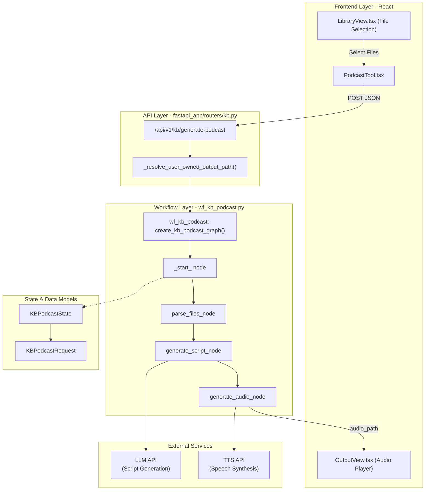
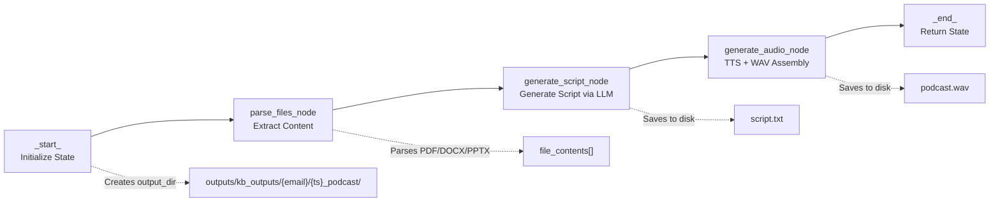
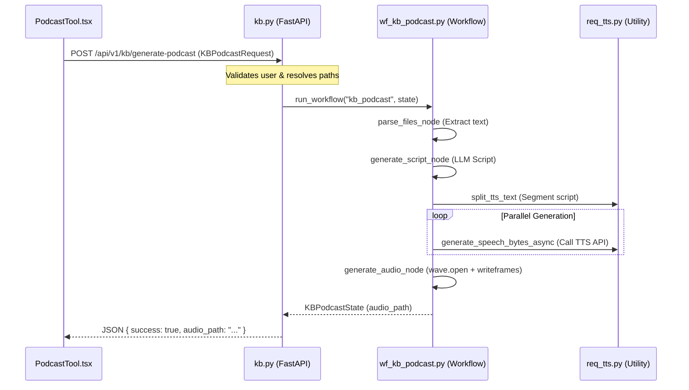

<!-- source: DeepWiki mcp.deepwiki.com · repo OpenDCAI/Paper2Any · page 7.3 Podcast Generation · fetched 2026-11-02 -->

# Podcast Generation

<details>
<summary>Relevant source files</summary>

The following files were used as context for generating this wiki page:

- [database/01_init_schema.sql](database/01_init_schema.sql)
- [dataflow_agent/workflow/wf_intelligent_qa.py](dataflow_agent/workflow/wf_intelligent_qa.py)
- [dataflow_agent/workflow/wf_kb_podcast.py](dataflow_agent/workflow/wf_kb_podcast.py)
- [fastapi_app/routers/kb.py](fastapi_app/routers/kb.py)
- [frontend-workflow/src/components/knowledge-base/LibraryView.tsx](frontend-workflow/src/components/knowledge-base/LibraryView.tsx)
- [frontend-workflow/src/components/knowledge-base/OutputView.tsx](frontend-workflow/src/components/knowledge-base/OutputView.tsx)
- [frontend-workflow/src/components/knowledge-base/RightPanel.tsx](frontend-workflow/src/components/knowledge-base/RightPanel.tsx)
- [frontend-workflow/src/components/knowledge-base/Sidebar.tsx](frontend-workflow/src/components/knowledge-base/Sidebar.tsx)
- [frontend-workflow/src/components/knowledge-base/ToolSelector.tsx](frontend-workflow/src/components/knowledge-base/ToolSelector.tsx)
- [frontend-workflow/src/components/knowledge-base/UploadView.tsx](frontend-workflow/src/components/knowledge-base/UploadView.tsx)
- [frontend-workflow/src/components/knowledge-base/index.tsx](frontend-workflow/src/components/knowledge-base/index.tsx)
- [frontend-workflow/src/components/knowledge-base/tools/ChatTool.tsx](frontend-workflow/src/components/knowledge-base/tools/ChatTool.tsx)
- [frontend-workflow/src/components/knowledge-base/tools/MindMapTool.tsx](frontend-workflow/src/components/knowledge-base/tools/MindMapTool.tsx)
- [frontend-workflow/src/components/knowledge-base/tools/PodcastTool.tsx](frontend-workflow/src/components/knowledge-base/tools/PodcastTool.tsx)
- [frontend-workflow/src/components/knowledge-base/tools/PptTool.tsx](frontend-workflow/src/components/knowledge-base/tools/PptTool.tsx)
- [frontend-workflow/src/components/knowledge-base/types.ts](frontend-workflow/src/components/knowledge-base/types.ts)

</details>


## Purpose and Scope

This page documents the Podcast Generation system within the Knowledge Base module. The system converts uploaded documents (PDF, DOCX, PPTX) into audio podcasts by generating natural language scripts (monologue or dialog) and synthesizing speech using Text-to-Speech (TTS) services like CosyVoice or OpenAI.

For general Knowledge Base file management, see [File Management](#7.1). For other KB AI tools like Q&A and mind maps, see [Intelligent Q&A](#7.2) and [Mind Map Generation](#7.4).

**Sources:** [dataflow_agent/workflow/wf_kb_podcast.py:1-470](), [fastapi_app/routers/kb.py:552-672]()

---

## System Architecture

The podcast generation system follows a three-tier architecture with clear separation between frontend components, the FastAPI router, and the DataFlow-Agent workflow engine:

### Component Interaction Diagram
Title: Podcast Generation System Architecture


**Sources:** [frontend-workflow/src/components/knowledge-base/tools/PodcastTool.tsx:76-193](), [fastapi_app/routers/kb.py:552-672](), [dataflow_agent/workflow/wf_kb_podcast.py:36-469]()

---

## Podcast Generation Workflow

The workflow is registered in the workflow registry as `"kb_podcast"` and consists of four sequential nodes.

Title: wf_kb_podcast Execution Flow


**Sources:** [dataflow_agent/workflow/wf_kb_podcast.py:36-469]()

### Node 1: Initialization (`_start_`)

The `_start_` node prepares the execution environment:
- Validates `KBPodcastRequest.files` array [dataflow_agent/workflow/wf_kb_podcast.py:60-61]().
- Creates a timestamped output directory: `outputs/kb_outputs/{email}/{timestamp}_podcast/` [dataflow_agent/workflow/wf_kb_podcast.py:65-71]().
- Initializes state fields: `file_contents`, `podcast_script`, and `audio_path` [dataflow_agent/workflow/wf_kb_podcast.py:75-77]().

**Sources:** [dataflow_agent/workflow/wf_kb_podcast.py:58-78]()

### Node 2: File Parsing (`parse_files_node`)

This async node extracts text content from documents in parallel using `asyncio.gather()` [dataflow_agent/workflow/wf_kb_podcast.py:161-162]().

| Format | Library | Implementation Details |
|--------|---------|------------------------|
| **PDF** | `fitz` (PyMuPDF) | Iterates pages and calls `page.get_text()` [dataflow_agent/workflow/wf_kb_podcast.py:104-112](). |
| **Word** | `python-docx` | Joins paragraph text with newlines [dataflow_agent/workflow/wf_kb_podcast.py:115-123](). |
| **PPT** | `python-pptx` | Extracts text from all shapes on all slides [dataflow_agent/workflow/wf_kb_podcast.py:126-140](). |
| **Text** | Native | Standard UTF-8 file read [dataflow_agent/workflow/wf_kb_podcast.py:144-146](). |

Content is truncated to 50,000 characters to manage token limits [dataflow_agent/workflow/wf_kb_podcast.py:153]().

**Sources:** [dataflow_agent/workflow/wf_kb_podcast.py:80-165]()

### Node 3: Script Generation (`generate_script_node`)

The LLM generates a script based on `podcast_mode` and `podcast_length` [dataflow_agent/workflow/wf_kb_podcast.py:182-183]().

- **Monologue Mode**: Single narrator, conversational tone [dataflow_agent/workflow/wf_kb_podcast.py:209-216]().
- **Dialog Mode**: Two speakers (Host and Guest) with alternating lines [dataflow_agent/workflow/wf_kb_podcast.py:217-227]().
- **Length Mapping**: Maps user preferences (e.g., "brief", "standard", "long") to specific duration hints for the LLM [dataflow_agent/workflow/wf_kb_podcast.py:184-206]().

The generated script is saved to `{result_path}/script.txt` [dataflow_agent/workflow/wf_kb_podcast.py:269]().

**Sources:** [dataflow_agent/workflow/wf_kb_podcast.py:167-272]()

### Node 4: Audio Generation (`generate_audio_node`)

This node handles the Text-to-Speech synthesis and final audio assembly.

1.  **Segmentation**: The script is split into chunks based on TTS model limits (e.g., 3800 chars for OpenAI, 4000 bytes for Gemini) [dataflow_agent/workflow/wf_kb_podcast.py:358-372]().
2.  **Parallel TTS**: Audio chunks are generated concurrently using `asyncio.Semaphore` to control rate limits [dataflow_agent/workflow/wf_kb_podcast.py:385-406]().
3.  **WAV Assembly**: Raw PCM bytes are concatenated and written to a WAV file using the `wave` module [dataflow_agent/workflow/wf_kb_podcast.py:438-446]().
    - **Channels**: 1 (Mono)
    - **Sample Width**: 2 bytes (16-bit)
    - **Frame Rate**: 24,000 Hz

**Sources:** [dataflow_agent/workflow/wf_kb_podcast.py:274-469](), [dataflow_agent/toolkits/multimodaltool/req_tts.py:37-147]()

---

## Frontend Component: PodcastTool

The `PodcastTool` provides the configuration UI and triggers the generation process.

### Configuration Parameters
The `podcastParams` state tracks the following:
- `api_key` / `api_url`: Service credentials [frontend-workflow/src/components/knowledge-base/tools/PodcastTool.tsx:80-81]().
- `model`: LLM for scriptwriting (e.g., `gpt-5.1`) [frontend-workflow/src/components/knowledge-base/tools/PodcastTool.tsx:82]().
- `tts_model`: Synthesis engine (e.g., `cosyvoice-v3-flash`, `tts-1`) [frontend-workflow/src/components/knowledge-base/tools/PodcastTool.tsx:83]().
- `voice_name` / `voice_name_b`: Speaker selections [frontend-workflow/src/components/knowledge-base/tools/PodcastTool.tsx:84-85]().
- `podcast_mode`: `monologue` or `dialog` [frontend-workflow/src/components/knowledge-base/tools/PodcastTool.tsx:86]().

### Voice Detection Logic
The component dynamically updates voice options based on the selected TTS model:
- **OpenAI TTS**: Uses `OPENAI_TTS_VOICES` list (e.g., `alloy`, `echo`, `shimmer`) [frontend-workflow/src/components/knowledge-base/tools/PodcastTool.tsx:12-50]().
- **CosyVoice**: Defaults to a single generic voice label [frontend-workflow/src/components/knowledge-base/tools/PodcastTool.tsx:9-10]().

**Sources:** [frontend-workflow/src/components/knowledge-base/tools/PodcastTool.tsx:1-406]()

---

## Data Flow: Code Entity Mapping

Title: Podcast Generation Data Flow (Frontend to Backend)


**Sources:** [frontend-workflow/src/components/knowledge-base/tools/PodcastTool.tsx:145-164](), [fastapi_app/routers/kb.py:552-672](), [dataflow_agent/workflow/wf_kb_podcast.py:36-469](), [dataflow_agent/toolkits/multimodaltool/req_tts.py:149-184]()

---

## Implementation Details

### Multi-File Merging
The backend router handles multiple input files by merging them into a temporary PDF before processing:
- It resolves local paths using `_resolve_user_owned_output_path` [fastapi_app/routers/kb.py:112-114]().
- If multiple files exist, it uses `_merge_pdfs` (which utilizes `fitz.insert_pdf`) to create a unified context for the LLM [fastapi_app/routers/kb.py:580-606]().

### Dialog Parsing Regex
In `dialog` mode, the workflow parses the LLM output using a specific regex to separate speakers:
```python
pattern = re.compile(r"^\s*([^:：]{1,20})\s*[:：]\s*(.+)$")
```
This regex captures the speaker name (up to 20 chars) and the dialogue content [dataflow_agent/workflow/wf_kb_podcast.py:315]().

### TTS Retry Logic
To handle API instability, the workflow includes a retry wrapper `_run_with_retry` that attempts synthesis up to 3 times with an exponential backoff [dataflow_agent/workflow/wf_kb_podcast.py:408-417]().

**Sources:** [fastapi_app/routers/kb.py:552-672](), [dataflow_agent/workflow/wf_kb_podcast.py:309-347](), [dataflow_agent/workflow/wf_kb_podcast.py:408-435]()

---

