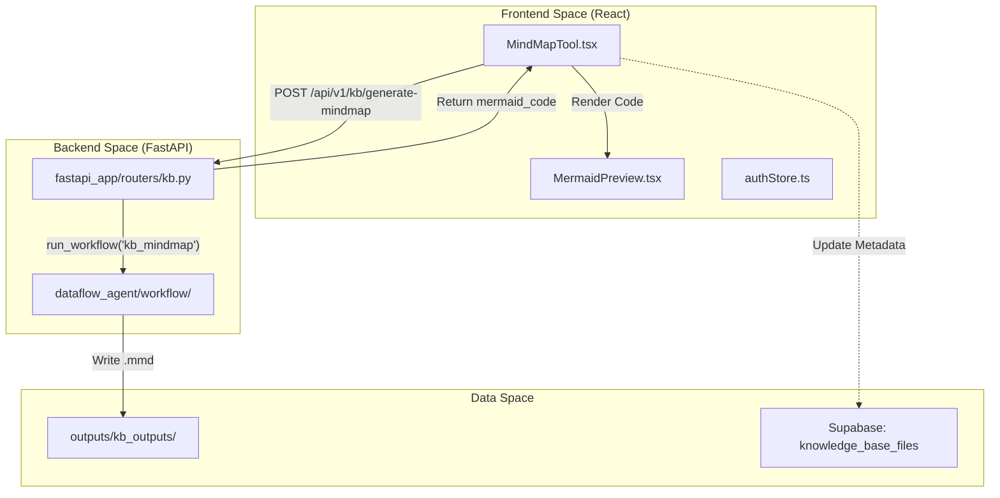
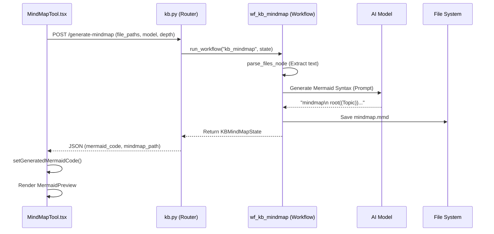

<!-- source: DeepWiki mcp.deepwiki.com · repo OpenDCAI/Paper2Any · page 7.4 Mind Map Generation · fetched 2026-11-02 -->

# Mind Map Generation

Relevant source files

The following files were used as context for generating this wiki page:

- [database/01_init_schema.sql](database/01_init_schema.sql)
- [dataflow_agent/toolkits/multimodaltool/bg_tool.py](dataflow_agent/toolkits/multimodaltool/bg_tool.py)
- [dataflow_agent/workflow/wf_kb_podcast.py](dataflow_agent/workflow/wf_kb_podcast.py)
- [dataflow_agent/workflow/wf_paper2page_content.py](dataflow_agent/workflow/wf_paper2page_content.py)
- [dataflow_agent/workflow/wf_paper2page_content_for_long_paper.py](dataflow_agent/workflow/wf_paper2page_content_for_long_paper.py)
- [docker-compose.yml](docker-compose.yml)
- [fastapi_app/routers/kb.py](fastapi_app/routers/kb.py)
- [frontend-workflow/Dockerfile](frontend-workflow/Dockerfile)
- [frontend-workflow/src/components/ParticleBackground.tsx](frontend-workflow/src/components/ParticleBackground.tsx)
- [frontend-workflow/src/components/knowledge-base/LibraryView.tsx](frontend-workflow/src/components/knowledge-base/LibraryView.tsx)
- [frontend-workflow/src/components/knowledge-base/OutputView.tsx](frontend-workflow/src/components/knowledge-base/OutputView.tsx)
- [frontend-workflow/src/components/knowledge-base/UploadView.tsx](frontend-workflow/src/components/knowledge-base/UploadView.tsx)
- [frontend-workflow/src/components/knowledge-base/index.tsx](frontend-workflow/src/components/knowledge-base/index.tsx)
- [frontend-workflow/src/components/knowledge-base/tools/MermaidPreview.tsx](frontend-workflow/src/components/knowledge-base/tools/MermaidPreview.tsx)
- [frontend-workflow/src/components/knowledge-base/tools/MindMapTool.tsx](frontend-workflow/src/components/knowledge-base/tools/MindMapTool.tsx)
- [frontend-workflow/src/components/knowledge-base/tools/PodcastTool.tsx](frontend-workflow/src/components/knowledge-base/tools/PodcastTool.tsx)
- [frontend-workflow/src/components/knowledge-base/tools/PptTool.tsx](frontend-workflow/src/components/knowledge-base/tools/PptTool.tsx)
- [frontend-workflow/src/types/index.ts](frontend-workflow/src/types/index.ts)

## Purpose and Scope

This document describes the **Mind Map Generation** system within the Knowledge Base module of Paper2Any. This system converts uploaded documents (PDF, DOCX, PPTX) into visual mind maps represented in Mermaid diagram format. Users can select one or more knowledge base files, configure generation parameters, and receive an editable Mermaid mindmap that hierarchically organizes the document content.

The system leverages the `kb_mindmap` workflow to process content through LLMs and provides a dedicated frontend tool for configuration and real-time previewing.

---

## Architecture Overview

The mind map generation system follows a three-layer architecture: frontend configuration/preview, backend API routing, and workflow orchestration.

**System Component Interaction Diagram**

**Sources:**
- [fastapi_app/routers/kb.py:30-36]()
- [frontend-workflow/src/components/knowledge-base/tools/MindMapTool.tsx:1-15]()
- [frontend-workflow/src/components/knowledge-base/index.tsx:34-40]()

---

## Backend API Endpoints

### Generate Mindmap Endpoint

The primary endpoint for mind map generation is implemented in the Knowledge Base router.

**Endpoint:** `POST /api/v1/kb/generate-mindmap`

**Request Body Parameters:**

| Parameter | Type | Description |
|-----------|------|-------------|
| `file_paths` | `List[str]` | URLs/paths of knowledge base files to process |
| `user_id` | `str` | User identifier for output directory creation |
| `email` | `str` | User email for output directory creation |
| `api_url` | `str` | LLM API endpoint (e.g., "https://api.apiyi.com/v1") |
| `api_key` | `str` | API key for LLM service |
| `model` | `str` | LLM model name (e.g., "gpt-5.1") |
| `mindmap_style` | `str` | Style hint: "default", "flowchart", or "tree" |
| `max_depth` | `int` | Maximum hierarchy depth (default: 3) |
| `language` | `str` | Target language: "zh" or "en" |

**Processing Logic:**

1. **Path Resolution**: Converts frontend URLs (e.g., `/outputs/kb_data/...`) to local absolute paths.
2. **State Initialization**: Creates a `KBMindMapState` containing the request parameters.
3. **Workflow Execution**: Calls `run_workflow("kb_mindmap", state)` which orchestrates document parsing and LLM-based diagram generation.
4. **File Persistence**: The resulting Mermaid code is saved as a `.mmd` file in the user's output directory: `outputs/kb_outputs/{email}/{timestamp}/mindmap.mmd`.
5. **URL Mapping**: Converts the local storage path back to a web-accessible URL using `_to_outputs_url`.

**Sources:**
- [fastapi_app/routers/kb.py:15-17]()
- [frontend-workflow/src/components/knowledge-base/tools/MindMapTool.tsx:69-85]()

### Save Mindmap Endpoint

The editing endpoint allows users to save modified Mermaid code back to the server after manual adjustments in the frontend.

**Endpoint:** `POST /api/v1/kb/save-mindmap`

**Request Body:**

| Parameter | Type | Description |
|-----------|------|-------------|
| `file_url` | `str` | URL of the mindmap file to update |
| `content` | `str` | New Mermaid code content |

**Sources:**
- [frontend-workflow/src/components/knowledge-base/index.tsx:213-220]()

---

## Frontend Components

### MindMapTool Component

The configuration interface is implemented in `MindMapTool.tsx`. It allows users to select models, styles, and depth before triggering the generation.

**Key Functions:**

- **`handleGenerateMindMap`**: Validates user authentication, file selection, and API keys before sending the request to the backend [frontend-workflow/src/components/knowledge-base/tools/MindMapTool.tsx:41-118]().
- **`onGenerateSuccess`**: A callback passed from the parent `KnowledgeBase` component to register the newly created `.mmd` file in the output list [frontend-workflow/src/components/knowledge-base/tools/MindMapTool.tsx:100-108]().

**UI Configuration Elements:**

| Element | Control Type | Source |
|---------|--------------|--------|
| API Key | Password Input | [MindMapTool.tsx:153-159]() |
| LLM Model | Select + Text | [MindMapTool.tsx:176-195]() |
| Max Depth | Range Slider | [MindMapTool.tsx:210-219]() |
| Language | Button Toggle | [MindMapTool.tsx:222-245]() |

**Sources:**
- [frontend-workflow/src/components/knowledge-base/tools/MindMapTool.tsx:16-118]()

### MermaidPreview and Inline Editing

The system provides a real-time preview and editing environment for Mermaid diagrams.

1. **`MermaidPreview`**: A specialized component that takes Mermaid syntax strings and renders them as SVG diagrams using the Mermaid.js engine [frontend-workflow/src/components/knowledge-base/tools/MermaidPreview.tsx]().
2. **Inline Editor**: Located in the Knowledge Base `index.tsx`, it uses a standard `textarea` for raw code editing and a "Refresh Preview" button to update the `MermaidPreview` component [frontend-workflow/src/components/knowledge-base/index.tsx:525-563]().

**Content Loading Logic:**
When a user selects a `.mmd` file from the output library, the system fetches the raw text content via `backendFetch` and populates the `mindmapDraft` state [frontend-workflow/src/components/knowledge-base/index.tsx:253-311]().

**Sources:**
- [frontend-workflow/src/components/knowledge-base/index.tsx:34-40, 253-311]()
- [frontend-workflow/src/components/knowledge-base/tools/MindMapTool.tsx:5]()

---

## Data Flow and State Management

The Mind Map system utilizes a specific state model to track the transformation from raw documents to structured diagrams.

**Mind Map Data Flow Diagram**

**State Model: `KBMindMapState`**

| Field | Description |
|-------|-------------|
| `request` | `KBMindMapRequest` containing user parameters |
| `file_contents` | List of extracted text from input documents |
| `mermaid_code` | The raw Mermaid string generated by the LLM |
| `result_path` | The local directory where outputs are stored |

**Sources:**
- [fastapi_app/routers/kb.py:15-17]()
- [frontend-workflow/src/components/knowledge-base/tools/MindMapTool.tsx:18-28]()

---

## Integration with Knowledge Base

Mind Map generation is one of several tools available in the Knowledge Base `RightPanel`.

- **File Selection**: The `LibraryView` filters supported files for the mindmap tool. Only `doc` types (PDF, DOCX, PPTX) are currently supported for mind map extraction [frontend-workflow/src/components/knowledge-base/LibraryView.tsx:33, 56]().
- **Output Management**: Generated mind maps are saved to the `knowledge_base_files` table in Supabase with a specific `file_type` to ensure they are recognized as editable diagrams in the `OutputView` [database/01_init_schema.sql:155-168]().
- **Secure Access**: All generated `.mmd` files are served through the `secureAssetService` to ensure only the owner can access or edit the diagram [frontend-workflow/src/components/knowledge-base/OutputView.tsx:16-43]().

**Sources:**
- [frontend-workflow/src/components/knowledge-base/LibraryView.tsx:26-33, 56]()
- [frontend-workflow/src/components/knowledge-base/OutputView.tsx:16-43]()
- [database/01_init_schema.sql:155-168]()

---

