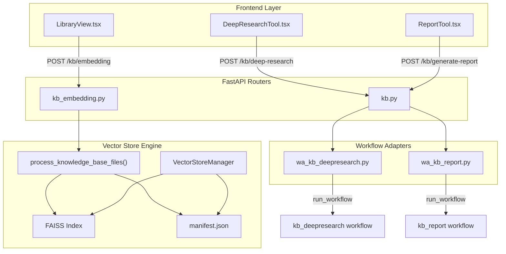
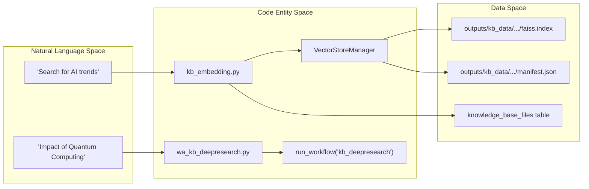

<!-- source: DeepWiki mcp.deepwiki.com · repo OpenDCAI/Paper2Any · page 7.5 Vector Embedding & Search · fetched 2026-11-02 -->

# Vector Embedding & Search

<details>
<summary>Relevant source files</summary>

The following files were used as context for generating this wiki page:

- [fastapi_app/routers/kb_embedding.py](fastapi_app/routers/kb_embedding.py)
- [fastapi_app/workflow_adapters/wa_kb_deepresearch.py](fastapi_app/workflow_adapters/wa_kb_deepresearch.py)
- [fastapi_app/workflow_adapters/wa_kb_report.py](fastapi_app/workflow_adapters/wa_kb_report.py)
- [frontend-workflow/src/components/knowledge-base/tools/DeepResearchTool.tsx](frontend-workflow/src/components/knowledge-base/tools/DeepResearchTool.tsx)
- [frontend-workflow/src/components/knowledge-base/tools/ReportTool.tsx](frontend-workflow/src/components/knowledge-base/tools/ReportTool.tsx)

</details>


## Purpose and Scope

This page documents the vector embedding and semantic search system used in the Knowledge Base feature. The system enables conversion of knowledge base files (documents, images, videos) into vector embeddings for semantic retrieval, context-enhanced generation workflows, and automated report generation.

The system is centered around the `kb_embedding` router and the `process_knowledge_base_files` tool, which orchestrate the creation of FAISS vector indices and metadata manifests.

---

## System Architecture

The vector embedding system implements a multi-stage pipeline for converting heterogeneous file types into searchable vector representations. The architecture separates storage management, embedding generation, and retrieval into distinct components.

### Embedding and Search Data Flow



**Sources:** [fastapi_app/routers/kb_embedding.py:90-102](), [fastapi_app/workflow_adapters/wa_kb_deepresearch.py:25-68](), [fastapi_app/workflow_adapters/wa_kb_report.py:23-49]()

---

## Embedding Workflow Implementation

The `kb_embedding` router handles the primary embedding lifecycle. It validates user ownership of files, determines the appropriate vector store directory, and invokes the processing logic.

### Canonical Path Resolution
To ensure security and multi-tenancy, the system uses canonical identifiers for users and validates paths against allowed roots.

```python
def _allowed_user_roots(user: AuthUser) -> List[Path]:
    email = _canonical_user_email(user)
    outputs_root = get_outputs_root()
    return [
        (outputs_root / "kb_data" / email).resolve(),
        (outputs_root / "kb_outputs" / email).resolve(),
        (outputs_root / "kb_exports" / email).resolve(),
    ]
```

**Sources:** [fastapi_app/routers/kb_embedding.py:14-35](), [fastapi_app/routers/kb_embedding.py:38-47]()

### Processing Logic
The `create_embedding` endpoint in `kb_embedding.py` orchestrates the following:
1.  **File Resolution**: Converts web paths to local paths using `_resolve_user_owned_output_path`. [fastapi_app/routers/kb_embedding.py:127-132]()
2.  **Storage Selection**: Determines if the vector store should be global for the user or specific to a `notebook_id`. [fastapi_app/routers/kb_embedding.py:143-150]()
3.  **Vectorization**: Calls `process_knowledge_base_files` from `ragtool`. [fastapi_app/routers/kb_embedding.py:153-162]()
4.  **Supabase Sync**: Writes back the generated `kb_file_id` to the `knowledge_base_files` table to link the database record with the vector store manifest. [fastapi_app/routers/kb_embedding.py:61-89]()

---

## Deep Research & Report Generation

The embedding system powers two advanced analytical tools: **Deep Research** and **Report Generation**. These tools utilize retrieved context to generate comprehensive markdown documents.

### Deep Research Workflow (`wa_kb_deepresearch.py`)
This workflow supports two modes: `llm` (model-native search) and `web` (agentic search via providers like SerpApi or Brave).

-   **State Initialization**: Creates a `KBDeepResearchState` with user-provided search parameters (depth, max queries, etc.). [fastapi_app/workflow_adapters/wa_kb_deepresearch.py:42-67]()
-   **Execution**: Executes the `kb_deepresearch` workflow via `run_workflow`. [fastapi_app/workflow_adapters/wa_kb_deepresearch.py:68]()
-   **Result Processing**: Extracts `report_markdown`, `search_results`, and `sources` from the resulting state. [fastapi_app/workflow_adapters/wa_kb_deepresearch.py:76-87]()

### Report Generation Workflow (`wa_kb_report.py`)
Focuses on synthesizing information from multiple uploaded documents into a structured report.

-   **Parameters**: Supports `report_style` (insight/analysis) and `length` (short/standard/long). [fastapi_app/workflow_adapters/wa_kb_report.py:35-46]()
-   **Storage**: Results are saved to a timestamped directory within `kb_outputs/{email}/{ts}_report`. [fastapi_app/workflow_adapters/wa_kb_report.py:14-20]()

**Sources:** [fastapi_app/workflow_adapters/wa_kb_deepresearch.py:1-101](), [fastapi_app/workflow_adapters/wa_kb_report.py:1-70]()

---

## Frontend Integration

The Knowledge Base tools provide interfaces for configuring embedding parameters and triggering research/report tasks.

### DeepResearchTool Component
The `DeepResearchTool` allows users to select between "LLM Research" and "Web Research".

-   **Configuration**: Users can set the `search_provider` (serpapi, google_cse, brave) and `search_depth`. [frontend-workflow/src/components/knowledge-base/tools/DeepResearchTool.tsx:37-42]()
-   **Execution**: Sends a POST request to `/api/v1/kb/deep-research`. [frontend-workflow/src/components/knowledge-base/tools/DeepResearchTool.tsx:113-135]()
-   **Success Callback**: Upon completion, it adds the generated markdown report to the file list via `onGenerateSuccess`. [frontend-workflow/src/components/knowledge-base/tools/DeepResearchTool.tsx:151-161]()

### ReportTool Component
The `ReportTool` focuses on document synthesis.

-   **Document Filtering**: Filters the selected files to ensure only supported formats (PDF, PPTX, DOCX) are used. [frontend-workflow/src/components/knowledge-base/tools/ReportTool.tsx:39-42]()
-   **API Call**: Triggers `/api/v1/kb/generate-report`. [frontend-workflow/src/components/knowledge-base/tools/ReportTool.tsx:63-79]()

**Sources:** [frontend-workflow/src/components/knowledge-base/tools/DeepResearchTool.tsx:1-170](), [frontend-workflow/src/components/knowledge-base/tools/ReportTool.tsx:1-110]()

---

## Technical Entity Mapping

The following diagram maps high-level concepts to specific code entities and storage locations.



**Sources:** [fastapi_app/routers/kb_embedding.py:90-150](), [fastapi_app/workflow_adapters/wa_kb_deepresearch.py:68-80](), [fastapi_app/routers/kb_embedding.py:61-75]()

---

## Configuration Defaults

The embedding system uses the following default models and settings:

| Parameter | Default Value | Source |
| :--- | :--- | :--- |
| Multimodal Model | `gemini-2.5-flash` | `settings.KB_EMBEDDING_MODEL` |
| Deep Research Model | `claude-sonnet-4-5-20250929-all` | `DeepResearchTool.tsx` |
| Report Model | `gpt-5.1` | `ReportTool.tsx` |
| Search Top-K | `10` | `DeepResearchTool.tsx` |

**Sources:** [fastapi_app/routers/kb_embedding.py:96](), [frontend-workflow/src/components/knowledge-base/tools/DeepResearchTool.tsx:35](), [frontend-workflow/src/components/knowledge-base/tools/ReportTool.tsx:21]()

---

