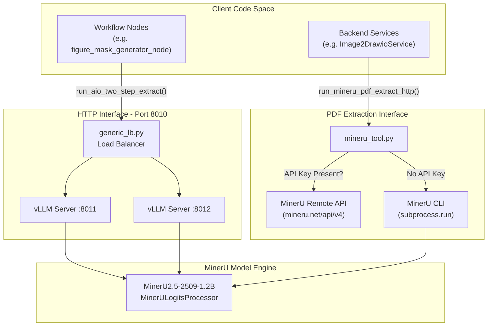
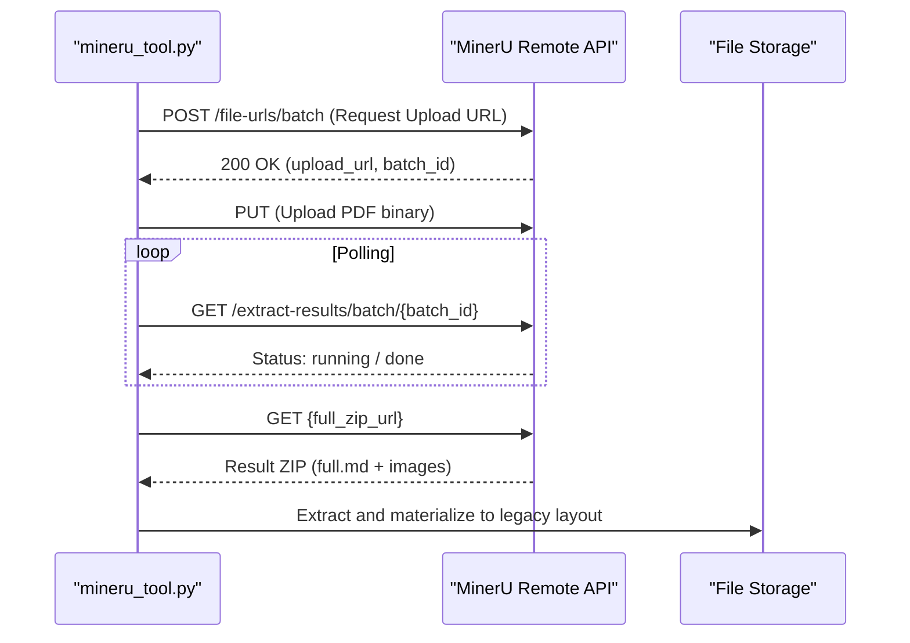
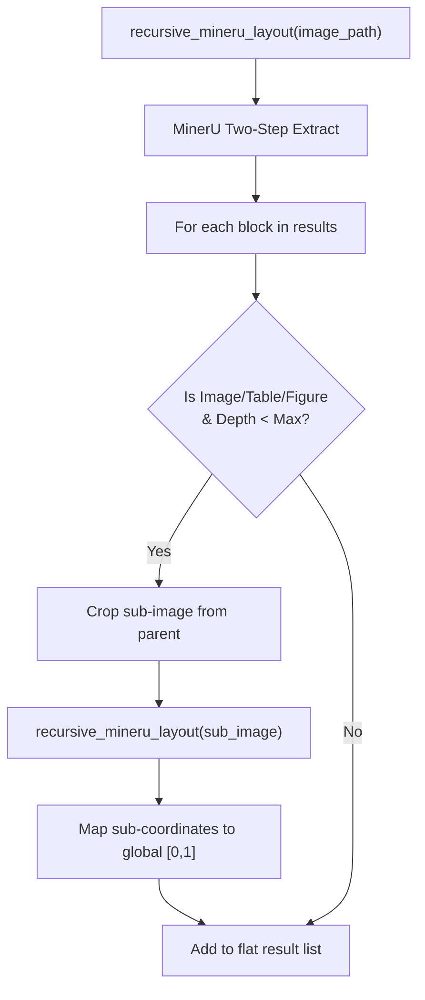

<!-- source: DeepWiki mcp.deepwiki.com · repo OpenDCAI/Paper2Any · page 8.1 MinerU PDF Parsing · fetched 2026-11-02 -->

# MinerU PDF Parsing

Relevant source files

The following files were used as context for generating this wiki page:

- [dataflow_agent/toolkits/multimodaltool/mineru_tool.py](dataflow_agent/toolkits/multimodaltool/mineru_tool.py)
- [dataflow_agent/workflow/wf_paper2drawio.py](dataflow_agent/workflow/wf_paper2drawio.py)
- [dataflow_agent/workflow/wf_paper2drawio_sam3.py](dataflow_agent/workflow/wf_paper2drawio_sam3.py)
- [fastapi_app/services/image2drawio_service.py](fastapi_app/services/image2drawio_service.py)
- [tests/manual/README.md](tests/manual/README.md)
- [tests/manual/sam3/test_paper2drawio_sam3_back.py](tests/manual/sam3/test_paper2drawio_sam3_back.py)
- [tests/test_mineru_remote_api.py](tests/test_mineru_remote_api.py)

MinerU is a multimodal document processing system that extracts structured content from PDFs and images. It identifies text blocks, tables, figures, and layout regions with normalized bounding box coordinates, enabling downstream workflows to reconstruct document structure programmatically.

**Scope**: This page covers MinerU's vLLM deployment, extraction capabilities, recursive layout analysis (`recursive_mineru_layout`), and the `mineru_tool.py` interface. It documents both local GPU-based extraction and the remote API integration.

---

## Architecture Overview

MinerU operates through two distinct interfaces: an HTTP API for single-image/batch-image analysis via vLLM servers, and a CLI/Remote API tool for full PDF document extraction.

Title: MinerU Extraction Architecture

**Extraction Modes**

| Mode | Entry Point | Use Case | Implementation |
|------|-------------|----------|----------------|
| **HTTP vLLM** | `run_aio_two_step_extract` | Real-time image/layout analysis | `MinerUClient` (mineru_vl_utils) |
| **Remote API** | `run_mineru_pdf_extract_http` | Cloud-based PDF to Markdown | `requests` to mineru.net |
| **Local CLI** | `run_mineru_pdf_extract` | Local GPU-based PDF processing | `subprocess` calling `mineru` |

**Sources**: [dataflow_agent/toolkits/multimodaltool/mineru_tool.py:1-40](), [fastapi_app/services/image2drawio_service.py:58-75](), [dataflow_agent/workflow/wf_paper2drawio_sam3.py:1-13]()

---

## Remote API Integration

The system supports the official MinerU remote API for environments without local GPU resources. This is triggered when `MINERU_API_KEY` is configured in the environment or settings.

Title: Remote PDF Extraction Flow

**Implementation Details**:
- **Polling**: The system polls the API at intervals defined by `poll_interval_seconds` (default 5.0s) until the task is `done` or `timeout_seconds` (default 900s) is reached [dataflow_agent/toolkits/multimodaltool/mineru_tool.py:89-103]().
- **Materialization**: The result ZIP is extracted, and `full.md` is copied to the task's output directory to maintain compatibility with local extraction paths [dataflow_agent/toolkits/multimodaltool/mineru_tool.py:130-149]().

**Sources**: [dataflow_agent/toolkits/multimodaltool/mineru_tool.py:151-230](), [tests/test_mineru_remote_api.py:44-135]()

---

## Recursive Layout Analysis

The `recursive_mineru_layout` function enables hierarchical content extraction by recursively analyzing sub-regions (like figures or tables) detected in the initial pass.

Title: Recursive Layout Logic

**Coordinate Transformation**:
When a block is found within a sub-image, its coordinates are relative to that sub-image. The tool maps these back to the global normalized `[0, 1]` space of the original image [dataflow_agent/toolkits/multimodaltool/mineru_tool.py:413-528]().

**Sources**: [dataflow_agent/toolkits/multimodaltool/mineru_tool.py:413-528](), [dataflow_agent/workflow/wf_paper2drawio_sam3.py:176-241]()

---

## MinerU Tool Interface (`mineru_tool.py`)

The `mineru_tool.py` module provides the primary interface for all MinerU operations within the `Paper2Any` framework.

### Key Functions

| Function | Purpose |
|----------|---------|
| `run_mineru_pdf_extract_http` | High-level entry point that chooses between Remote API and Local CLI [dataflow_agent/toolkits/multimodaltool/mineru_tool.py:233-255](). |
| `run_aio_two_step_extract` | Async wrapper for the vLLM-based vision-language extraction [dataflow_agent/toolkits/multimodaltool/mineru_tool.py:34-80](). |
| `crop_mineru_blocks_with_meta` | Crops detected regions into individual files while preserving metadata [dataflow_agent/toolkits/multimodaltool/mineru_tool.py:86-130](). |
| `_shrink_markdown` | Compresses extracted Markdown by keeping only top-level headers and limiting character count for LLM context windows [dataflow_agent/toolkits/multimodaltool/mineru_tool.py:531-602](). |

### Local CLI Execution
When running locally without the remote API, the tool manages GPU allocation by randomly selecting a device from the `MINERU_DEVICES` environment variable [dataflow_agent/toolkits/multimodaltool/mineru_tool.py:209-217]().

**Sources**: [dataflow_agent/toolkits/multimodaltool/mineru_tool.py:1-602]()

---

## Workflow Integration: Paper2Drawio

MinerU is heavily utilized in the `paper2drawio_sam3` workflow to identify layout regions before passing them to SAM3 for precise segmentation.

1.  **Text Extraction**: VLM OCR (e.g., `qwen-vl-ocr-latest`) is used alongside MinerU to extract textual elements [dataflow_agent/workflow/wf_paper2drawio_sam3.py:4-13]().
2.  **Coordinate Processing**: The `CoordProcessor` class handles scaling and normalization between the source image dimensions and the Draw.io canvas [dataflow_agent/workflow/wf_paper2drawio_sam3.py:186-221]().
3.  **Service Isolation**: Because visual workflows are GPU-intensive, they are protected by an `AsyncInterProcessSemaphore` named `sam3_visual_workflows` to ensure only one extraction runs at a time [fastapi_app/services/image2drawio_service.py:20-21]().

**Sources**: [dataflow_agent/workflow/wf_paper2drawio_sam3.py:1-13](), [fastapi_app/services/image2drawio_service.py:20-90]()

---

