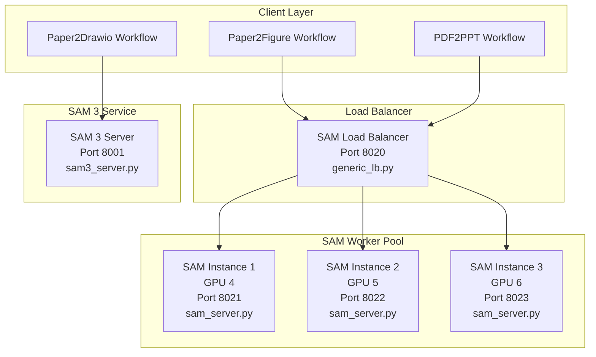
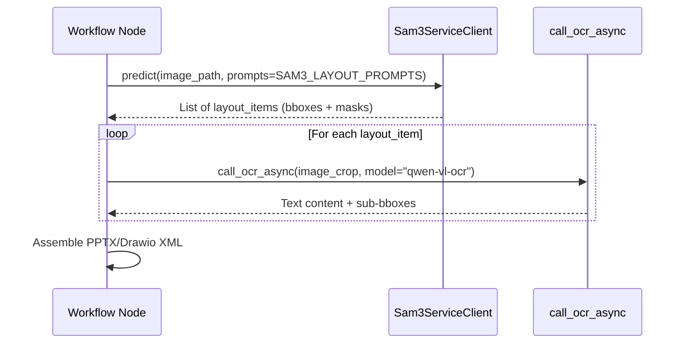

<!-- source: DeepWiki mcp.deepwiki.com · repo OpenDCAI/Paper2Any · page 8.2 SAM Image Segmentation · fetched 2026-11-02 -->

# SAM Image Segmentation

Relevant source files

The following files were used as context for generating this wiki page:

- [dataflow_agent/promptstemplates/paperbanana.md](dataflow_agent/promptstemplates/paperbanana.md)
- [dataflow_agent/toolkits/model_servers/sam_server.py](dataflow_agent/toolkits/model_servers/sam_server.py)
- [dataflow_agent/toolkits/multimodaltool/ocr_utils.py](dataflow_agent/toolkits/multimodaltool/ocr_utils.py)
- [dataflow_agent/toolkits/multimodaltool/req_ocr.py](dataflow_agent/toolkits/multimodaltool/req_ocr.py)
- [dataflow_agent/toolkits/multimodaltool/sam3_tool.py](dataflow_agent/toolkits/multimodaltool/sam3_tool.py)
- [dataflow_agent/toolkits/multimodaltool/sam_tool.py](dataflow_agent/toolkits/multimodaltool/sam_tool.py)
- [fastapi_app/routers/paper2drawio.py](fastapi_app/routers/paper2drawio.py)
- [script/start_local_sam3_dev.sh](script/start_local_sam3_dev.sh)
- [tests/ori.png](tests/ori.png)
- [tests/sam3/ori.png](tests/sam3/ori.png)
- [tests/sam3/test4.png](tests/sam3/test4.png)

## Purpose and Scope

This document describes the SAM (Segment Anything Model) image segmentation infrastructure in Paper2Any. SAM is a locally-hosted GPU-accelerated service that performs automatic image segmentation to extract layout boxes, icons, and visual elements from generated images. It is a critical component of the Paper2Figure workflow ([6.1]()) and PDF2PPT workflow ([6.3]()), enabling the system to decompose complex diagrams into editable components.

The system supports multiple segmentation backends, including the original SAM (Segment Anything), YOLOv8 instance segmentation, and the newer SAM 3 (SAM2/SAM3) architecture for enhanced promptable segmentation [dataflow_agent/toolkits/multimodaltool/sam_tool.py:1-48]().

---

## System Architecture

### Deployment Configuration

SAM runs as a distributed service with multiple GPU-backed instances behind a load balancer. The deployment architecture prioritizes high availability and concurrent request handling.

**Deployment Components:**
*   **SAM Server (`sam_server.py`)**: A FastAPI application that loads the SAM model and performs inference [dataflow_agent/toolkits/model_servers/sam_server.py:24-54]().
*   **SAM 3 Server (`sam3_server.py`)**: Specialized server for SAM 3 models, supporting text prompts and RLE/PNG mask formats [script/start_local_sam3_dev.sh:64-75]().
*   **Load Balancer (`generic_lb.py`)**: A round-robin proxy that distributes requests across multiple worker ports [script/start_model_servers.sh:176-182]().

**Sources:** [dataflow_agent/toolkits/model_servers/sam_server.py:24-123](), [script/start_model_servers.sh:146-182](), [script/start_local_sam3_dev.sh:8-16]()

---

## Server Implementation

### SAM Server (`sam_server.py`)
The standard SAM server exposes a `/predict` endpoint that accepts an image path and returns a list of segmented items. Each item includes a base64-encoded mask (compressed with zlib), bounding box, score, and area [dataflow_agent/toolkits/model_servers/sam_server.py:54-102]().

**Key Functions:**
*   `predict(req: SAMRequest)`: Executes `run_sam_auto` and serializes masks [dataflow_agent/toolkits/model_servers/sam_server.py:55-102]().
*   `free_model(checkpoint)`: Aggressively cleans up CUDA cache to prevent OOM [dataflow_agent/toolkits/model_servers/sam_server.py:112-119]().

### SAM 3 Client and Tooling
The `sam3_tool.py` module provides a high-level client for interacting with SAM 3 servers. It includes support for pooling multiple endpoints and deduplicating results across different prompt groups [dataflow_agent/toolkits/multimodaltool/sam3_tool.py:19-68]().

**Core Logic:**
*   **`Sam3ServicePool`**: Manages a thread-safe cursor for round-robin requests across multiple SAM 3 instances [dataflow_agent/toolkits/multimodaltool/sam3_tool.py:56-68]().
*   **`dedup_sam3_results_across_groups`**: Filters overlapping detections (e.g., "rectangle" vs "rounded rectangle") using IoU thresholds [dataflow_agent/toolkits/multimodaltool/sam3_tool.py:184-223]().
*   **`decode_sam3_mask`**: Handles both PNG and RLE (Run-Length Encoding) mask formats [dataflow_agent/toolkits/multimodaltool/sam3_tool.py:145-181]().

**Sources:** [dataflow_agent/toolkits/model_servers/sam_server.py:39-123](), [dataflow_agent/toolkits/multimodaltool/sam3_tool.py:19-223]()

---

## Integration with Workflows

### Layout Box Segmentation
SAM is used to decompose generated figure drafts into structured layout items. The system uses a set of predefined layout prompts to identify common diagram shapes:
*   `SAM3_LAYOUT_PROMPTS`: rectangle, rounded rectangle, diamond, ellipse, triangle, hexagon, arrow, line, connector, icon, symbol, pictogram, glyph [dataflow_agent/toolkits/multimodaltool/sam_tool.py:118-132]().

### Icon and Text Extraction
The segmentation pipeline often works in tandem with OCR services. While SAM isolates visual regions, `req_ocr.py` handles text extraction within those regions using providers like Qwen-VL [dataflow_agent/toolkits/multimodaltool/req_ocr.py:38-52]().

**Sources:** [dataflow_agent/toolkits/multimodaltool/sam_tool.py:118-132](), [dataflow_agent/toolkits/multimodaltool/req_ocr.py:38-114](), [dataflow_agent/toolkits/multimodaltool/sam3_tool.py:19-54]()

---

## Startup and Lifecycle Management

### SAM 3 Development Stack
The `start_local_sam3_dev.sh` script provides a one-click setup for local SAM 3 development, managing the model server, backend, and frontend concurrently [script/start_local_sam3_dev.sh:1-92]().

**Environment Variables:**
*   `SAM3_GPU`: GPU index (default 0) [script/start_local_sam3_dev.sh:8]().
*   `SAM3_PORT`: Port for the model server (default 8001) [script/start_local_sam3_dev.sh:9]().
*   `SAM3_CHECKPOINT_PATH`: Path to `.pt` weights [script/start_local_sam3_dev.sh:13]().

### Inter-process Locking
The `sam3_visual_workflows` often utilize locks during complex segmentation tasks to prevent GPU memory spikes when multiple workflows attempt to invoke heavy segmentation models simultaneously. This is managed via the `Sam3ServicePool` lock [dataflow_agent/toolkits/multimodaltool/sam3_tool.py:61-66]().

**Sources:** [script/start_local_sam3_dev.sh:1-98](), [dataflow_agent/toolkits/multimodaltool/sam3_tool.py:56-68]()

---

## Monitoring and Debugging

### Health Checks
Both standard SAM and SAM 3 servers expose `/health` endpoints. The `Sam3ServicePool` provides a `health()` method that aggregates status across all configured backends [dataflow_agent/toolkits/multimodaltool/sam3_tool.py:69-76](), [dataflow_agent/toolkits/model_servers/sam_server.py:120-122]().

### Logs
*   **SAM 3 Logs**: `logs/local_sam3.log` [script/start_local_sam3_dev.sh:75]().
*   **Standard SAM Logs**: `logs/sam_{gpu_id}.log` (when started via `start_model_servers.sh`).

**Sources:** [dataflow_agent/toolkits/multimodaltool/sam3_tool.py:69-76](), [dataflow_agent/toolkits/model_servers/sam_server.py:120-122](), [script/start_local_sam3_dev.sh:75-98]()

---

