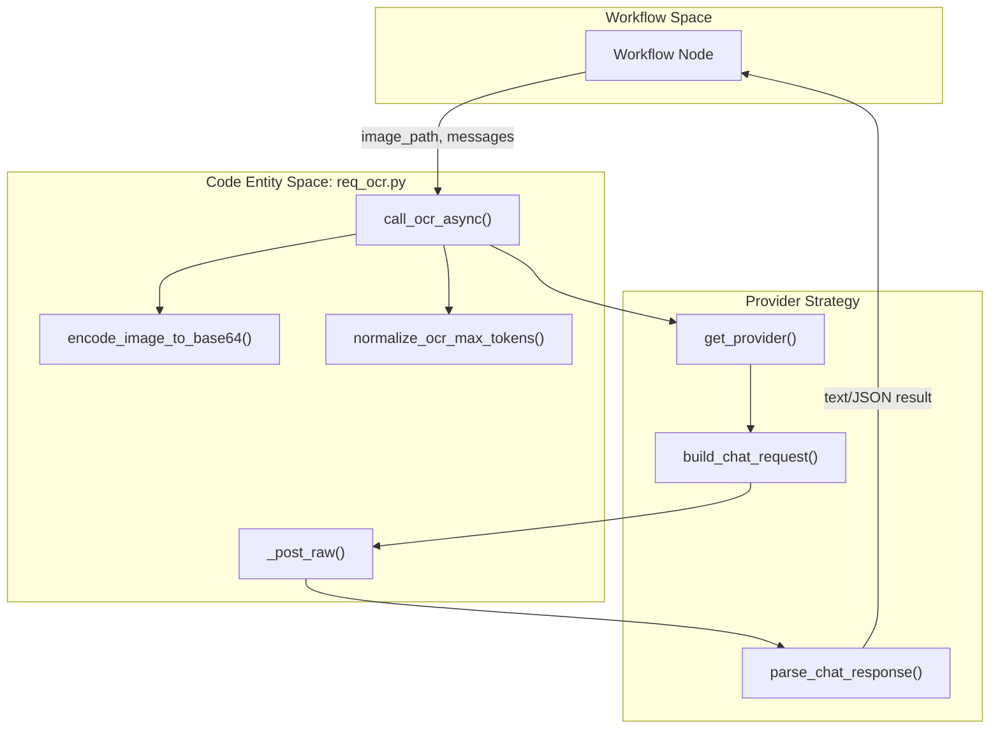
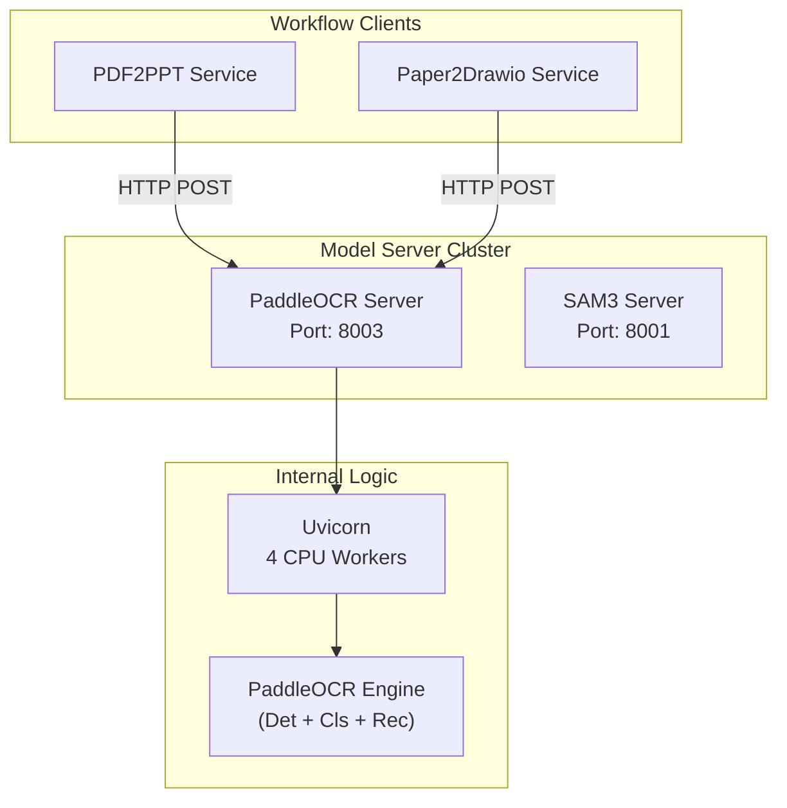

<!-- source: DeepWiki mcp.deepwiki.com · repo OpenDCAI/Paper2Any · page 8.3 OCR & Text Recognition · fetched 2026-11-02 -->

# OCR & Text Recognition

<details>
<summary>Relevant source files</summary>

The following files were used as context for generating this wiki page:

- [dataflow_agent/promptstemplates/paperbanana.md](dataflow_agent/promptstemplates/paperbanana.md)
- [dataflow_agent/toolkits/multimodaltool/ocr_utils.py](dataflow_agent/toolkits/multimodaltool/ocr_utils.py)
- [dataflow_agent/toolkits/multimodaltool/req_ocr.py](dataflow_agent/toolkits/multimodaltool/req_ocr.py)
- [dataflow_agent/toolkits/multimodaltool/sam3_tool.py](dataflow_agent/toolkits/multimodaltool/sam3_tool.py)
- [dataflow_agent/toolkits/multimodaltool/sam_tool.py](dataflow_agent/toolkits/multimodaltool/sam_tool.py)
- [fastapi_app/routers/paper2drawio.py](fastapi_app/routers/paper2drawio.py)
- [script/start_local_sam3_dev.sh](script/start_local_sam3_dev.sh)
- [tests/ori.png](tests/ori.png)
- [tests/sam3/ori.png](tests/sam3/ori.png)
- [tests/sam3/test4.png](tests/sam3/test4.png)

</details>


This page documents the OCR (Optical Character Recognition) infrastructure used by Paper2Any for extracting text from images and PDF pages. The system supports both local high-performance engines (PaddleOCR) and advanced Vision-Language Model (VLM) based OCR via external or local providers.

**Scope**: This page covers the OCR service setup, the `req_ocr.py` calling interface, and utility functions for result normalization. For PDF parsing with layout analysis, see [8.1 MinerU PDF Parsing](). For image segmentation, see [8.2 SAM Image Segmentation]().

---

## System Overview

The OCR system provides text extraction capabilities across multiple workflows, primarily supporting the **PDF2PPT** and **Paper2Figure** tasks where precise text localization and recognition are required to maintain document fidelity.

### Key Components

| Component | File Path | Role |
|-----------|-----------|------|
| **Request Handler** | `dataflow_agent/toolkits/multimodaltool/req_ocr.py` | Asynchronous caller for OCR/VLM models with image injection. |
| **Utilities** | `dataflow_agent/toolkits/multimodaltool/ocr_utils.py` | Token normalization and bounding box extraction. |
| **Local Engine** | `PaddleOCR` | CPU-based high-speed multilingual OCR. |
| **VLM OCR** | `Qwen-VL-OCR` | Advanced recognition for complex layouts and formulas. |

**Sources**: [dataflow_agent/toolkits/multimodaltool/req_ocr.py:1-9](), [dataflow_agent/toolkits/multimodaltool/ocr_utils.py:1-10]()

---

## OCR Request Flow

The system uses a provider-based strategy to call OCR services. It handles image encoding, message construction, and token budget management.

### Data Flow Diagram

The following diagram illustrates how a request travels from a workflow to the OCR provider.



**Sources**: [dataflow_agent/toolkits/multimodaltool/req_ocr.py:38-114](), [dataflow_agent/toolkits/multimodaltool/ocr_utils.py:10-20]()

### Implementation Details

*   **Token Normalization**: The `normalize_ocr_max_tokens` function clamps token budgets based on the specific provider. For example, DashScope's `qwen-vl-ocr` is capped at 8192 tokens [dataflow_agent/toolkits/multimodaltool/ocr_utils.py:10-20]().
*   **Image Injection**: If an `image_path` is provided, `call_ocr_async` automatically encodes the image to Base64 and injects it into the last "user" message in the standard OpenAI-compatible vision format [dataflow_agent/toolkits/multimodaltool/req_ocr.py:69-97]().
*   **Provider Abstraction**: The `get_provider` factory selects the correct strategy (e.g., DashScope, OpenAI) to format the payload correctly for the target API [dataflow_agent/toolkits/multimodaltool/req_ocr.py:100-108]().

---

## Result Processing & Normalization

OCR and VLM models often return results in varying JSON structures. `ocr_utils.py` provides normalization logic to ensure workflows receive a consistent format.

### Bounding Box Extraction

The `extract_bbox_items` function searches through common keys used by different OCR engines to find the list of detected elements.

| Key Name | Purpose |
|----------|---------|
| `bbox_result` | Standard key for structured OCR results. |
| `results` / `data` | Common keys for cloud-based providers. |
| `items` / `boxes` | Generic keys for detection models. |

**Sources**: [dataflow_agent/toolkits/multimodaltool/ocr_utils.py:7-46]()

### JSON Cleanup

VLM models frequently wrap JSON results in markdown blocks. The `_parse_bbox_json` utility handles:
1.  Stripping ```json ... ``` markers [dataflow_agent/toolkits/multimodaltool/ocr_utils.py:54-60]().
2.  Recursive parsing of nested stringified JSON in the `raw` field [dataflow_agent/toolkits/multimodaltool/ocr_utils.py:42-44]().

---

## Local Service Configuration

While VLM OCR is used for high-complexity tasks, a local PaddleOCR server is deployed for high-throughput, low-cost text extraction.

### Service Architecture



**Sources**: [fastapi_app/routers/paper2drawio.py:56-72](), [script/start_local_sam3_dev.sh:9-16]()

### Environment Variables

Configuration is managed via `.env` files, typically located in the `fastapi_app` directory.

| Variable | Description | Default |
|----------|-------------|---------|
| `DF_OCR_MODEL` | The model identifier for the OCR service. | `qwen-vl-ocr` |
| `DF_API_URL` | The endpoint for the OCR provider. | `http://127.0.0.1:3000/v1` |
| `SAM3_SERVER_URLS` | Endpoints for visual segmentation (often used with OCR). | `http://127.0.0.1:8001` |

**Sources**: [dataflow_agent/toolkits/multimodaltool/req_ocr.py:138-140](), [dataflow_agent/toolkits/multimodaltool/sam3_tool.py:109-129]()

---

## Integration with Visual Workflows

OCR is rarely used in isolation. In the **Paper2Drawio** and **Image2Drawio** workflows, OCR results are combined with SAM (Segment Anything Model) outputs to associate text with specific visual components.

### SAM & OCR Fusion

The `Sam3ServiceClient` provides a `predict` method that can be used alongside OCR to identify "icons", "arrows", and "rectangles" while the OCR engine extracts the labels inside them [dataflow_agent/toolkits/multimodaltool/sam3_tool.py:28-53]().

**Common Layout Prompts used with OCR**:
*   `rectangle`, `rounded rectangle`
*   `arrow`, `line`, `connector`
*   `icon`, `symbol`

**Sources**: [dataflow_agent/toolkits/multimodaltool/sam_tool.py:118-132](), [dataflow_agent/toolkits/multimodaltool/sam3_tool.py:80-86]()

---

