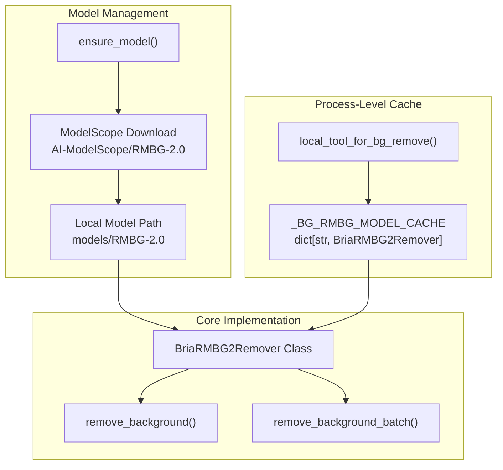
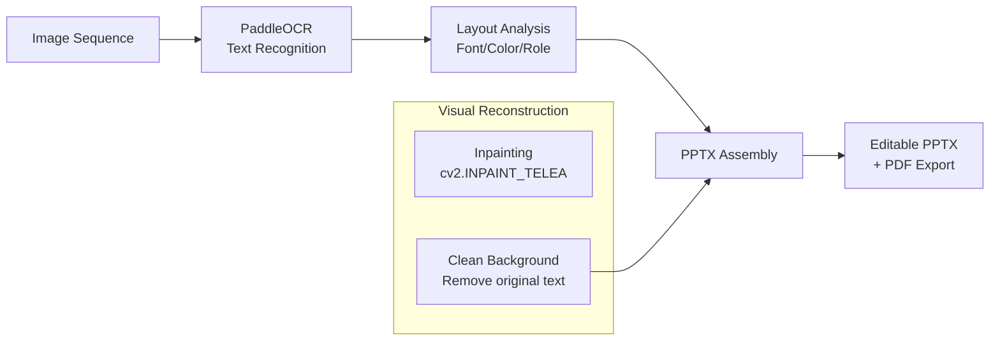

<!-- source: DeepWiki mcp.deepwiki.com · repo OpenDCAI/Paper2Any · page 8.5 Image Processing Tools · fetched 2026-11-02 -->

# Image Processing Tools

Relevant source files

The following files were used as context for generating this wiki page:

- [dataflow_agent/toolkits/multimodaltool/bg_tool.py](dataflow_agent/toolkits/multimodaltool/bg_tool.py)
- [dataflow_agent/toolkits/multimodaltool/ppt_tool.py](dataflow_agent/toolkits/multimodaltool/ppt_tool.py)
- [dataflow_agent/toolkits/multimodaltool/req_img.py](dataflow_agent/toolkits/multimodaltool/req_img.py)
- [dataflow_agent/toolkits/multimodaltool/utils.py](dataflow_agent/toolkits/multimodaltool/utils.py)
- [dataflow_agent/workflow/wf_paper2page_content.py](dataflow_agent/workflow/wf_paper2page_content.py)
- [dataflow_agent/workflow/wf_paper2page_content_for_long_paper.py](dataflow_agent/workflow/wf_paper2page_content_for_long_paper.py)
- [dataflow_agent/workflow/wf_pdf2ppt_qwenvl.py](dataflow_agent/workflow/wf_pdf2ppt_qwenvl.py)
- [docker-compose.yml](docker-compose.yml)
- [frontend-workflow/.env.example](frontend-workflow/.env.example)
- [frontend-workflow/Dockerfile](frontend-workflow/Dockerfile)
- [frontend-workflow/src/components/ParticleBackground.tsx](frontend-workflow/src/components/ParticleBackground.tsx)
- [frontend-workflow/src/components/knowledge-base/tools/MermaidPreview.tsx](frontend-workflow/src/components/knowledge-base/tools/MermaidPreview.tsx)
- [frontend-workflow/src/types/index.ts](frontend-workflow/src/types/index.ts)

This document describes the image processing utilities provided by the Paper2Any system for manipulating and converting images, generating visual assets via APIs, and handling multimodal document elements. These tools support background removal, OCR-driven PowerPoint generation, inpainting, and vector format conversion.

---

## Overview

The image processing toolkit is distributed across several specialized modules:

| Tool / Service | Primary Function | Key File |
|------|-----------------|----------|
| **RMBG-2.0 Background Removal** | High-quality foreground segmentation | [dataflow_agent/toolkits/multimodaltool/bg_tool.py:1-212]() |
| **PPT Generation (OCR-based)** | Converts images to editable PPTX with inpainting | [dataflow_agent/toolkits/multimodaltool/ppt_tool.py:1-166]() |
| **VLM Image Recognition** | Detects text and bounding boxes via Qwen-VL | [dataflow_agent/workflow/wf_pdf2ppt_qwenvl.py:1-56]() |
| **Image Generation APIs** | Interface for DALL-E, Gemini, and Stable Diffusion | [dataflow_agent/toolkits/multimodaltool/req_img.py:1-204]() |
| **MinerU PDF Parsing** | Extracts markdown and images from PDFs | [dataflow_agent/workflow/wf_paper2page_content.py:102-162]() |

**Sources:** [dataflow_agent/toolkits/multimodaltool/bg_tool.py:1-13](), [dataflow_agent/toolkits/multimodaltool/ppt_tool.py:1-21]()

---

## Background Removal (RMBG-2.0)

The system uses the **BRIA-RMBG 2.0** model for high-quality background removal, primarily used in the `Paper2Figure` workflow to isolate diagram elements.

### Architecture & Implementation
The implementation uses a process-level cache to avoid repeated model loading into GPU memory.

**Key Features:**
- **Automatic Device Selection:** Resolves to `cuda` if available, otherwise `cpu` [dataflow_agent/toolkits/multimodaltool/bg_tool.py:45-65]().
- **Resolution Handling:** Processes images at a standard 1024x1024 size before scaling the mask back to the original dimensions [dataflow_agent/toolkits/multimodaltool/bg_tool.py:160-202]().
- **Memory Management:** Includes a `free_bg_rm_model` function to explicitly clear CUDA cache after heavy batch operations [dataflow_agent/toolkits/multimodaltool/bg_tool.py:44]().

**Sources:** [dataflow_agent/toolkits/multimodaltool/bg_tool.py:40-116](), [dataflow_agent/toolkits/multimodaltool/bg_tool.py:127-212]()

---

## PowerPoint Generation Tool (`ppt_tool.py`)

The `ppt_tool.py` module is a sophisticated engine for converting raster images (like screenshots of slides) into editable PowerPoint presentations.

### Functional Pipeline
The tool follows a "Clean-and-Overlay" strategy to maximize editability while preserving visual fidelity.

### Core Mechanisms
1. **Adaptive Inpainting:** Uses a text mask generated from OCR bounding boxes to "erase" text from the original image, creating a clean background plate [dataflow_agent/toolkits/multimodaltool/ppt_tool.py:46-50]().
2. **Font Clustering:** Implements `FontSizeClustering` to map noisy OCR height measurements to discrete, standard font sizes (Title, Subtitle, Body) [dataflow_agent/toolkits/multimodaltool/ppt_tool.py:172-195]().
3. **Color Extraction:** Estimates the dominant text color by sampling pixels within the OCR bounding box while excluding the background color [dataflow_agent/toolkits/multimodaltool/ppt_tool.py:39-40]().
4. **Layout Preservation:** Automatically calculates slide dimensions (defaulting to 16:9) and maps pixel coordinates to PPTX EMUs [dataflow_agent/toolkits/multimodaltool/ppt_tool.py:116-128]().

**Sources:** [dataflow_agent/toolkits/multimodaltool/ppt_tool.py:22-54](), [dataflow_agent/toolkits/multimodaltool/ppt_tool.py:142-150]()

---

## Image Generation & Editing APIs

The `req_img.py` module provides a unified interface for external Image-as-a-Service providers.

### Supported Providers & Models
- **DALL-E:** Supports standard generation and multipart-form-based image editing (inpainting) [dataflow_agent/toolkits/multimodaltool/req_img.py:130-146]().
- **Gemini:** Specialized support for multi-image editing and high-resolution (2K/4K) generation [dataflow_agent/toolkits/multimodaltool/req_img.py:194-204]().
- **Generic OpenAI-Compatible:** Handles streaming and non-streaming responses for various VLM tasks [dataflow_agent/toolkits/multimodaltool/req_img.py:17-81]().

### Image Preprocessing
Before sending images to external APIs, the system performs automatic compression:
- **Size Limit:** Images exceeding 6MB are compressed [dataflow_agent/toolkits/multimodaltool/utils.py:42]().
- **Dimension Limit:** Max side length is capped at 2048px [dataflow_agent/toolkits/multimodaltool/utils.py:43]().
- **Format Conversion:** Converts RGBA/P modes to RGB JPEG for compatibility [dataflow_agent/toolkits/multimodaltool/utils.py:69-76]().

**Sources:** [dataflow_agent/toolkits/multimodaltool/req_img.py:82-129](), [dataflow_agent/toolkits/multimodaltool/utils.py:37-87]()

---

## Multimodal Workflows

### PDF-to-PPT with VLM (`wf_pdf2ppt_qwenvl.py`)
This workflow replaces traditional OCR with Vision-Language Models (VLM) for superior layout understanding.

**Data Flow:**
1. **PDF Rendering:** Converts PDF pages to PNG using PyMuPDF [dataflow_agent/workflow/wf_pdf2ppt_qwenvl.py:24]().
2. **VLM Recognition:** Uses `ImageTextBBoxAgent` to identify text, bounding boxes, and semantic roles [dataflow_agent/workflow/wf_pdf2ppt_qwenvl.py:4-10]().
3. **SAM3 Segmentation:** Identifies graphical elements (icons, shapes) for vectorization [dataflow_agent/workflow/wf_pdf2ppt_qwenvl.py:36-43]().
4. **Adaptive Fill:** A specialized `_adaptive_fill_text_regions` function uses neighbor-pixel statistics and `cv2.inpaint` to remove text from complex backgrounds [dataflow_agent/workflow/wf_pdf2ppt_qwenvl.py:106-197]().

**Sources:** [dataflow_agent/workflow/wf_pdf2ppt_qwenvl.py:1-13](), [dataflow_agent/workflow/wf_pdf2ppt_qwenvl.py:106-117]()

### MinerU Content Extraction
MinerU is the primary engine for academic paper parsing.

**Capabilities:**
- **Markdown Conversion:** Transforms complex PDFs into clean Markdown [dataflow_agent/workflow/wf_paper2page_content.py:102-141]().
- **Layout Awareness:** Detects images and tables, saving them to a structured directory (`auto/images/`) for subsequent processing [dataflow_agent/workflow/wf_paper2page_content.py:106-112]().
- **Long Document Support:** Includes a specialized routing for papers exceeding token limits, splitting them into batches for processing [dataflow_agent/workflow/wf_paper2page_content_for_long_paper.py:29-52]().

**Sources:** [dataflow_agent/workflow/wf_paper2page_content.py:143-162](), [dataflow_agent/workflow/wf_paper2page_content_for_long_paper.py:162-185]()

---

## Mind Map & SVG Rendering

The system supports Mermaid.js for mind map generation and SVG rendering for technical diagrams.

- **Mermaid Preview:** A React component (`MermaidPreview.tsx`) that renders mind maps with a dark theme and supports SVG export [frontend-workflow/src/components/knowledge-base/tools/MermaidPreview.tsx:11-38]().
- **Interactive Controls:** Users can zoom, pan, and download the generated diagrams as SVG or raw code [frontend-workflow/src/components/knowledge-base/tools/MermaidPreview.tsx:171-204]().

**Sources:** [frontend-workflow/src/components/knowledge-base/tools/MermaidPreview.tsx:24-71]()

---

