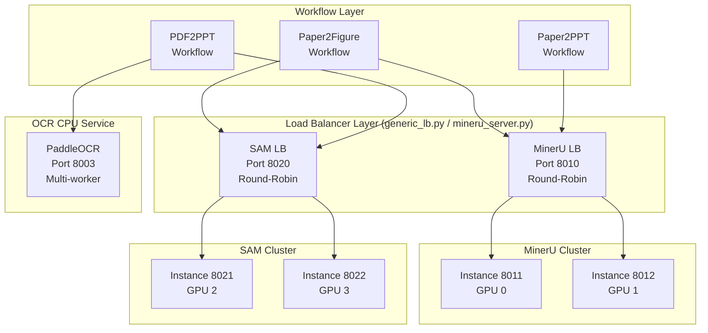
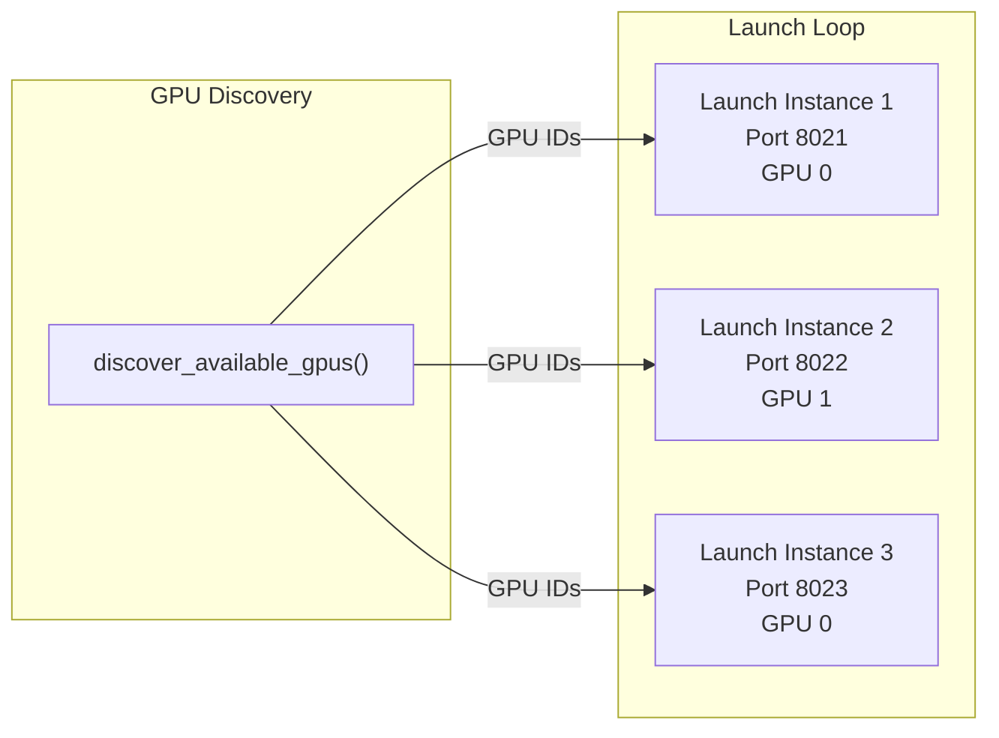

<!-- source: DeepWiki mcp.deepwiki.com · repo OpenDCAI/Paper2Any · page 8.6 Load Balancing & Scaling · fetched 2026-11-02 -->

# Load Balancing & Scaling

Relevant source files

The following files were used as context for generating this wiki page:

- [dataflow_agent/toolkits/dockertool/build_docker.py](dataflow_agent/toolkits/dockertool/build_docker.py)
- [dataflow_agent/toolkits/filetool/__init__.py](dataflow_agent/toolkits/filetool/__init__.py)
- [dataflow_agent/toolkits/filetool/filetools.py](dataflow_agent/toolkits/filetool/filetools.py)
- [dataflow_agent/toolkits/model_servers/generic_lb.py](dataflow_agent/toolkits/model_servers/generic_lb.py)
- [dataflow_agent/toolkits/model_servers/mineru_server.py](dataflow_agent/toolkits/model_servers/mineru_server.py)
- [script/start_model_servers.sh](script/start_model_servers.sh)

This document describes the load balancing and horizontal scaling architecture for GPU-accelerated model services in Paper2Any. It covers deployment strategies, service cluster configuration, and GPU resource allocation mechanisms using the generic load balancer and specialized server implementations.

**Scope**: This page focuses on the infrastructure layer for model services (MinerU, SAM, OCR). For model service integration and API usage, see [8.1](), [8.2](), and [8.3](). For backend API deployment, see [12.1]().

---

## Load Balancing Architecture

Paper2Any employs a combination of **centralized HTTP load balancing** via a proxy and **client-side random selection** for distributing requests across multiple model service instances.

### Overall Service Topology

**Sources:** [dataflow_agent/toolkits/model_servers/generic_lb.py:9-15](), [dataflow_agent/toolkits/model_servers/mineru_server.py:9-14](), [script/start_model_servers.sh:38-41]()

---

## Generic Load Balancer (generic_lb.py)

The system provides a `Generic Model Load Balancer` implemented using FastAPI and `httpx`. It uses a **Round-Robin** strategy to distribute incoming HTTP requests across a set of backend URLs.

### Implementation Details

The load balancer is initialized with a list of backend URLs and uses `itertools.cycle` to rotate through them for every request [dataflow_agent/toolkits/model_servers/generic_lb.py:71-72]().

- **Proxy Logic**: The `proxy` function catches all paths (`/{path_name:path}`) and forwards the method, headers, and body to the selected backend [dataflow_agent/toolkits/model_servers/generic_lb.py:16-47]().
- **Streaming Support**: It uses `StreamingResponse` with `r.aiter_raw()` to ensure large payloads (like images or PDF results) are streamed back to the client without loading the entire response into memory [dataflow_agent/toolkits/model_servers/generic_lb.py:52-57]().
- **Header Handling**: It explicitly removes the `host` and `content-length` headers from the forwarded request to allow `httpx` to regenerate them correctly for the target backend [dataflow_agent/toolkits/model_servers/generic_lb.py:30-33]().

### Specialized Variants
- **MinerU Load Balancer**: A specialized version (`mineru_server.py`) exists specifically for MinerU services, defaulting to port `8010` [dataflow_agent/toolkits/model_servers/mineru_server.py:64-76]().

**Sources:** [dataflow_agent/toolkits/model_servers/generic_lb.py:1-79](), [dataflow_agent/toolkits/model_servers/mineru_server.py:1-77]()

---

## Service Deployment & GPU Allocation

The `start_model_servers.sh` script automates the deployment of model clusters and handles GPU assignment based on environment profiles.

### GPU Discovery Mechanism

The script includes a robust `discover_available_gpus` function that supports multiple hardware vendors and query tools [script/start_model_servers.sh:147-194]():
- **NVIDIA**: Uses `nvidia-smi` [script/start_model_servers.sh:162-165]().
- **Muxi (Moore Threads)**: Uses `mx-smi` [script/start_model_servers.sh:167-175]().
- **PyTorch Fallback**: Queries `torch.cuda` directly and sorts GPUs by available free memory [script/start_model_servers.sh:177-193]().

### MinerU & SAM Scaling Strategies

| Service | Scaling Strategy | Configuration Variables |
| :--- | :--- | :--- |
| **MinerU** | Multi-instance vLLM | `MINERU_LOCAL_ENABLED`, `MINERU_GPU_UTIL` |
| **SAM** | Multi-instance per GPU | `SAM3_INSTANCES_PER_GPU`, `SAM3_MAX_INSTANCES` |
| **OCR** | Multi-worker Uvicorn | `OCR_WORKERS`, `OCR_PORT` |

**Sources:** [script/start_model_servers.sh:22-41](), [script/start_model_servers.sh:147-194]()

### SAM3 Instance Launch Logic

The script calculates the total number of instances to launch by multiplying available GPUs by `SAM3_INSTANCES_PER_GPU`, capped by `SAM3_MAX_INSTANCES` [script/start_model_servers.sh:239-270]().

**Sources:** [script/start_model_servers.sh:239-284]()

---

## High-Concurrency Strategies

For production environments, Paper2Any utilizes several strategies to maintain stability under high load:

### 1. Startup Staggering
To prevent GPU memory spikes and port collisions during initialization, the system supports a `SAM3_STARTUP_STAGGER_SEC` delay between launching instances [script/start_model_servers.sh:30, 314-317]().

### 2. Port Management
The script includes a `kill_port` utility that ensures target ports are free before attempting to start a service, preventing "Address already in use" errors during scaling or restarts [script/start_model_servers.sh:75-84]().

### 3. Health Checks
The `wait_for_http` function performs automated health checks on newly launched instances before the load balancer begins routing traffic to them [script/start_model_servers.sh:114-131]().

### 4. File System Isolation
For Docker-based deployments, the `build_docker.py` script generates isolated environments with non-root users (`appuser`) and specific requirements to ensure that scaling out containers doesn't lead to permission or dependency conflicts [dataflow_agent/toolkits/dockertool/build_docker.py:27-38]().

**Sources:** [script/start_model_servers.sh:30, 75-84, 114-131, 314-317](), [dataflow_agent/toolkits/dockertool/build_docker.py:27-38]()

---

## File Access & Security in Scaling

When scaling across multiple processes or containers, file access is restricted to the project root to ensure data integrity.

- **Path Resolution**: The `_resolve_path` function ensures all file operations are anchored to the `PROJECT_ROOT` [dataflow_agent/toolkits/filetool/filetools.py:45-59]().
- **Safety Checks**: `_is_path_within_project` prevents directory traversal attacks when multiple instances are reading/writing shared output directories [dataflow_agent/toolkits/filetool/filetools.py:25-42]().

**Sources:** [dataflow_agent/toolkits/filetool/filetools.py:22-59]()

---

