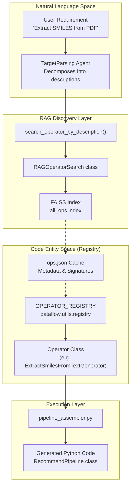
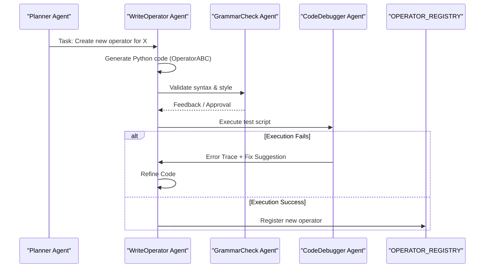

<!-- source: DeepWiki mcp.deepwiki.com · repo OpenDCAI/Paper2Any · page 9 Operator System · fetched 2026-11-02 -->

# Operator System

Relevant source files

The following files were used as context for generating this wiki page:

- [dataflow_agent/agentroles/cores/base_agent.py](dataflow_agent/agentroles/cores/base_agent.py)
- [dataflow_agent/graphbuilder/graph_builder.py](dataflow_agent/graphbuilder/graph_builder.py)
- [dataflow_agent/promptstemplates/prompts_repo.py](dataflow_agent/promptstemplates/prompts_repo.py)
- [dataflow_agent/resources/faiss_cache/all_ops.index.meta](dataflow_agent/resources/faiss_cache/all_ops.index.meta)
- [dataflow_agent/state.py](dataflow_agent/state.py)
- [dataflow_agent/toolkits/optool/op_tools.py](dataflow_agent/toolkits/optool/op_tools.py)
- [dataflow_agent/toolkits/pipetool/pipe_tools.py](dataflow_agent/toolkits/pipetool/pipe_tools.py)
- [dataflow_agent/toolkits/resources/ops.json](dataflow_agent/toolkits/resources/ops.json)

The Operator System provides the core infrastructure for discovering, assembling, and generating data processing operators within the Paper2Any framework. It bridges high-level natural language requirements with concrete code entities by maintaining an automated registry, a RAG-based semantic search engine, and a multi-agent pipeline assembly system.

This page documents the high-level architecture and core logic. For specific implementation details, refer to the child pages:
- [Operator Registry](#9.1) — Metadata extraction and caching.
- [RAG-Based Operator Discovery](#9.2) — FAISS-based semantic search.
- [Pipeline Assembly](#9.3) — Automated Python code generation.
- [Operator Writing Workflow](#9.4) — Multi-agent development loop.

---

## System Architecture

The operator system translates user intent into executable code through four distinct layers. It uses `OPERATOR_REGISTRY` as the single source of truth for all available code entities.

**Diagram 1: Operator System Architecture (Natural Language to Code Space)**

**Sources:** [dataflow_agent/toolkits/optool/op_tools.py:1-160](), [dataflow_agent/toolkits/pipetool/pipe_tools.py:1-100](), [dataflow_agent/promptstemplates/prompts_repo.py:76-113]()

---

## Operator Registry

The registry layer is responsible for scanning the codebase and extracting metadata from operator classes. It uses the `OPERATOR_REGISTRY` to locate classes and `inspect` to extract method signatures.

*   **Metadata Extraction**: The system calls `_gather_single_operator` to collect information such as the operator's category (e.g., `agentic_rag`, `chemistry`), description (via `@staticmethod get_desc`), and parameters for `__init__` and `run` methods. [dataflow_agent/toolkits/optool/op_tools.py:125-159]()
*   **Caching**: To avoid expensive re-scanning, metadata is serialized into `ops.json`. The `_ensure_ops_cache` function manages this lifecycle. [dataflow_agent/toolkits/optool/op_tools.py:195-208]()
*   **Base Class**: All operators are expected to follow the `OperatorABC` structure, ensuring compatibility with the automated assembly tools.

For details, see [Operator Registry](#9.1).

**Sources:** [dataflow_agent/toolkits/optool/op_tools.py:42-193]()

---

## RAG-Based Operator Discovery

The discovery layer enables semantic search over the operator library. It uses OpenAI embeddings and a FAISS index to find operators that match a natural language description.

*   **Semantic Search**: The `RAGOperatorSearch` class handles embedding generation and similarity matching. [dataflow_agent/toolkits/optool/op_tools.py:464-500]()
*   **Match Quality**: Results are categorized into "High", "Medium", or "Low" confidence based on cosine similarity thresholds (e.g., High >= 0.5). [dataflow_agent/toolkits/optool/op_tools.py:716-720]()
*   **Agent Integration**: Agents use the `search_operator_by_description` tool to find the right components during the planning phase. [dataflow_agent/toolkits/optool/op_tools.py:798-840]()

For details, see [RAG-Based Operator Discovery](#9.2).

**Sources:** [dataflow_agent/toolkits/optool/op_tools.py:464-628](), [dataflow_agent/toolkits/optool/op_tools.py:770-795]()

---

## Pipeline Assembly

The assembly system converts a list of matched operators into a fully functional Python script. This involves wiring parameters, managing imports, and selecting appropriate prompt templates.

*   **Code Generation**: `build_pipeline_code_with_full_params` generates a `RecommendPipeline` class including boilerplate for `FileStorage` and `LLMServing`. [dataflow_agent/toolkits/pipetool/pipe_tools.py:852-954]()
*   **Intelligent Prompting**: If an operator supports multiple prompts, `choose_prompt_template_by_llm` uses an LLM to select the best template based on the user's task description. [dataflow_agent/toolkits/pipetool/pipe_tools.py:148-180]()
*   **Parameter Wiring**: The system automatically handles `input_key` and `output_key` mappings to ensure data flows correctly between pipeline stages. [dataflow_agent/toolkits/pipetool/pipe_tools.py:712-849]()

For details, see [Pipeline Assembly](#9.3).

**Sources:** [dataflow_agent/toolkits/pipetool/pipe_tools.py:1-262](), [dataflow_agent/toolkits/pipetool/pipe_tools.py:712-954]()

---

## Operator Writing Workflow

When a required operator does not exist, the system triggers an automated development workflow. This multi-agent process writes, tests, and refines new operator code.

**Diagram 2: Multi-Agent Operator Development Loop**

*   **Agents**: The workflow involves specialized roles like `WriteOperator`, `GrammarCheck`, and `OpRewriter`.
*   **Templates**: Code generation is guided by Jinja2 templates (e.g., `operator.py.jinja`) to maintain consistency with the framework's standards.

For details, see [Operator Writing Workflow](#9.4).

**Sources:** [dataflow_agent/state.py:84-101](), [dataflow_agent/agentroles/cores/base_agent.py:95-144](), [dataflow_agent/promptstemplates/prompts_repo.py:118-165]()

---

