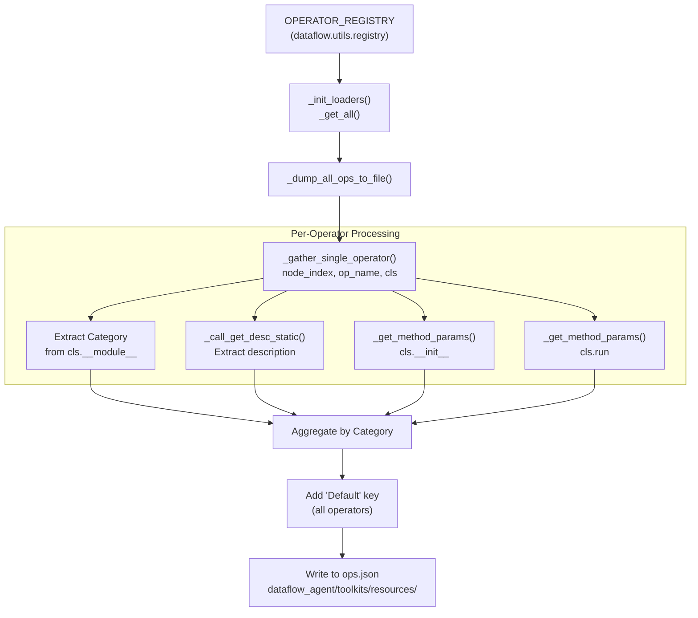
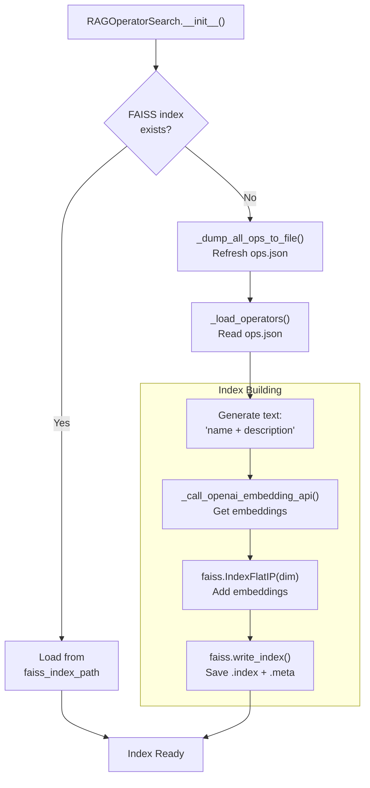
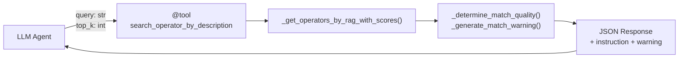

<!-- source: DeepWiki mcp.deepwiki.com · repo OpenDCAI/Paper2Any · page 9.1 Operator Registry · fetched 2026-11-02 -->

# Operator Registry

<details>
<summary>Relevant source files</summary>

The following files were used as context for generating this wiki page:

- [dataflow_agent/agentroles/cores/base_agent.py](dataflow_agent/agentroles/cores/base_agent.py)
- [dataflow_agent/graphbuilder/graph_builder.py](dataflow_agent/graphbuilder/graph_builder.py)
- [dataflow_agent/promptstemplates/prompts_repo.py](dataflow_agent/promptstemplates/prompts_repo.py)
- [dataflow_agent/resources/faiss_cache/all_ops.index.meta](dataflow_agent/resources/faiss_cache/all_ops.index.meta)
- [dataflow_agent/state.py](dataflow_agent/state.py)
- [dataflow_agent/toolkits/optool/op_tools.py](dataflow_agent/toolkits/optool/op_tools.py)
- [dataflow_agent/toolkits/pipetool/pipe_tools.py](dataflow_agent/toolkits/pipetool/pipe_tools.py)
- [dataflow_agent/toolkits/resources/ops.json](dataflow_agent/toolkits/resources/ops.json)

</details>


## Purpose and Scope

The Operator Registry is a metadata management and discovery system that maintains a centralized catalog of all DataFlow operators available in the system. It provides structured access to operator information including names, descriptions, parameter schemas, and categories, along with semantic search capabilities powered by FAISS vector indexing.

This page covers the operator metadata structure, automatic catalog generation, RAG-based search, and LangChain tool integration. For information about creating custom operators, see [11.1](). For the pipeline recommendation workflow that uses operator search, see [10.1]().

---

## Operator Metadata Structure

### ops.json Schema

The operator registry stores all operator metadata in `ops.json`, located at `dataflow_agent/toolkits/resources/ops.json`. Each operator entry contains the following fields:

| Field | Type | Description |
|-------|------|-------------|
| `node` | integer | Sequential index for ordering |
| `name` | string | Operator class name (e.g., `ExtractSmilesFromTextGenerator`) |
| `description` | string | Human-readable description from `get_desc()` method |
| `parameter.init` | array | Initialization parameters with name, default, kind |
| `parameter.run` | array | Runtime parameters with name, default, kind |
| `category` | string | Extracted from module path (e.g., "agentic_rag", "chemistry") |
| `required` | string | Reserved field (currently unused) |
| `depends_on` | array | Reserved field (currently unused) |
| `mode` | string | Reserved field (currently unused) |

**Example Entry:**
```json
{
  "node": 5,
  "name": "ExtractSmilesFromTextGenerator",
  "description": "ExtractSmilesFromText 用于从 OCR 文本中抽取或解析化学分子的 SMILES 表达式...",
  "parameter": {
    "init": [
      {"name": "llm_serving", "default": null, "kind": "POSITIONAL_OR_KEYWORD"},
      {"name": "prompt_template", "default": "dataflow.prompts.chemistry.ExtractSmilesFromTextPrompt", "kind": "POSITIONAL_OR_KEYWORD"}
    ],
    "run": [
      {"name": "storage", "default": null, "kind": "POSITIONAL_OR_KEYWORD"},
      {"name": "input_content_key", "default": "text", "kind": "POSITIONAL_OR_KEYWORD"}
    ]
  },
  "category": "chemistry"
}
```
[dataflow_agent/toolkits/resources/ops.json:195-223]()

The JSON structure groups operators by category, with a special `"Default"` key containing all operators regardless of category. [dataflow_agent/toolkits/optool/op_tools.py:183-183]()

**Sources:** [dataflow_agent/toolkits/optool/op_tools.py:161-193](), [dataflow_agent/toolkits/resources/ops.json:1-223]()

---

## Automatic Catalog Generation

### Metadata Collection Pipeline

The `_dump_all_ops_to_file` function iterates through the `OPERATOR_REGISTRY` to build the `ops.json` file.

**Metadata Extraction Flow**

[dataflow_agent/toolkits/optool/op_tools.py:161-193]()

**Sources:** [dataflow_agent/toolkits/optool/op_tools.py:125-193]()

### Category Extraction

Categories are automatically derived from the operator's module path using the pattern `dataflow.operators.<category>.*`:

```python
# Example: dataflow.operators.chemistry.ExtractSmilesFromTextGenerator → category = "chemistry"
```
[dataflow_agent/toolkits/optool/op_tools.py:132-136]()

If the module path doesn't match this pattern, the category defaults to `"unknown"`. [dataflow_agent/toolkits/optool/op_tools.py:132-132]()

**Sources:** [dataflow_agent/toolkits/optool/op_tools.py:131-136]()

### Parameter Schema Extraction

The `_get_method_params()` function uses Python's `inspect.signature()` to extract parameter information from both `__init__` and `run` methods. [dataflow_agent/toolkits/optool/op_tools.py:107-122]()

**Parameter Schema:**
```python
{
  "name": str,          # Parameter name
  "default": Any,       # Default value (None if inspect.Parameter.empty)
  "kind": str          # "POSITIONAL_OR_KEYWORD", "VAR_POSITIONAL", etc.
}
```
[dataflow_agent/toolkits/optool/op_tools.py:97-105]()

The `_safe_json_val()` function handles complex default values by converting classes to `"module.qualname"` format and falling back to `str()` for non-serializable objects. [dataflow_agent/toolkits/optool/op_tools.py:42-71]()

**Sources:** [dataflow_agent/toolkits/optool/op_tools.py:42-122]()

---

## FAISS-Based Operator Discovery

### Index Building and Caching

The system uses a FAISS index to enable semantic search over operator descriptions. The index is cached in `dataflow_agent/resources/faiss_cache/`.

**Operator Discovery Lifecycle**

[dataflow_agent/toolkits/optool/op_tools.py:515-565]()

**Sources:** [dataflow_agent/toolkits/optool/op_tools.py:515-565](), [dataflow_agent/resources/faiss_cache/all_ops.index.meta:1-120]()

---

## LangChain Tool Integration

### search_operator_by_description

Primary RAG search tool exposed to LLM agents. It returns match quality assessments (High/Medium/Low) based on similarity scores. [dataflow_agent/toolkits/optool/op_tools.py:798-825]()

**Tool Flow**

[dataflow_agent/toolkits/optool/op_tools.py:827-881]()

**Sources:** [dataflow_agent/toolkits/optool/op_tools.py:798-881]()

### Pipeline Assembly Tools

The `pipeline_assembler` module provides functions to convert selected operators into executable Python code.

| Function | Role | Source |
|----------|------|--------|
| `choose_prompt_template_by_llm` | Uses LLM to select the best `ALLOWED_PROMPTS` template for an operator based on the task target. | [dataflow_agent/toolkits/pipetool/pipe_tools.py:148-230]() |
| `extract_prompt_info` | Extracts class name, docstring, and template examples from a prompt class. | [dataflow_agent/toolkits/pipetool/pipe_tools.py:93-146]() |
| `build_pipeline_code_with_full_params` | Assembles operator initialization and run blocks into a complete Python script. | [dataflow_agent/toolkits/pipetool/pipe_tools.py:1260-1380]() |

**Sources:** [dataflow_agent/toolkits/pipetool/pipe_tools.py:93-1380]()

---

## Operator Base Class (OperatorABC)

While the registry handles metadata, the operators themselves are expected to follow a specific structure to be correctly indexed.

### Static Description
Operators should implement a static `get_desc(lang)` method to provide metadata to the registry. [dataflow_agent/toolkits/optool/op_tools.py:74-93]()

### Parameter Convention
The registry expects:
1. `__init__`: For service-level parameters (e.g., `llm_serving`). [dataflow_agent/toolkits/optool/op_tools.py:142-142]()
2. `run`: For data-level parameters (e.g., `input_key`, `output_key`). [dataflow_agent/toolkits/optool/op_tools.py:143-143]()

**Sources:** [dataflow_agent/toolkits/optool/op_tools.py:74-143]()

---

