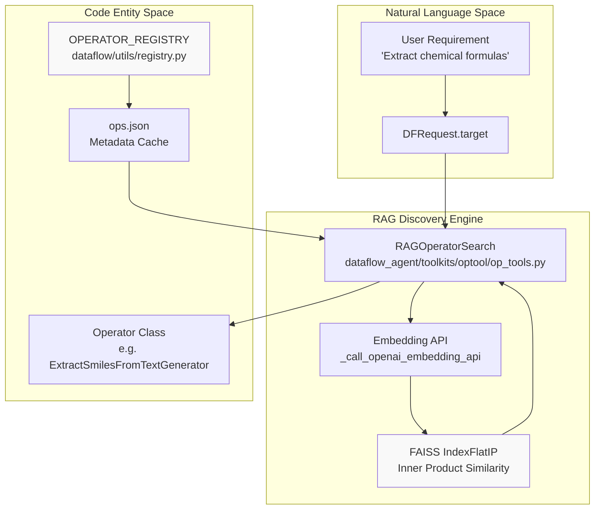
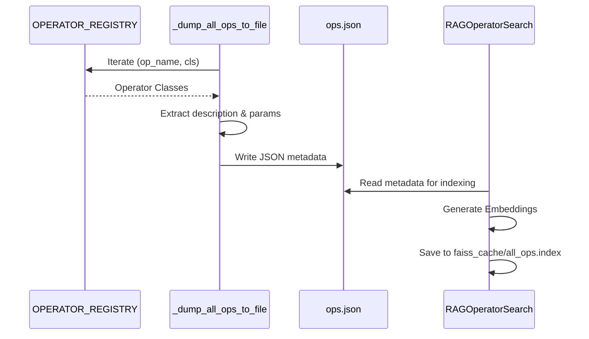
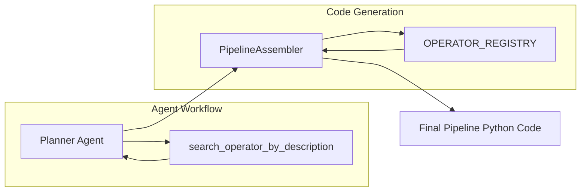

<!-- source: DeepWiki mcp.deepwiki.com · repo OpenDCAI/Paper2Any · page 9.2 RAG-Based Operator Discovery · fetched 2026-11-02 -->

# RAG-Based Operator Discovery

<details>
<summary>Relevant source files</summary>

The following files were used as context for generating this wiki page:

- [dataflow_agent/agentroles/cores/base_agent.py](dataflow_agent/agentroles/cores/base_agent.py)
- [dataflow_agent/graphbuilder/graph_builder.py](dataflow_agent/graphbuilder/graph_builder.py)
- [dataflow_agent/promptstemplates/prompts_repo.py](dataflow_agent/promptstemplates/prompts_repo.py)
- [dataflow_agent/resources/faiss_cache/all_ops.index.meta](dataflow_agent/resources/faiss_cache/all_ops.index.meta)
- [dataflow_agent/state.py](dataflow_agent/state.py)
- [dataflow_agent/toolkits/optool/op_tools.py](dataflow_agent/toolkits/optool/op_tools.py)
- [dataflow_agent/toolkits/pipetool/pipe_tools.py](dataflow_agent/toolkits/pipetool/pipe_tools.py)
- [dataflow_agent/toolkits/resources/ops.json](dataflow_agent/toolkits/resources/ops.json)

</details>


## Purpose and Scope

RAG-Based Operator Discovery is a semantic search system that enables intelligent discovery of data processing operators using natural language descriptions. Instead of requiring users to know exact operator names, the system uses Retrieval-Augmented Generation (RAG) with FAISS vector indexing to find the most relevant operators based on functional descriptions extracted from the `OPERATOR_REGISTRY` [dataflow/utils/registry:30]().

This page covers the semantic search mechanism, match quality assessment, and LangChain tool integration. It documents how the system bridges the gap between high-level user requirements and specific code entities (Operators).

**Key Features:**
- **FAISS-based vector similarity search**: Uses operator descriptions for semantic matching [dataflow_agent/toolkits/optool/op_tools.py:464-475]().
- **Automatic embedding generation**: Supports configurable models via OpenAI-compatible APIs [dataflow_agent/toolkits/optool/op_tools.py:420-435]().
- **Three-tier match quality assessment**: Categorizes results into High, Medium, or Low confidence [dataflow_agent/toolkits/optool/op_tools.py:715-720]().
- **Persistent index caching**: Stores vector indices in the `faiss_cache` directory to optimize performance [dataflow_agent/toolkits/optool/op_tools.py:559-565]().

---

## Architecture Overview

The discovery system transforms natural language queries into executable code entities by indexing the metadata of registered operators.

### Discovery Data Flow



**Sources:** [dataflow_agent/toolkits/optool/op_tools.py:464-674](), [dataflow/utils/registry:30](), [dataflow_agent/state.py:30]()

---

## RAGOperatorSearch Implementation

The `RAGOperatorSearch` class manages the lifecycle of operator indexing and retrieval. It is initialized with a path to `ops.json` and a target FAISS index path [dataflow_agent/toolkits/optool/op_tools.py:464-480]().

### Class Structure and Key Methods

| Method | Role | Implementation Detail |
| :--- | :--- | :--- |
| `_load_operators()` | Metadata Loading | Parses `ops.json` and filters by category if specified [dataflow_agent/toolkits/optool/op_tools.py:504-515](). |
| `_load_or_build_index()` | Index Management | Checks `faiss_cache` for existing `.index` and `.index.meta` files; builds new index if missing [dataflow_agent/toolkits/optool/op_tools.py:518-532](). |
| `_call_openai_embedding_api()` | Vectorization | Calls embedding endpoint and applies `faiss.normalize_L2` for cosine similarity [dataflow_agent/toolkits/optool/op_tools.py:420-461](). |
| `search()` | Retrieval | Embeds query, performs FAISS search, and returns ranked operators with similarity scores [dataflow_agent/toolkits/optool/op_tools.py:567-627](). |

### Metadata Extraction Pipeline

Before indexing, the system extracts metadata from the live registry. The function `_dump_all_ops_to_file()` iterates through `OPERATOR_REGISTRY`, gathering `init_params`, `run_params`, and descriptions via the operator's `get_desc` static method [dataflow_agent/toolkits/optool/op_tools.py:161-193]().



**Sources:** [dataflow_agent/toolkits/optool/op_tools.py:161-208](), [dataflow_agent/toolkits/optool/op_tools.py:528-565]()

---

## Match Quality Assessment

To ensure the reliability of operator discovery, the system assesses the "Match Quality" of search results based on similarity scores.

### Quality Thresholds
Thresholds are defined in `MATCH_QUALITY_THRESHOLDS` [dataflow_agent/toolkits/optool/op_tools.py:715-720]():
- **High (>= 0.5)**: The operator is a strong match for the requirement.
- **Medium (>= 0.3)**: The operator is relevant but requires manual verification.
- **Low (< 0.3)**: The operator might not meet the requirements.

### Tool Integration: search_operator_by_description
This LangChain-compatible `@tool` wraps the search logic and provides quality warnings to the LLM [dataflow_agent/toolkits/optool/op_tools.py:798-810]().

```python
# Example logic for quality assessment in the tool
quality = _determine_match_quality(max_score) # [dataflow_agent/toolkits/optool/op_tools.py:770-777]
warning = _generate_match_warning(quality)     # [dataflow_agent/toolkits/optool/op_tools.py:780-795]
```

**Sources:** [dataflow_agent/toolkits/optool/op_tools.py:715-720](), [dataflow_agent/toolkits/optool/op_tools.py:770-795](), [dataflow_agent/toolkits/optool/op_tools.py:798-881]()

---

## Persistence and the faiss_cache Directory

The system maintains a persistent cache to avoid expensive embedding re-computation.

### Cache Directory Structure
- **Location**: `dataflow_agent/resources/faiss_cache/` [dataflow_agent/toolkits/optool/op_tools.py:724]().
- **Files**:
    - `all_ops.index`: The FAISS binary index containing normalized vectors [dataflow_agent/toolkits/optool/op_tools.py:559]().
    - `all_ops.index.meta`: A pickled metadata file containing the ordered list of operator dictionaries mapped to index IDs [dataflow_agent/toolkits/optool/op_tools.py:561]().

### Cache Invalidation
The cache is checked during `RAGOperatorSearch` initialization. If the `.index` or `.meta` file is missing, the system triggers a full re-index by calling `_dump_all_ops_to_file()` followed by fresh embedding generation [dataflow_agent/toolkits/optool/op_tools.py:518-530]().

**Sources:** [dataflow_agent/toolkits/optool/op_tools.py:518-565](), [dataflow_agent/toolkits/optool/op_tools.py:724](), [dataflow_agent/resources/faiss_cache/all_ops.index.meta:1-15]()

---

## Integration in Pipeline Assembly

The discovery results are consumed by the `PipelineAssembler` to construct executable Python code.

### From Search to Code
1. **Discovery**: `search_operator_by_description` returns a list of candidate operators.
2. **Selection**: The agent selects an operator name (e.g., `ExtractSmilesFromTextGenerator`).
3. **Inspection**: The agent may call `get_operator_code_by_name` to read the source via `inspect.getsource` [dataflow_agent/toolkits/optool/op_tools.py:884-904]().
4. **Assembly**: `build_pipeline_code_with_full_params` (in `pipe_tools.py`) uses the selected operator to generate instantiation code [dataflow_agent/toolkits/pipetool/pipe_tools.py:1-20]().



**Sources:** [dataflow_agent/toolkits/optool/op_tools.py:798-904](), [dataflow_agent/toolkits/pipetool/pipe_tools.py:1-21](), [dataflow_agent/agentroles/cores/base_agent.py:102-108]()

---

