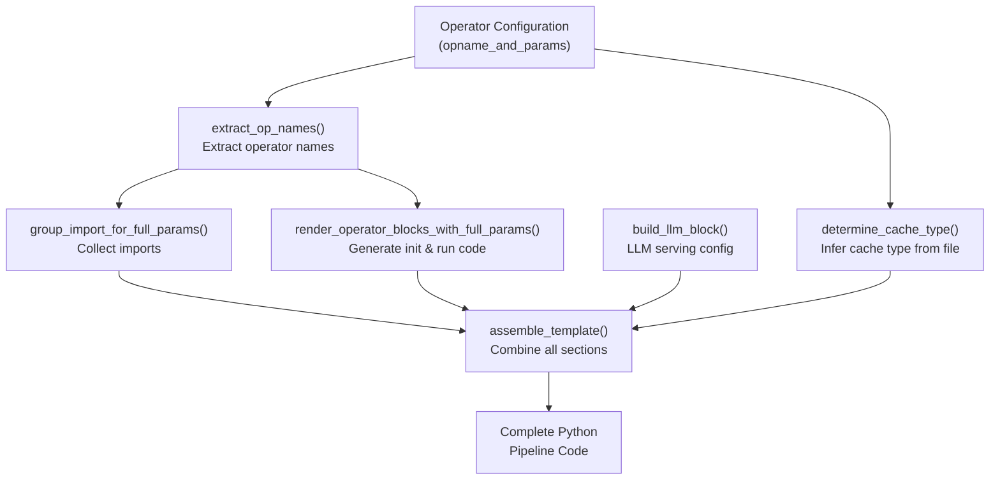
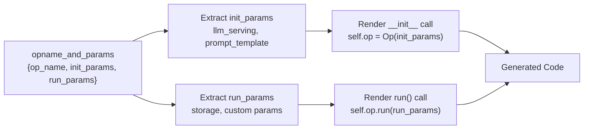
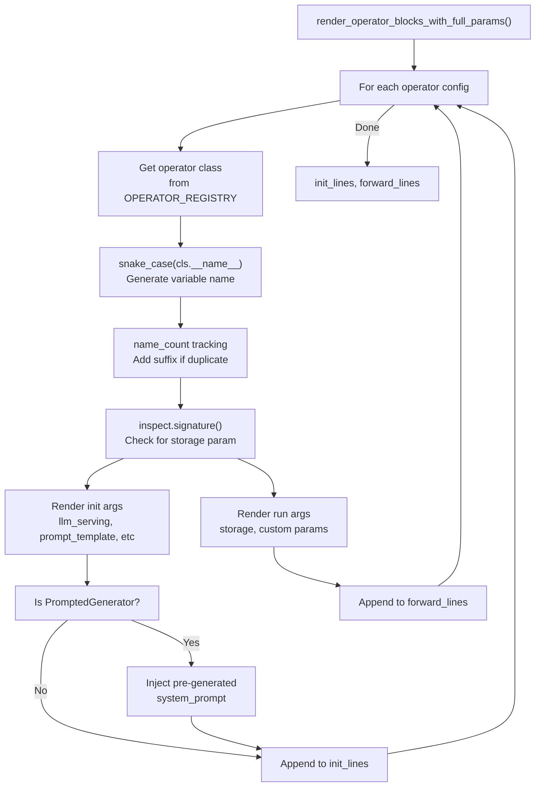
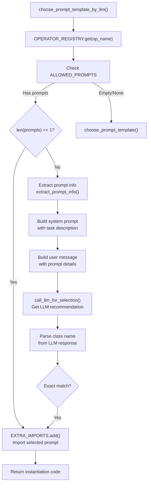

<!-- source: DeepWiki mcp.deepwiki.com · repo OpenDCAI/Paper2Any · page 9.3 Pipeline Assembly · fetched 2026-11-02 -->

# Pipeline Assembly

Relevant source files

The following files were used as context for generating this wiki page:

- [dataflow_agent/agentroles/cores/base_agent.py](dataflow_agent/agentroles/cores/base_agent.py)
- [dataflow_agent/graphbuilder/graph_builder.py](dataflow_agent/graphbuilder/graph_builder.py)
- [dataflow_agent/promptstemplates/prompts_repo.py](dataflow_agent/promptstemplates/prompts_repo.py)
- [dataflow_agent/resources/faiss_cache/all_ops.index.meta](dataflow_agent/resources/faiss_cache/all_ops.index.meta)
- [dataflow_agent/state.py](dataflow_agent/state.py)
- [dataflow_agent/toolkits/optool/op_tools.py](dataflow_agent/toolkits/optool/op_tools.py)
- [dataflow_agent/toolkits/pipetool/pipe_tools.py](dataflow_agent/toolkits/pipetool/pipe_tools.py)
- [dataflow_agent/toolkits/resources/ops.json](dataflow_agent/toolkits/resources/ops.json)

## Purpose and Scope

Pipeline Assembly is the code generation system that transforms operator configurations into executable Python pipeline code. This module automatically generates complete pipeline classes with proper operator initialization, parameter handling, and execution flow.

**Scope of this document:**
- Python code generation from operator configurations
- Parameter handling strategies (init vs. run parameters)
- Prompt template selection mechanisms
- Import statement management
- Integration with LLM serving and FileStorage

**Sources:** [dataflow_agent/toolkits/pipetool/pipe_tools.py:1-25]()

---

## Overview

The pipeline assembly system takes a list of operator names and their parameters, then generates a complete, executable Python pipeline class. This enables dynamic pipeline construction without manual coding.

### Pipeline Assembly Workflow

The following diagram illustrates the transformation from a high-level operator configuration to a functional Python script.

**Diagram: Pipeline Generation Flow**

**Sources:** [dataflow_agent/toolkits/pipetool/pipe_tools.py:852-954]()

---

## Core Functions

### Primary Entry Points

| Function | Purpose | Parameters |
|----------|---------|------------|
| `build_pipeline_code_with_full_params` | Generate pipeline with init+run params | `opname_and_params`, `cache_dir`, `llm_config` |
| `build_pipeline_code_with_run_params` | Generate pipeline with run params only | `opname_and_params`, `state`, `llm_config` |
| `render_operator_blocks_with_full_params` | Render operator init & run code | `opname_and_params`, `op_classes` |
| `choose_prompt_template_by_llm` | LLM-based prompt selection | `op_name`, `state` |

**Sources:** [dataflow_agent/toolkits/pipetool/pipe_tools.py:852-954](), [dataflow_agent/toolkits/pipetool/pipe_tools.py:712-849](), [dataflow_agent/toolkits/pipetool/pipe_tools.py:148-262]()

---

## Parameter Handling Strategies

The pipeline assembly system supports two parameter handling modes, each optimized for different use cases.

### Full Parameter Mode (Init + Run)

In this mode, parameters are explicitly separated into initialization parameters (for `__init__`) and runtime parameters (for `run`).

**Diagram: Full Parameter Mapping**

**Key characteristics:**
- **Explicit separation**: Uses `init_params` and `run_params` fields in the input dictionary [dataflow_agent/toolkits/pipetool/pipe_tools.py:734-740]().
- **Auto-detection**: If not separated, uses `inspect.signature` to classify parameters [dataflow_agent/toolkits/pipetool/pipe_tools.py:360-397]().
- **Special handling**: `llm_serving` is automatically mapped to `self.llm_serving` [dataflow_agent/toolkits/pipetool/pipe_tools.py:794-800]().

**Sources:** [dataflow_agent/toolkits/pipetool/pipe_tools.py:712-849](), [dataflow_agent/toolkits/pipetool/pipe_tools.py:360-397]()

---

## Operator Block Rendering

The rendering process transforms operator configurations into Python code blocks by iterating through the `OPERATOR_REGISTRY`.

### Rendering Architecture

**Diagram: Code Generation Logic**

**Variable Naming and Deduplication:**
The system ensures unique variable names when the same operator appears multiple times using a `name_count` dictionary [dataflow_agent/toolkits/pipetool/pipe_tools.py:767-773]().

**Sources:** [dataflow_agent/toolkits/pipetool/pipe_tools.py:712-849](), [dataflow_agent/toolkits/pipetool/pipe_tools.py:266-275]()

---

## Prompt Template Selection

The system uses an LLM-based intelligent selection mechanism to choose the most appropriate prompt template for each operator from its `ALLOWED_PROMPTS` list.

### LLM-Based Selection Workflow

**Diagram: Prompt Selection Logic**

**Prompt Information Extraction:**
The `extract_prompt_info` function gathers documentation and example outputs (by calling `build_prompt`) to provide context to the selector LLM [dataflow_agent/toolkits/pipetool/pipe_tools.py:93-145]().

**Sources:** [dataflow_agent/toolkits/pipetool/pipe_tools.py:148-262](), [dataflow_agent/toolkits/pipetool/pipe_tools.py:93-145]()

---

## Import Management

The system maintains a set of `EXTRA_IMPORTS` to track dependencies discovered during the assembly process (e.g., specific prompt classes) [dataflow_agent/toolkits/pipetool/pipe_tools.py:23]().

**Module Normalization:**
To avoid bloated import sections, the system normalizes operator module paths (e.g., `dataflow.operators.general_text.eval.x` becomes `dataflow.operators.general_text`) [dataflow_agent/toolkits/pipetool/pipe_tools.py:300-317]().

**Sources:** [dataflow_agent/toolkits/pipetool/pipe_tools.py:584-608](), [dataflow_agent/toolkits/pipetool/pipe_tools.py:300-317]()

---

## Generated Pipeline Structure

The final generated pipeline inherits from `PipelineABC` and integrates `FileStorage` for data persistence.

### Template Components

| Component | Code Entity | Purpose |
|-----------|-------------|---------|
| **Storage** | `FileStorage` | Manages step-by-step data caching [dataflow_agent/toolkits/pipetool/pipe_tools.py:921-926](). |
| **LLM Serving** | `APILLMServing_request` | Handles remote LLM calls [dataflow_agent/toolkits/pipetool/pipe_tools.py:892-897](). |
| **Local Serving** | `LocalModelLLMServing_vllm` | Handles local vLLM instances [dataflow_agent/toolkits/pipetool/pipe_tools.py:899-906](). |
| **Operators** | `self.op_name` | Instances of operators defined in `init` and called in `forward` [dataflow_agent/toolkits/pipetool/pipe_tools.py:930-935](). |

**Sources:** [dataflow_agent/toolkits/pipetool/pipe_tools.py:911-942](), [dataflow_agent/toolkits/pipetool/pipe_tools.py:892-908]()

---

## PromptedGenerator Special Handling

The `PromptedGenerator` operator receives special treatment. If the recommendation engine provides a specific `system_prompt` for a node, the assembler injects this prompt directly into the operator's initialization parameters [dataflow_agent/toolkits/pipetool/pipe_tools.py:788-792]().

**Logic for Prompt Injection:**
1. Maintain a `prompted_gen_counter` [dataflow_agent/toolkits/pipetool/pipe_tools.py:726]().
2. Match the current instance index with the `prompted_generator_prompts` dictionary.
3. Overwrite the `system_prompt` in `custom_init_params` [dataflow_agent/toolkits/pipetool/pipe_tools.py:816-818]().

**Sources:** [dataflow_agent/toolkits/pipetool/pipe_tools.py:712-849](), [dataflow_agent/toolkits/pipetool/pipe_tools.py:816-818]()

---

