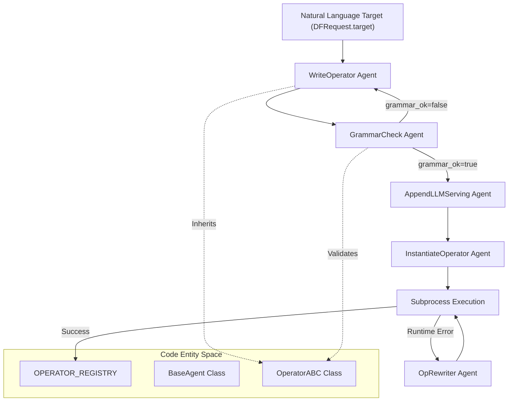
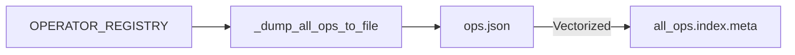

<!-- source: DeepWiki mcp.deepwiki.com · repo OpenDCAI/Paper2Any · page 9.4 Operator Writing Workflow · fetched 2026-11-02 -->

# Operator Writing Workflow

<details>
<summary>Relevant source files</summary>

The following files were used as context for generating this wiki page:

- [dataflow_agent/agentroles/cores/base_agent.py](dataflow_agent/agentroles/cores/base_agent.py)
- [dataflow_agent/graphbuilder/graph_builder.py](dataflow_agent/graphbuilder/graph_builder.py)
- [dataflow_agent/promptstemplates/prompts_repo.py](dataflow_agent/promptstemplates/prompts_repo.py)
- [dataflow_agent/promptstemplates/resources/pt_operator_qa_repo.py](dataflow_agent/promptstemplates/resources/pt_operator_qa_repo.py)
- [dataflow_agent/resources/faiss_cache/all_ops.index.meta](dataflow_agent/resources/faiss_cache/all_ops.index.meta)
- [dataflow_agent/state.py](dataflow_agent/state.py)
- [dataflow_agent/toolkits/optool/op_tools.py](dataflow_agent/toolkits/optool/op_tools.py)
- [dataflow_agent/toolkits/pipetool/pipe_tools.py](dataflow_agent/toolkits/pipetool/pipe_tools.py)
- [dataflow_agent/toolkits/resources/ops.json](dataflow_agent/toolkits/resources/ops.json)

</details>


## Purpose and Scope

This page documents the multi-agent workflow system for automatically generating DataFlow operators. The workflow orchestrates several specialized agents—including `WriteOperator`, `GrammarCheck`, and `OpRewriter`—to write, validate, test, and debug operator code based on natural language descriptions. It also details the `choose_prompt_template_by_llm` interface used to intelligently select prompt templates for generated operators.

The operator writing workflow is typically invoked when:
1. A user explicitly requests a new operator with specific functionality via `ChatIntent` [dataflow_agent/promptstemplates/prompts_repo.py:302-340]().
2. The pipeline recommendation system identifies a capability gap that requires a custom operator [dataflow_agent/promptstemplates/prompts_repo.py:154-165]().
3. An existing operator needs to be rewritten due to functional requirements changes [dataflow_agent/promptstemplates/prompts_repo.py:950-998]().

## Overview

The operator writing workflow implements a collaborative multi-agent system where each agent specializes in a specific aspect of code generation, validation, or debugging.

### Multi-Agent Interaction Flow
The following diagram bridges the natural language requirement space to the code entity space by showing how agents interact with state and registry components.


Sources: [dataflow_agent/promptstemplates/prompts_repo.py:746-998](), [dataflow_agent/agentroles/cores/base_agent.py:95-144](), [dataflow.utils.registry:30-30]()

## WriteOperator Agent

The `WriteOperator` agent generates initial operator code based on a target description and an example operator. It produces complete, standalone operator classes that must adhere to the `OperatorABC` interface.

### Generation Rules
The agent enforces critical constraints on generated code:
1. **LLM Serving Injection**: If the operator requires LLM functionality, it must accept `llm_serving` as a parameter in `__init__` [dataflow_agent/promptstemplates/prompts_repo.py:756-760]().
2. **Import Constraints**: Must use `from dataflow.serving import APILLMServing_request` [dataflow_agent/promptstemplates/prompts_repo.py:761-762]().
3. **API Usage**: Call `self.llm_serving.generate_from_input(list_of_strings)` [dataflow_agent/promptstemplates/prompts_repo.py:763-764]().

Sources: [dataflow_agent/promptstemplates/prompts_repo.py:746-771]()

## GrammarCheck Agent

The `GrammarCheck` agent performs syntax and structural validation. It acts as a quality gate before the operator enters the testing phase.

### Validation Responsibilities
- **Syntax Correctness**: Checks for basic Python syntax errors [dataflow_agent/promptstemplates/prompts_repo.py:1100-1105]().
- **Minimal Intervention**: Only fixes syntax-level issues (imports, indentation) without changing business logic [dataflow_agent/promptstemplates/prompts_repo.py:1115-1120]().

Sources: [dataflow_agent/promptstemplates/prompts_repo.py:1095-1136]()

## OpRewriter Agent

The `OpRewriter` agent fixes defective operator code based on diagnostic inputs. It performs surgical corrections to resolve runtime errors while minimizing changes to the original implementation.

### Debugging Inputs
The agent receives a comprehensive context for rewriting:
- `operator_code`: The failing source code [dataflow_agent/promptstemplates/prompts_repo.py:985-985]().
- `error_trace`: The full Python traceback from execution [dataflow_agent/promptstemplates/prompts_repo.py:987-987]().
- `debug_reason`: A preliminary analysis of the root cause [dataflow_agent/promptstemplates/prompts_repo.py:988-988]().

Sources: [dataflow_agent/promptstemplates/prompts_repo.py:950-998]()

## Intelligent Prompt Selection

The `choose_prompt_template_by_llm` interface allows the system to dynamically select the most appropriate prompt template for an operator based on the user's task.

### Selection Logic
1. **Candidate Extraction**: Retrieves all candidates from the operator's `ALLOWED_PROMPTS` attribute [dataflow_agent/toolkits/pipetool/pipe_tools.py:170-171]().
2. **LLM Evaluation**: Calls an LLM to analyze the `target` task description against the documentation and example prompts of each candidate [dataflow_agent/toolkits/pipetool/pipe_tools.py:188-200]().
3. **Template Injection**: Returns the instantiation code for the selected template (e.g., `MyPromptTemplate()`) to be used in the pipeline assembly [dataflow_agent/toolkits/pipetool/pipe_tools.py:178-179]().

### LLM Selection Prompting
The selection uses a specialized system prompt to ensure precision:
```python
system_prompt = """You are an expert at selecting the most appropriate prompt template for a given task.
1. Analyze the target task description
2. Review all available prompt templates
3. Select the MOST suitable prompt template
Respond with ONLY the exact class name..."""
```
Sources: [dataflow_agent/toolkits/pipetool/pipe_tools.py:148-200]()

## Data Flow and State Management

Data flows through the writing workflow using the `DFState` and `DFRequest` objects.

### Workflow State Mapping

| Entity | Code Symbol | Description |
| :--- | :--- | :--- |
| **User Requirement** | `DFRequest.target` | The natural language description of the operator's purpose [dataflow_agent/state.py:30-30](). |
| **Operator Registry** | `OPERATOR_REGISTRY` | The central store where valid operators are indexed [dataflow_agent/toolkits/optool/op_tools.py:30-30](). |
| **Prompt Template** | `ALLOWED_PROMPTS` | A list of valid prompt classes for a specific operator [dataflow_agent/toolkits/pipetool/pipe_tools.py:170-170](). |
| **Execution Result** | `DFState.execution_result` | Stores the outcome of the generated operator test run [dataflow_agent/state.py:97-97](). |

### Registry Metadata Extraction
The system periodically scans the `OPERATOR_REGISTRY` to update `ops.json`, which serves as the knowledge base for operator discovery and writing examples.


Sources: [dataflow_agent/toolkits/optool/op_tools.py:161-193](), [dataflow_agent/resources/faiss_cache/all_ops.index.meta:1-1]()

## Key Functions and Classes

| Function/Class | File Path | Role |
| :--- | :--- | :--- |
| `WriteOperator` | `prompts_repo.py` | Prompt class for initial code generation [dataflow_agent/promptstemplates/prompts_repo.py:746-746](). |
| `choose_prompt_template_by_llm` | `pipe_tools.py` | Logic for LLM-based template selection [dataflow_agent/toolkits/pipetool/pipe_tools.py:148-148](). |
| `_gather_single_operator` | `op_tools.py` | Extracts metadata (params, desc) from an operator class [dataflow_agent/toolkits/optool/op_tools.py:125-125](). |
| `OpRewriter` | `prompts_repo.py` | Prompt class for fixing runtime errors in generated code [dataflow_agent/promptstemplates/prompts_repo.py:950-950](). |
| `MainState` | `state.py` | Base class for workflow state management [dataflow_agent/state.py:41-41](). |

Sources: [dataflow_agent/promptstemplates/prompts_repo.py:746-998](), [dataflow_agent/toolkits/pipetool/pipe_tools.py:148-148](), [dataflow_agent/toolkits/optool/op_tools.py:125-125](), [dataflow_agent/state.py:41-41]()

---

