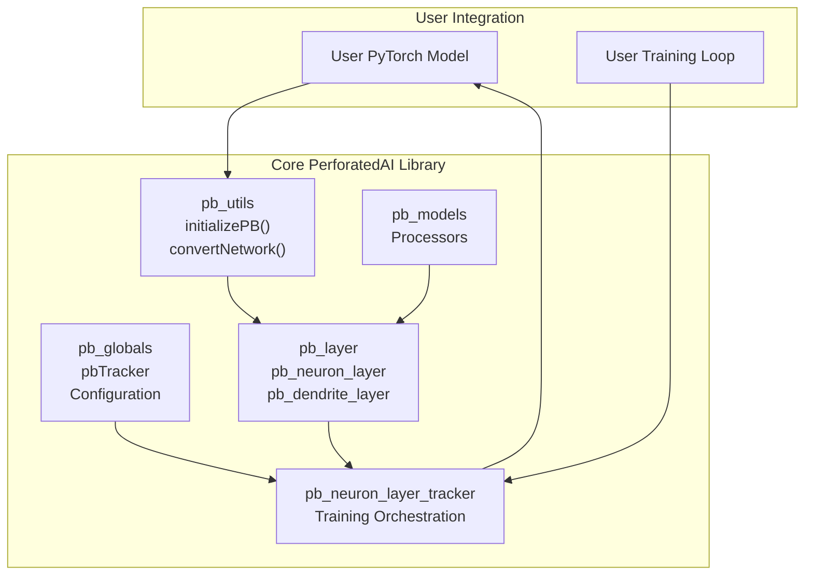
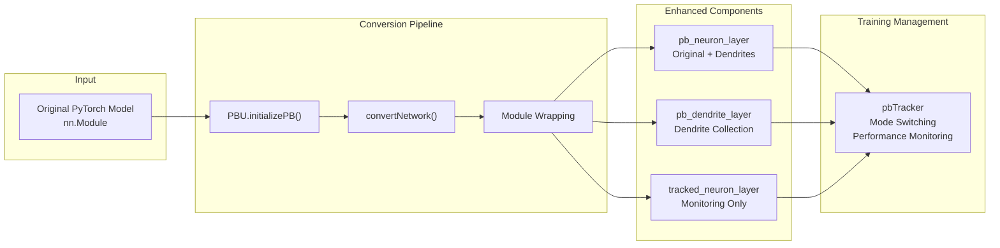
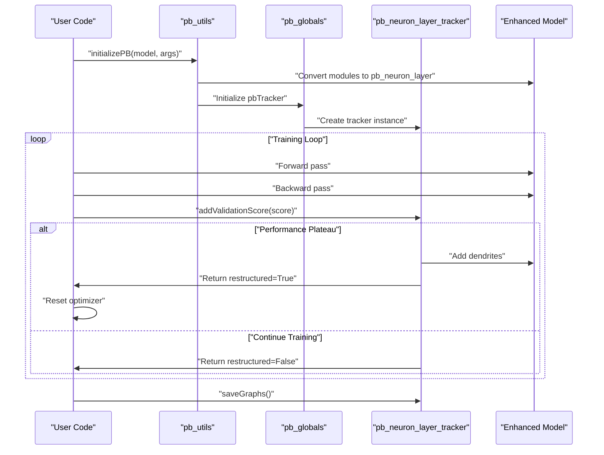

<!-- source: DeepWiki mcp.deepwiki.com · repo PerforatedAI/PerforatedAI · page 1 Overview · fetched 2026-10-21 -->

# Overview

Relevant source files

The following files were used as context for generating this wiki page:

- [README.md](README.md)

This document introduces the PerforatedAI library, explaining the concept of artificial dendrites and how the library enhances PyTorch neural networks with biologically-inspired dendrite functionality. It covers the library's purpose, core architecture, and integration approach.

For detailed research background, see [Research Foundation](#2). For hands-on usage instructions, see [Getting Started](#4.1). For specific implementation details of core components, see [Core Library Reference](#3).

## What is PerforatedAI?

PerforatedAI is a PyTorch library that adds artificial dendrites to existing neural networks with minimal code changes. Dendrites are branched extensions of neurons that process inputs before they reach the neuron's cell body. By incorporating dendrite-like structures into artificial neural networks, the library aims to improve model performance and learning efficiency.

The library's main value proposition is ease of integration - users can add dendrite functionality to any existing PyTorch model with less than an hour of coding work, rather than reimplementing entire architectures from scratch.

## Core Concepts

### Artificial Dendrites

Artificial dendrites are additional computational structures added to neural network layers that:
- Process inputs before they reach the main neuron computation
- Can be trained separately or in conjunction with main network parameters  
- Dynamically expand the network's representational capacity
- Are inspired by biological dendrite structures in real neurons

### Training Modes

The library operates in two primary training modes:

| Mode | Purpose | Target Parameters |
|------|---------|------------------|
| Neuron Training | Optimize main network parameters | Original PyTorch model weights |
| Dendrite Training | Optimize dendrite structures | Added dendrite parameters |

The system automatically switches between these modes based on validation performance metrics.

Sources: [README.md:1-46]()

## Library Architecture

### High-Level Component Structure

This diagram shows how user code interfaces with the PerforatedAI library. The `pb_utils.initializePB()` function converts the user's model, while `pb_globals.pbTracker` orchestrates the training process.

Sources: Based on high-level architecture diagrams provided

### Model Conversion Process

This conversion process transforms standard PyTorch modules into dendrite-enhanced versions while preserving the original model's functionality and interface.

Sources: Based on core library architecture analysis

## Supported Architectures

The library supports a wide range of PyTorch architectures through its flexible conversion system:

### Language Models
- **BERT**: Transformer-based models for NLP tasks
- **GPT2**: Autoregressive language models, including PEFT/LoRA integration
- Custom transformer architectures

### Computer Vision
- **CNN**: Convolutional neural networks for image classification
- **UNet**: Encoder-decoder architectures for segmentation
- **ResNet**: Residual networks and similar architectures

### Processing Adapters

The `pb_models` module provides specialized processors for different module types:

| Processor | Purpose | Target Modules |
|-----------|---------|----------------|
| `multiOutputProcesser` | General-purpose processing | Most standard layers |
| `LSTMCellProcessor` | Stateful module handling | LSTM, GRU cells |
| Custom processors | User-defined logic | Specialized architectures |

Sources: [README.md:14-38]()

## Integration Workflow

### Typical User Experience

The integration requires minimal changes to existing training loops - users primarily need to call `initializePB()` and `addValidationScore()` while the system handles dendrite management automatically.

Sources: Based on training orchestration analysis

## Key Features

### Automatic Dendrite Management
- Dynamic addition of dendrite structures based on performance metrics
- Automatic switching between neuron and dendrite training modes
- No manual architecture modification required

### PyTorch Compatibility
- Preserves existing model interfaces and training loops
- Compatible with standard PyTorch optimizers and loss functions
- Supports GPU acceleration and distributed training

### Flexible Configuration
- Customizable conversion rules through `pb_globals`
- Support for custom processing functions
- Configurable training strategies and performance thresholds

### Research-Backed Approach
- Based on decades of dendrite research in computational neuroscience
- Implements both classical and modern dendrite learning methods
- Provides pathway to advanced "Perforated Backpropagation" techniques

Sources: [README.md:1-46]()

## Getting Started

To begin using PerforatedAI with your existing PyTorch model:

1. **Install the library** - See [Installation and Setup](#6)
2. **Convert your model** - Use `pb_utils.initializePB()` to add dendrite capability
3. **Modify training loop** - Add validation score reporting with `pbTracker.addValidationScore()`
4. **Configure options** - Customize behavior through `pb_globals` settings

For detailed implementation instructions, see [Getting Started](#4.1). For advanced configuration options, see [Advanced Customization](#4.2).

The [MNIST Tutorial](#5.1) provides a complete walkthrough of integrating dendrites with a simple CNN, while [Architecture Examples](#5.2) show integration patterns for more complex models.

Sources: [README.md:1-46]()

---

