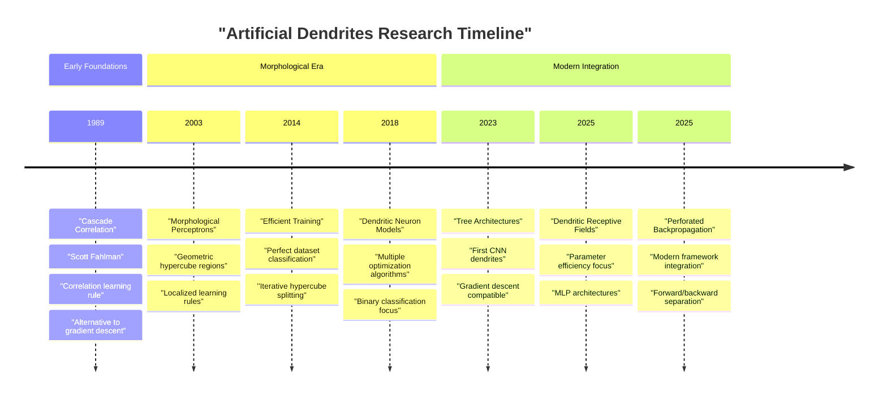
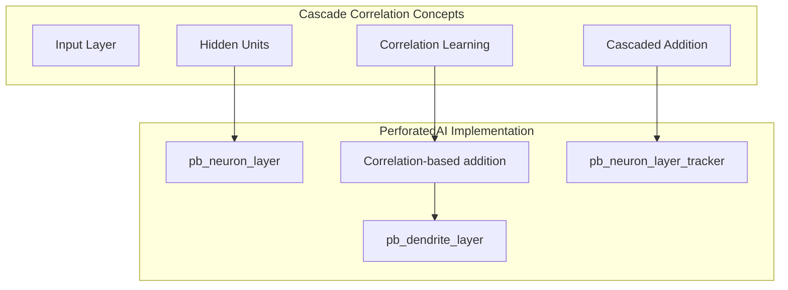
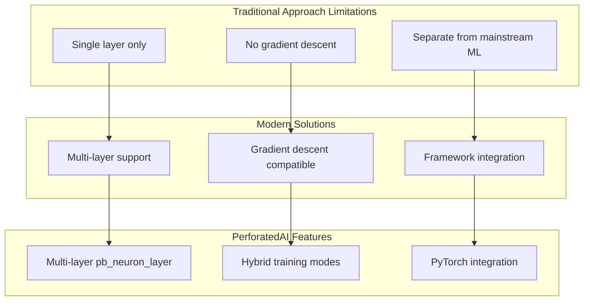
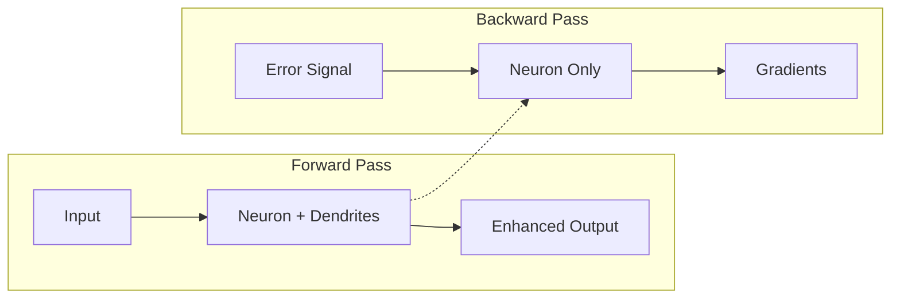

<!-- source: DeepWiki mcp.deepwiki.com · repo PerforatedAI/PerforatedAI · page 2 Research Foundation · fetched 2026-10-21 -->

# Research Foundation

Relevant source files

The following files were used as context for generating this wiki page:

- [DendritePapersAndSummaries/README.md](DendritePapersAndSummaries/README.md)

This document provides the scientific background and research history that informs PerforatedAI's dendrite integration approach. It traces the evolution of artificial dendrite research from 1989 to present, explaining how theoretical concepts translate into the practical implementation found in this library.

For technical implementation details of these research concepts, see [Core Library Reference](#3). For practical usage patterns, see [User Guide](#4).

## Research Evolution Timeline

The development of artificial dendrites in neural networks spans over three decades, with distinct methodological phases leading to the current gradient descent-compatible approach.

Sources: [DendritePapersAndSummaries/README.md:21-52]()

## Methodological Evolution

The research shows three distinct approaches to integrating dendrites with neural networks, each addressing different limitations of traditional architectures.

| Approach | Period | Key Papers | Learning Method | GD Compatible | Multi-Layer |
|----------|--------|------------|----------------|---------------|-------------|
| **Correlation Learning** | 1989 | Cascade Correlation | Correlation maximization | No | No |
| **Geometric Regions** | 2003-2018 | Morphological Perceptrons | Hypercube encapsulation | No | No |  
| **Gradient Integration** | 2023-2025 | Tree Architectures, Perforated BP | Hybrid GD + correlation | Yes | Yes |

Sources: [DendritePapersAndSummaries/README.md:7-17]()

## Core Research Insights

### Cascade Correlation Foundation (1989)

The foundational work by Fahlman introduced the correlation learning rule, establishing the theoretical basis for differentiating dendrite nodes from neuron nodes. This approach used correlation maximization rather than gradient descent.

Sources: [DendritePapersAndSummaries/README.md:21-22]()

### Morphological Perceptron Era (2003-2018)

This period focused on geometric interpretations where dendrites define hypercube regions in input space through excitatory and inhibitory connections. The 2014 work proved that sufficient dendrites allow perfect classification of any training dataset.

Key insights:
- **Hypercube Encapsulation**: Dendrites create geometric regions containing input patterns
- **Iterative Splitting**: Training involves progressively subdividing regions until class purity
- **Frozen Weights**: Final dendrite weights are fixed after region identification

Sources: [DendritePapersAndSummaries/README.md:24-33]()

### Modern Gradient Integration (2023-2025)

Recent work bridges traditional dendrite concepts with modern deep learning frameworks, culminating in gradient descent-compatible approaches.

Sources: [DendritePapersAndSummaries/README.md:39-52]()

## Perforated Backpropagation Innovation

The core innovation of Perforated Backpropagation separates forward and backward passes, allowing dendrites to enhance feature complexity without disrupting gradient flow.

### Forward Pass Enhancement
- Dendrites participate in forward computation
- Enable complex feature detection within existing neurons
- Maintain original network feature count

### Backward Pass Isolation  
- Dendrites excluded from gradient computation
- Prevents interference with established error signals
- Maintains training stability

This separation enables the `pb_neuron_layer_tracker` to manage dual training modes while preserving network stability.

Sources: [DendritePapersAndSummaries/README.md:46-48]()

## Research to Implementation Mapping

The theoretical concepts from decades of research directly inform PerforatedAI's implementation architecture:

| Research Concept | Implementation Component | Code Location |
|------------------|-------------------------|---------------|
| Correlation Learning | Dendrite addition logic | `pb_neuron_layer_tracker` |
| Cascaded Architecture | Dynamic layer modification | `pb_utils.initializePB` |
| Geometric Regions | Dendrite weight learning | `pb_dendrite_layer` |
| Forward/Backward Separation | Training mode switching | `pb_neuron_layer` |
| Multi-layer Support | Module conversion | `convertNetwork` functions |

Sources: [DendritePapersAndSummaries/README.md:1-53]()

## Parameter Efficiency Evidence

Recent research consistently demonstrates that dendritic architectures achieve superior parameter efficiency compared to traditional networks:

- **2023 CNN Study**: Dendritic models matched LeNet accuracy with significantly fewer parameters
- **2025 MLP Study**: Dendritic architectures substantially outperformed traditional MLPs in parameter efficiency  
- **2025 Compression Study**: Reduced network sizes with dendrite addition achieved equivalent performance

This efficiency stems from dendrites' ability to increase feature complexity without proportional parameter growth, a key motivation for the PerforatedAI library design.

Sources: [DendritePapersAndSummaries/README.md:40-52]()

---

