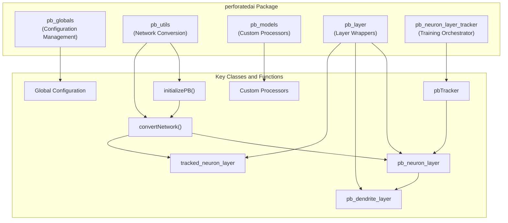
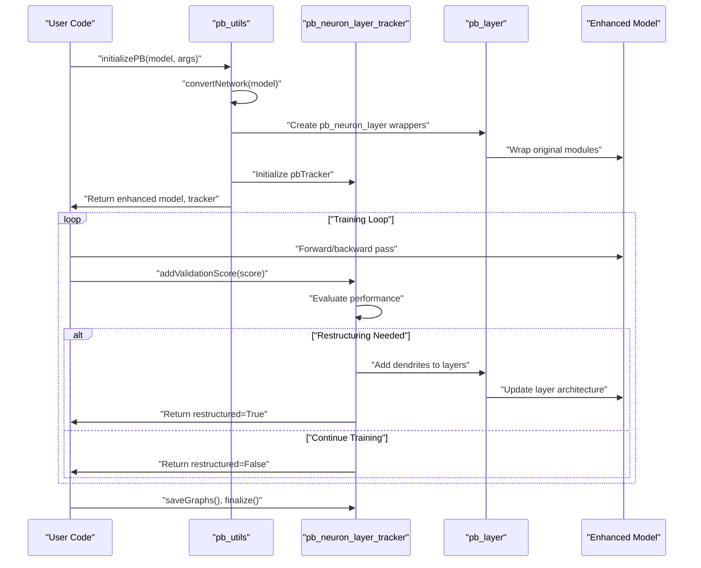
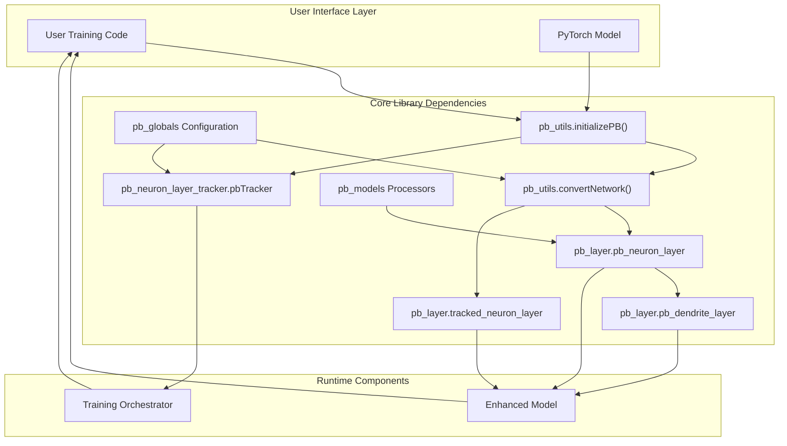

<!-- source: DeepWiki mcp.deepwiki.com · repo PerforatedAI/PerforatedAI · page 3 Core Library Reference · fetched 2026-10-21 -->

# Core Library Reference

Relevant source files

The following files were used as context for generating this wiki page:

- [perforatedai/__init__.py](perforatedai/__init__.py)
- [setup.py](setup.py)

This document provides technical documentation for the core PerforatedAI library components and their interactions. It covers the main modules, classes, and functions that implement the dendrite integration functionality.

For practical usage patterns and integration steps, see [Getting Started](#4.1). For detailed configuration options, see individual component sections [Architecture Overview](#3.1) through [Model Processors](#3.6).

## Core Library Structure

The PerforatedAI library consists of five main modules that work together to enable dendrite functionality in PyTorch neural networks. Each module has a specific responsibility in the dendrite integration pipeline.

### Core Module Architecture

**Sources:** Architecture diagrams, perforatedai/__init__.py

### Component Responsibilities

| Module | Primary Function | Key Components |
|--------|-----------------|----------------|
| `pb_utils` | Network conversion and initialization | `initializePB()`, `convertNetwork()` |
| `pb_neuron_layer_tracker` | Training lifecycle management | `pbTracker` |
| `pb_layer` | PyTorch module wrapping | `pb_neuron_layer`, `pb_dendrite_layer` |
| `pb_globals` | Configuration and settings | Global configuration variables |
| `pb_models` | Custom processing logic | Module-specific processors |

## System Integration Flow

The following diagram shows how user code integrates with the PerforatedAI library and the sequence of operations during model enhancement.

### Integration Sequence

**Sources:** Architecture diagrams, system flow documentation

## Module Dependencies

The core library modules have specific dependency relationships that determine initialization order and functionality availability.

### Dependency Graph

**Sources:** Architecture diagrams, module interaction patterns

## Training Mode Management

The library implements a sophisticated training mode switching system that alternates between optimizing neuron parameters and dendrite parameters based on validation performance.

### Mode Switching Logic

```mermaid
stateDiagram-v2
    [*] --> NeuronTraining: "Initial State"
    
    NeuronTraining --> ValidationCheck: "addValidationScore()"
    ValidationCheck --> NeuronTraining: "Performance Improving"
    ValidationCheck --> DendriteAddition: "Performance Plateaued"
    ValidationCheck --> TrainingComplete: "Convergence Criteria Met"
    
    DendriteAddition --> DendriteTraining: "Add Dendrites"
    DendriteTraining --> ValidationCheck: "Continue Training"
    
    TrainingComplete --> [*]
    
    note right of NeuronTraining
        doingHistory = False
        doingFixed = False
        Optimize main parameters
    end note
    
    note right of DendriteTraining
        doingHistory = True
        doingFixed = True  
        Optimize dendrite parameters
    end note
```

**Sources:** Architecture diagrams, training orchestration flow

## Key Integration Points

The library provides several key integration points where user code interacts with the PerforatedAI system:

### Primary Entry Points

| Function/Class | Module | Purpose |
|----------------|---------|---------|
| `initializePB()` | `pb_utils` | Main initialization function for model conversion |
| `pbTracker` | `pb_neuron_layer_tracker` | Central training orchestrator instance |
| `convertNetwork()` | `pb_utils` | Core network conversion function |
| `setupOptimizer()` | `pb_neuron_layer_tracker` | Optimizer configuration for dendrite training |
| `addValidationScore()` | `pb_neuron_layer_tracker` | Performance tracking and mode switching |

### Configuration Control Points

The system exposes several configuration mechanisms:

- **Global Settings**: Through `pb_globals` module configuration
- **Processing Rules**: Via `pb_models` custom processors  
- **Layer Wrapping**: Through `pb_layer` wrapper classes
- **Training Parameters**: Via `pbTracker` orchestrator settings

**Sources:** setup.py, architecture diagrams, integration flow documentation

## Package Structure

The PerforatedAI library is distributed as a single Python package with the following dependencies and structure:

### Dependencies

From [setup.py:18-26]():
- `torch` - PyTorch framework integration
- `torchvision` - Vision model support
- `matplotlib` - Visualization and graphing
- `pandas` - Data analysis and CSV output
- `rsa` - Cryptographic functions
- `pyyaml` - Configuration file support
- `safetensors` - Secure tensor serialization

### Package Information

- **Package Name**: `perforatedai` 
- **Version**: 1.0.9 (from [setup.py:7]())
- **Python Requirements**: >=3.6 (from [setup.py:17]())
- **License**: Apache 2.0

**Sources:** setup.py, perforatedai/__init__.py

---

