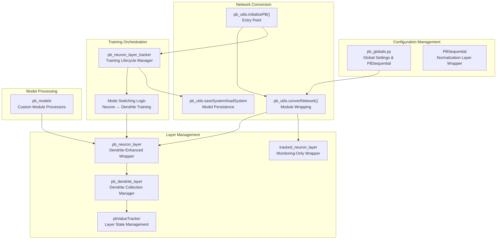
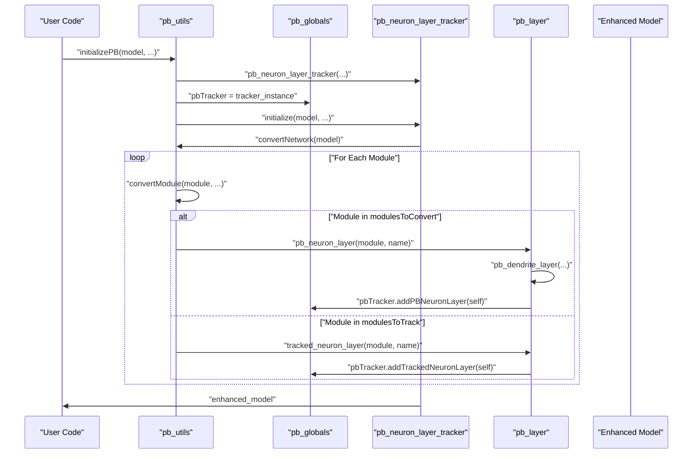
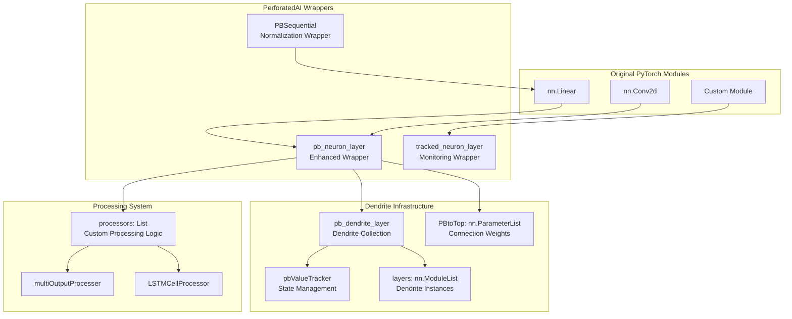
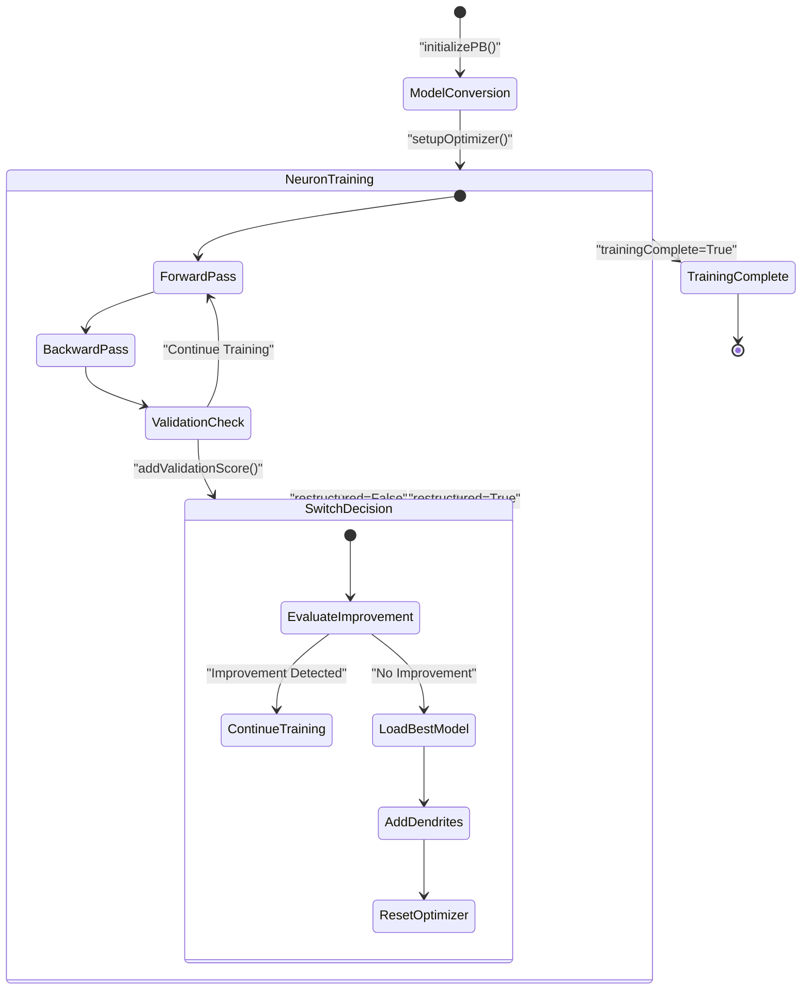
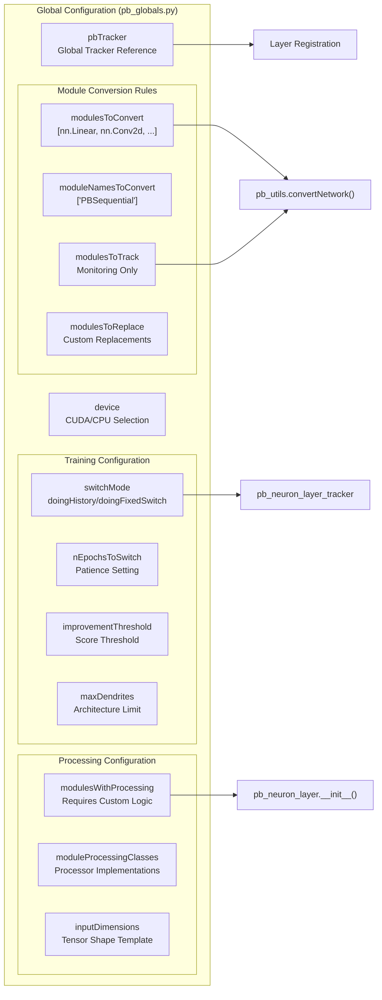

<!-- source: DeepWiki mcp.deepwiki.com · repo PerforatedAI/PerforatedAI · page 3.1 Architecture Overview · fetched 2026-10-21 -->

# Architecture Overview

Relevant source files

The following files were used as context for generating this wiki page:

- [perforatedai/pb_globals.py](perforatedai/pb_globals.py)
- [perforatedai/pb_layer.py](perforatedai/pb_layer.py)
- [perforatedai/pb_utils.py](perforatedai/pb_utils.py)

This document explains how the core PerforatedAI library components work together to enable dendrite functionality in PyTorch models. It covers the high-level system design, component interactions, and data flow patterns that transform standard neural networks into dendrite-enhanced architectures.

For detailed information about specific components, see [Training Orchestration](#3.2) for `pb_neuron_layer_tracker`, [Layer System](#3.3) for layer wrappers, [Configuration System](#3.4) for `pb_globals`, and [Utilities and Conversion](#3.5) for network transformation functions.

## Core Components Overview

The PerforatedAI library consists of five primary subsystems that work together to provide dendrite functionality:

### Component Architecture

**Sources:** [perforatedai/pb_globals.py:1-183](), [perforatedai/pb_layer.py:1-611](), [perforatedai/pb_utils.py:1-498]()

## System Integration Flow

The integration process transforms a standard PyTorch model into a dendrite-enhanced model through a well-defined sequence:

### Model Transformation Pipeline

**Sources:** [perforatedai/pb_utils.py:24-29](), [perforatedai/pb_utils.py:214-259](), [perforatedai/pb_layer.py:100-156]()

## Layer Architecture

The layer system creates a hierarchical wrapper structure that enables dendrite functionality while preserving the original PyTorch module interface:

### Layer Wrapper Hierarchy

**Sources:** [perforatedai/pb_layer.py:100-156](), [perforatedai/pb_layer.py:305-332](), [perforatedai/pb_layer.py:341-420](), [perforatedai/pb_globals.py:51-56]()

### Key Layer Classes and Responsibilities

| Class | Purpose | Key Methods | Configuration |
|-------|---------|-------------|---------------|
| `pb_neuron_layer` | Main wrapper for dendrite-enhanced modules | `forward()`, `setMode()`, `addPBLayer()` | `PBG.modulesToConvert` |
| `pb_dendrite_layer` | Manages collection of dendrite instances | `addPBLayer()`, `setMode()` | Internal to `pb_neuron_layer` |
| `tracked_neuron_layer` | Monitoring-only wrapper for unsupported modules | `forward()` | `PBG.modulesToTrack` |
| `pbValueTracker` | State management for dendrite layers | `setupArrays()`, `reinitializeForPB()` | Automatic initialization |
| `PBSequential` | Wrapper for normalization layer sequences | `forward()` | Manual wrapping required |

**Sources:** [perforatedai/pb_layer.py:100-300](), [perforatedai/pb_layer.py:305-332](), [perforatedai/pb_layer.py:341-527](), [perforatedai/pb_layer.py:532-611](), [perforatedai/pb_globals.py:51-56]()

## Training Orchestration

The training system coordinates between neuron optimization and dendrite addition through a centralized tracker:

### Training Lifecycle Management

**Sources:** [perforatedai/pb_utils.py:424-497](), [perforatedai/pb_layer.py:210-254]()

## Configuration Management

The configuration system provides centralized control over conversion behavior, training parameters, and system-wide settings:

### Configuration Architecture

**Sources:** [perforatedai/pb_globals.py:8-183](), [perforatedai/pb_utils.py:108-212](), [perforatedai/pb_layer.py:112-127]()

### Critical Configuration Points

The system relies on several key configuration decisions that must be made before model conversion:

1. **Input Dimensions**: `PBG.inputDimensions` defines the tensor shape template with exactly one `0` indicating the neuron dimension [perforatedai/pb_globals.py:104]()
2. **Module Conversion Lists**: `modulesToConvert` and `modulesToTrack` determine which PyTorch modules receive dendrite enhancement [perforatedai/pb_globals.py:59-64]()
3. **Switch Mode**: `switchMode` controls when dendrites are added during training [perforatedai/pb_globals.py:120-141]()
4. **Processing Requirements**: Complex modules need custom processors defined in `modulesWithProcessing` [perforatedai/pb_globals.py:76-79]()

**Sources:** [perforatedai/pb_globals.py:59-183](), [perforatedai/pb_layer.py:132-137](), [perforatedai/pb_layer.py:199-208]()

---

