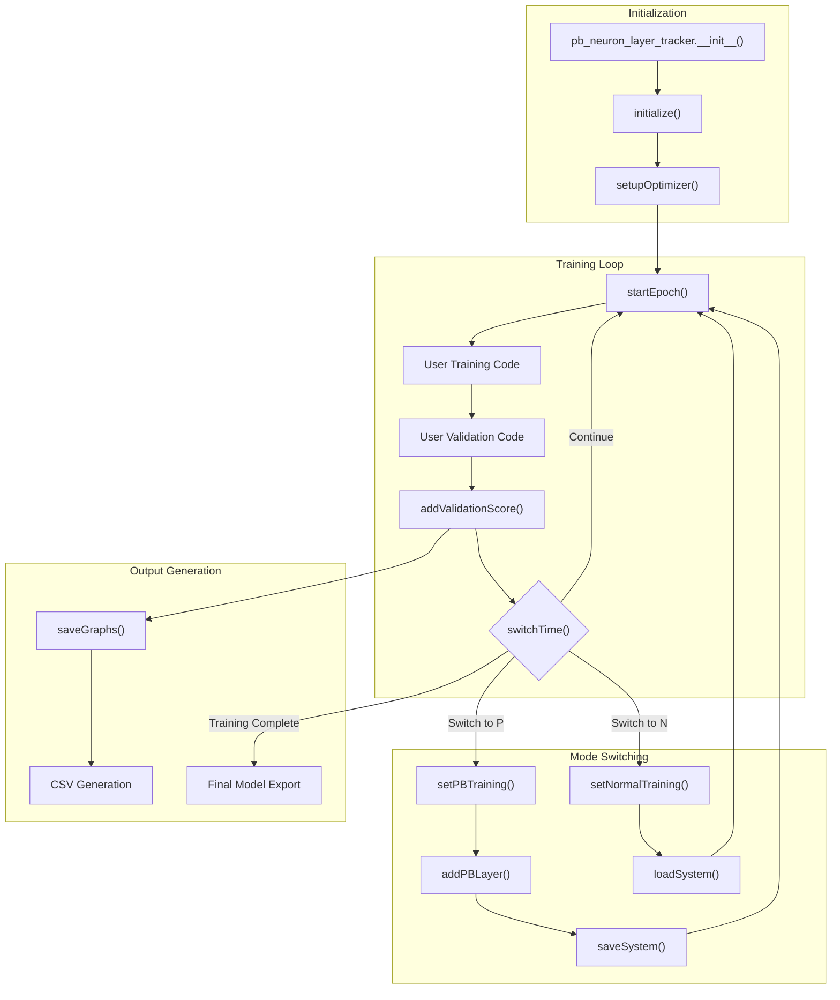
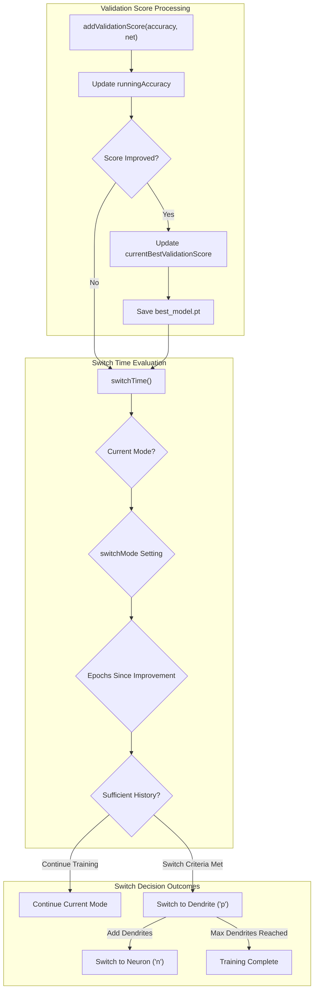
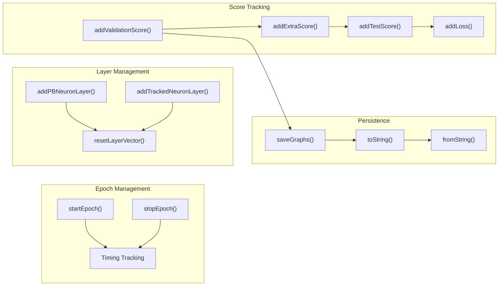
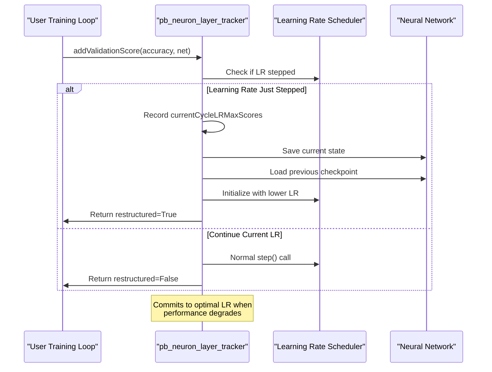
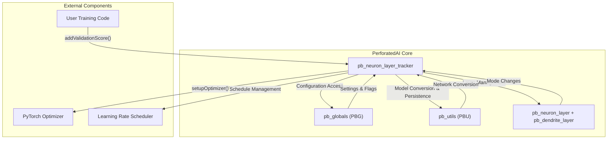

<!-- source: DeepWiki mcp.deepwiki.com · repo PerforatedAI/PerforatedAI · page 3.2 Training Orchestration · fetched 2026-10-21 -->

# Training Orchestration

Relevant source files

The following files were used as context for generating this wiki page:

- [perforatedai/pb_neuron_layer_tracker.py](perforatedai/pb_neuron_layer_tracker.py)

This document covers the `pb_neuron_layer_tracker` system, which serves as the central orchestrator for the PerforatedAI training process. The tracker manages the lifecycle of dendrite addition, coordinates training mode switches between neuron and dendrite optimization phases, and handles model persistence throughout the adaptive training process.

For information about the layer-level dendrite implementation, see [Layer System](#3.3). For configuration options that control orchestration behavior, see [Configuration System](#3.4).

## Purpose and Core Responsibilities

The `pb_neuron_layer_tracker` class acts as the central command system that:

- **Orchestrates Training Phases**: Manages switches between neuron training mode (`'n'`) and dendrite training mode (`'p'`)
- **Monitors Performance**: Tracks validation scores and determines when dendrite addition is beneficial
- **Manages Model State**: Handles saving, loading, and restoration of model states during restructuring
- **Controls Learning Parameters**: Coordinates optimizer and scheduler behavior across training phases
- **Generates Analytics**: Produces comprehensive metrics, graphs, and CSV outputs for training analysis

Sources: [perforatedai/pb_neuron_layer_tracker.py:29-33](), [perforatedai/pb_neuron_layer_tracker.py:34-254]()

## Training Orchestration Flow

The following diagram shows the high-level orchestration flow managed by `pb_neuron_layer_tracker`:

### Training Lifecycle Management

Sources: [perforatedai/pb_neuron_layer_tracker.py:709-737](), [perforatedai/pb_neuron_layer_tracker.py:1122-1524]()

## Training Mode Management

The orchestrator manages two distinct training phases through mode switching:

| Mode | Description | Parameter Optimization | Duration Control |
|------|-------------|----------------------|------------------|
| `'n'` | Neuron Training | Standard PyTorch parameters via `net.parameters()` | Until validation improvement stops |
| `'p'` | Dendrite Training | Dendrite-specific parameters via `getPBNetworkParams()` | Single epoch or until correlation learning completes |

### Mode Switching Decision Logic

Sources: [perforatedai/pb_neuron_layer_tracker.py:556-604](), [perforatedai/pb_neuron_layer_tracker.py:1122-1524]()

## Key Orchestration Methods

### Core Training Control Methods

The tracker provides several critical methods for managing the training process:

| Method | Purpose | Key Behavior |
|--------|---------|--------------|
| `addValidationScore()` | Process validation results and make switching decisions | [Lines 1122-1524]() |
| `switchTime()` | Evaluate whether to switch training modes | [Lines 556-604]() |
| `setPBTraining()` | Transition to dendrite training mode | [Lines 662-688]() |
| `setNormalTraining()` | Transition to neuron training mode | [Lines 691-708]() |
| `setupOptimizer()` | Configure optimizer for current training phase | [Lines 510-549]() |

### State Management Methods

The tracker handles complex state management across training phases:

Sources: [perforatedai/pb_neuron_layer_tracker.py:709-754](), [perforatedai/pb_neuron_layer_tracker.py:621-649](), [perforatedai/pb_neuron_layer_tracker.py:1062-1115]()

## Learning Rate and Scheduler Management

The orchestrator implements sophisticated learning rate management for optimal dendrite initialization:

### Learning Rate Discovery Process

When adding dendrites, the system automatically finds optimal initial learning rates:

1. **Baseline Establishment**: Train at default learning rate until scheduler steps twice
2. **Rate Testing**: Test progressively lower initial learning rates 
3. **Performance Comparison**: Compare validation scores at equivalent scheduler positions
4. **Optimal Selection**: Choose the learning rate that provides best dendrite initialization

Sources: [perforatedai/pb_neuron_layer_tracker.py:1326-1506](), [perforatedai/pb_neuron_layer_tracker.py:476-507]()

## Integration with Other Components

### Component Communication Pattern

### Key Integration Points

| Component | Interaction Pattern | Primary Methods |
|-----------|-------------------|-----------------|
| `pb_globals` | Configuration access via `PBG.*` | Global settings and flags |
| `pb_utils` | Model operations via `PBU.*` | `saveSystem()`, `loadSystem()`, `convertNetwork()` |
| `pb_layer` | Direct method calls | `setMode()`, `addPBLayer()` |
| User Code | Method invocation | `addValidationScore()`, `setupOptimizer()` |

Sources: [perforatedai/pb_neuron_layer_tracker.py:25-27](), [perforatedai/pb_neuron_layer_tracker.py:510-549]()

## Output and Analytics Generation

The tracker produces comprehensive training analytics through the `saveGraphs()` method:

### Generated Outputs

| Output Type | File Pattern | Content |
|-------------|-------------|---------|
| Training Graphs | `{saveName}.png` | Validation scores, timing, learning rates, dendrite scores |
| Score Data | `{saveName}Scores.csv` | All validation and extra scores by epoch |
| Timing Data | `{saveName}Times.csv` | Training and validation timing metrics |
| Switch Data | `{saveName}switchEpochs.csv` | Mode switching history |
| Parameter Data | `{saveName}paramCounts.csv` | Model parameter counts by structure |
| Best Scores | `{saveName}bestTestScores.csv` | Optimal scores by parameter count |

### Metrics Tracking

The tracker maintains detailed metrics across training phases:

- **Performance Metrics**: Validation accuracy, test scores, extra scores
- **Training Metrics**: Learning rates, training loss, epoch timing
- **Structural Metrics**: Parameter counts, switch epochs, dendrite counts  
- **Diagnostic Metrics**: Learning rate stepping, scheduler states, mode durations

Sources: [perforatedai/pb_neuron_layer_tracker.py:794-1059](), [perforatedai/pb_neuron_layer_tracker.py:1062-1115]()

---

