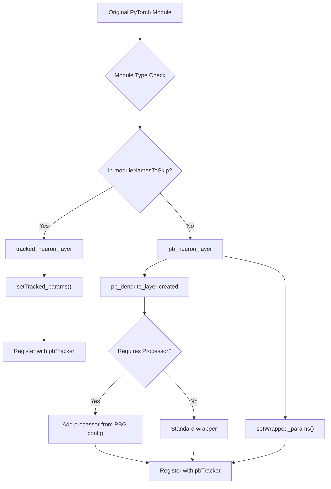
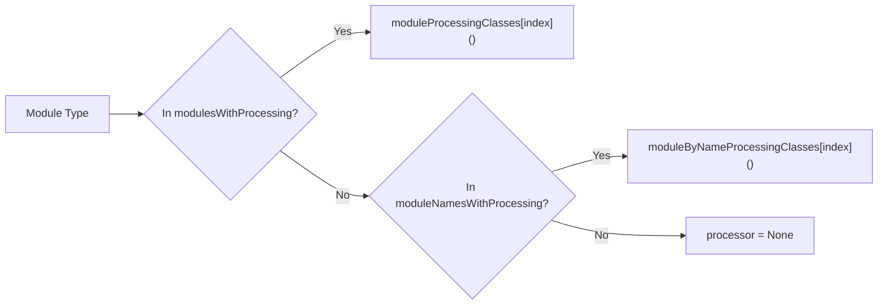
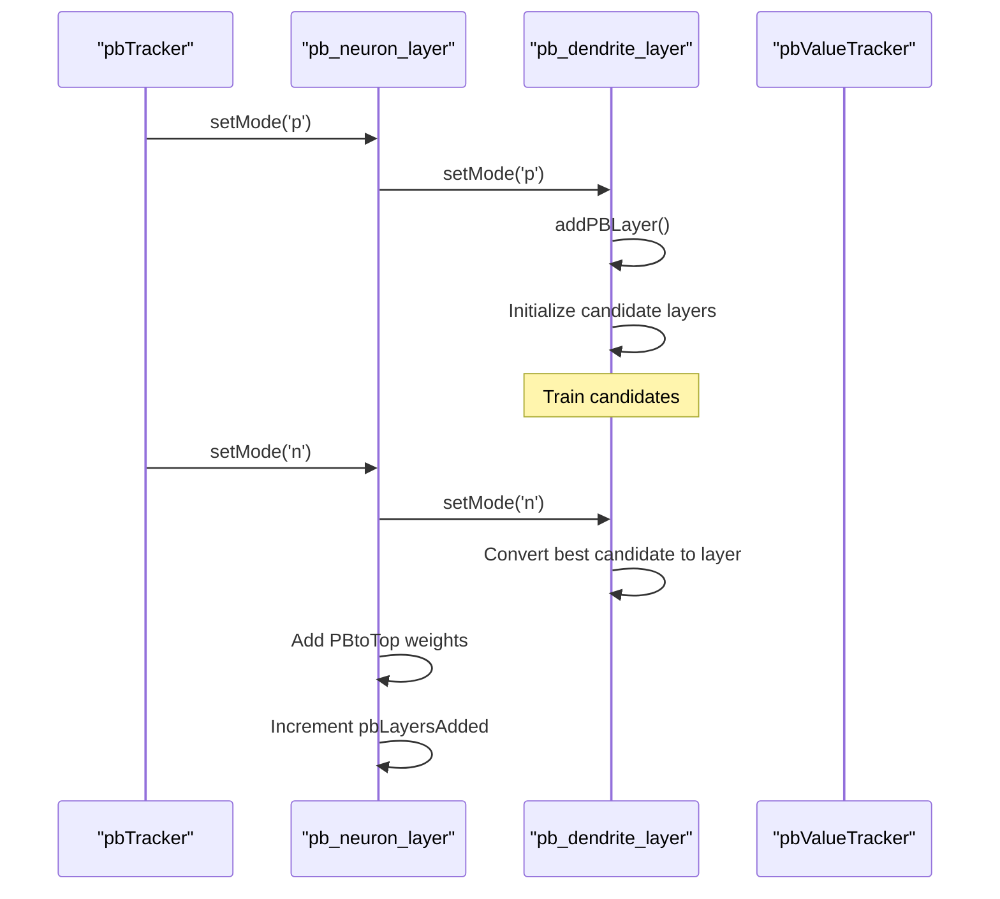
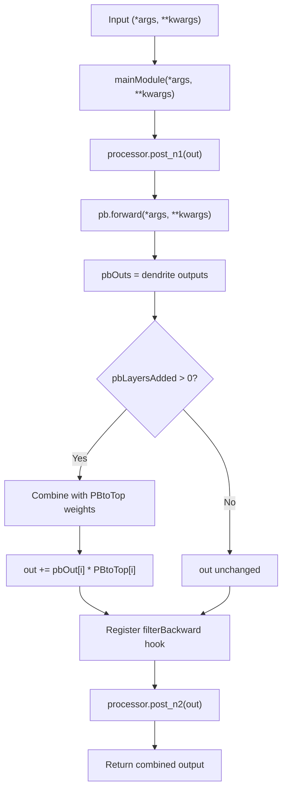
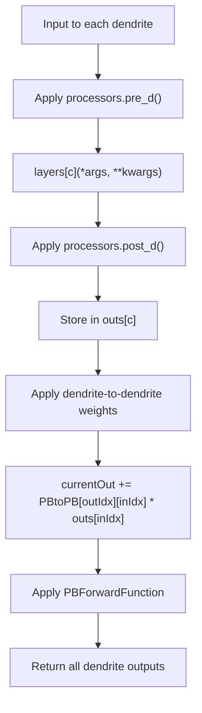
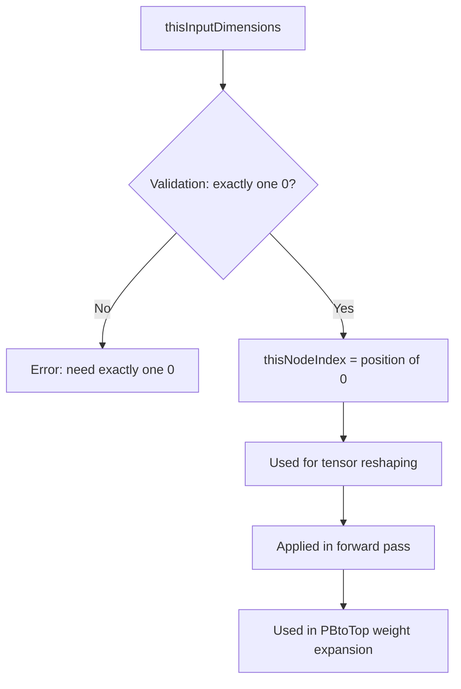
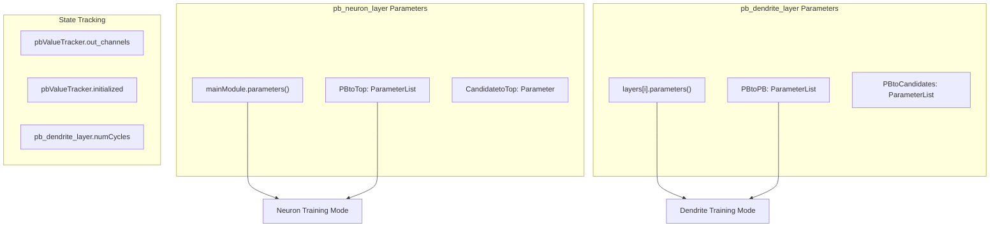
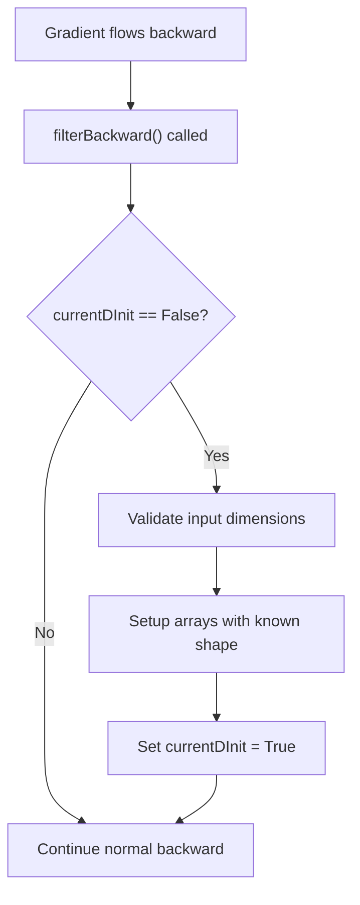

<!-- source: DeepWiki mcp.deepwiki.com · repo PerforatedAI/PerforatedAI · page 3.3 Layer System · fetched 2026-10-21 -->

# Layer System

<details>
<summary>Relevant source files</summary>

The following files were used as context for generating this wiki page:

- [perforatedai/pb_layer.py](perforatedai/pb_layer.py)

</details>


This document covers the core layer wrapper classes that transform standard PyTorch modules into dendrite-capable modules. The layer system handles module wrapping, parameter management, training mode switching, and the integration of dendrite outputs with neuron outputs.

For information about the training orchestration that manages these layers, see [Training Orchestration](#3.2). For configuration options that control layer behavior, see [Configuration System](#3.4).

## Layer Wrapper Classes Overview

The layer system consists of three main wrapper classes that encapsulate PyTorch modules with different levels of dendrite integration:

```mermaid
classDiagram
    class pb_neuron_layer {
        +mainModule: nn.Module
        +pb: pb_dendrite_layer
        +PBtoTop: ParameterList
        +pbLayersAdded: int
        +processor: Processor
        +forward(*args, **kwargs)
        +setMode(mode)
        +addPBLayer()
        +setThisInputDimensions(dims)
    }
    
    class tracked_neuron_layer {
        +mainModule: nn.Module
        +forward(*args, **kwargs)
        +setMode(mode)
    }
    
    class pb_dendrite_layer {
        +layers: ModuleList
        +numPBLayers: int
        +PBtoPB: ParameterList
        +candidateLayer: ModuleList
        +processors: list
        +forward(*args, **kwargs)
        +addPBLayer()
        +setMode(mode)
    }
    
    class pbValueTracker {
        +layerName: str
        +out_channels: int
        +thisInputDimensions: Tensor
        +initialized: Tensor
        +setupArrays(channels)
        +setOutChannels(shape)
    }
    
    pb_neuron_layer ||--|| pb_dendrite_layer : "contains"
    pb_dendrite_layer ||--o{ pbValueTracker : "tracks values"
    pb_neuron_layer ||--o| "Processor" : "optional processing"
```

**Sources:** [perforatedai/pb_layer.py:100-156](), [perforatedai/pb_layer.py:305-331](), [perforatedai/pb_layer.py:341-380](), [perforatedai/pb_layer.py:532-551]()

## Module Conversion and Wrapping

The conversion process transforms standard PyTorch modules into dendrite-capable wrappers based on configuration rules:

### Module Wrapping Flow



The wrapping process marks parameters appropriately and registers layers with the global tracker:

- **pb_neuron_layer**: Full dendrite capability with `setWrapped_params()` [perforatedai/pb_layer.py:107]()
- **tracked_neuron_layer**: Monitoring only with `setTracked_params()` [perforatedai/pb_layer.py:313]()

**Sources:** [perforatedai/pb_layer.py:89-95](), [perforatedai/pb_layer.py:100-156](), [perforatedai/pb_layer.py:305-317]()

### Processor Integration

Modules requiring special processing are automatically assigned processors based on type matching:



**Sources:** [perforatedai/pb_layer.py:112-126](), [perforatedai/pb_layer.py:415-421]()

## Training Mode Management

The layer system supports two training modes that are coordinated across neuron and dendrite components:

### Mode Switching Mechanics

| Mode | Description | Parameter Updates | Dendrite State |
|------|-------------|------------------|----------------|
| `'n'` (Neuron) | Train main module parameters | Neurons + dendrite-to-neuron weights | Fixed architecture |
| `'p'` (Dendrite) | Train dendrite parameters | Candidate dendrites only | Adding new dendrites |



**Sources:** [perforatedai/pb_layer.py:210-253](), [perforatedai/pb_layer.py:453-486]()

### Dendrite Addition Process

When adding dendrites, the system creates candidate modules and selects the best one:

1. **Candidate Creation**: Creates `PBG.globalCandidates` copies with random initialization [perforatedai/pb_layer.py:409-425]()
2. **Training Phase**: Candidates train independently during dendrite mode
3. **Selection**: Best candidate becomes permanent dendrite [perforatedai/pb_layer.py:474-483]()
4. **Weight Integration**: Dendrite-to-neuron weights added to `PBtoTop` [perforatedai/pb_layer.py:218-229]()

**Sources:** [perforatedai/pb_layer.py:399-436](), [perforatedai/pb_layer.py:461-486]()

## Forward Pass Mechanics

The forward pass integrates outputs from the main neuron and all dendrite layers:

### Neuron Layer Forward Pass



The key integration happens at lines [perforatedai/pb_layer.py:274-283]() where dendrite outputs are scaled and added to neuron outputs.

**Sources:** [perforatedai/pb_layer.py:258-299]()

### Dendrite Layer Forward Pass

Dendrites process inputs and apply inter-dendrite connections:



**Sources:** [perforatedai/pb_layer.py:490-526]()

## Input Dimension Management

The layer system requires proper input dimension specification for tensor shape handling:

### Dimension Configuration

Input dimensions use a special format where exactly one dimension is marked as `0` to indicate the neuron index:

- **Format**: `[batch_size, 0, height, width]` for CNNs
- **Format**: `[batch_size, 0]` for Linear layers  
- **Node Index**: Position of `0` indicates which dimension contains neurons



The dimension validation occurs at multiple points: [perforatedai/pb_layer.py:133-136](), [perforatedai/pb_layer.py:363-366](), [perforatedai/pb_layer.py:542-545]()

### Automatic Dimension Setting

For Linear layers with convolutional defaults, dimensions are automatically corrected:

```python
# Automatic correction for Linear layers
if ((issubclass(type(startModule),nn.Linear) or 
    (issubclass(type(startModule),PBG.PBSequential) and issubclass(type(startModule.model[0]),nn.Linear))) 
    and (np.array(self.thisInputDimensions)[2:] == -1).all()):
    self.setThisInputDimensions(self.thisInputDimensions[0:2])
```

**Sources:** [perforatedai/pb_layer.py:151-154](), [perforatedai/pb_layer.py:198-208]()

## Parameter and State Management

The layer system manages multiple parameter groups and state tracking:

### Parameter Organization



### State Persistence

The system supports model saving/loading with dendrite state preservation:

- **Clear Processors**: Remove temporary processor state [perforatedai/pb_layer.py:165-170]()
- **Clear Dendrites**: Reset dendrite architecture for loading [perforatedai/pb_layer.py:176-183]()
- **Parameter Marking**: Dendrite parameters marked with `.pbWrapped = True` [perforatedai/pb_layer.py:435]()

**Sources:** [perforatedai/pb_layer.py:140-144](), [perforatedai/pb_layer.py:369-371](), [perforatedai/pb_layer.py:432-435]()

### Gradient Flow Management  

The `filterBackward` function ensures proper gradient flow and dimension setup:



This function handles the lazy initialization of output channels based on the first backward pass through each layer.

**Sources:** [perforatedai/pb_layer.py:33-86](), [perforatedai/pb_layer.py:292-294]()

---

