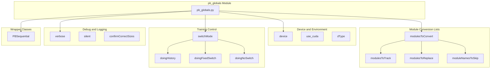
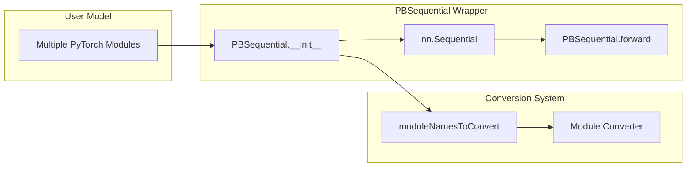
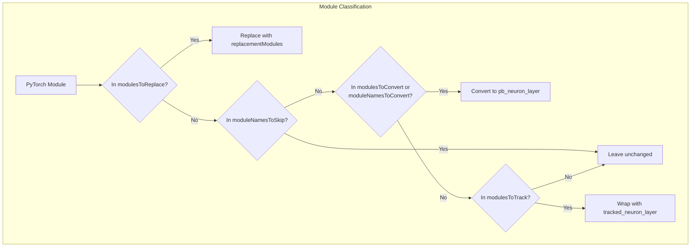
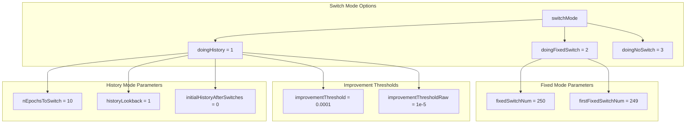
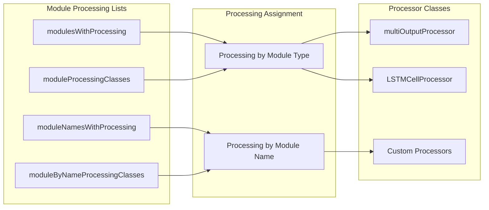
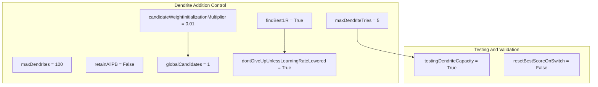

<!-- source: DeepWiki mcp.deepwiki.com · repo PerforatedAI/PerforatedAI · page 3.4 Configuration System · fetched 2026-10-21 -->

# Configuration System

Relevant source files

The following files were used as context for generating this wiki page:

- [perforatedai/pb_globals.py](perforatedai/pb_globals.py)

## Purpose and Scope

The Configuration System centralizes all settings and parameters that control the behavior of the PerforatedAI library. This system is primarily implemented in the `pb_globals` module, which provides global configuration variables, the `PBSequential` wrapper class, and settings that govern module conversion, training behavior, and dendrite addition policies.

For information about how these configurations are used during training orchestration, see [Training Orchestration](#3.2). For details on how module conversion settings work with the layer system, see [Layer System](#3.3).

## Configuration Architecture

The configuration system operates through global variables and lists that are imported and referenced throughout the PerforatedAI codebase. The central configuration file coordinates several key areas of functionality.

### Configuration Categories Overview

**Sources:** [perforatedai/pb_globals.py:1-183]()

## PBSequential Class

The `PBSequential` class provides a wrapper for sequences of PyTorch modules that should be treated as a single unit during conversion. This is essential for handling normalization layers and output layers that should not have dendrites added individually.

### PBSequential Usage Pattern

The `PBSequential` class wraps multiple layers into a single module that gets converted as one unit:

| Use Case | Example |
|----------|---------|
| Normalization Layers | `PBSequential([nn.Linear(hidden, width), nn.LayerNorm(width)])` |
| Output Layers | `PBSequential([nn.Linear(hidden, classes), nn.Softmax(dim=1)])` |
| Custom Sequences | `PBSequential([nn.Conv2d(in_ch, out_ch, 3), nn.ReLU(), nn.Dropout(0.1)])` |

**Sources:** [perforatedai/pb_globals.py:51-56]()

## Module Conversion Configuration

The module conversion system uses several lists to control which PyTorch modules get converted to dendrite-enabled layers, which get tracked, and which get replaced or skipped.

### Conversion Lists and Their Purposes

### Default Conversion Settings

| Configuration List | Default Values | Purpose |
|-------------------|---------------|---------|
| `modulesToConvert` | `[nn.Conv1d, nn.Conv2d, nn.Conv3d, nn.Linear]` | Module types that get dendrites |
| `moduleNamesToConvert` | `['PBSequential']` | Module names that get dendrites |
| `modulesToTrack` | `[]` | Module types to monitor but not convert |
| `moduleNamesToSkip` | `[]` | Specific module names to leave unchanged |
| `modulesToReplace` | `[]` | Module types to replace before conversion |

**Sources:** [perforatedai/pb_globals.py:58-84]()

## Training Mode Configuration

The training mode configuration controls when and how dendrites are added during the training process. Three primary modes are available, controlled by the `switchMode` variable.

### Switch Mode Settings

### Training Mode Parameters

| Mode | Key Settings | Behavior |
|------|--------------|----------|
| History Mode (`doingHistory`) | `nEpochsToSwitch`, `improvementThreshold` | Add dendrites when validation stops improving |
| Fixed Mode (`doingFixedSwitch`) | `fixedSwitchNum`, `firstFixedSwitchNum` | Add dendrites at fixed epoch intervals |
| No Switch Mode (`doingNoSwitch`) | N/A | Standard training without dendrite addition |

**Sources:** [perforatedai/pb_globals.py:114-141]()

## Processing Configuration

Complex modules that don't follow the standard single-tensor-input/single-tensor-output pattern require special processing. These are configured through processing lists that map module types to processor classes.

### Processing Configuration Structure

**Sources:** [perforatedai/pb_globals.py:73-79]()

## Debug and Performance Configuration

The configuration system provides extensive debugging and performance tuning options that control logging verbosity, memory usage, and validation behavior.

### Debug Configuration Options

| Setting | Default | Purpose |
|---------|---------|---------|
| `verbose` | `False` | Enable epoch-level debug output |
| `extraVerbose` | `False` | Enable batch-level debug output |
| `silent` | `False` | Suppress all PerforatedAI output |
| `confirmCorrectSizes` | `False` | Validate tensor dimensions (performance cost) |
| `debuggingInputDimensions` | `0` | Debug input dimension handling |

### Performance and Memory Settings

| Setting | Default | Purpose |
|---------|---------|---------|
| `usingSafeTensors` | `True` | Use SafeTensors format for model saving |
| `testSaves` | `True` | Save intermediate models during testing |
| `saveOldGraphScores` | `True` | Track performance without dendrites |
| `drawingPB` | `True` | Generate training visualization graphs |

**Sources:** [perforatedai/pb_globals.py:14-98]()

## Dendrite Addition Parameters

The configuration system controls the behavior of dendrite addition, including initialization, retry policies, and capacity limits.

### Dendrite Configuration Parameters

### Key Dendrite Parameters

| Parameter | Default | Description |
|-----------|---------|-------------|
| `maxDendriteTries` | `5` | Retry attempts for each dendrite addition |
| `maxDendrites` | `100` | Maximum total dendrites per module |
| `candidateWeightInitializationMultiplier` | `0.01` | Scale factor for random dendrite weights |
| `findBestLR` | `True` | Sweep learning rates when adding dendrites |
| `testingDendriteCapacity` | `True` | Quick test before full training |

**Sources:** [perforatedai/pb_globals.py:34-169]()

## Input Dimension Configuration

The `inputDimensions` setting is critical for proper dendrite operation and must be configured for each model architecture to specify the expected tensor format.

### Input Dimensions Format

The `inputDimensions` array specifies the expected tensor layout:
- `0`: Neuron/feature dimension
- `-1`: Variable dimensions (batch size, sequence length, etc.)

| Architecture | Input Format | `inputDimensions` Setting |
|-------------|--------------|--------------------------|
| Standard Dense | `[batch, features]` | `[-1, 0]` |
| CNN | `[batch, channels, height, width]` | `[-1, 0, -1, -1]` |
| Sequential | `[batch, sequence, features]` | `[-1, -1, 0]` |

**Sources:** [perforatedai/pb_globals.py:100-104]()

---

