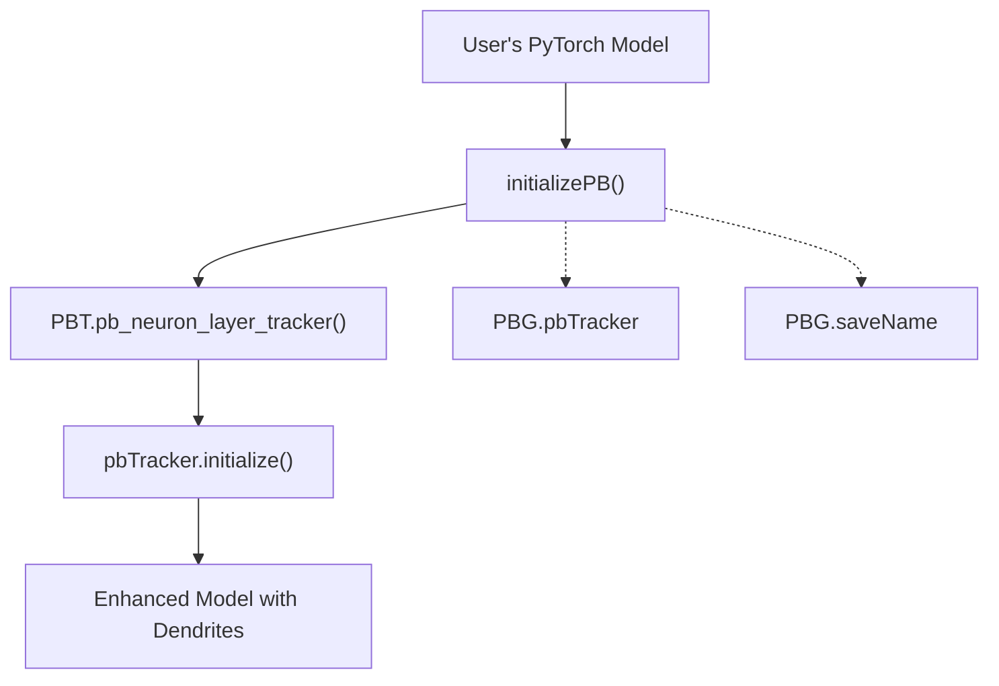
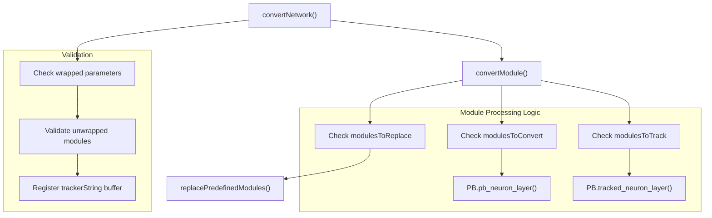
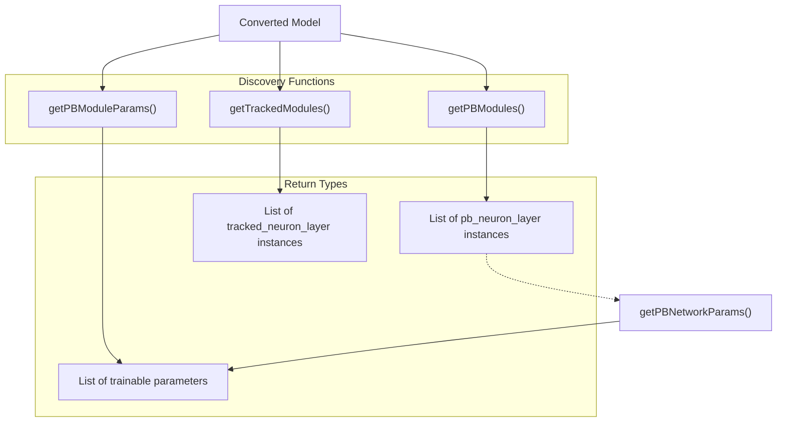
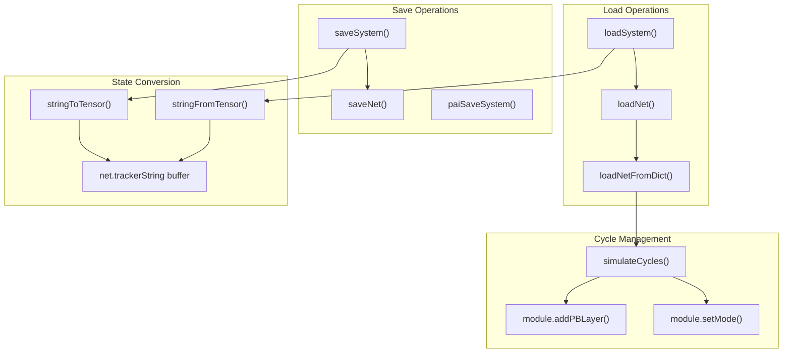
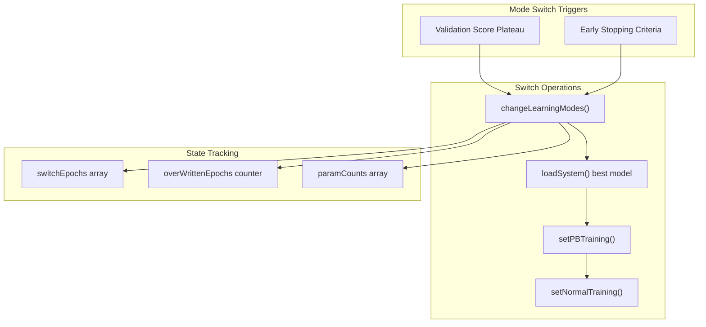
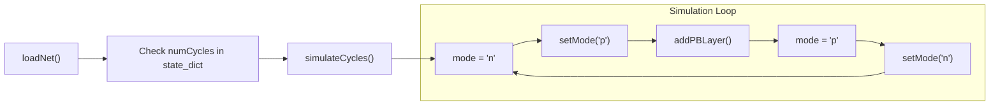

<!-- source: DeepWiki mcp.deepwiki.com · repo PerforatedAI/PerforatedAI · page 3.5 Utilities and Conversion · fetched 2026-10-21 -->

# Utilities and Conversion

Relevant source files

The following files were used as context for generating this wiki page:

- [perforatedai/pb_utils.py](perforatedai/pb_utils.py)

This document covers the `pb_utils` module, which provides the core utilities for converting PyTorch models to PerforatedAI-enhanced versions, managing model persistence, and handling training mode switches. This module serves as the primary interface between user code and the PerforatedAI system.

For information about the layer system that these utilities create, see [Layer System](#3.3). For configuration options that control conversion behavior, see [Configuration System](#3.4). For the training orchestration system that these utilities initialize, see [Training Orchestration](#3.2).

## Network Initialization and Conversion

The conversion system transforms standard PyTorch models into PerforatedAI-enhanced versions by wrapping selected modules with dendrite-capable layers.

### Primary Entry Point

The `initializePB` function serves as the main entry point for converting any PyTorch model to support dendrite functionality:

**Network Initialization Flow**

The function creates a global tracker instance and delegates the actual model conversion to the tracker's initialization system. It accepts parameters for training configuration, graph generation, and score optimization direction.

Sources: [perforatedai/pb_utils.py:25-29]()

### Module Conversion System

The conversion process recursively traverses the model structure and wraps eligible modules based on configuration rules:

**Module Conversion Decision Tree**

The system uses several configuration lists from `pb_globals` to determine how to handle each module:
- `modulesToReplace`: Modules to replace with custom implementations
- `modulesToConvert`: Modules to wrap with `pb_neuron_layer`
- `modulesToTrack`: Modules to wrap with `tracked_neuron_layer`
- `moduleNamesToNotSave`: Modules to skip during conversion

Sources: [perforatedai/pb_utils.py:108-259]()

### Recursive Module Processing

The `convertModule` function handles both sequential containers (`nn.Sequential`, `nn.ModuleList`) and general modules differently:

| Module Type | Processing Method | Key Considerations |
|-------------|-------------------|-------------------|
| `nn.Sequential` | Iterate over `named_children()` | Preserves order and indexing |
| `nn.ModuleList` | Iterate over `named_children()` | Maintains list structure |
| General Module | Iterate over `__dir__()` attributes | Handles arbitrary module structures |

The function includes safety checks for:
- Self-referential pointers within modules
- Duplicate module references 
- Normalization layers that should be wrapped
- Module name filtering based on `moduleNamesToNotSave`

Sources: [perforatedai/pb_utils.py:109-212]()

## Module Discovery and Parameter Management

The utilities provide several functions to locate and manage PerforatedAI-enhanced modules within converted models:

**Module Discovery Functions**

These functions recursively traverse model hierarchies to locate specific layer types:

- `getPBModules()`: Finds all `pb_neuron_layer` instances for dendrite management
- `getTrackedModules()`: Finds all `tracked_neuron_layer` instances for monitoring
- `getPBModuleParams()`: Extracts trainable parameters from dendrite-capable layers

Sources: [perforatedai/pb_utils.py:32-101]()

## Model Persistence and State Management

The persistence system handles both model weights and PerforatedAI-specific state information using safetensors for compatibility:

**Model Persistence Architecture**

The system stores both PyTorch state dictionaries and PerforatedAI training state:

1. **Tracker State Serialization**: Converts the training tracker to a tensor-encoded string for safetensors compatibility
2. **Dendrite Reconstruction**: Simulates training cycles to rebuild dendrite structures during loading
3. **Parameter Continuity**: Ensures dendrite parameters are properly restored with correct shapes

Sources: [perforatedai/pb_utils.py:262-382](), [perforatedai/pb_utils.py:404-420]()

### String-Tensor Conversion

The persistence system converts tracker state strings to tensors for storage compatibility:

| Function | Purpose | Memory Optimization |
|----------|---------|-------------------|
| `stringToTensor()` | Convert string to tensor of character codes | Direct conversion using `map(ord, string)` |
| `stringFromTensor()` | Convert tensor back to string | Block processing to handle memory constraints |

The `stringFromTensor` function processes tensors in 100,000-character blocks to avoid memory errors with large state strings.

Sources: [perforatedai/pb_utils.py:262-277]()

## Training Mode Management

The system manages transitions between neuron training and dendrite training modes:

**Training Mode Lifecycle**

The mode switching system handles:

1. **N-Mode to P-Mode**: Loads best neuron weights, adds dendrites, switches to dendrite optimization
2. **P-Mode to N-Mode**: Returns to neuron training with enhanced architecture
3. **State Preservation**: Tracks epoch counts, parameter counts, and score histories across switches

Sources: [perforatedai/pb_utils.py:424-497]()

### Cycle Simulation

When loading models with existing dendrites, the system must reconstruct the dendrite architecture by simulating the training cycles that created it:

**Dendrite Architecture Reconstruction**

Each cycle alternates between neuron mode ('n') and dendrite mode ('p'), with dendrites added during the transition to dendrite mode.

Sources: [perforatedai/pb_utils.py:405-419]()

## Helper Utilities

The module provides several utility functions for model management:

| Function | Purpose | Key Features |
|----------|---------|--------------|
| `deepCopyPAI()` | Create deep copy of PerforatedAI model | Clears processors before copying to avoid reference issues |
| `countParams()` | Count total model parameters | Standard PyTorch parameter counting |
| `paiSaveNet()` | Save additional PAI-specific state | Currently minimal in open source version |

The `deepCopyPAI` function is specifically designed to handle the complex reference structures within PerforatedAI models by clearing processor references before performing the deep copy operation.

Sources: [perforatedai/pb_utils.py:392-402]()

---

